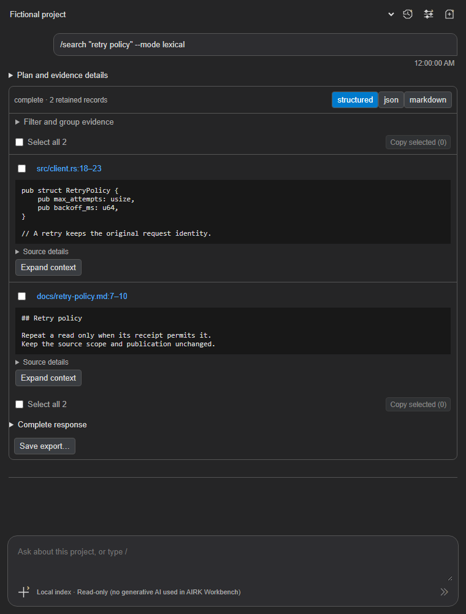
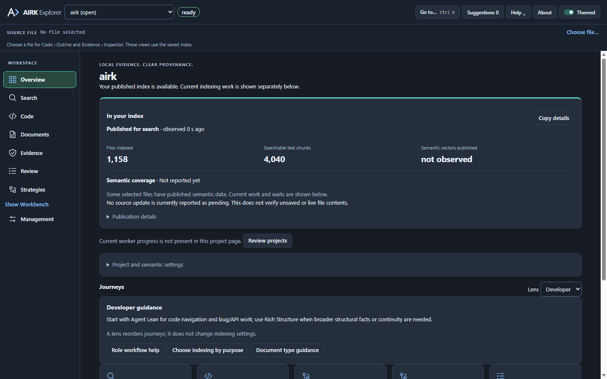

# AIRK: Local Search for Coding Agents

**Repair stopped, 9 November 2026:** 1.8.16 is an unfinished checkpoint. The
Windows VSIX is package-verified but failed installed-editor acceptance. See the
[stop and handoff](docs/research/installer-stop-2026-11-09.md) for the changes,
remaining binding cancellation, failure analysis and validation limits. It is not release-ready.

**1.8.16 clean-break baseline:** every installation older than 1.8.16 must use
fresh AIRK state and rebuild its indexes. Preserve reviewed source selections and
supported preferences; original source files remain untouched. Old index IDs,
grants, credentials and pending operations do not carry authority into the new
state. Verify shutdown and remove ownership-proven legacy installation artifacts
through the native reset lifecycle. From 1.8.16 onward, ordinary upgrades require
the supported persisted state contract as well as an approved runtime version.
The development line will be qualified before a public **1.9.0** release; 1.9.0
is a future release target, not the current package version.
See the [1.8.16 working record](docs/releases/release-1.8.16.md). Implementation
and installed qualification of this revised policy remain incomplete.
Management → Service → Runtime → **Complete runtime diagnostics** opens, copies
or exports the full cached native JSON with its capture time. It makes no new
native read; summary copies disclose their subset. Cached data is not live proof.

Historical r26/r29 packaging and pre-baseline migration experiments retain their
original identities in the working records and fixture compatibility matrix.
They do not define the current clean-break path. The authentic two-index
1.8.11 to 1.8.16 native reset passed within its recorded scope; installed-editor
and broader release qualification remain separate.

The [clean-break contract](docs/upgrade-rebuild-fallback.md) replaces the
previous optional rebuild and pre-1.8.16 migration paths. It requires a fresh
namespace, explicit client reconnection, durable interrupted-reset recovery and
ownership-checked cleanup. Older candidate evidence remains historical.

[Standalone CLI onboarding](docs/agent-integration.md#standalone-onboarding-without-vs-code)
is implemented on this branch for setup without VS Code: native service
discovery, reviewed index scope and protected client launch. Scoped CLI tests
pass; actual client launch and installed acceptance remain pending. Native
`airk setup` itself does not edit `PATH`; use its printed installed executable
path when no terminal integration is installed.
Standalone Windows/macOS/Linux installer source installs only the CLI/native
server; the VS Code extension remains a separate optional distribution.
Actual installer builds, signing and publication remain pending.
The [standalone Windows EXE](installers/windows/README.md) now adds its literal
`{app}\runtime` directory to user `PATH` only after native setup succeeds.
Its pending-to-owned receipt preserves existing raw entries and registry value
type; uninstall removes only the exact owned literal after confirmation and
successful native uninstall. This differs from the VSIX's existing reviewed
terminal integration. Inno compilation and real registry/signing round-trips
remain unqualified; the 13 static/mocked checks are not installed acceptance.

The reset rebuilds every saved index from its reviewed sources and supported
preferences, including restored pause/watch policy. It verifies predecessor
process exit and removes ownership-proven legacy state and executables;
incomplete or unproven cleanup stays visible. Existing terminals need reopening
to inherit installed CLI PATH changes. If Explorer still runs old extension
JavaScript, use **Restart Extensions** once to activate the replacement loader.
Public-release and full-matrix qualification remain incomplete. The
[working record](docs/releases/release-1.8.16.md) records exact candidate, package and installed
acceptance scopes and preserves failed evidence.

**1.8.16 source builds on the unpublished 1.8.14 implementation; qualification is stopped and incomplete.** The source versions and generated catalog identify the [One AIRK implementation](docs/one-airk.md). The single-executable HTTPS runtime is implemented; the [1.8.16 working record](docs/releases/release-1.8.16.md) tracks current clean-break and installed acceptance. The 1.8.14 record retains historical implementation evidence. Earlier binaries keep their original versions and hashes.

Before 1.8.16, legacy runtime, launcher and index formats are cleanup inputs,
not reusable index state. The reset preserves only reviewed sources and supported
preferences. It rebuilds fresh indexes and requires clients to reconnect with new
authority. Old AIRK-owned indexes, state, runtimes and launchers are removed only
through proven ownership and lifecycle checks; incomplete cleanup remains visible.
Supported upgrades within the 1.8.16+ state contract retain their own admission,
checkpoint and compatibility checks. Installed/platform qualification is pending.

HTTPS uses normal certificate validation with an installation-local CA; clients
do not ignore certificate errors or discard their existing trusted CAs. Native
discovery reports the actual bound port, including an alternate when the preferred
port is occupied. Owned connection configuration can be refreshed, while external
clients may still require reconnection. See the [local HTTPS API](docs/local-https-api.md)
for trust, credentials, endpoint discovery and local-tool examples.

Credential lifecycle corrections reclaim bounded active-ledger capacity after
revocation and proven Explorer attachment retirement, while retaining immutable
connection ownership and ID-reuse fences. Active manual credentials are preserved.
Validation and remaining client/platform gates are recorded in the working record.

**Explorer notices and updates:** dismiss update, connection and action-outcome notices with **×**. Dismissals are saved for the workspace and stay hidden across screens, Explorer reopen and window reload. Once the new loader is running, later detected AIRK extension replacements reload AIRK automatically and reopen its single Explorer panel when it was open. For the first transition from an older loaded extension, use **Restart Extensions** in VS Code’s Extensions pane to activate the new version. Installed-editor acceptance is recorded separately.

**Inherited 1.8.12 behavior:** Indexing has three tabs: **Search scope** selects local indexes and index sets with checkboxes; **Index library** creates and manages indexes, including **Delete index**; **Index sets** organizes reusable search groups. Choose indexes or sets and apply the selection; access details are handled internally. See the [historical 1.8.12 working-build record](docs/releases/release-1.8.12.md) for behavior and validation. The earlier 1.8.11, 1.8.10 and 1.8.9 records retain their dated evidence.

**MCP QA follow-up:** the working source preserves structured read failures, discloses unobserved filters and relationship limits, and aligns context inputs across interfaces. Terse capability replies summarize operation schemas; Full retains them. Validation results and remaining limits are recorded in the [QA evaluation](docs/reviews/mcp-qa-1.8.9.md).

Opening a trusted folder does not register or index it. Use **Indexing > Index library** to create an index with reviewed sources, storage and watching. In **Search scope**, check the indexes or index sets to search and apply the selection. Evidence reads and source verification do not start indexing.

**Setup and uninstall:** Successful setup or reconnection clears obsolete failure warnings. Current setup failures remain visible, and uninstall removes empty shell startup files that AIRK created. See [setup and uninstall guidance](docs/vscode-extension.md) and the [branch review](docs/reviews/branch-v190-review-2026-11-06.md).

**Missing sources and storage:** the working source adds [reviewed index
retirement and cleanup](docs/service-project-retirement.md) for removed files or folders and separate
[unavailable legacy-index upgrade recovery](docs/service-installation.md#unavailable-legacy-index-during-upgrade). Healthy indexes keep
their independent evidence; old grants are never silently narrowed. Post-P14
recovery has selected Windows native/process and Mac portable validation. Full
workspace and final installer qualification remain separate; see the working-build
record for current results and earlier failures.

**Find the code and documents behind a feature. Give your coding agent cited evidence, or explore it yourself in AIRK Workbench.**

AIRK builds a searchable local index of your project so you and your coding tools can retrieve relevant passages, definitions and document facts without loading entire files into every request. Use it with MCP clients such as Claude Code, Codex and GitHub Copilot, or work directly in VS Code with no coding agent required.

**Configurable concurrent evidence requests.** Management → Service → **Concurrent requests…** selects **4, 8, 16, 32 or 64**, default **16**, with one additional status/control slot. MCP admission, independent native channels and project workers use the same setting. Changes apply to subsequent requests without restarting agents; accepted work drains when capacity decreases. Finite queues, source scope, revision identity and typed retry receipts remain authoritative.

**Complete evidence across interfaces.** CLI and Workbench retain the MCP handlers' full results: provenance, readiness, coverage, continuations and retry details. Workbench exposes filters, exact/suffix/contains matching, count/file summaries and conditional/continuity inputs. **Complete response** and full JSON/Markdown exports retain the result even when cited cards are shown; selected-evidence exports identify their subset. Status and diagnostics report configured capacity, including inside completed plan steps. See the [1.8.7 behavior and validation](docs/releases/release-1.8.7.md).

- **Find useful context:** search code and documents together, then narrow the scope to a file, folder or named definition.
- **Inspect the evidence:** open cited sources, read surrounding context and keep source locations and indexed revisions with your results.
- **Keep retrieval local:** indexing, lexical and semantic search run on your machine with bundled models. AIRK needs no cloud service or API key.

**AIRK Workbench** puts direct evidence retrieval in VS Code’s secondary sidebar. Search, inspect sources, review an editable plan and copy cited results without opening an agent conversation. History, settings and new-session icons share a compact header; the **+** composer menu holds scope, recipes and tool forms. Workbench uses no generative AI; supported intent parsing and semantic search use local models.



*Compiled Workbench 1.8.7 UI with fictional project data, linked selection controls and Complete response. This preview is not an installed-editor or retrieval-quality benchmark.*

**AIRK Explorer** brings search, code navigation, document facts, evidence review and native indexing controls into an editor workspace. Inspect what is indexed, follow citations and manage project storage and agent connections.



*Explorer 1.7.1 preview with fictional observations. In 1.7.2, Workbench moves to the toolbar and project selection moves into Overview and Management.*

**Workbench session choices:** tool fields, selected operation and shared Scope/Recipe stay with their session and restore from saved history. The **Reset this tool form** icon clears only the active tool's fields; New, Clear and Fork start with fresh defaults. Editing or resetting choices submits no evidence request. See the [candidate record](docs/releases/release-1.8.7.md#candidate-1-8-4) for persistence, portability guards and qualification.

## Try AIRK

1. Install the platform extension from the [Visual Studio Marketplace](https://marketplace.visualstudio.com/items?itemName=iokaio.airk), or use a local candidate VSIX when testing unreleased changes. The runtime and models are bundled; VS Code 1.140+ is required.
2. **Create an index and choose what to search.** Open a trusted folder, then use **Indexing > Index library** to review source, storage and watching choices and create the index. In **Search scope**, check the indexes or index sets you want and apply the selection. Opening a folder alone does not register or index it. Management shows progress, readiness and skipped or failed work.
3. Open **AIRK: Open Workbench** and run `/files`. Search for a term from your project, inspect a cited result and open its source. Workbench opens once automatically after successful setup.
4. To use an agent, run **AIRK: Connect Coding Agent**, review its configuration and enable AIRK in that client. Verify access with a scoped request; configuration alone does not prove a live connection.

Try asking “I want to know about struct Owner.” with a symbol from your project, finding a feature’s implementation and design notes, collecting code and test mentions for a bug, or exporting a cited evidence set for a change. AIRK retrieves indexed evidence; your agent handles reasoning and edits. Returned evidence can go to that agent’s provider under its policies. AIRK does not promise complete language understanding, live-file freshness or universal token/cost savings.

**Inherited 1.8.2 behavior.** Supported conversational requests for code and document evidence now cover developer, writer, architect and QA/tester phrasing. Simple requests such as “I want to know about struct Owner.” preserve the symbol name. Unsupported requests still ask for clarification, and multiple matches remain cited candidates. See the [1.8.2 parser fix](docs/releases/release-1.8.7.md#candidate-1-8-2). Explorer publishes verified service health before optional management observations finish, and delivers each successful Search result once to its webview. Index readiness remains a separate observation. The [optimization phases](docs/optimizations.md) record implementation and validation; installed responsiveness and native throughput are measured separately in the performance report. Automatic Explorer observations use lightweight status; explicit Refresh obtains separately aged details. Eligible saved selected projects can appear in Explorer and Workbench before other workspace roots finish preparation; native scope and lifecycle checks still apply. First semantic requests can wait within a bounded startup allowance for the embedding-helper connection to become available. Workbench reuses its selected connection across New/Clear, avoids a duplicate session scan when saving, and sends scalar status/save updates while retaining complete export values. Previous stable release: **1.7.6 (2026-10-31)**. That release adds a first-use setup review, a no-native-execution mode, uninstall cleanup of terminal integration, a data inventory and purge, credential-file default exclusions, private-storage enforcement and a dependency advisory gate. Workbench reveals the query bubble for a new pending, completed or failed reply, keeping the question visible above its details and results. Sidebar tab switches retain the reading position. Structured results have linked **Select all N** controls above and below the cards, with **Copy selected** in both rows. See the [1.8.1 scroll fix](docs/releases/release-1.8.7.md#candidate-1-8-1), [1.8.0 candidate record](docs/releases/release-1.8.7.md#candidate-1-8-0) and [1.7.6 published record](docs/releases/release-1.7.6.md), [extension guide](docs/vscode-extension.md), [Workbench implementation](docs/workbench/implementation.md), [agent setup](docs/agent-integration.md) and [documentation index](docs/README.md). AIRK stands for Artifact Indexing and Retrieval Kernel. Updated indexes publish source-bound optional pages for native facts, relationships, imported assertions and text ranges. Eligible native-owned collections can use selected-page readers with automatic physical integrity maintenance and fresh crash recovery; unsupported storage boundaries and omitted optional representations retain strict reads. Integrated storage and release qualification remains in progress.

The [parser-training fork guide](docs/parser-training.md) shows how to inspect the included exact training corpora, add original role examples, regenerate splits, evaluate a new candidate and test a suggestion-only asset. Historical datasets and attribution remain reviewable in the [public data catalog](tools/parser-train/data/README.md).

**Measured UI work reductions:** Explorer delivers each full Search result once instead of twice (**50% fewer full-result deliveries**). Scalar status messages in the **200-turn Workbench fixture** are **over 95% smaller** than full-state messages. These are transfer-work measurements. The separate matched native campaign found slower indexing/read paths and hit BigDotNetProject’s readiness deadline in both versions; it does not measure installed launcher/editor responsiveness. The [special performance report](docs/performance-improvements-1.8.2.md) explains both outcomes and the remaining work.

<details>
<summary>Development updates and earlier release history</summary>

**1.7.2 development candidate:** [Workbench features, upgrade policy and validation limits](docs/releases/release-1.7.2.md).

Workbench opens once after successful trusted setup. Its compact header provides history, settings and new-session icons; the composer’s **+** menu holds scope, recipes and tool forms. Explorer’s **Workbench** toolbar button, immediately left of Help, toggles secondary-sidebar visibility and shows a pressed state while visible. The project selector is available inside Overview and Management; its selection remains shared across Explorer screens. VS Code retains control of sidebar tab order. For the initial transition from older AIRK code, use **Restart Extensions** in VS Code’s Extensions pane to activate the new loader.

**Workbench implementation introduced in 1.7.2:** a secondary-sidebar evidence transcript with editable plans, recipes, cited results, copy/export and bounded local sessions. Agents can use the same native `parse` tool to prepare or execute explicit read-only plans. Learned requests propose an editable plan; review its operation and arguments, then explicitly run it. Automatic learned execution remains disabled pending qualification. See the [implementation record](docs/workbench/implementation.md). Native/extension source versions are synchronized at **1.8.16** for implementation; packaging, qualification and any later release promotion remain separate.

**Version 1.6.4 — runtime upgrades, project cleanup and responsive diagnostics.** This public release consolidates the unpublished 1.6.1–1.6.3 branch work. Supported runtimes upgrade before connection checks; uninstall removes owned executables and recorded agent entries while preserving index data. Trusted open folders register and index automatically, subject to saved opt-out, pause and manual-update settings. Removing a project drains its workers and deletes its AIRK index and saved settings while preserving source files.

The Workbench development catalog exposes 29 tools, including read-only `parse` plan preparation/execution and grant-bound `query_scope` discovery; the preceding 1.6.4 catalog has 27 tools. `status` is a lightweight readiness check; `diagnostics` provides detailed runtime, job and watcher observations. Cold MCP verification survives individual status timeouts, so later polls reuse the same authenticated setup. CLI request-epoch preparation uses a bounded wait for explicit busy/uncertain registry responses and retains failure codes. macOS inference shutdown releases the owned ONNX environment after sessions drain, before native library cleanup. Connection checks keep unknown readiness distinct from a confirmed unavailable index. Agent connections follow their configured source folders across index replacement. Explorer bounds status polling, keeps local log actions responsive and reconciles uncertain requests internally without replaying them. Installation migrates registered historical default index roots to `index-v1`, preserving publications and settings; custom roots stay in place. See the [1.6.4 release notes](docs/releases/release-1.6.4.md). [Process ownership and counts](docs/process-model.md) explains the shared workers, per-connection frontends and retained Windows launcher layers.

**Introduced in 1.6.0 — offline semantic index optimization.** Two bundled INT8 MiniLM exports replace the previous FP32 model. Native CPU detection chooses unsigned INT8 on x64 without VNNI and signed INT8 on VNNI x64 and ARM64. Installation and rebuilding require no model download. Upgrade rebuilds semantic vectors and caches while preserving text/fact evidence, pause and semantic opt-out settings. See the [1.6.0 record](docs/releases/release-1.6.0.md) and [optimization rationale](docs/semantic-index-optimization.md).

The following management and agent improvements were introduced in 1.5.12 and remain available.

Management → Agents now offers **Copy instructions** and separate buttons to open Claude Code (`CLAUDE.md`), Codex (`AGENTS.md`) and GitHub Copilot (`.github/copilot-instructions.md`) project instructions. The suggestion teaches agents to discover deferred AIRK tools, confirm status, use focused evidence and verify live files. Existing files stay unchanged; missing files open as unsaved drafts for review and saving. The bundled **Project instructions for AI agents** help topic also covers other assistants.

Version **1.5.12** includes the index-management and startup improvements described below. Explorer opens while runtime checks continue in the background. Healthy completed installations reconnect without running native startup again, and simultaneous discovery requests share work. Agent configuration uses current native registrations. The Agents panel displays connection-check stages, elapsed time and copyable connection results. The full inline agent setup guide remains a proposal. See the [1.5.12 release record](docs/releases/release-1.5.12.md).

AIRK 1.5.12 also ties MCP process lifetime to its client and gives installed service, index and source workers distinct executable names. Role copies are created locally; downloads still include one main engine. Live agents keep independent MCP connections, while background indexing remains service-owned.

Overview and Management now lead with published files, text chunks, vectors and semantic file coverage. Current work appears separately with counters appropriate to source indexing, semantic batches or cleanup. The display updates automatically; starting another attempt does not replace saved index counts with zeros.

The [1.5.10 candidate](docs/releases/release-1.5.10.md) adds local raw job-error logs, continued cleanup of obsolete index objects, explicit failed repair results, and [storage format identifiers](docs/storage-formats.md) independent of application versions. Existing owned storage locations remain compatible; fresh installations use `runtime`, `index-v1` data and `service-v1` state defaults.

Version 1.5.9 fixes MCP discovery followed by a legacy handshake: a delayed discovery response no longer leaves a successfully initialized connection rejecting its tool requests. Protocol state stays per connection, so assistants can share one project using different handshake styles. Modern requests still require valid metadata. See the [1.5.9 compatibility record](docs/releases/release-1.5.9.md).

Failed jobs observed by the service now produce retained `job_failed` events with the exact job and safe failure code. Index preparation and discovery preserve stage and recognized native causes. Older generic failures cannot be reconstructed; unknown causes remain explicit.

**Management features introduced in 1.5.12.** Management uses consistent horizontal tabs for Indexing, Activity, Storage, Recovery, Service, Agents, Usage and Logs. Indexing contains a health banner, current progress, published search availability, and three everyday settings: search mode, updates and evidence detail. Semantic enablement verifies/prepares the offline model before saving the policy and requests source and semantic work. Registration records native setup durably, so closing the editor does not strand a newly registered project before its initial index requests. See the [1.5.8 development record](docs/releases/release-1.5.8.md).

Queued repair requests whose plan has finished or lost its owner are settled without replaying old approvals, so they cannot indefinitely block otherwise eligible source work. Overview and Management update automatically while visible. Management exposes plan gates, confirms manual diagnostic status checks, separates old counters from queued work, and provides Copy details for troubleshooting panels.

Updates distinguish the installed extension, the running interface and native runtime activation. Once its loader is active, AIRK reloads its own extension automatically after detecting a replacement and reopens Explorer if it was open. Native runtime activation remains separately observed. Notices can be dismissed without changing accepted work or connection permissions. An older loaded extension cannot gain the new loader until VS Code activates the new version; use **Restart Extensions** in VS Code’s Extensions pane for that one-time transition.

Indexing recovery now belongs to the native service: accepted search/detail settings finish without the editor, temporary source/storage failures wait for restored conditions, and worker/helper retry budgets survive service restarts. Version 1.5.7 corrects a completed-bootstrap marker that repeatedly requested recovery, resumes outstanding source work after successful recovery, and prevents source hints from replenishing repeated failure budgets. Pause, Cancel, manual updates, custom models and guarded cleanup remain authoritative. Management can open/copy/save a captured diagnostic report and export the full retained service log ring. Verified completed installations reopen quietly without repeating terminal installation or runtime cleanup.

Studio **Save** writes the complete draft inputs to `.airk/strategies/<name>.studio.airk.json` in the selected local project without a folder picker. It preserves the objective, parameters, path scope, steps, prompt profile and edited prompt under a `user/<name>` definition. Save again to update it, or change the name for a copy; outside edits are guarded. Browse saved strategies restores these inputs, with evidence recollected after loading. Accepting a suggestion does not save automatically. **Export…** continues to save only a strategy definition.

Management separates current work from published evidence. Captured files, newly extracted payloads, publications, phase time and last advancement remain distinct; unknown totals stay unknown. Each Management section has its own tab; inactive sections are unmounted, and project selection persists across tabs. Existing Management URLs open the corresponding tab. In 1.6.4, removal preserves source files and automatically deletes AIRK index data and saved project settings after owned workers drain. Only opaque identifiers and a removal timestamp remain in native history; incomplete cleanup resumes automatically.

**Published 1.5.4:** Installer upgrades stop verified previous AIRK processes, including older versions and Windows clients holding the launcher open. Existing watcher metadata migrates at service startup; shutdown ownership checks read saved metadata without migration and preserve the actual failure cause. See the [1.5.4 development record](docs/releases/release-1.5.4.md). Earlier candidate and validation records retain their original scope. This release also carries the previously unpublished 1.5.3 semantic preparation fix, Semantic/Hybrid search controls, missing-source project removal and bounded watcher directory diagnostics.

Explorer review fixes in this 1.5.0 local candidate guard plan saves, keep evidence and drafts bound to their project/publication, settle failed parallel reads, refuse expired proposals and preserve complete task instructions. Remote plan saving uses an untitled draft and the editor Save command. Platform qualification is recorded separately in the 1.5.0 release notes.

One **AIRK MCP connection** exposes 29 unique tools on this development branch without repeated `airk_` prefixes: evidence reads, documentation and reviewed UI drafts. Current CLI `tools list/help/call/shell` and public HTTPS use this same catalog. `search` returns indexed evidence; `draft_search` prepares a form for user review. `status` reports index readiness; `diagnostics` reports detailed work and Explorer attachment, and multi-root connections require an explicit configured project. Trusted startup consolidates ownership-proven earlier Retrieval and Explorer definitions into one HTTPS `airk` entry only when their complete original scope can be preserved. See the [unified catalog and migration contract](docs/unified-mcp.md).

**1.5.0 adds the AIRK Explorer**, an editor workbench that replaces the Service Console: search and inspect indexed evidence, review Git changes against the index, build evidence strategies and agent plans, and manage project indexing and the native service. The original 1.5.0 **Explorer Assistance** server answered how-to questions about the Explorer and delivered inert drafts to a Suggestions Inbox; it never calls AIRK Retrieval, runs commands or writes files. That release used a separate connection; 1.5.7 consolidates it into the unified endpoint. External agents reach AIRK through the stable launcher, so no system Node is needed. See the [1.5.0 release record](docs/releases/release-1.5.0.md) and the [extension guide](docs/vscode-extension.md).

Historical 1.4.4 release: the GitHub release verifier now follows the same macOS app-bundle layout as native packaging and signing. A narrowly pinned release-tool repair reuses the already-tested 1.4.4 binaries; its original source and CI identity remain unchanged. See the [release record](docs/releases/release-1.4.4.md).

1.4.4 corrects Unix cleanup after a child exits naturally. Cleanup confirms that the owned child has exited and its process group has drained before releasing it; transient native errors remain bounded by the existing deadline.

1.4.4 also creates staged Windows runtime directories with explicit current-user ownership and owner-only access, including nested payload directories, so elevated installations satisfy the same strict ownership checks. Installed macOS runtime validation, self-test and retirement read the complete app payload from its outer root. Cold service starts coordinate registration-metadata setup before source watching.

1.4.4 corrects a fixed WAL limit that could block indexing and repeatedly fail recovery despite free disk space. WAL and shared-memory allowances now scale with admitted database capacity; retained reads and pending replay inputs are preserved. SQLite growth admission includes uncheckpointed pages. See the [storage-recovery release record](docs/releases/release-1.4.4.md). This source fix still requires installation and recovery verification in affected workspaces.

1.4.2 scales Balanced admission to one quarter of detected RAM (2–32 GiB), protects capacity for up to four project query workers, and raises Balanced source pacing to 64 MiB/s per job within a 256 MiB/s shared ceiling. Native watching supports 8,192 directories per project and 32,768 shared, with bounded incremental traversal and specific limit diagnostics. Existing manual resource overrides and storage quotas are preserved. These are admission policies, not hard OS memory or disk-I/O limits.

Installation and upgrades now display a VS Code progress notification with the current stage: version and payload checks, staging, native activation, agent connection updates, workspace setup and cleanup. Progress uses actual stages without an invented percentage. On Windows and Linux, an admitted upgrade hard-stops verified preceding AIRK processes and disconnects their clients; success and failure remain explicit. VS Code owns the earlier VSIX installation UI, before AIRK can activate.

Successful runtime activation finishes quietly. The active AIRK loader handles later detected extension replacements automatically; external coding-agent sessions may need their own restart to load the new tool connection. Connection or cleanup issues produce a specific warning and details instead of a clean success message.

For 1.8.14, trusted startup and **Install or Repair CLI** migrate recognized owned project-local Codex, Claude Code and VS Code/Copilot Chat connections to the native HTTPS endpoint, preserving complete original authority, other servers, disabled state and tool policies. Successful installation then requires verified native removal of old launcher images, their processes and eligible approved superseded runtime executables, including skipped-release and later modern-to-modern updates. Unsupported clients, unproven/custom declarations, conflicts, unsafe files, unsaved edits and blocked cleanup remain incomplete. Restart external agents to load the new connection; a saved file alone does not prove reconnection.

The current published stable release is **1.7.6** (see its [release record](docs/releases/release-1.7.6.md)); the previous release, 1.7.3, is described in [its record](docs/releases/release-1.7.3.md). The earlier 1.5.0 candidate superseded 1.4.4; its [release notes](docs/releases/release-1.5.0.md) retain their original validation scope.

Successful CLI installation removes obsolete extension-managed terminal executable copies and eligible approved nonselected runtime payloads regardless of version, after activation and complete known-client configuration migration. It preserves the selected runtime, sources, indexes and settings. Locked files report incomplete cleanup; disconnect old clients and use **AIRK: Install or Repair CLI**, or allow the next trusted activation to resume the exact cleanup transaction. Close old terminal sessions completely; **Developer: Reload Window** can preserve their environment.

Trusted VSIX activation can install the approved native runtime and terminal integration; `airk.cli.autoInstall: false` disables automatic installation. Opening a folder does not create an index or grant evidence access. Use **Indexing > Index library** to review sources, storage and watching, then create the index. In **Search scope**, select the indexes or index sets to search and apply the selection. Saved watching, pause and manual-update preferences govern existing work; explicit Stop remains authoritative. Upgrade preserves existing saved evidence and settings rather than requesting a fresh reindex as migration proof. Agent connection is a separate scoped action. See [reviewed setup](docs/service-project-setup.md); earlier automatic-folder behavior remains in the dated release records.

**1.5.0 AIRK Explorer and Explorer Assistance.** See the [release record](docs/releases/release-1.5.0.md). The previous **1.4.4 native service and storage recovery** is recorded in its [release record](docs/releases/release-1.4.4.md). Earlier 1.4.0/1.4.1/1.4.2 qualification remains historical; this candidate requires its own validation. Publication is controlled by protected-main CI and the release workflows. [Routine CI](docs/ci-and-builds.md) runs the full workspace on Linux, focused Windows/macOS regressions and all native/VSIX build and smoke gates; full platform and multi-project lifecycle qualification is opt-in.

The [Windows build and editor harness](docs/windows-local-build.md) uses the verified single-image runtime and reviewed native authority. Runtime pairs remain authentic predecessor fixtures. An approved development stage can be exercised before creating a VSIX; final artifact acceptance remains separate.

AIRK indexes local code and documents and serves bounded, cited evidence to coding agents through read-only MCP tools. It preserves original document locations and exact indexed revision identities. It provides native syntax facts and candidate relationships without claiming complete language understanding or resolved references. Original files remain outside derived storage.


</details>

## Native service ownership

A per-user service owns authenticated HTTPS ingress, registration, durable work and resource policy. Its asynchronous adapter routes canonical evidence reads to project workers; source scanning and inference do not execute in the serialized metadata actor. The service owns shared in-process inference with bounded admission and truthful completion barriers.

The modern approved payload contains one native `airk` executable with embedded MiniLM assets and static CPU ONNX Runtime. MCP clients connect directly over HTTPS; inference has no separate `airk-embed` process. Index/source workers can still use the same approved image, so one distributed executable does not promise one OS process for every workload. Windows, Linux and both Mac architectures are targets; final native, model and installed-platform qualification of 1.8.14 remains pending. Earlier runtime-pair evidence retains its original version and scope.

The modern Mac layout keeps that one main image inside its GUI-less signed app bundle, with a macOS 13.3 deployment target and direct managed service startup. Static inference and model license notices remain in the distribution. See the [current signing contract](docs/native-signing.md) and [native installation](docs/service-installation.md). Signing, lifecycle and installed-platform qualification remain separate from portable ownership/package checks.

Each project has a canonical source, separate data root, collection name and opaque service binding. Registration reserves disjoint storage before creating it. Sources cannot overlap registered data, runtime state, control or bound logs. Native workers own indexing and source watching. Automatic watching explicitly continues after editor windows close; login startup is a separate opt-in choice.

## Historical 1.4 namespace transition

The following clean-break and automatic-folder behavior describes the historical
1.4 transition, not current setup or instructions to discard existing state.
For the inherited setup behavior during 1.8.14 implementation, follow [reviewed setup](docs/service-project-setup.md).

The [native management clients](docs/service-native-management.md) provide direct usage/settings reads, bounded exports and guarded project changes. Usage & Savings waits for native completion; imports bind the reviewed input bytes, and shared quota updates reject stale policies.

1.4 is a clean break. It does not read, convert or share live 1.3 indexes, journals, jobs or revision tokens. Old state and agent configurations remain for explicit review. Fresh indexing requires additional disk space. Known older workers can still compete for resources; review and stop their owned registrations separately.

In the extension, trusted activation sets up new workspace roots automatically. Use **AIRK: Index Now** for later explicit indexing and **AIRK: Choose Native Automatic Watching** to switch between manual and automatic watching. **AIRK Explorer > Management** shows cached observations, readiness, jobs, sampled native wait reasons, independent source/helper state, project settings, guarded repairs and lifecycle controls. Queued jobs remain visible while paused and can be canceled explicitly. Start is explicit after a deliberate Stop; reconnect cannot clear that preference. Management also offers Terse/Full response mode, reviewed runtime upgrades/rollback and saved-request recovery.

## Current native management

Native project retirement is reviewed and preserves source files. Permanent exclusions keep their stable owner after retirement; review a distinct new index setup when a new independent index is intended. Reopening folders grants no authority. See [project retirement](docs/service-project-retirement.md), [permanent exclusions](docs/source-policy.md) and [reviewed setup](docs/service-project-setup.md).

Native project settings can reset scan-limit overrides to automatic limits. Native quotas apply to manual and automatic work; retired editor timer/soft-budget settings no longer appear. Workspace tree actions use the clicked project, and native usage counts performed source, semantic and replacement work independently of job acceptance.

The MCP provider advertises only reviewed bindings. **Connect Coding Agent** creates native HTTPS configurations for the supported Codex, Claude Code and VS Code/Copilot Chat adapters while preserving unrelated client settings. Historical launcher and split Retrieval/Explorer entries require exact native ownership and complete original-scope migration before obsolete-executable cleanup. Unproven configurations remain incomplete; the [legacy transition record](docs/service-legacy-transition.md) retains its historical behavior. Saving configuration is separate from actual client reconnection and native HTTPS verification.

The console separately reviews old login startup and offers ownership-verified removal with its own approval and resumable receipts. Review never executes the old command. Startup removal preserves sources, settings and indexes; candidate process matches do not authorize stopping unrelated workers. A separate [offline CLI preview and deletion](docs/service-legacy-transition.md) retires owner-verified 1.3 derived files while preserving sources, settings and usage history. Mac loaded-registration proof is implemented; actual native removal qualification remains pending.

Approved managed payloads can remain read-only. In 1.8.14, clients use HTTPS and the provider retains control of its payload and direct service lifecycle; no client launcher is copied. Separately signed copied launcher images belong only to historical predecessor payloads. Development test evidence and remaining gates are recorded in [cutover qualification](docs/service-cutover-qualification.md).

## Native CLI

Install/select an independently approved single-image runtime using the [installation contract](docs/service-installation.md). A manifest's own checksum is not executable approval. The interactive CLI and direct manager use the approved main; MCP clients use HTTPS. For manual CLI installation, use the exact executable path printed by setup or add its directory to `PATH`; native `airk setup` does not edit `PATH`. The standalone Windows installer and VSIX terminal integration handle their own PATH entries as described above. The commands below assume an already reviewed Index mapping; `init` does not create one from a folder. For guided first use, see [standalone onboarding](docs/agent-integration.md#standalone-onboarding-without-vs-code).

```console
airk --service-install-dir <installation> --root <source> --data-dir <data> --collection project-a init
airk --service-install-dir <installation> --root <source> --data-dir <data> --collection project-a index
airk --service-install-dir <installation> --root <source> --data-dir <data> --collection project-a tools call airk_status
airk --service-install-dir <installation> --root <source> --data-dir <data> --collection project-a setup --client codex
```

`init` acknowledges an existing reviewed Index mapping; it does not register an unreviewed folder or create storage. `index` reports durable job acceptance; completion and semantic readiness are separate. CLI requests save their exact key before submission and support explicit recovery after a lost acknowledgment. Read aliases and `tools shell` share native authority checks and canonical read handlers. A saved opaque binding supports retained reads when sources are unavailable. Missing or incompatible service state fails explicitly; there is no local-store fallback.

The old window scheduler and public direct-store maintenance commands are retired. Full rebuilds require a guarded native preview and separate approval. Advanced native management is available through bounded typed metadata RPC and the service console. See [client adapters and request recovery](docs/service-client-adapters.md) and [project setup](docs/service-project-setup.md).

## Indexed evidence and response size

`help` exposes native usage topics, generated public CLI command help, public tool schemas and optional Explorer guidance. `diagnostics.work` independently reports jobs, bounded queues, cached progress, watcher status and sampled waits. The development catalog has 29 tools; its nineteen native evidence/help/plan/scope tools remain read-only. UI draft tools queue proposals for user review and never change index jobs.

`airk_status` includes a runtime JSON bundle for the MCP frontend, index worker and native service: compiled versions, process identities, executable/payload hashes and available build receipt metadata. Missing observations remain explicit; see the [MCP contract](docs/mcp.md).

MCP provides bounded file discovery, outlines, symbols, code/document facts, imports, references, relationships, search, reads, context, capabilities and changes. **Terse is the default.** It sends the exact token once, uses shared source bindings and `items`, and avoids repeated static diagnostics. Full mode supplies detailed provenance, coverage and readiness for audits or surprising results; agents can request it per call. Compact navigation uses names, kinds, lines and signatures. Syntax call targets remain labeled candidates.

Results describe indexed evidence. `airk_changes` calls its validation `index-current`; this is not a live-file verification. Change baselines retain bounded metadata across up to 64 publications/24 hours, with explicit coverage floors under pressure. Reads retain usable prior generations during publication or disclose a finite retry hint. See [response modes](docs/mcp-response-modes.md) and the [MCP contract](docs/mcp.md).

Storage uses independent collection ownership, admitted publication/replacement space, bounded readers and conservative recovery. DiskANN is the selected disk-backed vector engine; bootstrap lexical/retained-snapshot adapters are not a substitute for that engine. Scoped repair preserves original sources and reports partial failures. See [publication](docs/service-publication.md), [storage ownership](docs/service-storage-ownership.md) and [maintenance plans](docs/service-maintenance.md).

## Development and records

Developer references: [every MCP tool: purpose, contracts and examples](docs/mcp-developer-guide.md) and [every CLI command: behavior and implementation](docs/cli-developer-guide.md). Current CLI `tools list/help/call/shell` and public HTTPS share the 29-tool unified catalog; its 19 native evidence/help/plan/scope operations are a backend subset.

Read [CONTRIBUTING.md](CONTRIBUTING.md), [architecture and dependency boundaries](docs/architecture.md) and the [documentation index](docs/README.md). For scoped Clippy, persistent targets and timed local iteration, follow the [local Rust workflow](CONTRIBUTING.md#local-rust-iteration). The 1.8.14 runtime builder stages one host-native executable with embedded models and static inference dependencies; VSIX packaging is a separate step. Formatting, Clippy, workspace tests, repository checks and exact artifact verification remain release gates. Installed-platform evidence is recorded separately from development fixtures. The unreleased [CI follow-up](docs/ci-and-builds.md#native-build-reuse-and-darwin-failure-diagnostics) separates builds from validation, reuses verified same-run payloads and adds bounded Darwin failure diagnostics; hosted performance and the Intel cold-client failure remain unqualified.

[Semantic index optimization](docs/semantic-index-optimization.md) explains the
1.6.0 switch to two bundled INT8 MiniLM exports: lower helper memory and CPU cost,
smaller weight assets, offline delivery, CPU selection and semantic-only rebuilding.

The [1.3.2](docs/releases/release-1.3.2.md), [1.3.1](docs/releases/release-1.3.1.md), [1.3.0](docs/releases/release-1.3.0.md) and earlier release notes are historical records. Their direct-helper/window-scheduler instructions do not describe 1.4 defaults. Existing public releases are separate from this source candidate; publication requires successful exact-main CI and the release workflows.

AIRK is [Apache-2.0 licensed](LICENSE). Preserve [NOTICE](NOTICE), [third-party notices](THIRD_PARTY_NOTICES.md), original SPDX headers and dependency license bundles. Commits use the authorized human contributor's DCO sign-off.
