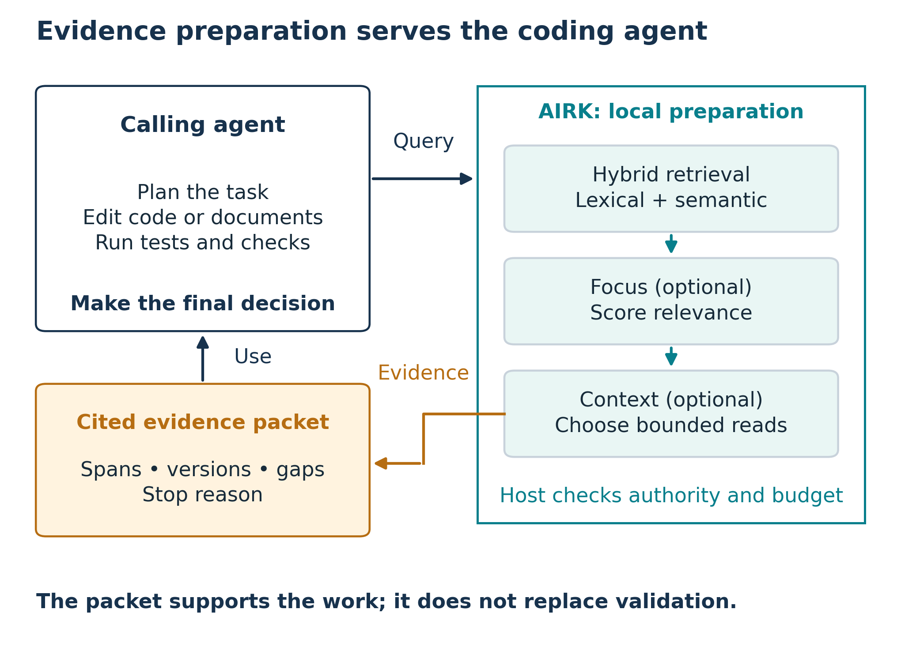
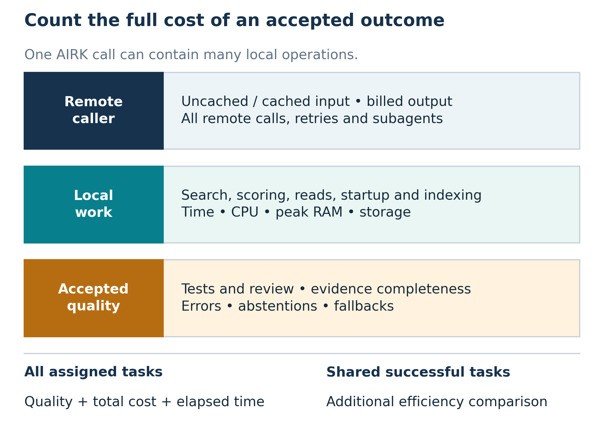
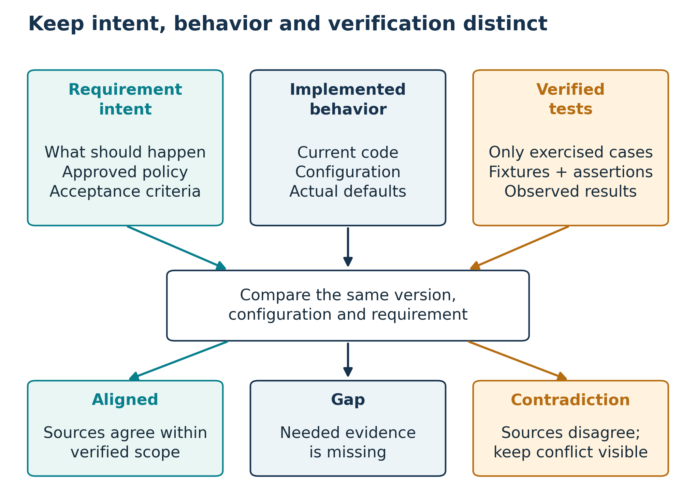

WHITEPAPER

AIRK Arbiter for AI Assisted Software Development

Local evidence preparation for better code and documents

**Tyler Jensen**

Creator of AIRK and founder of Ioka LLC

November 16, 2026

An opinion analysis of how local evidence preparation can help Claude Code, Codex, and GitHub Copilot produce better code, requirements analysis, and development documents. The paper examines the mechanisms for reducing avoidable agent calls and cumulative token use, the costs and limitations of the approach, and the comparative evidence needed to establish its value.

[<u>github.com/iokaio/airk</u>](https://github.com/iokaio/airk)

Personal research and opinion

Copyright 2026 Tyler Jensen

Executive summary

AIRK has a credible opportunity to improve AI assisted software development by reducing the work an agent must perform to assemble a defensible understanding of a project. Its value depends on returning evidence that is relevant, sufficiently complete, traceable to sources, and appropriate to the decision at hand. Arbiter extends that opportunity by moving selected relevance judgments and next-read decisions into a bounded local inference process.

My central judgment is that better evidence preparation can improve both quality and efficiency. An agent that sees the relevant implementation, governing requirement, configuration, and test before committing to a change has a better basis for its reasoning. It may also avoid exploratory calls, speculative edits, and corrective conversations. The commercial and engineering opportunity lies in reducing the total cost of reaching an accepted result.

That outcome is conditional. The local models consume time and memory. Retrieval can omit decisive evidence. Existing agents already have capable search tools. The strongest case for AIRK therefore rests on measured improvement over those native workflows, with correctness and completeness protected while token use, model calls, elapsed time, and human review effort are counted separately.

Principal findings

• Better initial evidence can prevent incorrect assumptions from becoming code changes, incomplete requirements analyses, or unsupported documentation.

• Arbiter can move selected relevance judgments and next-read decisions into a bounded local process while the calling agent retains the development task.

• Fewer remote calls can lower cumulative token use, but local inference, indexing, failed attempts, and human review belong in the full accounting.

• The strongest evaluation compares accepted outcomes against each client's normal capabilities and isolates the contribution of retrieval, Focus, and Context.

**Audience.** Developers, architects, engineering leaders, testers, and technical writers evaluating the use of AI agents in software development.

Contents

[Executive summary](#executive_summary) [2](#executive_summary)

[1 The case for preparing better evidence](#the-case-for-preparing-better-evidence) [4](#the-case-for-preparing-better-evidence)

[2 What AIRK and Arbiter contribute](#what-airk-and-arbiter-contribute) [5](#what-airk-and-arbiter-contribute)

[3 Why richer context can reduce agent work](#why-richer-context-can-reduce-agent-work) [8](#why-richer-context-can-reduce-agent-work)

[4 The economics of turns tokens and local computation](#the-economics-of-turns-tokens-and-local-computation) [10](#the-economics-of-turns-tokens-and-local-computation)

[5 Benefits for code requirements and development documents](#benefits-for-code-requirements-and-development-documents) [13](#benefits-for-code-requirements-and-development-documents)

[6 How AIRK fits Claude Code Codex and GitHub Copilot](#how-airk-fits-claude-code-codex-and-github-copilot) [17](#how-airk-fits-claude-code-codex-and-github-copilot)

[7 Where the approach can fail](#where-the-approach-can-fail) [19](#where-the-approach-can-fail)

[8 What would establish a convincing benefit](#what-would-establish-a-convincing-benefit) [21](#what-would-establish-a-convincing-benefit)

[9 My assessment and priorities](#my-assessment-and-priorities) [24](#my-assessment-and-priorities)

[References](#references) [25](#references)

Figures

[1 How AIRK prepares evidence for the calling agent](#figure_1) [7](#figure_1)

[2 The full cost of reaching an accepted result](#figure_2) [13](#figure_2)

[3 Comparing intent behavior and verification](#figure_3) [16](#figure_3)

Tables

[1 Model roles and expected contributions](#table_1) [6](#table_1)

[2 Units used to measure agent effort](#table_2) [10](#table_2)

[3 Illustrative cumulative input token use](#table_3) [11](#table_3)

[4 Requirements implementation and verification evidence](#table_4) [15](#table_4)

[5 Benefits costs and product implications](#table_5) [19](#table_5)

[6 Configurations for comparative evaluation](#table_6) [21](#table_6)

[7 Outcome and cost measures](#table_7) [23](#table_7)

# 1 The case for preparing better evidence

## The expensive part is reaching a justified decision

A software change often begins with uncertainty about the project rather than uncertainty about programming syntax. Where is the behavior implemented? Which configuration changes it? What does the interface promise? Which test establishes the exception? Does an apparently relevant design document still describe the current system? The agent must resolve these questions before a plausible patch becomes a dependable patch.

Each unresolved question can create another discovery cycle. The agent chooses a search, reads a result, updates its understanding, and decides what to inspect next. Sometimes this is necessary exploration. Sometimes it is avoidable because the first result omitted an adjacent definition, a controlling default, a negative test, or the requirement that explains why the code behaves as it does.

AIRK addresses this preparation problem. The public repository describes local indexing of code and documents, bounded evidence retrieval, source citations, and indexed revision identities. The companion technical guide describes the Arbiter architecture that adds optional relevance scoring and bounded selection of further reads. Together, these provide a coherent mechanism for improving the material an agent receives before it reasons, edits, or writes an explanation. \[[<u>1</u>](#ref_1), [<u>2</u>](#ref_2)\]

I regard that mechanism as strategically useful because it addresses several outputs at once. A programmer needs the evidence to implement a change. A reviewer needs it to assess the change. A technical writer needs it to explain the behavior. An analyst needs it to distinguish a requirement from an assumption and an implemented behavior from a proposed one. A shared evidence service can support these activities without requiring each to rediscover the project independently.

## The position and its evidence base

I created AIRK and am the founder of Ioka LLC. This paper presents my architectural assessment and product judgment. It combines the supplied AIRK model and lifecycle document with public repository material, official coding-agent documentation, and selected research. It is an opinion analysis of mechanisms, tradeoffs, and expected value; the supplied material does not establish a controlled, general performance comparison across Claude Code, Codex, and GitHub Copilot.

The review date is November 16, 2026. The public repository identifies 1.8.7 as its published stable release. The companion document describes a completed Arbiter preparation and qualification workflow, which this analysis takes as its premise. Public release evidence and the supplied Arbiter design have different scopes. A completed preparation and qualification process does not itself supply new comparative token, latency, or task-success measurements. \[[<u>1</u>](#ref_1), [<u>2</u>](#ref_2)\]

The distinction strengthens the case. It allows a clear claim about what the architecture is designed to improve, a reasoned explanation of why improvement is plausible, and an explicit standard for proving how much improvement occurs in practice.

# 2 What AIRK and Arbiter contribute

## A reusable source of project evidence

The useful unit of context is often smaller than a file and larger than an isolated matching line. An agent may need a function signature and its relevant branch, a document section and its qualification, or a configuration key together with its default and override rule. AIRK's tool contracts cover discovery, outlines, definitions, code and document facts, relationships, search, reads, and surrounding context. Those interfaces can organize discovery around project structure. \[[<u>3</u>](#ref_3)\]

This matters most when information is distributed. A feature may appear in source code, tests, migration scripts, deployment configuration, requirements, and release notes. A general search can locate mentions, but assembling their significance is an additional task. My expectation is that AIRK can reduce repeated navigation by returning source material with enough structure for the agent to understand what each result represents.

The precision of those labels matters. Public code contracts describe syntax-derived relationships as candidates where resolution is incomplete. A possible call target is useful discovery evidence; it should retain that status until stronger analysis establishes the relationship. AIRK's value increases when it makes such boundaries visible because the consuming agent can direct its next investigation toward the remaining uncertainty. \[[<u>3</u>](#ref_3), [<u>5</u>](#ref_5)\]

## Three model roles with different jobs

The supplied design separates broad candidate retrieval, close relevance judgment, and the selection of further evidence. MiniLM produces embeddings for semantic retrieval. Focus evaluates a query and candidate passage together. Context scores a small menu of complete action cards in light of the evidence already collected. Compact and Large are alternative Context profiles. Focus and Context are optional stages. \[[<u>1</u>](#ref_1)\]

Lexical retrieval matches query terms and is useful when a question names an exact identifier, configuration key, or distinctive string. Semantic retrieval adds candidates whose wording differs from the question. Hybrid retrieval combines these routes before any optional reranking or next-read scoring. \[[<u>1</u>](#ref_1), [<u>3</u>](#ref_3)\]

| **Model role** | **Model in the supplied design \[**[<u>1</u>](#ref_1)**\]** | **Potential contribution** |
|----|----|----|
| Broad semantic retrieval | all-MiniLM-L6-v2, approximately 22M parameters; bundled | Surface relevant passages despite differences in terminology |
| Optional Focus reranking | Qwen3-Reranker-0.6B | Prioritize shortlisted query–passage pairs that address the request |
| Optional Context selection | Qwen3-1.7B Compact or Qwen3-4B Large | Choose a useful permitted next read or qualified terminal action based on the evidence already gathered |

**Table 1.** Model roles and expected contributions

The distinction between relevance and usefulness is central. A passage can be relevant to a question while adding nothing the agent does not already know. A test for a rare exception may be less similar to the original wording but more useful because it resolves the final open issue. An action selector that considers the current evidence state has a route to making that distinction.

This is the strongest conceptual contribution of Arbiter. Retrieval asks what might matter. Reranking asks which candidate most closely addresses the request. The next-read decision asks what additional evidence could change the answer. The last question moves context preparation toward the structure of the task.

AIRK retains control of the permitted actions, source identities, budgets, and stop conditions. The local scorer selects among constructed choices; deterministic host code validates what can happen next. The resulting packet includes citations, gaps, and a stop reason. These are supplied design contracts, and they make the output more inspectable than an unexplained relevance score alone. \[[<u>1</u>](#ref_1)\]

**Figure 1.** The calling agent retains planning, edits, tests, and final assessment. AIRK prepares a cited evidence packet through retrieval and optional Focus and Context stages, while host code enforces authority and read budgets. A shorter caller trace may still contain substantial local search and scoring work.

## Why the model preparation work matters

The preparation described in the companion guide is consequential to the product. A useful local scorer depends on its tokenizer, visible input window, prompt, pooling or readout, numerical representation, and calibrated acceptance policy. A training label about evidence outside the deployed input window teaches a relationship the running model cannot observe. An export or quantization change can alter decisions even when the underlying task is unchanged. \[[<u>1</u>](#ref_1)\]

AIRK's emphasis on input parity, controlled adaptation, held-out evaluation, and artifact-specific calibration addresses these failure modes. It gives the local judgments a defined operating contract and a basis for comparison with simpler publisher baselines. This improves the credibility of the engineering approach. The quality of the selected artifact still has to translate into better downstream software outcomes; lower training loss or successful export is insufficient evidence for that conclusion.

## The agent retains the development task

The calling agent still interprets the request, makes design decisions, modifies files when authorized, runs tests, and explains the result. AIRK prepares evidence for those activities. A local decision to read another source does not establish the correctness of the eventual patch, and a stop decision does not certify that every requirement has been met.

This allocation is valuable because bounded evidence preparation can be evaluated separately from broader reasoning. It also preserves useful specialization. The same repository evidence can support different coding agents while each retains its own model, tools, interaction style, and validation workflow.

The public tool named context and implementation helpers that focus snippets should not be confused with the Arbiter Context and Focus models described in the companion guide. The argument here concerns the combination of the public retrieval foundation and the supplied local inference architecture, with each attributed to its own evidence. \[[<u>1</u>](#ref_1), [<u>3</u>](#ref_3)\]

# 3 Why richer context can reduce agent work

## Relevance and completeness serve different purposes

Richer context contains the evidence needed for a decision, together with its relationships and limitations. It need not contain more text. A short packet covering an implementation, its contract, and its decisive test can be more useful than a longer collection of near-duplicate source matches.

The practical goal is coverage of the required evidence units. For a change to retry behavior, that might include the retry implementation, the definition of an idempotent request, the configured retry limit, and the test for a permanent failure. Finding three passages about retry loops does not compensate for missing the permanent-failure rule. The companion guide explicitly distinguishes retrieval recall from complete evidence-set coverage. \[[<u>1</u>](#ref_1)\]

This distinction explains how quality and efficiency can improve together. If the missing rule is supplied before the first edit, the agent can account for it in its initial reasoning. That may prevent a patch that passes a narrow test but violates the broader contract. Avoiding the subsequent diagnosis and rewrite can save more work than reducing the first response by a few hundred tokens.

## Three mechanisms deserve measurement

First, AIRK can reduce irrelevant material presented to the agent. Local candidate selection and optional reranking can concentrate attention on passages that address the question. The benefit depends on retaining decisive exceptions and contradictions; filtering that discards them produces an attractively small but misleading context.

Second, AIRK can combine related evidence into a bounded preparation step. The local loop may examine several sources before returning a packet. This can remove some remote model decisions about which file to open next. The underlying reads still occur and must be counted, but their orchestration can move away from the more expensive reasoning loop.

Third, AIRK can make remaining uncertainty explicit. A packet that says a configuration override has not been found gives the agent a useful next question. It can prevent repeated searches for an already established fact and discourage an unsupported conclusion about the missing one. Gaps are part of the useful output.

These mechanisms are plausible routes to fewer exploratory calls and fewer recovery calls. They do not imply that every task should finish in fewer steps. A correct additional read can increase the immediate count while preventing a more consequential error.

## Research supports the mechanism with limited scope

RepoCoder studied repository-level code completion using iterative retrieval and generation and reported improvements in its evaluated settings. It supports the proposition that relevant material outside the current file can improve code generation. Its results are not measurements of AIRK or of current end-to-end coding-agent workflows. \[[<u>14</u>](#ref_14)\]

Lost in the Middle showed that the position of relevant material affected performance on the long-context tasks and models it studied. The useful lesson is to test whether a model can use the supplied context effectively. The 2023 study does not establish a fixed limitation or a current savings rate for the agents considered here. \[[<u>15</u>](#ref_15)\]

My inference from the architecture and this research is that evidence selection deserves first-class engineering attention. A larger context allowance expands what can be supplied. Task-specific evidence preparation determines which of that material is most useful, how it is presented, and which important questions remain unanswered.

# 4 The economics of turns tokens and local computation

## Define what a turn means

The word turn can conceal different kinds of work. A user may submit one request while an agent makes many model calls and invokes several tools. One tool invocation may execute a bounded local loop with multiple searches and reads. A fair account must distinguish these activities.

| **Quantity** | **What should be counted** | **Why it matters** |
|----|----|----|
| User interactions | Requests, clarifications, and corrective interventions | Measures supervision and interruption |
| Agent model calls | Every invocation used for planning, tool choice, generation, or recovery | Captures repeated reasoning work |
| Tool invocations | Calls issued by the agent, including retries | Shows how discovery and execution are orchestrated |
| Local Arbiter work | Retrieval operations, source reads, scoring calls, and abstentions | Reveals work inside the evidence service |
| Token usage | Provider-reported input, output, and cached categories | Supports actual usage and cost analysis |
| Accepted outcomes | Results meeting the predeclared quality criteria | Provides the denominator for useful efficiency |

**Table 2.** Units used to measure agent effort

A reduction in visible tool calls can result from packaging the same work behind one interface. That may still improve latency or model use, but the packaging alone proves neither. The useful claim is that the system reaches an accepted outcome with a better measured resource profile.

## Count repeated context and provider behavior

An irrelevant passage can have a cost beyond its first appearance when the harness retains it in later model inputs. Avoiding a discovery cycle can also avoid replaying system instructions, task context, tool schemas, and earlier conversation state. The size of that effect depends on the harness's retention, caching, and compaction behavior.

Official Claude Code guidance describes context and tool-result costs, prompt caching, and compaction. Codex documentation cautions that prompt length alone does not reliably predict usage. Current GitHub Copilot documentation also relates usage to model calls and token categories. Consequently, visible text length and visible user turns are incomplete proxies for the resources a provider records. \[[<u>7</u>](#ref_7), [<u>9</u>](#ref_9), [<u>13</u>](#ref_13)\]

Consider a deliberately simplified accounting example. Five model calls consuming 12,000 input tokens each total 60,000 input tokens. Three calls averaging 14,000 input tokens total 42,000. Under these assumptions, richer individual inputs coexist with a 30 percent reduction in cumulative input tokens. This is arithmetic illustrating a mechanism, not an AIRK benchmark. It assumes comparable accepted output and excludes output tokens, cache categories, and local work.

| **Hypothetical configuration** | **Model calls** | **Average input tokens per call** | **Cumulative input tokens** |
|----|----|----|----|
| More exploratory calls | 5 | 12,000 | 5 × 12,000 = 60,000 |
| Fewer calls with richer inputs | 3 | 14,000 | 3 × 14,000 = 42,000 |

**Table 3.** Illustrative cumulative input token use

The reverse is also possible. If an agent already finds the required evidence in one inexpensive call, an additional packet, tool description, and inference stage can increase total cost. An evaluation should use provider telemetry, distinguish cached from uncached input, and include any separately reported reasoning or output usage according to the provider's own definitions. Avoid counting a category twice when it is already included in another reported total.

Dollar savings and subscription value also differ. Lower recorded usage can create capacity under a plan or reduce metered charges where those charges apply. It does not automatically change a fixed subscription payment. Product claims should identify the actual billing model and measurement period instead of translating every token reduction into an invoice reduction.

## Local inference has a break even point

Local inference moves some computation onto the user's machine. That can be attractive when it replaces enough remote discovery or correction work, or when better evidence raises the chance of an accepted result. It also consumes CPU time, memory, electricity, and operational attention. Index construction and updates must be included, with their costs amortized over the workloads that actually reuse them.

For elapsed time, the relevant comparison is the end-to-end critical path. Local evidence preparation improves time to completion only when the remote work and rework avoided exceed the additional work and waiting introduced, after accounting for overlap. A model call saved while a build is running does not necessarily shorten the task. Parallel reads should not be summed as though they were all sequential.

Restricted output scoring avoids generating a long answer, but the model still processes the full prompt; a small decision output can therefore require substantial inference time and memory. \[[<u>1</u>](#ref_1)\]

The companion guide records a historical Compact run with a 20-sample p95 of approximately 86 seconds and peak RSS of approximately 15.1 GB at an 8,192-token input. These measurements belong to that artifact and environment. They establish a concrete reason to test resource fit; they cannot predict the latency of another configuration or justify adding the component to every query. \[[<u>1</u>](#ref_1)\]

I therefore favor progressive use of the optional stages. Exact lookup and ordinary hybrid retrieval should handle questions that need little interpretation. Focus should earn its cost where relevance is ambiguous. Context should earn its cost where choosing the next read affects evidence completeness. The most capable local configuration is not automatically the best default for every task.

## Optimize the cost of an accepted result

The central economic measure should include unsuccessful attempts. Divide the total measured cost of all attempts by the number of accepted outcomes, and report the acceptance rate alongside it. Apply the same principle to aggregate work time where useful, while also reporting the distribution of individual task completion times. A zero-acceptance configuration has no useful finite cost per accepted result.

This avoids rewarding a system for ending quickly with incomplete work. It also captures the value of a more expensive evidence step that prevents repeated failures. Human review and correction time belong in a broader productivity assessment because the user's objective is a dependable software outcome.

**Figure 2.** Evaluate the full remote and local workload together with accepted task quality. Report quality, total incurred cost, and elapsed time over all assigned tasks. Efficiency among tasks both configurations solve is an additional conditional comparison; it cannot hide regressions, failures, retries, or fallback work.

# 5 Benefits for code requirements and development documents

## Implementing a change across project boundaries

Consider a requirement to preserve cancellation behavior when a request is retried. The relevant evidence may include an interface contract, the retry loop, cancellation propagation, a configuration default, and tests for both transient and terminal failures. A keyword match on cancellation may expose only part of that set.

AIRK can provide a common route to the code and associated documents. Arbiter's useful contribution would be to identify which missing read is most likely to resolve a remaining uncertainty. If the loop is already understood but the exception policy is missing, a test or contract may be more valuable than another similar implementation passage.

The expected benefit is a stronger initial change plan and fewer corrections caused by overlooked behavior. Validation still requires the calling agent to inspect the current editing targets, run suitable tests, and assess regressions. This scenario illustrates a possible use of the design; it is not a reported AIRK trial.

## Diagnosing a defect with conflicting evidence

Suppose a customer reports duplicate processing after a timeout. The implementation suggests retries are safe, an older design note describes a deduplication guarantee, and a current test documents an exception when a request identifier is absent. A useful evidence service must preserve the conflict and source identities.

A packet dominated by repeated claims that retries are safe could push the agent toward the wrong diagnosis. A packet containing the exceptional test can redirect the investigation before code is changed. In my assessment, finding disconfirming evidence is one of the highest-value uses of local evidence preparation because it can prevent a confidently wrong development path.

The acceptance criterion is resolution of the actual defect with the relevant behavior preserved. A lower token count would be a secondary benefit. A diagnostic result that correctly identifies an unmet precondition may also prevent an unnecessary code change.

## Producing software development documents

Documentation needs a wider evidence standard than fluent prose. An architecture description should distinguish a design intention from an implementation observation. An API guide should include the exceptions that affect use. A migration plan should identify dependencies, version assumptions, and validation steps. A test plan should trace its scenarios to requirements and relevant behavior.

AIRK's code-and-document scope creates a useful foundation for this work. The agent can receive cited implementation material alongside relevant design text and requirements, then build an explanation whose claims are reviewable. My expectation is that this can reduce the time spent reopening files to verify statements and the number of revision cycles caused by unsupported descriptions. \[[<u>1</u>](#ref_1), [<u>3</u>](#ref_3)\]

The benefit can persist beyond the initial draft. Source locations and revision identities give a reviewer a route back to the evidence. When behavior changes, the same relationships can guide a targeted review of affected prose. This is a possible workflow advantage, not a claim that AIRK automatically proves every document is current or performs a complete change-impact analysis.

## Comparing requirements with implemented behavior

Requirements analysis has a crucial distinction: evidence of what the system does is different from authority about what it should do. A code path cannot create stakeholder intent. An old document may have been superseded. A test can capture a historical convention or an incomplete interpretation of a requirement.

AIRK's documented extraction identifies written requirement candidates, requirement IDs, numeric constraints, decisions, and acceptance cues across supported prose and document formats. It preserves source locations such as pages, slides, rows, and cells where the format provides them. These cues give an analyst useful starting points for traceability; their interpretation still requires the cited context and the applicable authority. \[[<u>5</u>](#ref_5)\]

The strongest workflow keeps three questions visible. What behavior is requested by an authoritative requirement? What behavior is present in the current implementation? What behavior has actually been verified, under which conditions? AIRK can supply material for that comparison; the analyst and agent must preserve the distinction when drawing conclusions.

| **Evidence view** | **Question answered** | **Typical evidence** | **Interpretation boundary** |
|----|----|----|----|
| Requirements | What should the system do? | Authoritative requirements, acceptance criteria, and approved decisions | Preserve authority, revision, and exceptions; code alone cannot establish intent |
| Implementation | What behavior is present? | Source code, configuration, interfaces, and dependencies | Preserve indexed scope and revision; syntax relationships may remain candidates |
| Verification | What has been checked, and under which conditions? | Tests, recorded results, and review evidence | The presence of a test does not establish that it passed or covers every requirement |

**Table 4.** Requirements implementation and verification evidence

**Figure 3.** Requirements describe intended behavior, code and configuration establish implemented behavior, and tests verify particular exercised cases. Compare them under a common version and scope. Agreement, missing evidence, and contradictions must remain visible; a relevance score or passing test does not automatically settle a requirement.

Consider a requirement that a file upload be rejected above a stated size. The implementation may enforce a lower application limit, a proxy may impose another limit, and a test may cover only one path. A useful analysis would cite each source, identify the conflict, and ask which authority governs the intended behavior. It would avoid converting whichever value was easiest to retrieve into a definitive requirement.

This approach can improve requirements traceability, acceptance criteria, gap analysis, and review questions. It cannot establish a requirement that is absent from the authorized source set. A well-supported statement of uncertainty is a useful analysis result when the evidence does not justify a stronger conclusion.

## Reusing evidence across development roles

A further opportunity is consistency across analysis, implementation, testing, and documentation. An analyst can identify the relevant requirement and unresolved questions. A developer can inspect the associated code and tests. A writer can explain the resulting behavior using the same cited sources. A shared retrieval foundation can reduce repeated discovery and make disagreements easier to locate.

The practical benefit is strongest when these handoffs preserve scope and revision identity. After code changes, later work must use evidence appropriate to the new state. Each agent still incurs its own model and context costs, so reuse of an index should be measured separately from reuse of evidence packets or reduction in repeated reasoning. The design creates an opportunity for more consistent work across tools; the integration determines how much of that opportunity is realized.

## Where the greatest benefit is likely

I expect the largest gains where the answer crosses several files or source types, where relevant terminology varies, where behavior depends on exceptions, and where the same project is examined repeatedly. These tasks provide opportunities to amortize indexing and avoid repeated discovery.

The likely marginal benefit is smaller for a precise lookup in a tiny project, an isolated edit whose full context is already available, or a question requiring external business decisions that are not represented in the indexed material. These workload differences should shape deployment defaults and benchmark reporting.

# 6 How AIRK fits Claude Code Codex and GitHub Copilot

## Compare with the tools agents already possess

The relevant baseline is each client's normal, well-configured workflow. MCP support provides an integration route, but access to another tool does not ensure the agent will select it well. It also does not establish that the new tool adds value beyond native search, repository indexing, direct file reads, and other available capabilities.

Claude Code documents MCP integration. OpenAI documents MCP use for Codex CLI and the IDE extension. VS Code documents MCP tools for its agent experience, while GitHub describes a separately configured MCP environment for the Copilot cloud agent. These are distinct execution surfaces. A local service available to an editor process is not automatically reachable from a cloud runner. \[[<u>6</u>](#ref_6), [<u>8</u>](#ref_8), [<u>10</u>](#ref_10), [<u>12</u>](#ref_12)\]

GitHub also documents semantic repository indexing for Copilot and semantic code search in its cloud agent. AIRK must therefore demonstrate marginal value beyond existing semantic retrieval as well as beyond lexical search. The promising differentiators to test are evidence completeness, code-and-document coverage, explicit gaps, source identity, bounded local follow-up, and reuse across clients. \[[<u>11</u>](#ref_11)\]

## Integration quality is part of the result

The agent needs clear guidance about when AIRK is useful, what a result means, and when direct inspection is still required. A compact source packet can lose its advantage if the agent immediately rereads every result without a reason. Conversely, an agent that treats indexed evidence as a substitute for checking a changed working file may act on stale assumptions.

Tool descriptions and default responses also consume context. AIRK's published response-mode contract provides terse and fuller representations, preserving detailed provenance and coverage for cases that need inspection. My recommendation is to expose the smallest useful interface for the task, with a clear route to fuller evidence. A large catalog should be evaluated for selection ambiguity and context overhead. \[[<u>4</u>](#ref_4)\]

Deferred tool discovery can reduce catalog overhead in supported clients. Measure the definitions and results the actual harness loads; do not assume that every available tool schema enters every model request. \[[<u>6</u>](#ref_6)\]

Comparisons should use the same model, task instructions, permission policy, and time limits within each client. Researchers should record tool-selection behavior and fallback rates. If the integration requires explicit guidance to obtain its benefit, that guidance belongs in the measured configuration and in the published result.

## The privacy boundary follows the full workflow

Local indexing and scoring can avoid sending the full corpus to a separate retrieval provider. The selected evidence can still be transmitted when a cloud-backed coding agent uses it. The public AIRK documentation makes this distinction explicit. A privacy claim must describe the actual agent configuration and destination of the evidence. \[[<u>2</u>](#ref_2)\]

Read-only retrieval also leaves the agent's own edit and command permissions intact. A carefully bounded retrieval service improves control of its own operations. It does not grant a broader guarantee about downstream actions, data handling, or the correctness of the consuming model's interpretation.

# 7 Where the approach can fail

| **Potential benefit** | **Corresponding cost or limitation** | **Product implication** |
|----|----|----|
| More targeted context | Filtering can omit decisive exceptions or contradictions | Evaluate complete evidence sets as well as relevance |
| Fewer exploratory agent calls | Local reads, scoring, and prompt processing still consume time and memory | Count all remote and local work per accepted result |
| Traceable code and document analysis | Extracted facts do not establish requirement authority or implementation compliance | Preserve citations, qualifications, and unresolved questions |
| Reusable local project indexes | Building, updating, and refreshing indexes incur cost; evidence can become stale | Measure amortized costs and verify live editing targets |
| Consistent evidence across clients and roles | Tool selection, integration overhead, and each agent's reasoning costs remain | Compare each integration with its normal native workflow |
| Bounded, calibrated local decisions | Artifact preparation, calibration, recovery, and adversarial source handling require ongoing work | Keep host authority explicit and qualify changes against frozen criteria |

**Table 5.** Benefits costs and product implications

## A confident score can hide an incomplete evidence set

Every selection stage creates a possible bottleneck. A passage missing from the index cannot be found through that index. A candidate omitted by retrieval cannot be rescued by reranking. A useful action absent from the offered menu cannot win the Context decision. The quality of the final packet depends on those upstream choices. \[[<u>1</u>](#ref_1)\]

This creates a risk of false assurance: the packet looks orderly and well cited while omitting the fact that would change the conclusion. Precision, coverage, contradiction discovery, and terminal decisions should be evaluated together. More aggressive filtering should earn its place through evidence, especially when it increases the chance of declaring the search sufficient too early.

The companion guide's calibration discipline is relevant here. Thresholds belong to a specific model and input recipe, and terminal decisions require their own evidence. Abstention gives the system a controlled response to uncertainty. It should leave the caller with an intelligible gap or fallback path. \[[<u>1</u>](#ref_1)\]

## Index freshness and relationship quality need visible limits

Indexed revision identity makes evidence reproducible, but it does not establish that the working tree is unchanged. Unsaved edits, recent generated files, excluded material, extraction failures, and changes made during a task can all create coverage or freshness differences. The calling agent should verify the live targets before editing and interpret source revisions explicitly.

Likewise, syntax extraction and semantic similarity should not be presented as complete program understanding. Reflection, dynamic dispatch, generated code, configuration-driven behavior, and external services can require additional investigation. The correct response is to state the observed evidence and its coverage, then use appropriate tools to close the gap.

## Local costs can outweigh saved reasoning

The optional models can compete with an editor, compiler, test runner, or other agents for resources. Concurrency may improve throughput while worsening latency for an individual developer. Cold startup, model loading, indexing, and corpus rebuilds can dominate a short task even when warm repeated use is efficient.

These effects favor workload-aware defaults and measured escalation. The economics of a repository used by several agents all day can differ substantially from those of a one-time question on a laptop. Both are legitimate uses; they require different cost accounting and expectations.

## Source text can be misleading or adversarial

A retrieved comment or document can be wrong, outdated, or written to influence an agent. Source-bound citations help inspection, but they do not make the content trustworthy. Scoring prompts, delimiter escaping, and bounded action menus should be supported by host-enforced permissions and by clear separation between evidence and instructions. \[[<u>1</u>](#ref_1)\]

This is particularly relevant when a packet will guide an agent authorized to modify files or execute commands. AIRK should preserve the origin of selected material, and the agent should apply its instruction hierarchy and authorization policy independently of a passage's relevance score.

## Operational discipline is a real product cost

Model preparation, export checks, calibration, dataset separation, compatible embeddings, index updates, and recovery create maintenance obligations. A model or recipe change can invalidate previous comparisons. The same discipline that makes the system inspectable also increases the work needed to release it responsibly. \[[<u>1</u>](#ref_1)\]

My assessment is favorable where this work is amortized over repeated, consequential development tasks. For low-volume or simple work, a lighter configuration may provide a better balance. A product that makes these choices easy and observable is more likely to deliver consistent value than one that always applies every available stage.

# 8 What would establish a convincing benefit

## Use paired tasks and isolate the contribution

A persuasive evaluation should compare the same tasks under matched conditions. Freeze repository revisions, requirements, client and model versions, tool availability, prompts, hardware, artifact identities, and budget rules. Use multiple runs where the system is nondeterministic, and keep training and tuning material separate from the final test set.

Record native index readiness and coverage, editor-attached context, loaded project instructions, reasoning settings, and any model routing or fallback. Start paired attempts from matched conversation and memory states, counterbalance execution order, and distinguish provider prompt-cache conditions from local index and model warm-up.

The principal comparison is the native client against the same client with AIRK. Additional configurations should isolate the contributions of ordinary AIRK retrieval, Focus, and Context. Those ablations explain whether the measured gain comes from indexing, the evidence interface, reranking, local decisions, or an interaction among them.

Hold the AIRK retrieval mode and candidate budgets fixed when comparing Focus and Context, and evaluate lexical versus hybrid retrieval separately.

| **Configuration** | **Main question it answers** |
|----|----|
| Native client with its normal tools | What does the agent achieve without AIRK? |
| Native client plus AIRK retrieval | What does the indexed evidence service add? |
| AIRK retrieval plus Focus | Does reranking improve the downstream result enough to justify its cost? |
| AIRK retrieval plus Context | Does bounded evidence gathering improve coverage and reduce avoidable model calls? |
| AIRK retrieval with Focus and Context | Does the combined system outperform the useful simpler configurations? |

**Table 6.** Configurations for comparative evaluation

Keep direct reads and validation tools available where the normal workflow uses them. A deliberately weakened baseline would answer the wrong product question. Evaluate both ordinary agent-directed use and a clearly identified best-practice integration if the latter uses task guidance or routing rules.

## Define success separately for different outputs

For code changes, evaluate functional correctness, regression behavior, requirements satisfied, inappropriate edits, and relevant maintainability concerns. Tests provide important evidence, but the rubric should also address requirements that the test suite does not cover. A plausible patch or a successful command exit is not sufficient on its own.

SWE-bench illustrates evaluation around real repository issues and patches exercised through tests. Its approach is useful methodological background, but a code-repair score does not establish document accuracy or requirements-analysis quality. Those outputs need their own acceptance criteria. \[[<u>16</u>](#ref_16)\]

For documents, review material claims against their cited sources, missing qualifications, unsupported assertions, contradictions, and the distinction between current behavior and intended behavior. For requirements analysis, assess whether the result identifies relevant requirements, traces them to implementation and verification evidence, and preserves unresolved authority or coverage questions.

Reviewers should judge outputs without knowing which configuration produced them where practical. Human adjudication should cover meaningful samples of both successes and failures. An automated judge can assist, but its preferences should not become the sole definition of quality.

## Publish the full cost and outcome picture

| **Dimension** | **Minimum useful observations** |
|----|----|
| Outcome quality | Acceptance rate, severe defects, incomplete evidence, unsupported claims, and relevant task-specific criteria |
| Agent effort | Model calls, tool calls, retries, corrective cycles, and user interventions |
| Provider usage | Actual input, output, cached categories, recorded charges or credits, and relevant limits |
| Local work | Retrieval and scoring counts, cold and warm timings, CPU time, peak memory, index build and update cost |
| User experience | End-to-end elapsed time, time to useful evidence, and review or rework time |
| Coverage and uncertainty | Repository and task strata, abstentions, fallback rates, sample sizes, and uncertainty intervals |

**Table 7.** Outcome and cost measures

Report success across the full task set before presenting efficiency on the subset both configurations solve. Jointly solved tasks are useful for comparing effort on comparable outcomes, but that subset excludes tasks won by only one configuration. Show those wins and losses explicitly, and include failed attempts in aggregate cost measures.

Latency needs both typical and tail behavior, separated into cold and warm conditions. Percentiles of individual components cannot simply be added to obtain an end-to-end percentile. Measure the complete workflow, including parallelism and resource contention.

Use confidence intervals appropriate to the paired design, and account for correlated tasks from the same repository when estimating uncertainty. Publish enough of the task definitions, scoring rules, and traces to allow scrutiny without exposing confidential source material. The source guide's promotion criteria can guide product decisions, but they are criteria to apply rather than reported results. \[[<u>1</u>](#ref_1)\]

## Test the boundaries that could reverse the conclusion

Include exact lookups, cross-file changes, terminology mismatches, contradictory sources, missing requirements, stale-index situations, and questions that should produce uncertainty. Include projects and languages outside the adaptation data. Evaluate both single-agent use and realistic concurrent workloads where concurrency is part of the deployment claim.

Documentation and requirements tasks should include cases where the desired information is genuinely absent. A system that invents a clean answer in those cases can look efficient while damaging the work. Correct abstention, a focused clarification, or an explicit evidence gap should count as an appropriate result when the task requires it.

Finally, repeat selected comparisons after changing the underlying coding model or client. Native retrieval, context handling, and tool use evolve. AIRK's value proposition must remain observable against the actual tools developers use.

# 9 My assessment and priorities

I believe AIRK with Arbiter is a promising architecture for improving AI assisted software development, particularly when an agent must reason across implementation, tests, configuration, and documents. It provides a concrete way to invest local computation in evidence preparation before spending further agent reasoning on the task.

The strongest expected benefits are better initial change plans, fewer errors caused by missing project context, more traceable technical documents, and more explicit requirements gaps. Lower cumulative token use and fewer model calls are plausible consequences when this preparation replaces exploratory or corrective work. Their magnitude depends on the task, the client, the selected profile, and the machine running it.

My product priorities follow from that judgment. Make evidence completeness and source identity visible. Keep the fast retrieval path effective. Apply optional inference where it changes a decision. Preserve contradictions and unresolved gaps. Give the agent a clear integration contract. Measure accepted outcomes and the full resource cost.

The result could be valuable even when every individual metric does not improve at once. A modest increase in local latency may be worthwhile if it prevents a costly incorrect change. A smaller token saving may be commercially useful across repeated tasks. A more accurate document may justify the system through reduced review effort. These are separate benefits and should be reported separately.

The most credible claim is therefore specific: AIRK and Arbiter can prepare bounded, traceable project evidence to help coding agents reach better-supported software decisions, with the potential to reduce avoidable model calls and cumulative token use. Demonstrating that claim requires comparative results that preserve quality and include the local work. The architecture gives AIRK a serious basis for pursuing those results.

# References

This paper distinguishes supplied project evidence, public implementation documentation, official client documentation, and research background. Public pages were reviewed on November 16, 2026. The illustrative token calculation is arithmetic under stated assumptions. The scenarios and recommendations are the author's analysis.

\[[<u>1</u>](#ref_1)\] Tyler Jensen. AIRK Model Weights and Evidence Retrieval. Companion explainer and practical tutorial, November 2026, based on the supplied technical source record. Source for the Arbiter model roles, completed lifecycle premise, qualification rules, historical measurements, and deployment contracts. The record is project evidence rather than an independent comparative benchmark.

\[[<u>2</u>](#ref_2)\] Ioka LLC. AIRK public repository and README. Public retrieval baseline, published release status, indexed evidence, local operation, and downstream information boundary. [<u>https://github.com/iokaio/airk</u>](https://github.com/iokaio/airk) [<u>https://github.com/iokaio/airk/blob/main/docs/releases/release-1.8.7.md</u>](https://github.com/iokaio/airk/blob/main/docs/releases/release-1.8.7.md)

\[[<u>3</u>](#ref_3)\] Ioka LLC. AIRK MCP developer guide. Tool purposes, source scopes, indexed evidence, retrieval and context expansion, and the requirement to check live sources before edits. [<u>https://github.com/iokaio/airk/blob/main/docs/mcp-developer-guide.md</u>](https://github.com/iokaio/airk/blob/main/docs/mcp-developer-guide.md)

\[[<u>4</u>](#ref_4)\] Ioka LLC. MCP response modes. Terse and full responses, retained citation identity, and the distinction between serialized response bytes and provider token usage. [<u>https://github.com/iokaio/airk/blob/main/docs/mcp-response-modes.md</u>](https://github.com/iokaio/airk/blob/main/docs/mcp-response-modes.md)

\[[<u>5</u>](#ref_5)\] Ioka LLC. Document requirements and design indexing and Implemented format support. Source-derived document cues, original locations, and the limits of syntax facts and relationship candidates. [<u>https://github.com/iokaio/airk/blob/main/docs/document-indexing.md</u>](https://github.com/iokaio/airk/blob/main/docs/document-indexing.md) [<u>https://github.com/iokaio/airk/blob/main/docs/formats.md</u>](https://github.com/iokaio/airk/blob/main/docs/formats.md)

\[[<u>6</u>](#ref_6)\] Anthropic. Connect Claude Code to tools via MCP. Supported integration mechanisms and deferred tool discovery. [<u>https://code.claude.com/docs/en/mcp</u>](https://code.claude.com/docs/en/mcp)

\[[<u>7</u>](#ref_7)\] Anthropic. Manage costs effectively. Context, tool results, caching, compaction, and usage measurement. [<u>https://code.claude.com/docs/en/costs</u>](https://code.claude.com/docs/en/costs)

\[[<u>8</u>](#ref_8)\] OpenAI. Model Context Protocol. MCP support in Codex hosts and distinctions between local clients and hosted execution. [<u>https://learn.chatgpt.com/docs/extend/mcp?surface=cli</u>](https://learn.chatgpt.com/docs/extend/mcp?surface=cli)

\[[<u>9</u>](#ref_9)\] OpenAI. Pricing. Usage factors and the limitations of prompt length as a predictor. No price amount from this changing page is used in this paper. [<u>https://learn.chatgpt.com/docs/pricing</u>](https://learn.chatgpt.com/docs/pricing)

\[[<u>10</u>](#ref_10)\] Microsoft. Add and use MCP servers in VS Code. Local and remote tools, configuration scope, and verification of actual invocation. [<u>https://code.visualstudio.com/docs/agent-customization/mcp-servers</u>](https://code.visualstudio.com/docs/agent-customization/mcp-servers)

\[[<u>11</u>](#ref_11)\] GitHub. Indexing repositories for GitHub Copilot. Native semantic repository context and semantic search in the cloud agent. [<u>https://docs.github.com/en/copilot/concepts/prompting-and-context/repository-indexing</u>](https://docs.github.com/en/copilot/concepts/prompting-and-context/repository-indexing)

\[[<u>12</u>](#ref_12)\] GitHub. Model Context Protocol. Supported Copilot surfaces and the separate cloud-agent configuration contract. [<u>https://docs.github.com/en/copilot/concepts/customizations/mcp</u>](https://docs.github.com/en/copilot/concepts/customizations/mcp)

\[[<u>13</u>](#ref_13)\] GitHub. Usage based billing for individuals. AI credits and token categories, including multiple model calls within agentic tasks. Organizational contracts and other billing arrangements require their own accounting. [<u>https://docs.github.com/en/copilot/concepts/billing-and-usage/individuals/billing</u>](https://docs.github.com/en/copilot/concepts/billing-and-usage/individuals/billing)

\[[<u>14</u>](#ref_14)\] Fengji Zhang and colleagues. RepoCoder Repository Level Code Completion Through Iterative Retrieval and Generation. EMNLP 2023. Research background on repository retrieval and code completion, with results limited to its evaluated setting. [<u>https://aclanthology.org/2023.emnlp-main.151/</u>](https://aclanthology.org/2023.emnlp-main.151/)

\[[<u>15</u>](#ref_15)\] Nelson F Liu and colleagues. Lost in the Middle How Language Models Use Long Contexts. 2023. Research background on context position effects in the evaluated tasks and models. [<u>https://arxiv.org/abs/2307.03172</u>](https://arxiv.org/abs/2307.03172)

\[[<u>16</u>](#ref_16)\] SWE-bench. Frequently Asked Questions. Benchmark methodology for evaluating repository issue fixes through patches and tests. [<u>https://www.swebench.com/SWE-bench/faq/</u>](https://www.swebench.com/SWE-bench/faq/)
