Tyler Jensen

November 2026

A practical guide to MiniLM retrieval, Focus reranking, Context decisions, model preparation, calibration, and recoverable deployment.

Architecture, worked examples, historical lessons, tradeoffs, and an implementation tutorial.

Contents

Select a chapter title to jump to that section.

[<u>About this guide</u>](#about_guide) [3](#about_guide)

[<u>1 The evidence retrieval architecture</u>](#the-evidence-retrieval-architecture) [4](#the-evidence-retrieval-architecture)

[<u>2 Concepts and the effective model identity</u>](#concepts-and-the-effective-model-identity) [7](#concepts-and-the-effective-model-identity)

[<u>3 MiniLM embeddings and training</u>](#minilm-embeddings-and-training) [9](#minilm-embeddings-and-training)

[<u>4 Focus relevance scoring</u>](#focus-relevance-scoring) [14](#focus-relevance-scoring)

[<u>5 Context decisions over whole action cards</u>](#context-decisions-over-whole-action-cards) [17](#context-decisions-over-whole-action-cards)

[<u>6 Export precision and quantization</u>](#export-precision-and-quantization) [21](#export-precision-and-quantization)

[<u>7 Building evidence data that matches deployment</u>](#building-evidence-data-that-matches-deployment) [25](#building-evidence-data-that-matches-deployment)

[<u>8 Adapting the models with controlled experiments</u>](#adapting-the-models-with-controlled-experiments) [29](#adapting-the-models-with-controlled-experiments)

[<u>9 Calibrating scores into accepted decisions</u>](#calibrating-scores-into-accepted-decisions) [33](#calibrating-scores-into-accepted-decisions)

[<u>10 A worked evidence retrieval example</u>](#a-worked-evidence-retrieval-example) [35](#a-worked-evidence-retrieval-example)

[<u>11 Evaluating the complete system</u>](#evaluating-the-complete-system) [38](#evaluating-the-complete-system)

[<u>12 Deployment identity and recovery</u>](#deployment-identity-and-recovery) [42](#deployment-identity-and-recovery)

[<u>13 Pros cons and choosing a deployment</u>](#pros-cons-and-choosing-a-deployment) [45](#pros-cons-and-choosing-a-deployment)

[<u>14 A practical tutorial for reproducing the method</u>](#a-practical-tutorial-for-reproducing-the-method) [52](#a-practical-tutorial-for-reproducing-the-method)

[<u>Appendix A Implementation file map</u>](#appendix-a-implementation-file-map) [56](#appendix-a-implementation-file-map)

[<u>Appendix B Historical inspection and decisions</u>](#appendix-b-historical-inspection-and-decisions) [57](#appendix-b-historical-inspection-and-decisions)

[<u>Appendix C Additional terminology</u>](#appendix-c-additional-terminology) [58](#appendix-c-additional-terminology)

[<u>Appendix D Sources and further reading</u>](#appendix-d-sources-and-further-reading) [59](#appendix-d-sources-and-further-reading)

<span id="about_guide" class="anchor"></span>About this guide

AIRK finds the evidence a coding agent needs to answer a question: an implementation, the test that exercises it, the contract that defines it, a configuration default, or an exception that changes the conclusion. Its model architecture separates broad retrieval, close relevance judgment, and the choice of the next useful read. This separation makes it possible to spend expensive inference on a small number of decisions while retaining explicit control over which files can be read and when the process must stop.

This guide explains the complete lifecycle: preparing data, training or adapting weights, exporting models, checking numerical behavior, calibrating decisions, evaluating the full retrieval system, and deploying a recoverable release. It also explains why a completed training program can correctly retain a publisher model. A new checkpoint earns deployment through evidence; producing it is only one step in that decision.

The intended readers are software engineers, applied AI developers, architects, and technical leaders who want to understand how the approach works and how to reproduce its discipline in another system. Familiarity with basic programming is sufficient for the early chapters. Later chapters develop the mathematical and operational details through examples. AIRK implementation contracts and historical measurements are identified with \[[<u>1</u>](#ref_1)\]. Public technical references appear at the end.

The central design principle is straightforward: learned models estimate relevance and usefulness, while deterministic software defines the available actions, enforces authority and budgets, and records the evidence. Good predictions help the system; the surrounding contracts determine whether a prediction is allowed to affect the next step.

## Reading paths

For an architectural understanding, read Chapters 1, 2, 5, 9, and 13. For model preparation and training, read Chapters 3, 4, 6, 7, and 8. For implementation and evaluation, read Chapters 10 through 12 and the practical lab in Chapter 14. The appendices retain the source file map, historical inspection context, terminology, and reference material.

# 1 The evidence retrieval architecture

## Three questions with different computational costs

The three model roles solve related problems at different scales. MiniLM asks which passages are plausible candidates. Focus asks whether a particular candidate actually addresses the question. Context asks which permitted action is most useful given the evidence already gathered. \[[<u>1</u>](#ref_1)\]

| **Role** | **Model family** | **Input and output** | **When the work happens** |
|----|----|----|----|
| Broad retrieval | MiniLM L6 v2, approximately 22 million parameters | One text becomes a 384 dimensional vector | Document embeddings mainly at indexing time; one query embedding per search |
| Focus reranking | Qwen3 Reranker 0.6B | A question and passage produce a relevance score | At query time for each shortlisted pair |
| Context Compact | Qwen3 1.7B | A bounded state and action menu produce scores over letters | At each permitted decision step |
| Context Large | Qwen3 4B | The same bounded decision contract with a larger model | At each permitted decision step |

MiniLM is the bundled retrieval model. Focus and the Context profiles are optional. Compact and Large are alternative Context profiles, rather than two stages that both need to run for every decision. The three roles correspond to four model sizes because Context has two choices. \[[<u>1</u>](#ref_1)\]

Suppose the corpus contains N passages. A cross encoder must process the question together with each passage it scores. Running Focus over the entire corpus therefore requires N pair evaluations for every query, even if they are batched. MiniLM makes a different tradeoff: it encodes each passage in advance and stores the resulting vectors. At query time it encodes the question and searches the vector index, using DiskANN to retrieve approximate nearest neighbors. Only a small candidate set proceeds to Focus. \[[<u>1</u>](#ref_1), [<u>2</u>](#ref_2), [<u>9</u>](#ref_9)\]

The final stage is more selective still. Context sees a bounded representation of what the system knows and a menu of at most eight choices. AIRK constrains the menu, scores it, validates the selected action, and performs any authorized read. A short output does not make Context computationally cheap, because it still processes the prompt through the full transformer.

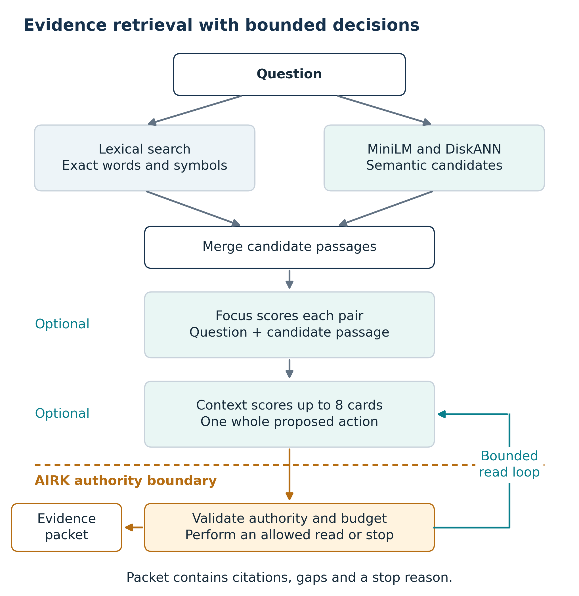

**Figure 1.** Hybrid retrieval supplies candidates; optional Focus and Context models score them. AIRK retains authority over reads, budgets and stopping, and returns an evidence packet to the calling agent.

## Why hybrid retrieval matters

Lexical search is particularly useful for exact identifiers, exception names, configuration keys, and unusual strings. Semantic retrieval can surface related ideas expressed with different words. A contract may use “idempotency,” while the most relevant test describes “duplicate execution.” A lexical search may miss that connection; MiniLM gives the system another route to the evidence. The route is useful, but a semantic match is never guaranteed. \[[<u>1</u>](#ref_1), [<u>2</u>](#ref_2)\]

Focus can reorder candidates that it receives. It cannot promote a passage that neither retrieval route found. Context has the same limitation at the action level: it cannot choose a useful read that the menu builder never offered. These two ceilings are essential to diagnosis. Candidate recall limits reranking, and menu coverage limits decision quality.

A hybrid implementation must define how it combines lexical and semantic results. Candidate union, deduplication, tie handling, and any rank fusion rule belong to the retrieval recipe. Changing that recipe can improve results without changing a single model weight. The source describes hybrid retrieval but does not establish a specific fusion formula; the recipe should be recorded explicitly in an implementation manifest. \[[<u>1</u>](#ref_1)\]

## The bounded answer loop

The answer flow has six operational steps. First, lexical and MiniLM retrieval produce candidates. Second, optional Focus scores question and passage pairs. Third, AIRK constructs a small roster of complete action cards. Fourth, optional Context selects the strongest whole card. Fifth, AIRK checks authority and budget, executes an allowed read, and updates the evidence state. Finally, a bounded loop returns an evidence packet containing citations, remaining gaps, and a stop reason. \[[<u>1</u>](#ref_1)\]

The packet is meant for the calling agent. It is not a guarantee that the agent will reason correctly from the evidence. Its value comes from making the available support and its limits inspectable. If a budget ends before a required test is found, the packet should preserve that gap rather than quietly turn an incomplete search into a positive answer.

## Where authority resides

The model produces scores. AIRK owns the file identities, allowed paths, action types, read limits, and loop budget. The validator must apply those rules after selection because an apparently useful action can become invalid: a file may have changed, a budget may be exhausted, or the roster may refer to stale evidence.

For the read only retrieval task, this boundary prevents a score from directly becoming an arbitrary command or write operation. It also gives the caller a reproducible explanation of what was considered and why the loop stopped. The quality of the boundary depends on the deterministic code and its inputs, not on a model promising to follow instructions.

# 2 Concepts and the effective model identity

## Training inference and preparation

Weights, also called parameters, are the numbers learned by a neural network. Training updates them using examples and an objective called a loss function. Inference runs fixed weights on a new input. Ordinary use of Arbiter performs inference; it does not train the models or change their weights. A checkpoint is a saved parameter set, represented here by files such as model.safetensors. \[[<u>1</u>](#ref_1)\]

An export translates the computation into a deployable graph. AIRK uses ONNX so its native Rust integration can execute models through ONNX Runtime. Large exports can keep tensor data in a separate model.onnx.data file. Exporting a model does not create a new training result. Quantization changes its numerical representation, and may change its outputs, even when it involves no gradient based learning. Calibration establishes decision rules for the finished artifact. \[[<u>1</u>](#ref_1), [<u>5</u>](#ref_5), [<u>6</u>](#ref_6)\]

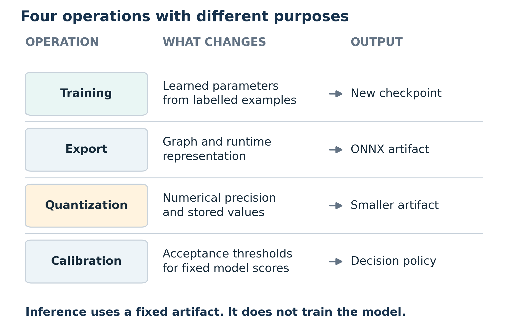

**Figure 2.** Training learns parameters. Export changes the execution representation. Quantization changes numeric precision. Calibration fits the policy for accepting scores from the final artifact.

## The vocabulary used throughout this guide

| **Term** | **Meaning in this system** |
|----|----|
| Tokenizer | Maps text and special markers into integer token IDs using an exact vocabulary and preprocessing recipe |
| Embedding | A fixed length vector that allows text to be compared numerically |
| Contrastive loss | Pulls a query toward supported evidence and separates it from eligible alternatives |
| InfoNCE | A common contrastive objective based on distinguishing a positive item from a set of negatives |
| Cross encoder | Processes question and passage together so their tokens can interact before scoring |
| Logit | An unnormalized output score; its scale is not automatically a probability of correctness |
| Softmax | Converts a set of logits into nonnegative values that sum to one over that particular set |
| Margin | The winning score minus the runner up score within the evaluated roster |
| LoRA | Learns low rank adapter matrices while keeping the original parameter matrix fixed during adaptation |
| Calibration | Fits and validates the rule that determines whether a score can be acted upon |
| Qualification | The collection of numerical, quality, resource, and decision policy checks required for a release |

An embedding is a useful representation, not a stored explanation. Two passages can be close in vector space yet disagree about a default value. A cross encoder can help distinguish them, but its score also requires interpretation. A high score means the model prefers the item under its learned behavior and input recipe; it does not certify that the item is authoritative or current.

## More than a weight file

The effective model includes the tokenizer, prompt bytes, special tokens, sequence limits, padding side, truncation policy, pooling, output token IDs, graph, numerical precision, and execution environment. Each can change the result. A tokenizer mismatch can feed a model the wrong semantic input even when every tensor loads successfully. A pooling change can alter every document vector without changing the encoder weights. \[[<u>1</u>](#ref_1), [<u>2</u>](#ref_2), [<u>3</u>](#ref_3)\]

This is why AIRK binds artifacts to exact recipes and hashes. A hash proves byte identity relative to a trusted expected value. It does not establish that the expected value came from a trustworthy source; acquisition, review, and license records remain part of provenance.

For retrieval, identity must extend to the index. Query embeddings and stored document embeddings must be generated by compatible model recipes. Sharing the same dimension is insufficient. Two different 384 dimensional models can assign completely different meanings to the same coordinates.

## What completion means in a qualified lifecycle

The completed workflow includes data acquisition and acceptance, adaptation runs, export checks, calibration, held out evaluation, and assembly of a qualified catalog. It records a selection for each role. That selection can remain a publisher checkpoint when the challenger fails a frozen rule. The historical baseline in this guide used original MiniLM weights, publisher Focus weights in W8, and publisher Context weights in FP32. \[[<u>1</u>](#ref_1)\]

The historical attempts and measurements explain why the checks exist. They should remain attached to their original artifacts and fixtures. A subsequent completed release has its own manifest and receipts; it does not inherit a new score merely because an earlier obstacle was resolved.

# 3 MiniLM embeddings and training

## The deployed embedding contract

MiniLM processes at most 256 input token positions under its pinned WordPiece tokenizer recipe, including any special tokens that recipe adds. It runs a six layer BERT style encoder and produces one hidden vector of width 384 for every token position. AIRK applies a masked mean over the nonpadding positions and then normalizes the result to unit length. Each export records its deployed contract in model.json: 256 tokens, 384 dimensions, attention-mask-mean-l2 pooling, batch size one, and CPU execution. \[[<u>1</u>](#ref_1), [<u>2</u>](#ref_2)\]

The attention mask makes padding contribute neither to the sum nor to the count. “Real tokens” here means the positions included by that mask; an implementation must preserve its treatment of special tokens as well. L2 normalization makes the vector length one, so cosine similarity reduces to a dot product. A zero or nonfinite norm must be handled as an invalid representation instead of being silently indexed.

``` math
u\  = \ \frac{\sum_{t}^{}{m_{t}h_{t}}}{\sum_{t}^{}m_{t}}\ \ \ \ \ e\  = \ \frac{u}{\left\| u \right\|_{2}}
```

In the equation, h is a token hidden vector, m is the attention mask, u is the masked mean, and e is the normalized embedding. The denominator counts the included token positions. Query and document vectors use the same computation.

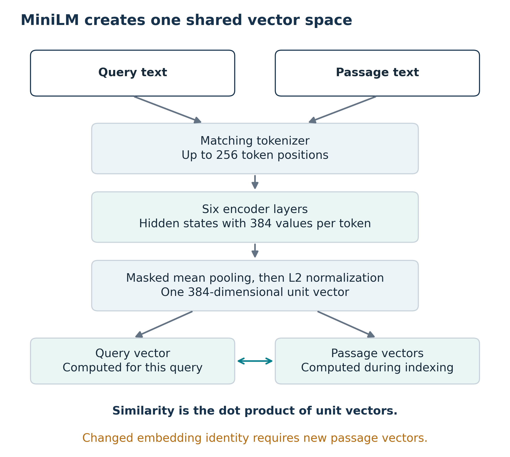

**Figure 3.** MiniLM applies the same tokenizer, encoder and pooling recipe to queries and passages. A new embedding identity requires a matching rebuilt corpus index.

## Why the input window changes the meaning of a label

A passage may contain the correct evidence somewhere in its full text while placing it outside the first 256 tokens. If the training label calls that passage positive but the deployed model sees only an introductory paragraph, training rewards an input that contains none of the required evidence. The problem is a mismatch between labels and visible content.

The source's visible-prefix-mining-v1 recipe addresses the same issue when selecting hard negatives. A distractor should be hard because of the words the model actually receives. Mining it using an invisible suffix can produce an apparently challenging example that is easy or meaningless after tokenization. \[[<u>1</u>](#ref_1)\]

Chunking, overlap, and parent or child grouping therefore participate in the model's task. If a chunker changes, repeat visibility checks and retrieval controls before attributing any gain to training. A wider parent document can be useful to the caller without implying that the 256 token encoder saw all of it.

## The original training procedure

The MiniLM trainer is tools/retrieval-train/train_encoder.py. It begins by checking SHA-256 values for the corpus, publisher model.safetensors, configuration, and tokenizer. Unexpected input bytes stop the run. The pooler.\* tensors are dropped because the deployed pipeline uses masked mean pooling rather than BERT's pooler. \[[<u>1</u>](#ref_1)\]

The original run used seed 1908, deterministic CUDA algorithms, and disabled TF32. These settings aim for repeatability within a frozen environment. PyTorch explicitly warns that full reproducibility is not guaranteed across releases, platforms, or CPU and GPU execution, so a repeatability claim must include hardware, drivers, libraries, and kernel settings. \[[<u>1</u>](#ref_1), [<u>7</u>](#ref_7)\]

Training examples came from QASPER evidence annotations and mechanically paired Requests docstrings. For each training question, each cited evidence paragraph supplied a positive example. One hard distractor was selected from nonpositive paragraphs by lexical overlap with the question. Mechanically constructed pairs are useful training material but should not be relabeled as human gold judgments when applying the later D03 evidence policy. \[[<u>1</u>](#ref_1), [<u>10</u>](#ref_10)\]

Each batch contained eight questions, eight positives, and eight distractors. The encoder produced vectors for all 24 inputs. Matrix multiplication compared the eight query vectors with the 16 passage vectors, dividing similarity by a temperature of 0.05. The result was an 8 by 16 logit matrix. \[[<u>1</u>](#ref_1)\]

``` math
z_{ij}\  = \ \frac{{q_{i}}^{T}p_{j}}{\tau}\ \ \ \ \ \tau\  = \ 0.05
```

``` math
L_{i}\  = \  - \log\left( \frac{\exp\left( z_{ii} \right)}{\sum_{j\  \in \ E_{i}}^{}{\exp\left( z_{ij} \right)}} \right)
```

Here q and p are normalized query and passage vectors; their subscripts identify the query row and passage column. E is the eligible column set for that query, including the designated positive and excluding masked alternate positives. The first equation defines the temperature scaled similarity; the second defines the per query loss. InfoNCE provides the broader contrastive learning foundation for this kind of positive versus negative objective. \[[<u>11</u>](#ref_11)\]

For query i, the designated positive was passage column i. Other known positives for the same query were excluded from competition by setting their logits to negative ten thousand. Cross entropy then rewarded the designated positive against the remaining eligible columns. There were up to 15 competing negatives per row; the count decreased when known positive columns were masked. This prevents one annotated positive from being punished for resembling another annotated positive. It does not identify unannotated positives automatically.

The optimizer was AdamW with learning rate 0.00002, weight decay 0.01, gradient clipping at 1.0, and three epochs. The script saved a checkpoint after each epoch. Its receipt retained hashes, losses, elapsed time, peak GPU memory, and library versions, followed by a final check that the inputs had not changed during the run. \[[<u>1</u>](#ref_1)\]

## Interpreting the contrastive objective

Consider a question about an idempotent retry. Its positive paragraph explains how a request identifier prevents duplicate work. A hard negative also discusses retries but describes only exponential backoff. The objective increases similarity to the evidence about deduplication and decreases similarity to the superficially related backoff paragraph.

The temperature controls how sharply score differences affect the loss. It is not a deployment confidence threshold. Lower training loss also does not establish better retrieval on a new repository. A model can learn the vocabulary or document style of a small corpus while becoming worse at the diverse tasks the product must handle.

## What the historical experiments established

| **Historical observation** | **Recorded value** | **Interpretation** |
|----|----|----|
| Initial training material | 315 rows, 287 questions, 37 source groups | Several rows can come from the same underlying question or source |
| Initial retrieval result | Mean recall 0.523; complete evidence on 72 of 205 questions | Below the frozen recall and complete set floors |
| Visibility audit | 58 positives and 147 distractors cropped | Many labels or hard negative choices depended on unseen text |
| Native parent bag experiment | 99 admitted rows; 17 of 20 for both candidate and original | A tie on a small usable evaluation slice |
| Index repair | Complete evidence rose from 6 of 20 to 17 of 20 with unchanged weights | The measured gain came from the retrieval infrastructure |
| Usable evaluation slice | 20 usable questions out of 64 | The selected denominator limits generalization |

These are historical measurements, not results for every later export or corpus. The initial complete evidence result is about 35.1 percent, well below the 70 percent floor. The 17 of 20 result happens to equal 85 percent arithmetically, but it is not evidence that a model passed the complete frozen evaluation. The candidate tied its control on only 20 usable questions. \[[<u>1</u>](#ref_1)\]

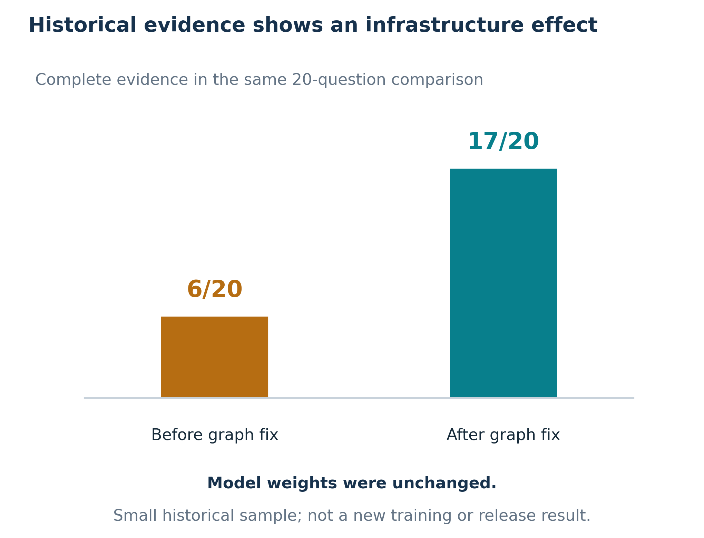

**Figure 4.** In the supplied historical comparison, fixing the DiskANN graph raised complete evidence from 6 of 20 to 17 of 20 without changing model weights. The small sample does not establish a general quality rate.

The resulting baseline decision retained publisher MiniLM weights in the minilm-l6-v2-u8-v3 and s8-v3 profiles. The lesson is methodological: establish index correctness and label visibility before asking whether gradient updates helped. The later completed adaptation workflow preserves that discipline. \[[<u>1</u>](#ref_1)\]

# 4 Focus relevance scoring

## A question and a passage read together

Focus uses Qwen3-Reranker-0.6B as a cross encoder. It sees the instruction, query, and document in one sequence. The transformer can compare their tokens directly, giving it a richer relevance judgment than the distance between independently computed vectors. The additional work is paid for each candidate pair. \[[<u>1</u>](#ref_1), [<u>3</u>](#ref_3)\]

The baseline Rust compiler at crates/airk-retrieval/src/arbiter/compiler/focus.rs constructs the following prompt. The exact web search wording is retained because it is part of the baseline artifact's input contract. The F1 adaptation later replaces that instruction with one about software evidence. \[[<u>1</u>](#ref_1)\]

\<\|im_start\|\>system\
Judge whether the Document meets the requirements based on the Query and the Instruct provided.\
Note that the answer can only be "yes" or "no".\<\|im_end\|\>\
\<\|im_start\|\>user\
\<Instruct\>: Given a web search query, retrieve relevant passages that answer the query\
\<Query\>: {question}\
\<Document\>: {passage}\<\|im_end\|\>\
\<\|im_start\|\>assistant\
\<think\>\
\
\</think\>

The model is evaluated where it would produce its next token. AIRK reads the logits for no and yes, with vocabulary IDs 2152 and 9693 in the pinned tokenizer. These IDs belong to the tokenizer contract; a different vocabulary must not reuse them blindly. The public Qwen reranker example obtains the IDs from its tokenizer and uses the same yes versus no scoring concept. \[[<u>1</u>](#ref_1), [<u>3</u>](#ref_3)\]

## Understanding the two token score

The yes and no logits are the two scores. Their difference ranks a pair, and a two class softmax converts that difference into a value between zero and one. These two representations produce the same ordering for fixed pairs.

``` math
P_{yes}\  = \ \frac{\exp\left( \ell_{yes} \right)}{\exp\left( \ell_{yes} \right)\  + \ \exp\left( \ell_{no} \right)}\  = \ \sigma\left( \ell_{yes}\  - \ \ell_{no} \right)
```

For an illustrative pair with yes logit 2.0 and no logit 0.0, the normalized yes score is about 0.881. That is the probability mass assigned to yes within the restricted two token calculation. It is not an independently validated 88.1 percent probability that the passage is correct, complete, or authoritative.

## A strict sequence budget

The AIRK Focus graph is static at 512 tokens and uses left padding. The budget includes the template, instruction, query, document, special tokens, and assistant suffix. A 512 token document by itself will generally exceed the budget once the rest of the prompt is added. If the complete pair does not fit, the compiler refuses it instead of silently truncating. \[[<u>1</u>](#ref_1)\]

This makes failures visible and protects exact input parity, but it transfers responsibility to the chunk builder. The system needs a defined response to an oversized pair, such as selecting a smaller independently valid passage under the same evidence policy. Ad hoc cropping inside the scoring function would create a different recipe.

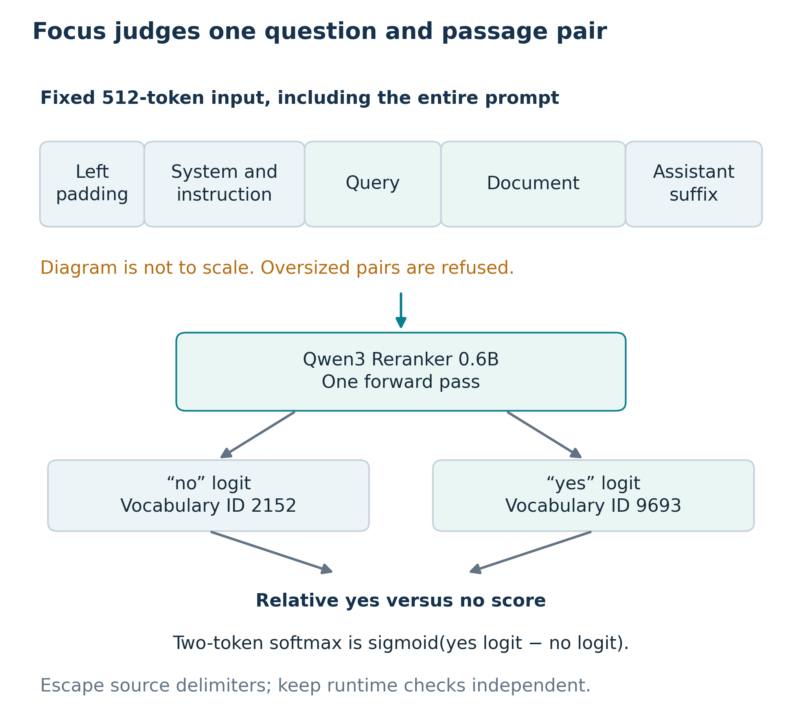

**Figure 5.** Focus reads a complete question–passage prompt and compares the yes and no logits. Prompt overhead counts toward the fixed 512-token limit; no silent truncation is allowed.

Source text is escaped so embedded chat delimiters such as \<\|im_end\|\> cannot terminate its structural slot. That protects the prompt format. It does not prove immunity to semantic instruction attacks, such as a document telling the model to rate itself highly using ordinary words. The constrained score output and AIRK's separate authority checks limit the consequences of a manipulated score. \[[<u>1</u>](#ref_1)\]

## Preparing the Focus baseline

The preparation process pins a publisher revision, checks every file hash, exports a static 512 token ONNX graph, and quantizes the weights to W8. The historical W8 payload was approximately 1.13 GB and passed its numerical comparisons. \[[<u>1</u>](#ref_1)\]

The storage normalization script at artifacts/advanced-split/models/native-onnx-storage-normalization-r1/normalize_focus_artifact.py inlines three small tensors so the native loader can accept the artifact. Its verification establishes that the main weight file remains byte identical. Moving tensor storage can fix a loading problem without changing model mathematics, provided the graph references and values remain equivalent. \[[<u>1</u>](#ref_1), [<u>6</u>](#ref_6)\]

The historical 20 sample component run reported approximately 2.1 seconds at p95 for full 512 token Focus scoring. This is evidence about that component, hardware setup, and sample. It is not the latency of a complete answer loop or proof of better task completion. \[[<u>1</u>](#ref_1)\]

# 5 Context decisions over whole action cards

## A language model used for bounded choice

Context uses Qwen3-1.7B for Compact or Qwen3-4B for Large. AIRK does not ask these profiles to generate an explanation, path, or command. It asks them to score the letters corresponding to a roster AIRK has already built. The output is a score array over available choices. \[[<u>1</u>](#ref_1), [<u>4</u>](#ref_4)\]

The prompt includes the question, up to four newest evidence snippets of at most 192 bytes each, and up to eight cards labeled A through H. Up to five cards are verified Read actions. The remaining choices are terminal classes: Sufficient, Clarify, and NoJustifiedRead. Byte limits are distinct from token limits; code handling a UTF-8 string must preserve valid character boundaries when enforcing a byte bound. \[[<u>1</u>](#ref_1)\]

Each card is a complete proposition: an action, the evidence gap it addresses, a reason, and role or relevance hypotheses for each source. Context chooses that proposition as a unit. Selecting the action from one card and the reason from another would create an option that the model never scored.

## What the terminal choices mean

Sufficient means the available evidence meets the defined completion standard. Clarify means the question requires information from the caller that the current evidence cannot resolve. NoJustifiedRead means the current menu and state do not support another useful read. None of these meanings should be expanded into a claim that every file in the repository has been exhaustively searched.

Terminal decisions require separate qualification because they do different things. A wrong Read wastes resources and may distract the caller. A wrong Sufficient can stop the search before contradictory evidence is found. The cost of that error explains the more demanding evidence required to enable it. \[[<u>1</u>](#ref_1)\]

## The six graph inputs

| **Input name** | **Meaning** | **Common implementation mistake** |
|----|----|----|
| input_ids | Tokenized prompt | Using a different tokenizer or prompt template |
| attention_mask | Which prompt positions are active | Including padding in the logical sequence |
| position_ids | Positional indices used by the model | Misaligning positions when padding changes |
| decision_positions | Index of the final prompt token whose state predicts the answer | Selecting a padding position or an offset after the sequence |
| candidate_positions | Vocabulary IDs for A through H, 32 through 39 in the pinned tokenizer | Treating these values as positions inside the prompt |
| option_mask | Which option slots are structurally live | Allowing nonexistent letters to compete |

The name candidate_positions is easy to misread. These values select rows of the vocabulary output head. They do not identify where each option appeared in the prompt. The last prompt token's hidden state predicts the next answer token; the answer letter has not already been generated. \[[<u>1</u>](#ref_1)\]

## The restricted output head

The graph performs full prefill through all Qwen3 layers, takes the final hidden state at the decision position, and computes its dot product with the tied embedding rows for the allowed letter tokens. The existing language model head is restricted to at most eight rows. The result has shape scores\[1, N\]; masked option scores are set to negative ten thousand. \[[<u>1</u>](#ref_1), [<u>4</u>](#ref_4)\]

``` math
s_{j}\  = \ {h_{t*}}^{T}E_{v_{j}}\ \ \ \ \ j\  \in \ live\ options
```

``` math
\Delta\  = \ s_{(1)}\  - \ s_{(2)}
```

Here h at the selected position is the final hidden state, E is the embedding row for option j's vocabulary token, and the superscript T denotes a dot product through transposition. The scores with ordered subscripts one and two are the winner and runner up over the same live roster.

Tied embeddings mean that the input embedding matrix and the language model output head share the same learned weights. Reusing the letter rows avoids introducing an untrained pointer head. The four superseded candidates used a different approach associated with tools/retrieval-train/qwen_export.py; they should not be confused with the selected Qwen3 trio. \[[<u>1</u>](#ref_1)\]

The restricted head reduces output projection work and avoids autoregressive answer generation. It does not skip the transformer computation over the prompt. Long context can still dominate latency and memory. A single letter is a small output, not a small inference.

## Choosing the global winner

AIRK takes the highest score over the entire live roster, then calculates its margin over the runner up in that same roster. The winner must satisfy the policy for its action class. A Read needs the applicable calibrated threshold and deterministic validation. A terminal choice needs qualification for that terminal class. \[[<u>1</u>](#ref_1)\]

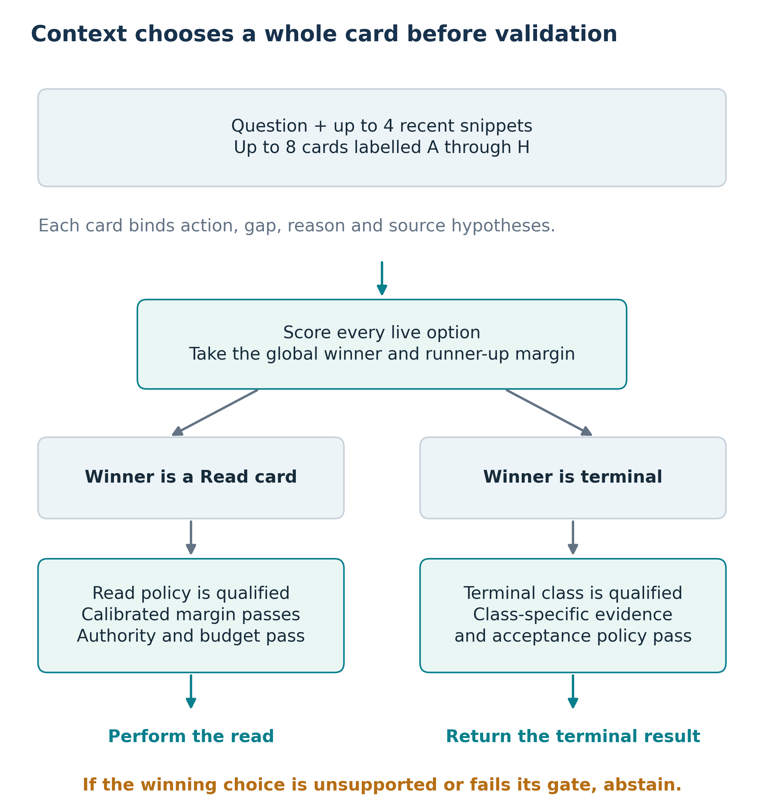

**Figure 6.** Context first selects the global winner across the whole roster. That winner must pass its own qualification and execution checks. An unsupported terminal winner leads to abstention, never substitution of the second-best Read.

An unsupported terminal winner causes abstention. AIRK does not silently discard that winner and execute the second best Read. Such a fallback would be a different policy from the one evaluated: it would allow a weaker action after the model's preferred conclusion had already failed qualification.

Structural masking and class qualification serve different purposes. option_mask removes slots that do not exist. Qualification controls whether an existing class can be accepted. When the contract permits an unsupported terminal to remain in the scored roster, its victory must remain visible as abstention.

## Authenticating and loading the Context profiles

The preparation routine authenticates the manifest, exact publisher revision, expected file set, and all hashes before loading. The source records revision prefixes 70d244cc for 1.7B and 1cfa9a72 for 4B. These are human readable identifiers only; automation must use the full recorded revision and digest. The accepted architecture is dense Qwen3 with tied embeddings, head_dim 128, no sliding window, and rope_theta 1000000. \[[<u>1</u>](#ref_1), [<u>4</u>](#ref_4)\]

The strict loader requires BF16 source tensors and accounts for every tensor exactly once. When a duplicate lm_head tensor is present in the authenticated file set, it must be byte identical to embed_tokens, confirming the tied head contract. The prepared FP32 artifact casts those tensors to FP32. Expanding BF16 values into FP32 does not recover information lost before export; it establishes the precision used for the subsequent computation. \[[<u>1</u>](#ref_1)\]

The reference scorer checks shapes of 17 tokens with three options, 128 tokens with eight options, and 2048 tokens with eight options. The CPU ONNX Runtime export must agree with the PyTorch reference within 0.001 absolute error under the specified comparison. Full 8192 token qualification adds a distinct long input check; passing a short shape is insufficient. \[[<u>1</u>](#ref_1)\]

# 6 Export precision and quantization

## Following the artifact through each transformation

A useful preparation receipt distinguishes the source checkpoint, training output, exported graph, tensor storage layout, quantized representation, and runtime profile. These objects are related but not interchangeable. A good PyTorch result does not prove that a converted ONNX graph is correct, and a numerically close export does not prove that its retrieval decisions are useful.

For MiniLM, export_encoder.py wraps the encoder to return last_hidden_state and exports an FP32 ONNX graph at opset 18 with a dynamic token axis. Native code performs pooling. The profile still enforces the 256 token interface; a dynamic axis is not permission to ignore the deployed limit. \[[<u>1</u>](#ref_1)\]

The U8 preparation uses quantize_dynamic for per channel integer MatMul weights. The six feed forward output projections named layer.N/output/dense/MatMul remain FP32, as do the embeddings. Keeping sensitive operations in higher precision trades some storage and computation for better numerical fidelity. It also explains why “8 bit model” rarely means that every byte of the artifact stores an 8 bit weight. \[[<u>1</u>](#ref_1)\]

## What quantization changes

An affine quantizer represents a real value approximately as a scale multiplied by an integer minus a zero point. Fewer integer levels mean a coarser representation. The scale controls spacing; the zero point identifies the integer corresponding to zero. Per channel quantization allows different weight channels to use different scales.

Quantization generally reduces weight storage and can improve inference speed, but the outcome depends on CPU instructions, operator coverage, kernel choices, tensor shapes, and conversion overhead. Some formats can be slower on a particular processor. Measure the exported graph on the target runtime instead of treating bit width as a performance result. \[[<u>5</u>](#ref_5)\]

The names U8 and S8 are profile identifiers in the supplied workflow. In a full numerical manifest, distinguish activation dtype, weight dtype, zero points, scale granularity, accumulator precision, and any operations that remain floating point. A single label cannot describe all of those choices.

## Why the signed byte path needs special handling

Some AVX2 and AVX512 implementations use an instruction that multiplies unsigned activation bytes by signed weight bytes and adds pairs into a signed 16 bit intermediate. That intermediate can saturate before accumulation into a wider result. ONNX Runtime documents this issue for U8S8 kernels; CPU features and selected kernels determine whether it applies. \[[<u>5</u>](#ref_5)\]

The source's safe_int8.py converts unsigned weights to signed weights using Qs = Qu minus 128. To preserve the represented real values, the zero point must also shift by 128 while the scale remains the same. The identity is then scale times (Qu minus zu) equals scale times (Qs minus zs). Merely changing the byte values without adjusting the zero point is incorrect.

The helper also decomposes each unsigned activation byte into a low seven bit value and a high one bit value. It evaluates two MatMulInteger operations and combines their results in a wide accumulator. \[[<u>1</u>](#ref_1)\]

``` math
a\  = \ a_{low}\  + \ 128a_{high}\ \ \ \ \ a_{low}\  = \ a\ mod\ 128
```

``` math
a_{high}\  = \ \left\lfloor \frac{a}{128} \right\rfloor\ \ \ \ \ AQ_{s}\  = \ A_{low}Q_{s}\  + \ 128A_{high}Q_{s}
```

For an illustrative activation value of 200, the low part is 72 and the high part is 1. Multiplying by a signed weight of 100 gives 7200 plus 12800, or 20000, exactly matching the integer product. For a pair of low parts, the largest positive contribution is 2 times 127 times 127, or 32258, which fits in a signed 16 bit intermediate. The most negative corresponding pair is negative 32512. The high bit path is smaller still.

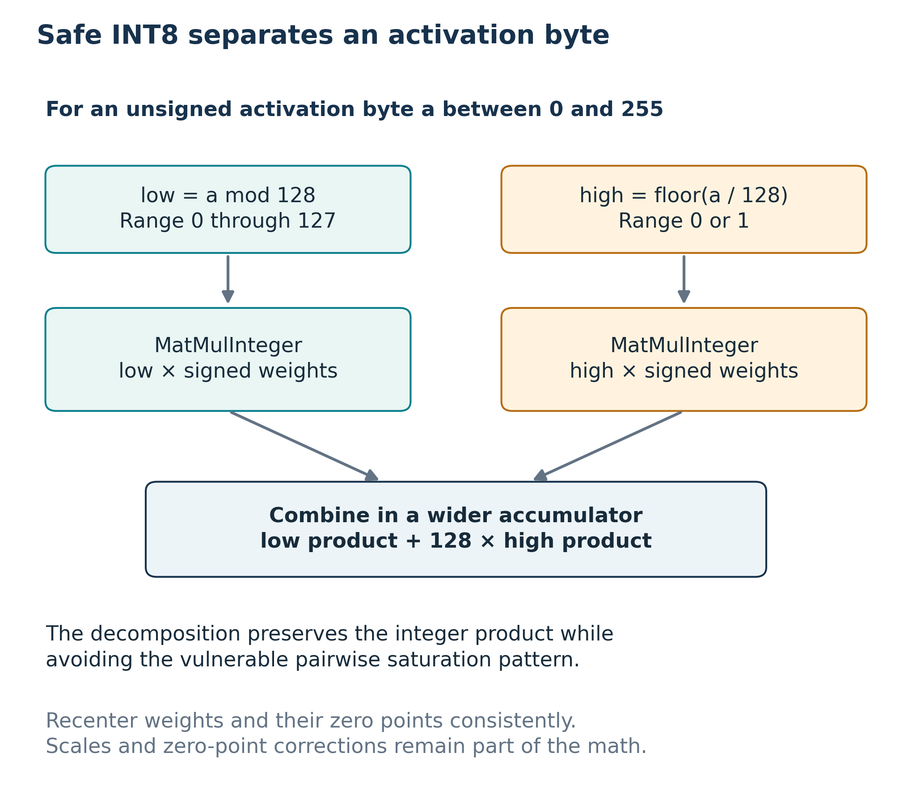

**Figure 7.** Splitting each activation byte into low seven bits and a high bit lets the runtime recombine two safe integer products. Recentring unsigned weights also requires consistent zero-point handling; wider accumulation must remain within range.

Zero point corrections and the final combination must follow the graph's exact arithmetic, using sufficient accumulator width. The technique addresses the specific saturating pairwise intermediate. It preserves the intended quantized integer calculation; it does not remove the approximation already introduced when floating point values were quantized, nor does it make every possible accumulator overflow impossible.

## Numerical probes and attribution

MiniLM's export checks compare eight probe sentences through PyTorch and each ONNX profile. The fixtures include Unicode, emoji, and negation. The receipt records cosine agreement, L2 distance, norm error, and finiteness. These probes catch conversion mistakes but are a small numerical diagnostic set, not a retrieval quality evaluation. \[[<u>1</u>](#ref_1)\]

The --baseline-original option applies the same quantization recipe to publisher weights. This gives a fairer comparison: original versus adapted weights under an identical export and precision recipe. Without that control, a change attributed to learning could come from quantization, pooling, or graph handling instead.

The export also appends modification and dataset attribution information to LICENSE. The original record identifies QASPER under CC BY 4.0 and Requests under Apache-2.0. A release records the specific source versions and retained notices; merely naming a dataset is not a substitute for preserving its actual license and attribution files. \[[<u>1</u>](#ref_1)\]

## Why Context retained FP32 in the baseline

The Context W8 experiment used MatMulNBits with eight bit weights, block size 32, and symmetric quantization. Its frozen checks required raw logit drift no greater than 0.25, softmax mass drift no greater than 0.05, and identical argmax on the tested fixtures. Compact recorded raw drift of 0.2908, exceeding 0.25 even though its winning option matched. The baseline therefore retained FP32 for Compact and Large, at approximately 6.9 GB and 16.1 GB respectively. \[[<u>1</u>](#ref_1)\]

An unchanged winner is only one numerical property. If two actions have nearly equal scores, drift that appears harmless on a few fixtures can change either the winner or the acceptance margin elsewhere. Passing argmax checks does not waive a raw score rule, particularly when calibration depends on those scores.

| **Historical Context measurement** | **Recorded result** | **What it establishes** |
|----|----|----|
| Compact full length numerical diagnostic | 8192 tokens, eight options, approximately 84 seconds | One diagnostic completed and passed its numerical check |
| Compact resource run | 20 samples; p95 86.0 seconds; peak RSS about 15.1 GB | Resource behavior for that profile and test setup |
| Compact memory bound | 16 GiB | The stated bound uses binary units; the measurement's GB label should be preserved and resolved from raw bytes in receipts |
| Large full length diagnostic | Approximately 71 seconds; raw error 0.00133 against 0.001 limit | A historical FP32 parity failure despite matching argmax |
| Suspected Large failure mechanism | Tiled FP32 summation order | A diagnostic hypothesis, not an established cause |

The historical Large diagnostic remains a failed run. Qualification of a later export requires a new passing receipt under the unchanged rule; the old value is not rewritten. Compact's and Large's recorded times also do not establish that the larger model is generally faster. They are different observations with limited sample and execution context. \[[<u>1</u>](#ref_1)\]

## Separate the numerical gates

The 0.001 FP32 reference parity rule and the 0.25 raw and 0.05 mass quantization rules compare different transformations. They must be evaluated and reported separately. A quantized artifact cannot use the looser quantization allowance to excuse an incorrect FP32 reference export. Likewise, a storage relocation check proves byte preservation, not task completion.

Qualification should specify precisely which outputs contribute to each maximum error, how masked options are excluded, how softmax mass drift is measured, and how nonfinite values are handled. Those definitions belong in frozen machine readable rules. The source provides thresholds, while the freeze files and receipts provide the executable comparison contract. \[[<u>1</u>](#ref_1)\]

# 7 Building evidence data that matches deployment

## Establish the baseline before adapting weights

Step 7 freezes the runtime, model artifacts, and indexes. It compares exact vector search with DiskANN and separates lexical, semantic, and hybrid retrieval. It measures whether needed evidence appears within the actual model input and whether a useful action appears in Context's menu. \[[<u>1</u>](#ref_1)\]

These controls isolate different failures. If exact search retrieves the right vectors and DiskANN does not, investigate index construction or search parameters. If neither vector route retrieves the evidence but lexical search does, examine the embedding or chunking recipe. If the evidence is present among candidates but missing from the action menu, changing Context weights is an indirect response to a deterministic menu problem.

An exact search control can use a manageable evaluation corpus; it need not become the production search strategy for millions of passages. Its purpose is to establish what the stored vectors can support before approximation error enters the comparison.

## Define evidence units before labeling

A useful query group includes a question, its repository and version, the evidence units required to answer it, acceptable alternative spans for each unit, and any contradictions or scope limits. For “Does retry preserve idempotency under a transient failure?”, the required units could include the implementation, the failure path test, and the published behavioral contract.

Alternative passages that establish the same fact can satisfy one unit. They should not conceal the absence of a different required fact. This distinction carries through training and evaluation: retrieving two descriptions of the implementation does not replace retrieving the test.

For Focus, label the exact 512 token prompt representation after all template overhead. For Context, label the full card in the state where it is offered, including the evidence already seen. A path that is useful in one state may be redundant in another. “Useful read” is a state dependent judgment, not a permanent property of a file.

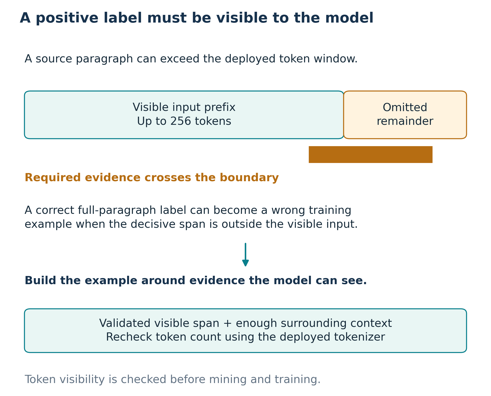

**Figure 8.** An evidence label must refer to content inside the deployed model input. Mining from an invisible suffix creates misleading positive and negative examples.

## The software evidence corpus

The Step 8 program specifies about 2000 query groups from at least 20 unrelated repositories. Its target mixture is 40 percent code and tests, 35 percent documentation, contracts, and configuration, 15 percent cross file diagnostics, and 10 percent general replay. At exactly 2000 groups, those proportions correspond to 800, 700, 300, and 200 groups. These are design allocations, not a claim that the historical acquisition already met them. \[[<u>1</u>](#ref_1)\]

The earlier acquisition and audit included 1955 judged CoSQA and CodeSearchNet pairs, ContextBench, and TechQA. Only 21 pairs passed the strict MiniLM whole input visibility rule in that audit. The completed data workflow resolves split placement, source rights, and label scope before admitting material into adaptation. The historical 21 pair count remains a useful demonstration of the difference between acquiring examples and accepting model appropriate evidence. \[[<u>1</u>](#ref_1)\]

Only human labels count as gold under the D03 rule. A model generated explanation, a mechanically paired docstring, or a teacher's preference can still serve a separately identified training purpose. It must retain that label origin and must not be silently promoted to human evaluation truth.

## Split before mining

The workflow separates TRAIN, DEV, CAL, policy confirmation, and FINAL before selecting negatives or deriving new examples. Assignment is grouped by repository, symbol family, and chronology. Clone detection and duplicate handling prevent closely related versions from entering both development and final evaluation. \[[<u>1</u>](#ref_1)\]

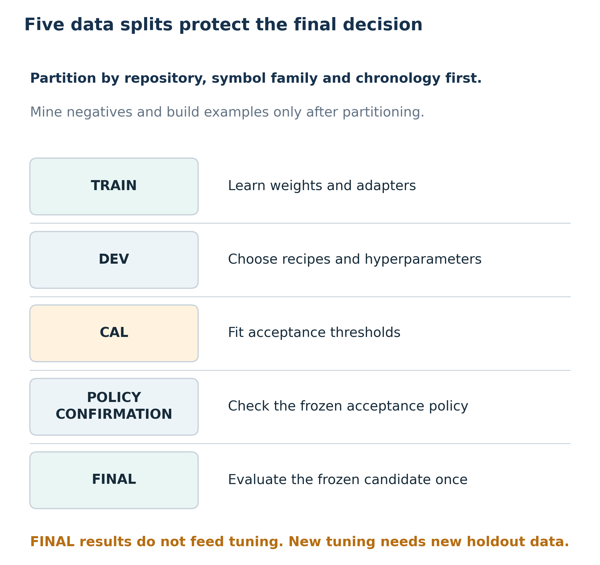

**Figure 9.** The five splits have separate jobs. Repository, symbol-family, time and clone separation are enforced before example mining; the final holdout is not a tuning resource.

| **Split** | **Permitted purpose** | **What must not flow back from it** |
|----|----|----|
| TRAIN | Gradient updates, training negatives, training trajectories | Held out labels or final evaluation examples |
| DEV | Compare candidate recipes and select development changes | Claims of untouched final quality |
| CAL | Fit thresholds for the exact finished artifact | A presumption that fitted error rates are independently confirmed |
| Policy confirmation | Confirm the frozen acceptance policy independently | Repeated threshold tuning while still calling the set independent |
| FINAL | One frozen end to end evaluation for the promotion decision | Further tuning against the same final cases |

The order matters. Mining negatives across all repositories before splitting can reveal the held out corpus to training. Near duplicate questions, forked repositories, copied tests, and successive versions of the same symbol can leak even if their filenames differ.

When a held out failure leads to a new hypothesis, it can inform a new research cycle. That cycle needs a fresh untouched final set or an explicitly revised evaluation claim. The original FINAL result remains part of the record; it does not become an endlessly reusable development score.

## Keep the acceptance record with each example

A practical record contains source revision, license identity, query group, split, symbol family, timestamp or chronology group, exact span coordinates, input recipe hash, tokenizer identity, visible token range, label provenance, adjudication outcome, and exclusion reason when applicable. These are recommended record fields, not a claim about the existing AIRK schema.

Visibility is checked after the exact deployed preprocessing. License and usage acceptance is also completed per source before training. The resulting corpus manifest makes it possible to determine which examples a checkpoint actually saw and why each was permitted to participate.

# 8 Adapting the models with controlled experiments

## Change one cause at a time

Steps 9 through 11 define small experiments, each with a named intervention. M1 adapts MiniLM. F1 changes only the Focus instruction. F2 adapts Focus with LoRA. C1 adapts Context's decision symbol. C2 and C3 add more demanding forms of decision supervision when their triggers apply. The experiments are separate because their causes and failure modes differ. \[[<u>1</u>](#ref_1)\]

| **Experiment** | **Intervention** | **Recorded starting settings** |
|----|----|----|
| M1 | MiniLM contrastive adaptation with required evidence units and screened negatives | AdamW 0.00001; temperature 0.05; effective batch 32; one epoch |
| F1 | Software evidence instruction for Focus | Prompt change only; weights unchanged |
| F2 | Focus LoRA supervised adaptation on the yes or no token | Rank 16; learning rate 0.00005; batch 32; one epoch |
| C1 | Context LoRA supervision on allowed A through H symbols | Rank 16; learning rate 0.00005; dropout 0.05; attention projections first |
| C2 | Counterfactual supervision for read utility | Conditional branch using valid training states |
| C3 | Offline retraining on states reached by the adapted policy | Conditional DAgger style branch |

These values are starting recipes, not universal best settings. Changing one creates a new experiment identity. A completed experiment includes its comparison and decision, including a rejection when the required improvement is absent.

## MiniLM and complete evidence pressure

M1 uses multi positive contrastive learning so every required evidence unit contributes its own training pressure. This prevents one easy implementation paragraph from satisfying a question that also needs a test and a contract. Screened lexical and dense negatives are compared with easy negatives to determine whether harder competition improves the task. \[[<u>1</u>](#ref_1)\]

A subtle loss design issue matters here. A single numerator that sums all positive exponentials can be dominated by one already easy positive. One way to express the intended pressure is to average a separate loss over required units while allowing equivalent spans within a unit to share positive credit. This is an illustrative formulation of the requirement, not a claim about the exact trainer's code.

``` math
M_{qu}\  = \ \sum_{p\  \in \ P_{qu}}^{}{\exp\left( \frac{s(q,\ p)}{\tau} \right)}
```

``` math
L_{q}\  = \ \frac{1}{\left| U_{q} \right|}\sum_{u\  \in \ U_{q}}^{}{- \log\left( \frac{M_{qu}}{M_{qu}\  + \ \sum_{n\  \in \ N_{qu}}^{}{\exp\left( \frac{s(q,\ n)}{\tau} \right)}} \right)}
```

For query q, U is the set of required units. P contains interchangeable positive spans for unit u, while N contains its screened negatives; their subscripts identify the query and unit. M is the total positive exponential mass for that unit, s is the similarity function, and tau is the training temperature. Averaging the separate unit losses preserves a penalty for each unit whose evidence is poorly separated from its negatives.

For each required unit u, its valid positive spans compete with screened negatives. The loss averages over units, so an easy code span cannot erase loss from a missing test unit. Other required positives must not be accidentally treated as negatives. Group weights should also avoid giving a query extra influence merely because it has many duplicated spans.

Effective batch 32 specifies the examples contributing to an optimizer update. It may be implemented as one physical batch or through accumulated microbatches. If it is reached using four microbatches of eight, the contrastive matrix still contains only each microbatch's negatives unless the implementation explicitly shares embeddings across microbatches. A training receipt should record both optimizer batch size and the actual negative pool construction.

## Focus instruction and weight adaptation

F1 tests whether a software evidence instruction improves the existing reranker. An illustrative instruction is: “Judge whether this passage provides evidence needed to answer the software question, including implementation behavior, tests, contracts, and configuration.” The final bytes must be frozen before evaluation and calibration. The wording is an example, not an assertion that it is the selected production prompt.

A prompt change can alter behavior even with identical weights. It must therefore be evaluated as a real recipe change. Compare F1 with the baseline on identical candidate pairs, then inspect where it changes false positives, false negatives, and useful downstream evidence.

F2 applies LoRA to exact native 512 token pairs. Training computes loss on the yes or no answer token while masking the prompt positions from the supervised loss. The prompt remains the model's input; masking its loss simply means that reproducing those input tokens is not the learning objective. \[[<u>1</u>](#ref_1)\]

LoRA learns a low rank update to selected weight matrices while the original matrix remains fixed during adaptation. The adapter can be merged into the original matrix before export. This reduces the number of trainable parameters, but it does not eliminate data preparation, activation memory, or postmerge qualification. \[[<u>8</u>](#ref_8)\]

``` math
W_{merged}\  = \ W_{0}\  + \ \frac{\alpha}{r}BA\ \ \ \ \ rank(BA)\  \leq \ r
```

W with subscript zero is the original matrix. A and B are the learned smaller factors, r is their configured rank, and alpha controls the adapter scale. The product BA forms an update with rank at most r; merging adds the scaled update to the original matrix before deployment preparation.

The merged checkpoint must go through the same native export and numerical checks as every other candidate. If deployment uses W8, merge first and prepare the final quantized graph before calibration; the calibration policy belongs to those deployed bytes.

## Context decision adaptation

C1 trains the A through H decision symbol over the allowed options. When several cards are equally useful, the target distributes credit across those cards instead of arbitrarily declaring one correct. Option order is balanced so the model cannot succeed by learning that the useful choice is usually B. \[[<u>1</u>](#ref_1)\]

The dataset must preserve the global roster, including terminal alternatives where the policy requires them. Training only on isolated good Reads would teach a different decision problem from deployment. It must also preserve the same evidence snippet limits, complete card text, option mask, and decision position used by the native scorer.

C2 uses counterfactual utility labels: evaluate what changes if a particular permitted read is taken from a given state. A read that closes a required evidence gap has a different value from a read that repeats known facts. The observed consequence may be used to label the training action, while the model input must remain the preaction state. Putting the newly read evidence into that input would leak the answer to the decision.

C3 addresses a sequential learning problem. An adapted policy may reach states absent from the original demonstrations. Offline DAgger style collection records those training partition states, obtains valid supervision, and retrains on the expanded set. It follows the motivation of dataset aggregation while remaining an offline, bounded AIRK adaptation recipe. It does not authorize learning during a user's normal query session. \[[<u>1</u>](#ref_1), [<u>12</u>](#ref_12)\]

## Conditional branches and release preparation

Step 12 includes teacher distillation, refreshed negatives, and W4 or quantization aware training when explicit triggers justify them. A completed lifecycle evaluates those triggers; it does not need to run every possible branch. Teacher labels remain distinguishable from human gold, and a new negative pool must respect the existing split boundaries. \[[<u>1</u>](#ref_1)\]

Every adapted candidate is merged where appropriate, exported, re-quantized where required, and rechecked in the native runtime. A favorable result that exists only in a training notebook is not the deployable result. The final decision compares complete artifacts under the frozen task and resource gates.

# 9 Calibrating scores into accepted decisions

## Calibration follows the final artifact

A model's logits express preference under its learned function. Calibration decides when that preference is strong enough to act upon. For Context, a common input to the rule is the global winner's margin over the runner up. The margin is meaningful only for the exact prompt, roster construction, score calculation, and export being qualified. \[[<u>1</u>](#ref_1)\]

Any change to weights, prompt, or export invalidates the old calibration binding. Tokenizer and quantization changes are also changes to the effective artifact. Calibration therefore comes after artifact preparation and binds to the exact final export. Even a storage only change requires a new artifact bound calibration or validation receipt; a proof of numerical equivalence may support that receipt but does not silently preserve the old binding. \[[<u>1</u>](#ref_1)\]

## The generic Read rule

The source's CAL100 calibration set contains 100 ordered questions across 13 chunks. The generic Read fit must find a threshold that accepts at least one certified useful Read and accepts zero UNKNOWN choices. If no threshold meets both requirements, that profile cannot qualify for that Read policy. \[[<u>1</u>](#ref_1)\]

UNKNOWN means that available adjudication does not certify the action's usefulness. It is not automatically proof that the read is harmful, yet accepting it would violate the rule. This makes the acceptance policy conservative with respect to unsupported decisions.

A threshold that accepts one useful case is evidence that the rule is nonempty on the calibration data. It is not evidence of broad coverage. Report both the accepted fraction and the quality of accepted cases. A policy that abstains almost everywhere may have low observed error while delivering little practical value.

## Separate policies for terminal classes

Sufficient, Clarify, and NoJustifiedRead each need appropriate human labeled evidence and a separate acceptance policy. Qualification of generic Read does not transfer to them. If a terminal class lacks qualifying evidence, its victory causes abstention according to the roster rule. \[[<u>1</u>](#ref_1)\]

For Sufficient, the source requires zero observed false sufficient decisions and a 95 percent upper bound below one percent. The statistical statement applies to independent accepted Sufficient decisions evaluated under a fixed policy. It is not satisfied merely by collecting that many unrelated questions, especially if the policy accepted only a few of them.

## Why approximately 299 clean decisions matter

With zero failures among n independent accepted decisions, the probability of observing no failures at a true error rate p is (1 minus p) raised to n. Setting that probability to 0.05 gives the exact one sided 95 percent upper bound. This follows the binomial confidence limit construction; the numerical values below are direct calculations. \[[<u>13</u>](#ref_13)\]

``` math
p_{upper}\  = \ 1\  - \ {0.05}^{\frac{1}{n}}\ \ \ \ \ at\ one\ sided\ 95\ percent\ confidence
```

| **Zero failure sample size** | **One sided 95 percent upper bound** | **Meets a bound below one percent** |
|----|----|----|
| 100 | Approximately 2.951 percent | No |
| 298 | Approximately 1.0002 percent | No |
| 299 | Approximately 0.9969 percent | Yes, under the stated assumptions |
| 500 | Approximately 0.5974 percent | Yes, under the stated assumptions |

The 299 figure uses a one sided bound. A two sided 95 percent interval allocates only 0.025 to the upper tail and needs 368 zero failure cases for the same less than one percent upper limit. This distinction should be explicit in the frozen rule.

Independence is also substantive. Many nearly identical states from one repository do not provide the same evidence as independent deployment representative decisions. A policy chosen by repeatedly testing thresholds on those same observations also weakens a fresh confirmation claim. The separate policy confirmation split exists to address that problem.

## A calibration example

Consider an illustrative roster whose Read winner has score 4.2 and whose runner up has score 3.6. Its margin is 0.6. If the frozen Read threshold is 0.5, the numerical threshold passes. AIRK must still confirm the selected card's identity, file authority, and remaining budget before reading.

If an unsupported Sufficient card instead wins at 4.4, the same Read at 4.2 must not be substituted. The result is abstention, even though the Read might have passed under a different roster. Calibration evaluates a complete decision policy, including its winner selection rule and its handling of unsupported classes.

## Record the policy as a deployable dependency

A useful calibration receipt identifies the artifact hash, prompt and roster recipe, class policy, threshold comparison operator, tie rule, accepted and rejected counts, UNKNOWN handling, independent confirmation results, and any statistical assumptions. Threshold equality should be deliberate: “margin greater than or equal to m” and “margin greater than m” can produce different accepted sets.

When the deployment distribution changes, collect labeled monitoring evidence and rerun the appropriate controlled qualification cycle. Repeatedly nudging a threshold in production without preserving its provenance would sever the connection between the release and its supporting evidence.

# 10 A worked evidence retrieval example

## Define the question and its evidence requirements

This chapter uses an invented repository to make the workflow concrete. The filenames, source behavior, scores, thresholds, and packet fields are teaching examples, not an AIRK execution trace or API specification.

The caller asks: “If a payment request times out and the client retries, can the service charge twice, and does the default configuration protect against that?” A complete answer needs at least four evidence units: request identity handling, the retry path, the default deduplication configuration, and a test demonstrating the relevant failure case. A contract may also be needed to distinguish intended behavior from an implementation accident.

| **Illustrative source** | **What it can establish** | **What it cannot establish by itself** |
|----|----|----|
| src/payments/submit.rs | How the service checks an idempotency key | Whether a timeout test covers the same path |
| src/client/retry.rs | How retry preserves or regenerates the request key | Whether server deduplication is enabled by default |
| config/defaults.toml | Default deduplication setting and retention value | Whether the running deployment overrides that setting |
| tests/payment_retry.rs | Behavior exercised after a simulated timeout | The scope of untested failure modes |
| docs/payment_contract.md | Published guarantee and qualifications | Proof that the current implementation satisfies it |

The requirement is about multiple connected facts. A single paragraph saying “retries are safe” is insufficient because it does not establish the default configuration or the failure behavior.

## Retrieve candidates and inspect coverage

Lexical retrieval searches terms such as timeout, retry, idempotency_key, and deduplication. Semantic retrieval may surface a test named duplicate_execution_after_disconnect even if it uses different wording. The candidate union removes duplicates while preserving source identity and retrieval provenance.

Suppose the first retrieval returns the implementation, retry code, and contract, but misses the configuration file. Focus can judge those candidates, yet the question's default setting remains uncovered. The correct response is to preserve the gap and offer a targeted next read. A very high relevance score on the contract does not replace the missing default.

Before scoring, each Focus pair is assembled exactly and checked against the 512 token budget. If a test body is too long, the evidence window must be selected under a defined recipe that still includes the assertion and the setup that makes it meaningful. Keeping only the assertion while dropping the simulated failure would distort the evidence.

## Construct complete action cards

After reading the implementation and retry code, the following illustrative six choice roster is available. Every Read refers to an authorized and verified source. The reasons describe hypotheses to inspect, not conclusions already established.

| **Letter** | **Whole card in abbreviated form** |
|----|----|
| A | Read config/defaults.toml to close the default configuration gap; it may establish whether deduplication is enabled without an override |
| B | Read tests/payment_retry.rs to close the failure behavior gap; it may show that a timeout followed by retry produces one charge |
| C | Read docs/payment_contract.md to check the promised scope and exclusions |
| D | Sufficient because the currently collected evidence covers the defined requirements |
| E | Clarify because the answer depends on an unspecified deployment override |
| F | NoJustifiedRead because no offered read can resolve a remaining gap |

Each full production card also carries the source hypotheses and fields required by the compiler. The abbreviated table is designed for a reader to follow the decision, not to replace the exact serialized input.

## Score and validate the winner

Use illustrative logits A 2.7, B 3.5, C 1.9, D 1.2, E 1.4, and F 0.6. B is the global winner, and A is the runner up, giving a margin of 0.8. If the frozen Read threshold is 0.5, the score rule admits B. AIRK then checks that the card still refers to the intended test, the file is within authority, and the read fits the remaining budget.

The read reveals an assertion that exactly one charge is created when a timeout occurs after the server commits the payment. That closes a narrowly defined test evidence unit. It does not establish every network failure mode. The evidence state records both the supporting assertion and its setup.

The next roster can prioritize the default configuration. If that read confirms the feature is enabled by default but the caller asked about an actual deployment, an override may remain unresolved. The final packet should say that the default is protected while the deployment specific setting still requires verification.

## A terminal victory without authority to stop

Now consider a different illustrative roster where D, the Sufficient choice, has the highest logit. If its terminal policy is unavailable, the system abstains. It does not execute A or B as a substitute. If Sufficient is qualified but its acceptance margin fails, it also abstains under that policy.

The calling agent can then use the packet's gaps and stop reason according to its own authorized workflow. This preserves the meaning of the bounded scorer's outcome instead of inventing a different decision after the fact.

## Return an inspectable evidence packet

The following compact representation illustrates the information a useful packet carries. Real field names and serialization should follow the actual AIRK interface.

{\
"question": "Can a timeout retry charge twice under defaults?",\
"evidence": \[\
{"source": "src/payments/submit.rs", "unit": "server key handling"},\
{"source": "src/client/retry.rs", "unit": "client key reuse"},\
{"source": "tests/payment_retry.rs", "unit": "timeout assertion"},\
{"source": "config/defaults.toml", "unit": "default setting"}\
\],\
"remaining_gaps": \[\],\
"scope_limits": \["deployment overrides are outside this question"\],\
"stop_reason": "bounded retrieval finished",\
"release_identity": "illustrative qualified bundle"\
}

Production citations need exact source versions and usable span locations. The packet should distinguish an inferred relationship from a directly observed assertion. A reviewer should be able to open the cited material and determine whether the claimed evidence actually appears there.

# 11 Evaluating the complete system

## Measure the stage that owns the failure

Retrieval evaluation asks whether the evidence appears among candidates. Reranking evaluation asks whether useful evidence is placed where the downstream process can use it. Context evaluation asks whether the selected actions reduce remaining gaps without premature termination. End to end evaluation asks whether the calling task finishes with the required evidence at an acceptable resource cost.

Numeric parity belongs alongside these measurements, not in place of them. A perfectly exported model can be unhelpful, and a useful training checkpoint can be damaged by export. Qualification requires both representation correctness and task value.

## Recall and complete evidence are different metrics

For a query with a defined gold evidence set, a basic Recall@10 calculation counts how much of that set appears in the top ten results. A complete set indicator is one only when all required evidence units are represented. Equivalent spans should count according to the frozen matching rule rather than inflate the denominator.

``` math
Recall@k(q)\  = \ \frac{\left| R_{k}(q)\  \cap \ G(q) \right|}{\left| G(q) \right|}
```

``` math
Complete@k(q)\  = \ 1\left\lbrack G(q)\  \subseteq \ R_{k}(q) \right\rbrack
```

G denotes the required gold evidence units for query q, and R with subscript k denotes the units represented by its top k results under the matching policy. The bracketed expression in Complete@k is an indicator: it equals one when every required unit is present and zero otherwise.

As an illustrative example, suppose a question needs code, a test, and a configuration default. Returning code and the test gives two thirds recall and a complete set value of zero. Returning ten copies of the code gives no additional required unit coverage. The exact AIRK aggregate definition is governed by its freeze files; a tutorial formula must not silently replace that recorded contract. \[[<u>1</u>](#ref_1)\]

Report macro averages across questions when that is the selected metric, and preserve group level uncertainty. Many related questions from the same repository are not interchangeable with evidence from many unrelated repositories. Counts, exclusions, and the number of usable cases belong beside the score.

## Separate weights from the retrieval recipe

The source calls for a two by two experiment crossing weights and recipe. It isolates whether an improvement comes from adaptation, a pipeline fix, or their interaction. \[[<u>1</u>](#ref_1)\]

| **Controlled comparison** | **Original recipe** | **Revised recipe** |
|----|----|----|
| Original weights | Establishes the original control | Measures recipe change with weights fixed |
| Adapted weights | Measures weight change under the original recipe | Measures combined change and possible interaction |

Each cell uses compatible vectors for its model recipe. Reusing original document vectors in the adapted model cells would invalidate the comparison. The exact versus approximate search control should also be maintained so an index defect cannot impersonate a learned improvement.

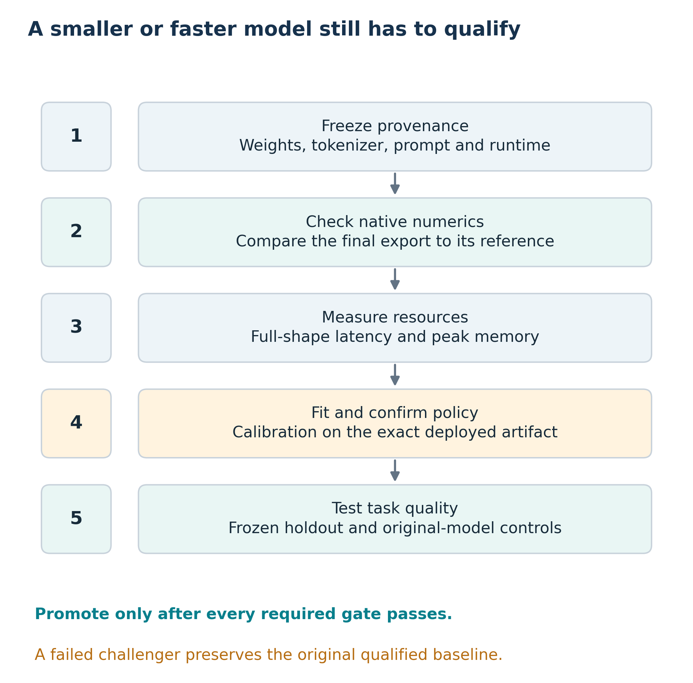

**Figure 10.** Qualification joins provenance, numerical fidelity, resource measurements, calibrated decisions and held-out task outcomes. A component check alone does not establish end-to-end usefulness.

## Frozen promotion gates

| **Scope** | **Required rule from the source** | **Practical interpretation** |
|----|----|----|
| MiniLM retrieval | Recall@10 at least 0.85 and complete set at least 0.70 | Both broad retrieval and full evidence coverage must qualify |
| MiniLM improvement | At least 0.03 absolute improvement over each original control on both U8 and S8 | A gain in one precision profile cannot hide regression in another |
| Optional stages | Completion at least 0.75 | The complete task must meet an absolute quality floor |
| Optional stage comparison | No more than 0.02 absolute below the strongest baseline | The specified tolerance is checked against the best simpler control |
| Optional stage efficiency | At least 10 percent fewer agent turns on jointly solved tasks | Quality and efficiency are assessed together |
| FP32 reference export | Absolute error at most 0.001 for the applicable checks | The base export must preserve the reference calculation |
| Quantized export | Raw drift at most 0.25, mass drift at most 0.05, identical argmax | All applicable numerical conditions must pass |
| Context resource profile | p95 at most 120 seconds under the 8192 token and 120 second budget | Qualification applies to the defined workload and runtime |

These are the supplied frozen rules, not thresholds chosen to make a later run look favorable. The at most 0.02 rule allows up to two percentage points of completion difference under that gate; it is not permission to ignore the separate 0.75 floor. The 0.03 improvement is three percentage points, not a three percent relative increase. \[[<u>1</u>](#ref_1)\]

## Evaluate turns without hiding failures

For the jointly solved subset, a simple relative turn saving divides the baseline turns minus candidate turns by baseline turns, using the aggregate definition chosen before evaluation. Median per task savings and a ratio of total turns are different statistics; freeze the intended one. \[[<u>1</u>](#ref_1)\]

``` math
Turn\ saving\  = \ 1\  - \ \frac{\sum_{q\  \in \ S}^{}{T_{candidate}(q)}}{\sum_{q\  \in \ S}^{}{T_{baseline}(q)}}
```

In this equation, S is the jointly solved task set and T is the turn count for each configuration. It shows the ratio of summed turns, one possible frozen aggregation rule.

Always report the full completion results as well. A candidate that solves fewer tasks can appear efficient if its hardest failures disappear from the jointly solved subset. The conditional efficiency metric is useful only alongside the absolute and comparative quality gates.

Measure wall time, CPU use, peak resident memory, model startup, candidate counts, abstention, and the number of read steps as well. A reduction in remote agent work can coexist with a longer local wait. Whether the tradeoff is worthwhile depends on the user's workload.

## Component timings and complete loop timings

The historical Focus p95 of about 2.1 seconds and Compact p95 of 86.0 seconds are component observations. Adding percentiles or multiplying one by a candidate count does not yield a valid end to end p95. Dependencies, batching, concurrency, cold starts, and shared memory pressure change the latency distribution. \[[<u>1</u>](#ref_1)\]

A useful accounting model adds observed durations within each trace: retrieval, each rerank operation, each Context decision, each read, and serialization. Then calculate the desired percentile over complete traces. Record timeout and cancellation outcomes explicitly instead of dropping slow failures from the sample.

For an illustrative economic comparison, suppose an optional stage adds 40 seconds of local work and saves two agent turns that would each have taken 10 seconds. It saves agent work while increasing net wall time by about 20 seconds under those assumptions. If each avoided turn took 30 seconds, the same local cost could save about 20 seconds. These are teaching calculations, not AIRK performance estimates.

## One final evaluation per frozen candidate decision

Steps 13 and 14 calibrate the final artifact, confirm its decision policy, and evaluate the untouched FINAL split once for the promotion decision. A failure retains the original qualified weights. A later research cycle can change the candidate, but it cannot present repeated tuning against the same FINAL cases as a fresh held out result. \[[<u>1</u>](#ref_1)\]

The final release receipt records pass and fail results, sample counts, exclusions, environment, selected model identity, and rollback identity. A completed qualification process produces a defensible selection, including the choice to retain a simpler baseline.

# 12 Deployment identity and recovery

## Deploy a compatible bundle

An operational release includes model weights, graph files, tokenizer, input recipe, output mapping, numerical profile, runtime expectations, calibration policy, and index identity where applicable. These components must be selected together. The qualified three profile optional catalog contains Focus, Context Compact, and Context Large alongside the bundled MiniLM retrieval identity. \[[<u>1</u>](#ref_1)\]

The catalog makes explicit which action classes and numerical profiles are supported. It records completed data acceptance, adaptation decisions, export qualification, calibration, held out evaluation, and recovery information. A baseline selected after a challenger fails is a valid final entry, not an unfinished training task.

## Rebuild embeddings when their meaning changes

Step 15 assigns a new embedding identity to a promoted MiniLM model and re-embeds the entire corpus. The system must never query old document vectors with new query vectors. This rule also applies to changes in tokenizer, pooling, or preprocessing that alter the embedding space even when the weight filename and dimension appear familiar. \[[<u>1</u>](#ref_1)\]

The transition can prepare a new index beside the old one, validate it, and switch the active release reference atomically. Requests already in progress should remain bound to a consistent snapshot or restart under an explicitly new identity. Mixing two snapshots within one evidence packet makes debugging and citation interpretation harder.

Rollback restores the former encoder and its corresponding document vectors together. Restoring only the executable or weight file leaves the system internally inconsistent if the active vectors were rebuilt for a different model. Calibration and recipe identities must also match the restored release.

## Estimate storage separately from runtime memory

As a direct arithmetic example, one million FP32 vectors of 384 coordinates require 1536000000 bytes for the coordinates alone, approximately 1.536 GB or 1.431 GiB. This excludes the ANN graph, identifiers, text, metadata, alignment, working memory, and any compression. An actual index can have a very different total size depending on its representation.

Likewise, a 6.9 GB model payload does not imply a 6.9 GB peak process. Activations, buffers, runtime allocation, memory mapping behavior, and concurrent work affect resident memory. The historical Compact observation of approximately 15.1 GB peak RSS illustrates why payload size and measured memory need separate fields. \[[<u>1</u>](#ref_1)\]

Rebuilding alongside the existing index adds temporary disk and compute requirements. Recovery also requires retaining enough of the old bundle to restore it. These operational costs should be included when deciding how frequently model changes are worth deploying.

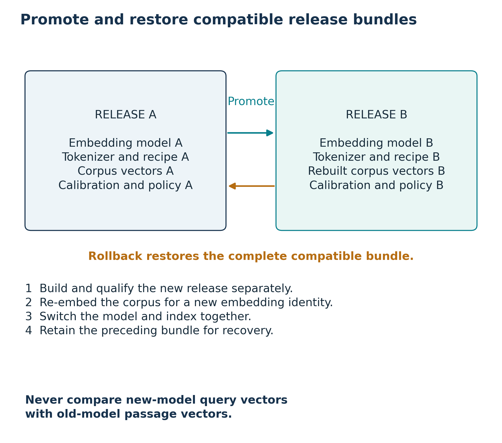

**Figure 11.** A promotion changes a compatible release bundle. When MiniLM changes, its corpus vectors must be regenerated, and rollback restores the former model and former index together.

## An illustrative release manifest

The following is a conceptual checklist expressed as YAML. It is not an existing AIRK configuration schema and contains no invented production hashes.

release:\
identity: recorded release identifier\
source_revision: full authenticated revision\
weights_digest: recorded SHA-256\
graph_digest: recorded SHA-256\
tokenizer_digest: recorded SHA-256\
prompt_recipe_digest: recorded SHA-256\
runtime_profile: recorded provider and kernel configuration\
embedding_identity: matching encoder and pooling identity\
index_identity: compatible corpus snapshot\
calibration_receipt: exact artifact and class policies\
final_evaluation_receipt: frozen gates and observed results\
rollback_identity: prior compatible release bundle

Actual manifests need complete machine valid values, explicit file sets, and no abbreviated digests. A checksum mismatch stops loading; it should not be repaired by accepting whatever file happens to be present.

## Observe behavior without turning inference into training

A useful trace identifies the release, query, candidate sources, rejected oversized inputs, roster, scores, winner, margin, policy outcome, validation outcome, read duration, gaps, and stop reason. The trace should make a source of failure distinguishable from its symptoms. For example, a timeout, an unsupported terminal, and a low margin are different reasons to stop.

Operational logging does not update weights. Any use of collected examples in a later adaptation program follows the same source acceptance, partitioning, label provenance, and qualification workflow. This preserves the source's invariant that using Arbiter does not train the models. \[[<u>1</u>](#ref_1)\]

Read only retrieval also needs accurate citations. Repositories change after indexing, so the evidence packet should identify the revision or content digest used for each span. If a file is no longer the indexed version, the host must apply its defined freshness policy rather than silently present an old vector match as current source evidence.

# 13 Pros cons and choosing a deployment

The main benefit of AIRK's staged design is that it assigns different kinds of uncertainty to different components. Retrieval asks where evidence might be. Focus asks whether a candidate addresses the question. Context asks which available read would reduce an unresolved gap. AIRK retains control of what can be read, how much work can be done, and when a proposed action is admissible. This separation makes the system easier to inspect and evaluate, but it creates several artifacts, interfaces, and evaluation responsibilities instead of one.

A useful deployment is the least expensive configuration that meets the workload's evidence requirements. The relevant expense includes latency, memory, disk space, index maintenance, labeling effort, calibration, and the calling agent's work. A stage earns its place through measured benefit on representative tasks. Its presence, parameter count, or plausible reasoning does not establish that benefit.

## Comparing the retrieval configurations

| **Configuration** | **Useful properties** | **Main limitation** | **Decision to evaluate** |
|----|----|----|----|
| Lexical retrieval only | Simple execution; strong handling of exact identifiers, literal messages, and known terms; no embedding lifecycle | Relevant evidence can use different words from the question | Does the task distribution mostly provide precise search terms? |
| Hybrid retrieval only | Combines exact-term matches with semantic neighbors; passage embeddings are reusable | Nearest vectors can be topically similar without proving the requested fact | Is candidate recall sufficient without pairwise judging? |
| Lexical retrieval plus Focus | Joint query-passage assessment can improve ordering within the lexical candidate set | Focus cannot score evidence lexical retrieval omitted | Is poor ordering, rather than missing candidates, the main problem? |
| Hybrid retrieval plus Focus | Broad candidate discovery followed by a more detailed relevance assessment | Adds pairwise inference and strict input-fitting requirements | Does reranking improve useful evidence enough to justify its cost? |
| Hybrid retrieval plus Focus and Context | Adds bounded choice of subsequent reads based on the question and accumulated evidence | Highest runtime and qualification burden; constrained by menu quality | Do additional decisions improve complete evidence on difficult tasks? |

These are evaluation configurations, not a universal ranking from worst to best. An exact-symbol lookup may be complete after lexical retrieval. A question about behavior spread across implementation, tests, and configuration may benefit from hybrid retrieval and additional reads. A broad question can remain unresolved even with every stage enabled if the relevant passage is absent from the index or the necessary read never enters the menu.

## Why separating the stages can help

### Expensive reasoning is applied to a bounded set

MiniLM encodes document passages when the index is built and encodes the query once during retrieval. Focus spends more work on the selected query-passage pairs. Context spends its work on a small menu of actions. This allocation makes it possible to reserve the most expensive scorer for the point where its judgment could change the next read.

The tradeoff is a dependency between stages. A correct passage omitted early cannot be rescued by better downstream judgment. A useful passage that is retrieved but poorly packaged may still be unscoreable under the Focus limit. A useful next action that is never offered cannot win a Context decision. Candidate recall, visible evidence, and menu coverage are therefore prerequisites for interpreting model scores.

### Each component can be evaluated against an appropriate question

Retrieval can be tested for recall and evidence-set completeness. Focus can be tested for pairwise relevance and the effect of reranking. Context can be tested for useful reads, premature stopping, abstention, and the final evidence packet. Export checks can examine numerical parity separately from task behavior.

This separation supports diagnosis. If exact vector search finds a passage that DiskANN misses, the immediate investigation belongs in the approximate index. If both find it but Focus lowers it below irrelevant results, inspect the input recipe and relevance scorer. If the right candidates are present but the next menu omits the needed test, inspect menu construction. Training without this diagnosis can spend considerable effort on the wrong component.

### Bounded choices make execution easier to control

Context selects a complete card from a roster built by AIRK. The card binds an action to its gap, reason, and source hypotheses. This gives the host a concrete object to validate before reading. Restricting the output to permitted choice symbols also avoids the need to interpret an arbitrary generated path or command.

The remaining risk is semantic. A model can select a poor card, prefer a misleading reason, or choose a premature terminal action. A correctly serialized card is not necessarily useful evidence. The action boundary is valuable because AIRK can enforce permissions and budgets independently; it does not make relevance judgments infallible.

## Where the approach becomes expensive

### A small output does not imply cheap inference

Context returns only a handful of scores, but its transformer still processes the prompt through all layers. Restricting the output head reduces output work and avoids a generated response sequence; it does not remove prefill computation. A long prompt containing cards and context can therefore be expensive even when the visible result is a single letter.

The historical source illustrates this cost. Compact's full 8,192-token resource run reported a 20-sample p95 of 86.0 seconds and approximately 15.1 GB peak RSS. The same source recorded approximate FP32 artifact payloads of 6.9 GB for Compact and 16.1 GB for Large. These are observations from that evaluation environment. \[[<u>1</u>](#ref_1)\] They are not performance promises for another machine or evidence that every short decision costs the same amount.

Focus also adds repeated pairwise work. Its historical 20-sample p95 of approximately 2.1 seconds describes a component measurement. The component value comes from the historical source. \[[<u>1</u>](#ref_1)\] Multiplying that percentile by a candidate count does not produce a statistically valid end-to-end p95. Batching, concurrency, input shape, startup behavior, and shared resource contention affect the total. Measure the actual retrieval configuration with the intended candidate counts and hardware.

### The operational artifact is larger than the weights

A deployment includes the tokenizer, prompt recipe, padding rules, truncation or refusal behavior, output-token mapping, pooling, numerical profile, index identity, and calibration record. Their versions must remain compatible. A smaller model file does not remove this management work.

Changing MiniLM creates a further cost: document embeddings must be regenerated under the new embedding identity. Keeping the same vector width does not make old and new embeddings interchangeable. A safe transition maintains a compatible model-and-index pair, and recovery restores both. Teams should include rebuild duration, duplicate storage during transition, and index availability in the deployment decision.

### Adaptation requires evidence that fits the runtime

Training examples must represent the inputs the deployed model can see. Labels beyond a truncated prefix teach a relationship that the inference interface cannot reproduce. Hard negatives need screening so that another valid evidence passage is not used as a false negative. Context examples need useful actions, balanced answer positions, and labels that distinguish acceptable alternatives from unsafe stopping.

The work also extends beyond training. A candidate must survive export, numerical checks, calibration, and held-out evaluation. Every material change to weights, prompt, or export can require renewed calibration. This is a real engineering cost, and it explains why retaining publisher weights after a completed evaluation can be a sound result.

## Interpreting quality and efficiency honestly

### Fewer turns can conceal missing evidence

An agent that stops early may use fewer turns while producing a worse answer. Evaluate complete evidence and task success before treating reduced interaction as an improvement. The source's efficiency gate compares agent turns on tasks both configurations solve, alongside separate quality requirements. That conditional comparison is useful, but it does not describe failures or wins unique to either configuration.

Report both sides: overall completion and evidence quality across the full test set, then efficiency on the jointly solved subset. Also inspect elapsed time and resource use. A local scorer can reduce the calling agent's work while increasing total wall time. Whether that is acceptable depends on the user's task and the value of the resulting evidence.

### Calibration trades coverage for a more selective policy

A larger required margin can cause more abstentions. That may reduce accepted mistakes, but it can leave more decisions to fallback behavior or the calling agent. A configuration that accepts almost nothing can satisfy a narrow zero-error observation while providing little utility. The generic Read admission minimum is therefore a gate, not a complete quality report.

Terminal decisions deserve separate analysis because their effects differ. An incorrect Read can waste a bounded step; an incorrect Sufficient can end the search before necessary evidence appears. Class-specific qualification, independent confirmation, and explicit abstention help manage that asymmetry. Zero observed failures still leaves statistical uncertainty, particularly when examples are few, correlated, or drawn from a narrow repository family.

### Reproducibility improves diagnosis without proving correctness

Pinned inputs, hashes, fixed recipes, recorded environments, and deterministic settings make comparisons more informative. They help identify whether a change came from weights, data, the retrieval index, or the runtime. They do not guarantee that the dataset is representative or that the labels capture every important case.

Exact reproducibility also depends on the execution environment. Different hardware, library versions, kernels, and numerical implementations can change results. Record these conditions and validate the artifact that will actually run. A successful Python experiment is useful development evidence; native evaluation establishes the behavior of the delivered profile.

## Security and information boundaries

Local inference can keep model execution near the indexed material, but information handling still depends on the entire workflow. The evidence packet is passed to the calling agent, whose own configuration determines what happens next. Local scoring alone is not a guarantee about downstream storage or transmission.

Escaping prompt delimiters prevents source text from directly breaking the serialized message structure. It does not stop source prose from trying to influence the scorer's interpretation. Treat indexed content as evidence to assess, not instructions that grant authority. Keep authorization, path validation, budget checks, and allowed actions in host code. A model's high score must not expand those permissions.

Read-only execution limits what the retrieval component can change, but the quality of selected information still matters. An omitted contradiction, stale configuration default, or persuasive irrelevant passage can mislead the agent. Source identity, citations, explicit gaps, and stop reasons make these failures easier to inspect and challenge.

## A practical selection procedure

First define representative tasks and the evidence needed to consider each one complete. Include exact lookups, vocabulary mismatches, cross-file behavior, conflicting sources, and questions whose answer is genuinely unsupported. Define acceptable latency and resource limits before comparing configurations.

Next establish lexical and hybrid baselines. Verify the index and compare exact vector search with DiskANN so infrastructure defects do not masquerade as model weakness. Record both retrieved evidence and missing evidence, not merely a single aggregate score.

Then add Focus to the same task set and inspect whether its ordering changes help. Track rejected oversized pairs and confirm that the model receives the actual evidence relevant to the label. A gain on a few attractive examples is a reason to investigate, not enough to establish a broad benefit.

Add Context where repeated reads are part of the task. Inspect whether useful reads enter the menu, how often the policy abstains, whether terminal choices are supported, and which gaps remain in the resulting packet. Compare complete task outcomes and total resource consumption with the strongest simpler configuration.

Finally select and freeze a profile with its full recipe, runtime evidence, calibration, and recovery path. Retain the simpler configuration as a control and an operational fallback. Reevaluate when the workload, source distribution, or artifact changes enough to invalidate the original comparison.

## Troubleshooting matrix

| **Symptom** | **Likely layer to inspect** | **First diagnostic** | **Corrective direction** |
|----|----|----|----|
| Exact names are missed | Lexical index and source coverage | Confirm the source is indexed and the expected term is searchable | Repair indexing, tokenization, or filtering before training |
| Relevant meaning is missing from candidates | Semantic retrieval and candidate budget | Compare exact vectors, DiskANN, and hybrid results | Repair ANN behavior or candidate construction; then assess encoder quality |
| Dense results are topical but unhelpful | Embedding objective and passage boundaries | Inspect which visible spans support the question | Improve evidence labels, chunking, or reranking |
| Focus rejects many pairs | Prompt size and input assembly | Count complete prompt tokens including special tokens | Build valid evidence windows or adjust candidate packaging |
| Focus disagrees with expected relevance | Input recipe, labels, or scorer | Inspect exact native prompt and yes/no mapping | Correct serialization or label scope before adaptation |
| Context cannot choose the useful read | Menu construction | Check whether a valid useful card was offered | Improve card generation and coverage |
| Context favors one letter | Position effects and adaptation data | Permute equivalent cards and compare outcomes | Balance positions and examine prompt dependence |
| Many decisions abstain | Calibration and roster margins | Separate unsupported-class wins from small-margin wins | Improve evidence or policy coverage without bypassing gates |
| Search ends without necessary proof | Terminal policy and completion labels | Inspect the winning class, qualification, and unresolved gaps | Correct terminal qualification and preserve explicit unresolved evidence |
| Export has the same winner but fails drift limits | Numerical graph and quantization | Compare raw logits and probability mass against the exact reference | Reject or repair the artifact; retain the passing profile |
| New weights appear better only with a new index | Experimental controls | Run the weights-by-recipe comparison and exact-vs-ANN checks | Attribute improvements to the changed component |
| Results degrade after a model update | Embedding identity and calibration | Verify matching model, tokenizer, vectors, and policy record | Restore a compatible bundle or complete the rebuild |
| Turn count improves but users wait longer | Full request timing | Measure retrieval, reranking, decision, reads, and agent time together | Use the configuration that meets the task's joint quality and latency needs |

The purpose of this matrix is to localize the next investigation. It is not a claim that every symptom has one cause. Preserve the failing input, exact artifact identities, and observed outputs so a repair can be compared against the same case and a representative held-out set.

# 14 A practical tutorial for reproducing the method

## Start with a controlled question set

Choose a small set of repositories you are authorized to use and record their exact revisions. Define questions that require exact identifier lookup, terminology matching across different wording, multiple evidence units, a contradiction, and an answer that the available files cannot justify. Write the required units and acceptable evidence spans before running a model.

This initial exercise is a development lab. It is not large enough to establish the source's promotion thresholds or terminal risk bounds. Its purpose is to make the contracts observable and expose mistakes before expensive training or export work begins.

Prepare an evidence worksheet with question ID, source revision, required unit, accepted span, tokenizer identity, visible token count, split, and label origin. Exclude a positive when its supporting span is outside the deployed input. Record that exclusion so a high discard rate becomes a visible design signal.

## Exercise one inspect an embedding calculation

Use a two dimensional example to understand the 384 dimensional production calculation. Let the included token vectors be (3, 0) and (0, 4), followed by a padding position with arbitrary values. The attention mask is (1, 1, 0). The masked mean is (1.5, 2), its length is 2.5, and its normalized vector is (0.6, 0.8). Its dot product with a unit query vector (1, 0) is 0.6.

Change the padding vector to a million in both coordinates. The embedding must remain unchanged because the attention mask excludes it. If the result changes, the pooling implementation is using the wrong positions. This small calculation tests the meaning of the recipe without requiring a trained model.

Next inspect a real tokenized passage near the 256 position boundary. Mark the exact tokens that contain the evidence. Count the tokenizer's special positions as part of the complete input. Compare this view with the full source to see why a valid human citation can still be an invalid training example for the chosen window.

## Exercise two inspect the Focus prompt

Construct the exact baseline template from Chapter 4 using a short question and a supporting passage. Verify the yes and no vocabulary IDs using the pinned tokenizer, then count the complete assembled prompt. Confirm left padding and the expected decision location.

Repeat with a passage containing a literal chat delimiter and inspect the escaped representation. Then repeat with a deliberately oversized pair and confirm the compiler's refusal path. These checks concern the input contract; they do not require claiming that the model is resistant to every adversarial document.

For a selected pair, inspect the two logits and manually compute the restricted softmax. Change the instruction only, keeping the weights and passage fixed, to see how F1 is a real behavioral experiment. Keep its results separate from the baseline until its recipe is frozen and evaluated.

## Exercise three replay bounded decisions

The following Python example uses only the standard library. It demonstrates global winner selection, margin checks, and abstention after an unsupported terminal wins. It is an intentionally small teaching function, not a replacement for AIRK's authority validation, tokenizer, or runtime.

from math import isfinite\
\
def decide(cards, scores, qualified, cutoffs):\
\# Only structurally live cards enter this example.\
if len(cards) != len(scores) or len(cards) \< 2:\
raise ValueError("Need matching live cards and scores")\
if not all(isfinite(s) for s in scores):\
return "abstain", "nonfinite score"\
\
order = sorted(range(len(scores)),\
key=lambda i: scores\[i\], reverse=True)\
winner, runner_up = order\[:2\]\
margin = scores\[winner\] - scores\[runner_up\]\
action = cards\[winner\]\["kind"\]\
\
if not isfinite(margin):\
return "abstain", "nonfinite margin"\
if margin == 0:\
return "abstain", "tie in this teaching policy"\
if not qualified.get(action, False):\
return "abstain", "winning class is unsupported"\
cutoff = cutoffs.get(action)\
if cutoff is None or not isfinite(cutoff) or cutoff \< 0:\
return "abstain", "invalid acceptance policy"\
if margin \< cutoff:\
return "abstain", "winning margin is too small"\
\
\# The host must still validate authority and budget.\
return cards\[winner\]\["id"\], "eligible for host validation"\
\
cards = \[\
{"id": "A", "kind": "Read"},\
{"id": "B", "kind": "Read"},\
{"id": "C", "kind": "Sufficient"},\
\]\
qualified = {"Read": True, "Sufficient": False}\
cutoffs = {"Read": 0.5}\
\
print(decide(cards, \[3.0, 2.0, 1.0\], qualified, cutoffs))\
print(decide(cards, \[3.0, 2.0, 4.0\], qualified, cutoffs))

The first call returns A as eligible for host validation. The second abstains because Sufficient wins and is unsupported. It does not return A as a replacement. Try an exact tie, a nonfinite score, and a Read margin below 0.5. Each should have a distinct explainable outcome. The actual production tie rule must be frozen in its own policy; this example chooses abstention for clarity.

The first return value is deliberately an eligibility result. Before executing a read, the real host rechecks the card's identity, allowed source, freshness policy, and remaining budget. Keeping that final validation outside the score function is part of the architecture.

## Exercise four separate representation and task checks

Start with an authenticated publisher checkpoint and the recorded baseline export recipe. For MiniLM, inspect train_encoder.py, verify_encoder_inputs.py, export_encoder.py, and safe_int8.py using the file map. The source documents --baseline-original as the baseline export option; consult the actual script's argument definitions for all other invocation details. \[[<u>1</u>](#ref_1)\]

Compare reference and native outputs on the prescribed numerical fixtures. Record cosine agreement, L2 distance, norm error, and finiteness for embeddings. For Context, record raw score differences, the exact mass drift metric, argmax, and the short and full length input shapes. Do not substitute a few correct task answers for these numerical checks.

Then run the retrieval task set against lexical, exact vector, DiskANN, and hybrid controls. Add Focus only after candidate coverage is visible. Add Context only after the roster contains useful choices. This sequence prevents a downstream model from being blamed for missing source material or a malformed menu.

## Exercise five confirm the statistical boundary

Calculate the zero failure upper bound directly with Python: 1 - 0.05 \*\* (1 / 299). The result is about 0.009969, or 0.9969 percent. Repeating the calculation with 298 gives a value just above one percent. The difference is small, yet a frozen rule should still distinguish them.

Now ask what the sample actually represents. Were the observations accepted Sufficient decisions under one fixed policy? Were they independent? Were they chosen after inspecting failures? Were closely related states duplicated? The calculation is simple; qualifying its assumptions is the more consequential work.

## Exercise six rehearse promotion and recovery

Create two explicit bundle identities in the development lab. Associate each with its encoder recipe, tokenizer, corpus vectors, and policy record. Intentionally pair the second query encoder with the first index and confirm that identity validation refuses the mismatch before retrieval.

Prepare a compatible new index, run its evaluation, and switch the active bundle reference. Then restore the former bundle and confirm that queries use the former vectors as well as the former model. Retain citations to source revisions in both cases. A rollback rehearsal is successful when the restored system has a coherent identity and observable behavior, not merely when an older file loads.

## The completed workflow in operational order

| **Step** | **Completed activity** | **Evidence retained** |
|----|----|----|
| 7 | Freeze and diagnose the baseline | Runtime and artifact identities, exact versus ANN controls, visibility and menu coverage |
| 8 | Accept software evidence data | Rights and split decisions, human gold scope, exact visible spans, exclusions |
| 9 through 11 | Run the triggered model and prompt experiments | Training settings, checkpoints, controls, adaptation decisions |
| 12 | Resolve conditional adaptation branches | Trigger decisions and receipts for any branch executed |
| 13 | Calibrate the final native artifact | Class policies, fitted thresholds, independent confirmation |
| 14 | Evaluate the frozen final candidate | Untouched FINAL results and all quality, numerical, and resource gates |
| 15 | Promote or retain with recovery | Selected catalog, compatible embedding index, prior bundle, recovery check |

This order gives the tutorial its practical purpose. A team can inspect the data the model saw, reproduce the computation it performed, explain why a score was accepted, and restore a compatible earlier release when a change fails to justify its cost.

# Appendix A Implementation file map

The paths below are retained from the technical source record. Paths are relative to the AIRK repository or its associated artifact workspace. The selected Qwen preparation scripts are identified as private in that record. The map distinguishes the selected implementation from the superseded exporter. \[[<u>1</u>](#ref_1)\]

| **Purpose** | **Path** |
|----|----|
| Final lifecycle plan | docs/arbiter/final-plan.md |
| Weight adaptation plan | docs/arbiter/weights-v2-plan.md |
| Training documentation | docs/arbiter/training.md |
| MiniLM training | tools/retrieval-train/train_encoder.py |
| MiniLM export | tools/retrieval-train/export_encoder.py |
| Safe integer arithmetic | tools/retrieval-train/safe_int8.py |
| Input verification | tools/retrieval-train/verify_encoder_inputs.py |
| Original frozen rules | tools/retrieval-train/a0-freeze.json |
| Software evidence frozen rules | tools/retrieval-train/software-v2-freeze.json |
| Focus prompt and readout | crates/airk-retrieval/src/arbiter/compiler/focus.rs |
| Context prompt and action cards | crates/airk-retrieval/src/arbiter/context_action.rs |
| Qwen native compiler | crates/airk-retrieval/src/arbiter/compiler/qwen.rs |
| Superseded exporter | tools/retrieval-train/qwen_export.py |

The superseded qwen_export.py supported the four earlier Intern, Strands, and Kev candidates. It is not the export path for the selected Focus, Compact, and Large Qwen3 profiles.

## Selected private preparation artifacts

The selected Qwen root is artifacts/advanced-split/models/qwen3-challengers-r1/. Within that root, qwen3_reference_r2.py implements the reference scorer, full-stages-r4/export_scores_r4.py implements the selected export, and context-weight8-r3/quantize_context.py implements the Context W8 preparation experiment. The authenticate routine establishes manifest, revision, file set, and tensor provenance before loading.

The complete paths are retained here for lookup:

> • artifacts/advanced-split/models/qwen3-challengers-r1/qwen3_reference_r2.py
>
> • artifacts/advanced-split/models/qwen3-challengers-r1/full-stages-r4/export_scores_r4.py
>
> • artifacts/advanced-split/models/qwen3-challengers-r1/context-weight8-r3/quantize_context.py
>
> • artifacts/advanced-split/models/native-onnx-storage-normalization-r1/normalize_focus_artifact.py

# Appendix B Historical inspection and decisions

The originating technical inspection recorded the shell identity as tyai\tdotn. It reported reading the plan documents, MiniLM trainer and exporter, INT8 helpers, private Qwen3 export and W8 scripts, and Rust Focus and Context prompt builders. It reported changing no files. These are provenance statements about that originating inspection. \[[<u>1</u>](#ref_1)\]

At that point, AIRK had performed weight training experiments only on MiniLM. The three Qwen models used publisher weights prepared for AIRK's runtime through export, numerical checks, and Focus compression. None of the deployed baseline weights had been replaced by AIRK fine tuning. MiniLM's trained candidates had failed their promotion gates, so the baseline catalog retained original MiniLM, publisher Focus W8, and publisher Compact and Large FP32. \[[<u>1</u>](#ref_1)\]

Those decisions should remain intelligible after the full lifecycle is completed. Training an adapted candidate and retaining a publisher baseline are compatible outcomes. Finishing qualification also does not change the recorded values of an earlier failed diagnostic.

The historical evidence explains seven recurring controls. Input recipes are part of the effective model. Small selected evaluations need their denominators. Infrastructure changes require separate attribution. Compression needs numerical checks beyond argmax. Dataset separation prevents leakage. Sufficient requires stronger evidence because it can stop the search. Finally, downloads approaching 16 GB, roughly 15 GB of measured memory, and decisions exceeding 80 seconds require demonstrated task value. The exact component observations and their limitations appear in Chapters 3, 4, and 6. \[[<u>1</u>](#ref_1)\]

# Appendix C Additional terminology

| **Term** | **Practical meaning** |
|----|----|
| ANN | Approximate nearest neighbor search, which trades some exactness for a different cost profile |
| DiskANN | A graph based nearest neighbor indexing and search system used for the vector retrieval route |
| BF16 | A 16 bit floating point format used by the authenticated Context source checkpoints |
| FP32 | A 32 bit floating point representation used for the baseline Context exports and selected sensitive operations |
| W8 and W4 | Weight quantization profiles using nominal eight or four bit weight representations |
| QAT | Quantization aware training, which incorporates quantization effects into the adaptation procedure |
| SFT | Supervised fine tuning on labeled target outputs |
| Prefill | Processing the input sequence through the transformer before any next token decision |
| Tied head | An output projection that shares parameters with the token embedding matrix |
| False negative | A genuinely relevant item that a learning objective incorrectly treats as irrelevant |
| Hard negative | A screened incorrect item that is challenging because it resembles the correct evidence |
| Menu coverage | Whether the offered action roster contains a valid useful next read |
| Evidence visibility | Whether the exact supporting content is inside the model's deployed input window |
| Abstention | A recorded refusal to accept a model choice under the applicable policy |
| RSS | Resident set size, a process memory measure distinct from model file size |
| p95 | The 95th percentile of a specified measurement distribution, whose meaning depends on the sample and procedure |
| Gold label | A human adjudicated label accepted under the source's D03 policy |
| DAgger | Dataset aggregation for training on states induced by a learned policy; adapted here as an offline workflow |

# Appendix D Sources and further reading

Reference numbers in the text distinguish AIRK implementation evidence from public descriptions of the underlying methods. The source record supplies AIRK specific paths, settings, historical results, and frozen rules. The public references explain the model families, numerical formats, learning methods, and statistical foundations. The arithmetic teaching examples are derived in the relevant chapters.

<span id="ref_1" class="anchor"></span>\[[<u>1</u>](#ref_1)\] AIRK technical source record. How AIRK's model weights work a tutorial. User supplied markdown in Pasted text(3).txt, including the originating inspection, implementation contracts, historical experiment results, file map, and lifecycle steps.

<span id="ref_2" class="anchor"></span>\[[<u>2</u>](#ref_2)\] Sentence Transformers. all-MiniLM-L6-v2 model card. Vector width, masked mean pooling, normalization, and the sentence embedding input limit. [<u>https://huggingface.co/sentence-transformers/all-MiniLM-L6-v2</u>](https://huggingface.co/sentence-transformers/all-MiniLM-L6-v2)

<span id="ref_3" class="anchor"></span>\[[<u>3</u>](#ref_3)\] Qwen. Qwen3-Reranker-0.6B model card. Query and document instruction format, left padding example, and yes versus no logit readout. AIRK's fixed 512 token export remains a separate deployment constraint. [<u>https://huggingface.co/Qwen/Qwen3-Reranker-0.6B</u>](https://huggingface.co/Qwen/Qwen3-Reranker-0.6B)

<span id="ref_4" class="anchor"></span>\[[<u>4</u>](#ref_4)\] Qwen. Qwen3-1.7B and Qwen3-4B model configurations. Dense architecture, tied token embeddings, head dimension, rotary position setting, BF16 source dtype, and sliding window configuration. These public main branch pages explain the architecture; production authentication uses the full pinned revisions in the release manifest. [<u>https://huggingface.co/Qwen/Qwen3-1.7B/blob/main/config.json</u>](https://huggingface.co/Qwen/Qwen3-1.7B/blob/main/config.json) [<u>https://huggingface.co/Qwen/Qwen3-4B/blob/main/config.json</u>](https://huggingface.co/Qwen/Qwen3-4B/blob/main/config.json)

<span id="ref_5" class="anchor"></span>\[[<u>5</u>](#ref_5)\] ONNX Runtime. Quantize ONNX models. Integer formats, CPU kernel behavior, saturation in certain U8S8 instruction paths, and hardware dependent performance considerations. [<u>https://onnxruntime.ai/docs/performance/model-optimizations/quantization.html</u>](https://onnxruntime.ai/docs/performance/model-optimizations/quantization.html)

<span id="ref_6" class="anchor"></span>\[[<u>6</u>](#ref_6)\] ONNX. External Data. Representation of tensor data outside the main ONNX protobuf and associated loading and checking requirements. [<u>https://onnx.ai/onnx/repo-docs/ExternalData.html</u>](https://onnx.ai/onnx/repo-docs/ExternalData.html)

<span id="ref_7" class="anchor"></span>\[[<u>7</u>](#ref_7)\] PyTorch. Reproducibility. Limits of reproducibility across releases and platforms, random seeds, and deterministic algorithm settings. [<u>https://github.com/pytorch/pytorch/blob/main/docs/source/notes/randomness.md</u>](https://github.com/pytorch/pytorch/blob/main/docs/source/notes/randomness.md)

<span id="ref_8" class="anchor"></span>\[[<u>8</u>](#ref_8)\] Hu and colleagues. LoRA Low Rank Adaptation of Large Language Models. 2021. The low rank adapter method used as the foundation for the Focus and Context adaptation recipes. [<u>https://arxiv.org/abs/2106.09685</u>](https://arxiv.org/abs/2106.09685)

<span id="ref_9" class="anchor"></span>\[[<u>9</u>](#ref_9)\] Subramanya and colleagues. DiskANN Fast Accurate Billion Point Nearest Neighbor Search on a Single Node. NeurIPS 2019. The graph based approximate search method; its published benchmark results are not AIRK benchmark results. [<u>https://www.microsoft.com/en-us/research/publication/diskann-fast-accurate-billion-point-nearest-neighbor-search-on-a-single-node/</u>](https://www.microsoft.com/en-us/research/publication/diskann-fast-accurate-billion-point-nearest-neighbor-search-on-a-single-node/)

<span id="ref_10" class="anchor"></span>\[[<u>10</u>](#ref_10)\] Dasigi and colleagues. A Dataset of Information Seeking Questions and Answers Anchored in Research Papers. 2021. Introduces QASPER and its evidence oriented question answering task. [<u>https://arxiv.org/abs/2105.03011</u>](https://arxiv.org/abs/2105.03011)

<span id="ref_11" class="anchor"></span>\[[<u>11</u>](#ref_11)\] van den Oord, Li, and Vinyals. Representation Learning with Contrastive Predictive Coding. 2018. Background for the InfoNCE contrastive objective. [<u>https://arxiv.org/abs/1807.03748</u>](https://arxiv.org/abs/1807.03748)

<span id="ref_12" class="anchor"></span>\[[<u>12</u>](#ref_12)\] Ross, Gordon, and Bagnell. A Reduction of Imitation Learning and Structured Prediction to No Regret Online Learning. AISTATS 2011. The dataset aggregation method and the problem of learning from states induced by a policy. [<u>https://proceedings.mlr.press/v15/ross11a.html</u>](https://proceedings.mlr.press/v15/ross11a.html)

<span id="ref_13" class="anchor"></span>\[[<u>13</u>](#ref_13)\] NIST and SEMATECH. Engineering Statistics Handbook section 7.2.4.1 Confidence intervals. Exact binomial confidence limit construction. Chapter 9 derives the zero failure one sided special case and states its assumptions. [<u>https://www.itl.nist.gov/div898/handbook/prc/section2/prc241.htm</u>](https://www.itl.nist.gov/div898/handbook/prc/section2/prc241.htm)
