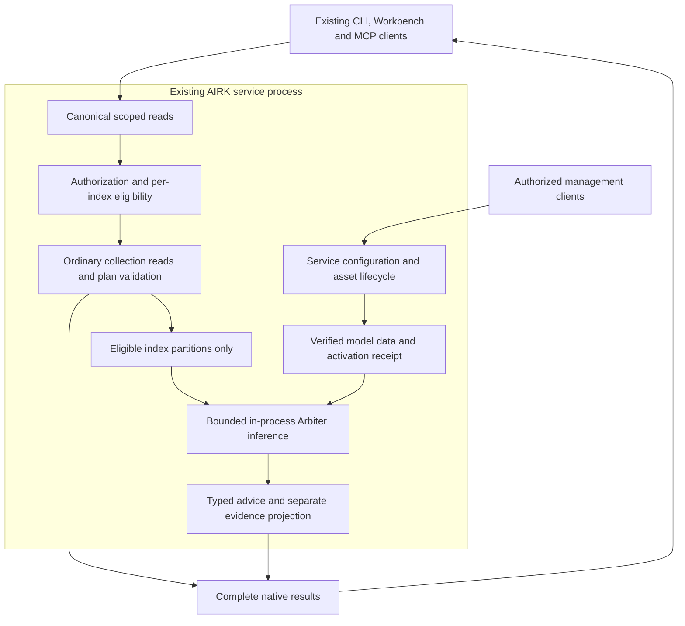

# AIRK Arbiter: Service Integration and Model Preparation Plan

Original concept: 10 November 2026 · @Tyler Jensen

Revised: 12 November 2026 · proposal only; no implementation or model qualification is claimed.

AIRK keeps MiniLM INT8 built into its installer and service executable for semantic indexing and retrieval. The first model-improvement priority is better training of that embedded encoder, followed by export and qualification of the INT8 artifacts. Semantic indexing remains available independently of Arbiter and requires no optional model download.

AIRK Arbiter is a separate, optional capability inside the same service, turned off by default. It scores bounded retrieval choices and evidence relevance, returning typed advice or abstaining. Its target catalog contains four additional models: two smaller choices and two larger choices. Users explicitly choose the indexes that may use it and a model that passes both system-requirement qualification and current resource-availability checks. The service downloads only the selected model's missing data assets and runs it inside its existing process.

There is no Arbiter add-on, separate installer, additional executable, model server or required Python environment. AIRK's existing `airk` service and `airkctl` client remain the executable inventory. Model preparation, training where needed, native export, calibration and evaluation happen before a model becomes a selectable product option.

## 1. Decisions and review boundary

### Fixed product requirements

- Arbiter ships as part of AIRK, disabled by default. Enabling it is an explicit management action, never a consequence of an ordinary read.
- MiniLM INT8 remains bundled in every installer and embedded in the service executable. It is the semantic-indexing foundation, not one of the four optional Arbiter choices; Arbiter disablement or unavailability never disables ordinary semantic indexing.
- Improve the MiniLM encoder's retrieval training first. Training only decision heads over frozen embeddings does not satisfy that objective. A changed encoder requires its own model identity, INT8 qualification and supported index-regeneration plan before shipment.
- Enablement is per index. A service-wide switch permits or suspends the capability; it never implicitly enrolls every index. New or recreated indexes start with Arbiter off.
- Offer exactly two smaller and two larger Arbiter model choices, with backend/precision profiles under those four model identities. Only qualified compatible profiles with sufficient current resources can activate. The service owns downloads, verification, loading, switching, rollback and removal.
- Inference code ships with AIRK. Downloaded bundles contain model data and declarative metadata only, not executables, scripts, native plugins or custom operators supplied by a model repository.
- No agent reasoning loop, generator routing, edits, commands, test orchestration, cloud inference or external database is added. Arbiter advises on local, bounded retrieval; existing callers retain action authority.
- Existing explicit reads, scope checks, publication identities, source locations, budgets, review requirements and failure reporting remain authoritative. Source workspaces remain read-only.
- Training is a developer preparation workflow, outside the installed product. Enabling Arbiter neither trains a model nor authorizes collecting workspace content for training.

These decisions replace the original sidecar, separate-install, host-controller and machine-wide shared-store proposals. The former `airk-arbiter` binary and `airk-embed` connector are not implementation options.

### Review ledger for this document

| Item | Boundary or evidence |
| --- | --- |
| Acceptance | Improve embedded MiniLM retrieval training while retaining bundled INT8 semantic indexing; exactly two smaller and two larger optional Arbiter models; global default off and per-index opt-in; system qualification plus live availability; no new executable; preparation before product inclusion |
| Allowed change | Only `docs/arbiter/concept.md`; no code, other documentation, configuration, dependency or version edits |
| Source baseline | Initial review at `02158a4c53aadffcac15196b3075bf7250dca98a`; narrowed model/training revision checked against live HEAD `d45dd144a0646427af857ea915c94e6c0c2b1bf4`, with unrelated working changes present. Source review, not a built or released baseline |
| Required corrections found | Prior shortlist mixed the bundled encoder with optional choices and lacked two larger alternatives; frozen-head training alone would not improve semantic embeddings; static hardware fit did not fully specify runtime resource availability |
| Unconfirmed hypotheses | MiniLM adaptation gains after INT8 export; each optional model's quality/native support; measured per-profile requirements and coexistence with normal service workloads |
| Intended validation | Complete consistency review; local Markdown-link and whitespace checks; repository checks from CONTRIBUTING where runnable; confirm the edit boundary. No model downloads, training, native builds or runtime qualification for this prose change |
| Prior review/checks | Previous revision passed independent reviews and local document checks; its repository check stopped on an existing broken link in `docs/history/airk-feature-review.md` to `packages/vscode/src/explorerWebview/manage.tsx`. These are retained prior observations, not validation of this revision. Native formatting, Clippy and workspace/runtime tests are outside this document-only edit |
| Current revision checks | Independent model-catalog and embedded-training reviews passed. Local links, fenced blocks, whitespace and the independently specified two-smaller/two-larger catalog passed. Repository checks again stopped at the same unrelated historical link; no native/model qualification was run |
| Investigation checkpoint | Initial review bounded to 15 minutes; extend only for a named acceptance blocker |

The [architecture](../architecture.md), [process model](../process-model.md), [read parity](../read-interface-parity.md), [split contracts](../split/contracts.md) and [simplification plan](../simplify-plan.md) govern future implementation. This concept does not approve unresolved wire/state decisions, crate extraction, later simplification milestones or a restart of installed-editor repair. Arbiter is future feature work, not Track R stabilization; keep any structural preparation separate from behavior changes.

## 2. Service and index configuration

### Two levels of control

The following names describe proposed contracts, not existing commands or settings.

| Level | Proposed configuration | Meaning |
| --- | --- | --- |
| Service installation | `enabled`, `selected_profile`, approved asset source, resource ceilings | Permits Arbiter and selects one qualified profile; global off suspends scoring for every index |
| Individual index | Stable index identity, `enabled`, allowed task set, configuration revision | Explicitly includes or excludes that index; absence means disabled |
| Request | Authorized index scope, task, byte/token/deadline budgets | Narrows permission; cannot enable Arbiter or override an index's exclusion |

Effective eligibility requires service enablement, that index's enablement, ordinary request authorization, an allowed task, a profile qualified for the current system, a verified loaded bundle, and current resource admission. Installation-time hardware fit does not guarantee availability later. Arbiter enablement grants no index access. A client cannot enable it through a tool-read argument, prompt, imported plan or repository text.

Bind enrollment to installation/catalog identity and immutable index identity, never to a display name or path alone. Rename preserves the choice. Deletion, recreation, import into another installation or a clean-break reset does not silently transfer consent. Retain configuration through upgrades only under the existing supported state contract; do not invent a migration exception.

The first implementation uses one selected Arbiter profile per service installation, shared by its explicitly enabled indexes. Per-index enablement is mandatory; different simultaneously resident models per index are outside the first release. Each index can use only tasks qualified for the profile and its evidence types. An unavailable task returns a reason rather than silently switching models.

### User flow

1. In AIRK management, choose **Enable Arbiter**, select indexes, and choose from two smaller and two larger model entries. Show unsupported, unqualified or temporarily constrained entries with reasons; only eligible entries can activate. Existing indexes remain unchecked unless explicitly selected. Bulk selection names current identities, never future indexes.
2. Show supported tasks, license notices, download bytes, peak disk requirement, measured memory/latency limits and platform qualification beside current resource observations. Distinguish missing assets, unsupported systems and temporary resource pressure. MiniLM semantic indexing remains a separate bundled capability.
3. The enable/apply action authorizes provisioning of that exact profile for the chosen indexes. With no indexes selected, report incomplete configuration and do not implicitly download a model.
4. The service downloads missing assets, verifies them and rechecks available resources before warming. Report readiness only after qualification fixtures pass. While provisioning or resource-constrained, indexes continue ordinary lexical and MiniLM semantic behavior with Arbiter pending or unavailable.
5. Expose progress, cancellation, retry, profile change, per-index disablement, global disablement and explicit asset removal. Closing the UI does not transfer ownership away from the service.

The service is the configuration authority. CLI and Workbench/Admin submit the same authorized management operations; MCP exposes equivalent supported reads without turning the public read endpoint into a management interface. No client loads its own model. Exact commands and UI labels follow review of the owning native contracts.

### Exclusion and mixed-index reads

- An opted-out index contributes no content, features, candidates or cached decisions to Arbiter. Its retrieval, ordering, completeness and continuations use ordinary AIRK behavior. Sharing public weights does not share index state.
- Partition a multi-index request by authorized index before assembling model input. Score eligible partitions independently; preserve native results for excluded partitions. Do not apply a learned global filter or rank to excluded results.
- Report per-index application: applied, disabled, unavailable, unsupported or budget-limited, with selection/omission metadata where applicable. Do not label the whole response as Arbiter-processed or silently drop an index.
- Preserve each partition's publication and continuation. A projection is not a complete cross-index answer. If the canonical operation cannot represent mixed processing faithfully, return its ordinary result and an explicit not-applied reason.
- Cache keys include index identity, publication, authorization scope and configuration revision. Disabling an index cancels queued work, invalidates its advice cache and suppresses in-flight decision delivery. Recheck eligibility at dispatch and delivery.
- Cancellation cannot erase content already admitted to native execution. Report draining until execution completes; keep model and resource ownership pinned. Once disablement is acknowledged as drained, no later decision may consume that index's content.
- Disabling the last enabled index unloads Arbiter after safe drain. Public assets may remain cached. Disablement and removal are separate operations; neither deletes an index or changes original sources.

Per-index inference opt-in is not training consent. Private adaptation would require a separate dataset authorization and isolation contract; it is outside initial product delivery.

## 3. Compatibility and scope

| Surface | Required behavior |
| --- | --- |
| Existing reads | Global off or an excluded index preserves existing input semantics and full results; exact bytes for digested formats, parsed equality elsewhere, normalizing only documented transport identities/timing |
| Process inventory | One resident service per installation; no Arbiter process, model endpoint, Python subprocess or extra installer |
| Indexes/publications | No re-index, replacement embedding representation or automatic schema migration for enabling Arbiter; DiskANN remains the selected vector engine |
| Embedded MiniLM | Semantic indexing stays bundled and independent of Arbiter. Shipping retrained/requantized encoder weights is a separate versioned change requiring representation identity and supported regeneration; never mix old document vectors with new query embeddings |
| Parse/plan contracts | Keep request/plan shapes, digests, bindings, confirmation policy and limits; advice has a separately reviewed versioned contract |
| Explicit choices | Explicit commands, direct tool arguments, selected operations and reviewed plans bypass learned route selection |
| Recoverable model failure | Loading, capacity, scoring and qualification failures expose unavailable reasons; ordinary permitted reads remain usable |
| Budgets | Preserve native byte/read/fan-out limits; model tokens, inference time and selection work are separate bounded costs |
| Usage reporting | Preserve the content-free ledger and experiment semantics; no invented provider-token savings |
| Clients | Complete equivalent CLI, Workbench and MCP read data/inputs; projections are disclosed, never reduced replacements |

New capabilities and persisted enrollment records still require the applicable decisions in [simplify-plan.md §9](../simplify-plan.md#9-decisions-for-the-user), especially D8. Before writing state, prove schema identity against retained `airk-state/1` fixtures or obtain approval for a new state contract. A separate asset directory is not an exemption.

## 4. Architecture and ownership

### Owners and live integration seams

No new crate is proposed. Add owned modules and narrow facades inside existing crates, respecting documented dependency edges.

| Owner | Responsibility | Source to inspect before implementation |
| --- | --- | --- |
| `airk-core` | Cross-owner task, advice, profile/status and configuration contracts only | [Workbench](../../crates/airk-core/src/workbench.rs), [service](../../crates/airk-core/src/service.rs) |
| `airk-retrieval` | Catalog, tokenization, native scoring, feature recipes and calibration primitives | [model catalog](../../crates/airk-retrieval/src/model_catalog.rs), [model assets](../../crates/airk-retrieval/src/model.rs), [compute scope](../../crates/airk-retrieval/src/native_inference.rs) |
| `airk-kernel` | Collection eligibility, bounded reads, proposal preparation and selection | [Workbench](../../crates/airk-kernel/src/workbench.rs), including `parse_text` |
| `airk-cli` | Service inference lifecycle, admission, provisioning, drain and management | [service inference](../../crates/airk-inference/src/service_inference.rs), [inference owner](../../crates/airk-inference/src/inference_engine/pool/owner.rs), [completion ledger](../../crates/airk-inference/src/inference_completion_ledger.rs) |
| `airk-store` | Ownership-checked persistence, quotas and cleanup | [store filesystem contract](../../crates/airk-store/src/store_fs/CONTRACT.md); define state ownership before records |
| `airk-mcp` | Canonical read schemas, handlers and full result conversion | [Workbench adapter](../../crates/airk-mcp/src/workbench.rs) |
| `airkctl`, Workbench/Admin | Presentation and authorized service requests | [service tool path](../../crates/airk-service/src/service_runtime/tools_call.rs), [CLI contract](../../crates/airkctl/src/contract/CONTRACT.md) |

Core gains no inference, filesystem or scheduler implementation. `airkctl` keeps its restricted dependencies. Evidence stays on the scoped worker/read path, outside the serialized metadata actor. Extend service inference ownership; do not add a second Workbench scheduler or recursive MCP calls.

The embedding catalog validates specific MiniLM profiles. Reuse its principles and owner, not a relaxation allowing arbitrary models through its embedding contract. Arbiter has task-qualified descriptors and never silently replaces the embedding model or existing vector identities.

### Request flow

1. Validate authority, index identities, publication and budgets; capture relevant configuration revisions.
2. Run explicit commands and deterministic grammar first. For remaining eligible bounded reads, build candidates from implemented catalogs and verified target inventories.
3. Select a task supported by the chosen profile. Compile inputs from enabled partitions only; reject unsupported or over-budget inputs before admission.
4. Score in-process, apply applicability/calibrated acceptance policy, and recheck scope/configuration before delivery.
5. Prepare accepted recommendations through canonical handlers. Native code resolves targets and validates arguments; learned acceptance does not authorize execution.
6. Optionally project evidence from the complete original result, preserving coverage, warnings and continuations for every index.

### Native ownership and fault boundary

Retain the actual exclusive service lease through synchronous native calls, as required by `ServiceComputeScope`. Timeout or disconnection suppresses delivery but does not establish completion. Admission charges, model pins, memory and completion obligations remain until native execution finishes.

Switching, disablement, shutdown and removal wait for observed completion, not fixed sleeps. A stuck call opens the appropriate circuit and reports unresolved drain; it is not safely unloaded. Recovery follows existing service ownership rules, without spawning another inference executable.

Threads do not isolate access violations, aborts or driver crashes. Embedded inference shares the service failure domain. Recoverable failures can disable Arbiter; a native crash can affect the whole service. Backend qualification and restart/recovery evidence are release gates. Omit a model that cannot meet this boundary; do not introduce a sidecar fallback.

## 5. Model choices and embedded execution

### Bundled foundation and four optional choices

MiniLM INT8 remains the always-bundled semantic foundation, using the supported CPU exports embedded in AIRK. Improve its encoder training through section 8's preparation path. It is neither an optional download nor an entry in the Arbiter selector. See [AIRK's bundled profiles](../onnx-models.md) and the [MiniLM publisher card](https://huggingface.co/sentence-transformers/all-MiniLM-L6-v2).

The target Arbiter catalog is exactly the following two smaller and two larger models. IDs are proposed product identities. Publisher cards were checked on 12 November 2026; none of these models is yet AIRK-qualified. Pin complete upstream revisions, assets and notices before experiments.

| Group / proposed ID | Model choice | Intended role and preparation | Qualification boundary |
| --- | --- | --- | --- |
| Smaller / `arbiter-small-intern-08b` | [Intern-Decision-0.8B](https://huggingface.co/internlm/Intern-Decision-0.8B) | Lowest nominal size in this catalog; evaluate bounded routing/relevance, then adapt on AIRK examples where needed | Apache-2.0 publisher metadata; preserve exact template, option order and symbol-logit positions in native execution |
| Smaller / `arbiter-small-strands-2b` | [Strands Decider 2B](https://huggingface.co/StrandsAgents/strands-decider-2B-qwen3.5-v1-2610) | Alternative compact decision model; evaluate and specialize its trained adapter/readout for AIRK tasks | Apache-2.0 publisher metadata; package the required Qwen base, adapter and head together; Python reference serving is not the product path |
| Larger / `arbiter-large-intern-4b` | [Intern-Decision-4B](https://huggingface.co/internlm/Intern-Decision-4B) | Larger alternative in the Intern family for tasks where measured quality justifies its cost | Apache-2.0 publisher metadata; independently qualify its weights, scoring/export, calibration and hardware profile; the smaller sibling's receipt does not transfer |
| Larger / `arbiter-large-kev-4b` | [Kev-4B](https://huggingface.co/jaredpalmer/kev-4b) | Alternative larger decision model with a pointer head; train/adapt only for measured task gaps | Apache-2.0 publisher metadata; complete base/adapter/head, faithful native pointer scoring and separate resource/quality evidence |

The two larger choices are alternatives at similar nominal scale, not successive performance or hardware tiers. Size is not proof of quality, speed or memory fit. Each larger choice must demonstrate useful task coverage or quality beyond the smaller options at an acceptable measured cost. Review actual model/base/data terms and notices, not only metadata labels.

LiquidAI d1 is removed from the active plan; no fifth model or general-LLM catalog is proposed. Backend/precision variants remain profiles of these four choices and do not count as extra models. Frozen-MiniLM head experiments may serve as developer baselines, but are not another shipped Arbiter option.

Prepare models sequentially, starting with the embedded MiniLM improvement and then the two smaller and two larger candidates. The four-choice feature is complete only when two models in each group pass their gates. A failed slot stays unavailable with its reason; it is not filled by an unqualified artifact or a silently substituted model. Any replacement requires a reviewed revision to this four-slot plan.

### Product profile contract

A selectable profile binds the complete immutable bundle: base weights, head/adapter, tokenizer, compiler/template, candidate mapping, masks, pooling/readout, precision, backend, service runtime build, calibration, policy, task versions and evidence recipe. A model name alone is insufficient.

The catalog exposes:

- Stable profile ID, upstream revision, complete file hashes, notices and license decisions.
- Supported tasks, languages, evidence types, candidate limits and context profiles.
- Required AIRK contract/runtime versions and qualified OS, architecture, CPU features, backend/device and driver ranges.
- Exact context/candidate/concurrency profile; download and peak installed bytes including staging/rollback; measured RAM/VRAM peaks, service/display reserves and latency evidence.
- Qualification receipt and status: research, prepared, qualified or withdrawn. Only qualified compatible profiles are selectable.
- Selected versus actually active profile, including failure or rollback reasons.
- Separate release qualification, system fit, current availability and asset readiness, with observation time, reason and permitted recovery. MiniLM semantic readiness is reported independently.

Recommend the smallest qualified profile that meets the user's task needs and current resource budget, using measured evidence rather than model size alone. Users can select any eligible choice. Pin that choice: no hidden substitution, automatic revision upgrade, cloud fallback or trying models until one is confident. Temporary pressure preserves the selection and falls back explicitly to ordinary AIRK reads, including existing MiniLM semantic capability.

### Runtime strategy

Prefer existing statically linked ONNX integration where it reproduces the complete computation. Decoder support, masks and readout must be demonstrated; an ONNX file does not prove compatibility with AIRK's shipped runtime version or operators.

For the Intern pair, reproduce the exact question compiler, placeholder positions and typed score extraction. For Strands and Kev, preserve each trained adapter/head computation; ordinary decoder logits do not replace a pointer or learned readout head. Test tokenization, masks, scores and policy outcomes against each model's reference implementation. Sharing a model family may reuse code but does not transfer qualification.

A pinned embedded library/shim is an alternative only if the full decision path passes reference fixtures and packaging gates. Reference server support is not an embeddable API guarantee. AIRK never starts `llama-server`, Ollama, vLLM or Python serving for Arbiter. Native support is an unresolved gate for every optional choice.

Runtime code belongs in the normal AIRK build and sealed dependency inventory. Model downloads cannot install backend DLLs, execute repository code, load unreviewed custom operators or install drivers. Unsupported backends remain unavailable until a qualified AIRK build supports them.

## 6. Provisioning, activation and storage

### Asset manifest and trust

Use a release-approved catalog authenticated by the distribution trust mechanism, with pinned digests and exact lengths. An untrusted download's hash is not authenticity proof. Define catalog signing and verification ownership before implementation.

The manifest declares data roles, approved sources/mirrors, transfer/expanded sizes, tokenizer/head/base dependencies, notices, compatibility, fixtures and rollback disk requirements. Fetch only the selected precision and required text assets. Never clone whole repositories or fetch URLs from prompts, evidence or arbitrary model metadata.

Store assets in installation-owned, user-private content-addressed storage outside sources and index contents. Reuse public immutable weights across enabled indexes in that installation. Private examples, features, adapters and caches retain index/user isolation. Cross-user sharing is outside this plan.

### Lifecycle state machine

| State or transition | Required behavior |
| --- | --- |
| Disabled | No scoring, automatic downloads or Arbiter model allocation; ordinary AIRK behavior |
| Enable/apply | Validate management authority, explicit index roster, compatibility, notices and resources; capture operation/configuration identity |
| Downloading | Service-owned bounded transaction with progress, cancellation and retry details; private staging, size limits and validated paths/redirects |
| Verifying | Verify catalog trust, lengths/digests, complete inventory, tokenizer/head bindings and safe data formats before loading |
| Warming/qualifying | Load under service ownership; run native reference fixtures, memory probe and first inference. Downloaded is not ready |
| Ready | Atomically activate the bundle; receipt binds service build, profile, backend, hardware/driver, fixtures and configuration generation |
| Qualified but resource-constrained | Preserve selection/enrollment and report the scarce resource; deny new Arbiter admissions while ordinary reads continue. Safely drain before unloading if needed; do not imply missing qualification or silently downgrade |
| Switching/draining | Stop admissions, await actual native completion, unload safely, warm replacement and update active identity atomically |
| Failed/unavailable | Preserve reason/recovery options; ordinary reads continue; partial assets never become active |
| Disable/remove | Revoke eligibility, drain, unload; remove only explicitly selected owned assets without active/rollback references |

Interrupted downloads retain bounded resumable state only for the same authorized operation/manifest. On restart, reconcile cancellation and configuration generation; never resume canceled or superseded selections. Verify complete bytes before activation. No background polling for model revisions is required.

Keep the previous qualified bundle on disk during updates. With one resident model, switching may temporarily make Arbiter unavailable. Failed replacement may restore the verified prior bundle, disclosing selected versus active identities and rollback reason. Failed rollback remains unavailable. Disk-full, corruption, cancellation and restart recovery need independent fixtures.

Startup may warm verified assets for a previously enabled configuration. Missing assets require explicit reprovisioning; reads and ordinary startup do not authorize new downloads. Offline import uses the same authenticated bundle and verification through management.

### Qualification, system requirements and current availability

Use three separate gates. Passing one does not imply the others, and none enables Arbiter without user opt-in.

| Gate | Required observations | Failure behavior |
| --- | --- | --- |
| Release qualification | Exact model/task/export/runtime/backend passes quality, calibration, native parity and package/platform tests | Mark profile unqualified; no product activation |
| System fit | Supported OS/architecture/CPU features, device/backend/driver, address space, measured RAM/VRAM limits and peak disk requirement | Show unsupported requirements; do not download/install drivers or new executable runtimes |
| Current availability | Available RAM/VRAM after AIRK/OS/display reserves, current device health, disk space for provisioning, bounded queue/concurrency capacity and remaining deadline | Report temporary unavailability; preserve selected model and index choices; use ordinary AIRK behavior |

Publish a measured requirements row for every qualified profile of all four models. Include minimum and recommended system resources, exact token/candidate/concurrency limits, peak load/warm/inference memory, transfer/staging/rollback disk, and cold/warm p50/p95/p99. No RAM or VRAM minimum is established by this concept. Measure the exact exported artifact before publishing a requirement; model-card sizes or advertised installed VRAM are not acceptance thresholds.

The qualification matrix covers CPU-only hosts as the bundled MiniLM baseline, smaller-model candidates on lower-memory systems, and both larger alternatives on higher-memory systems. Optional CPU, integrated/unified-memory and discrete-GPU execution each needs evidence; none inherits support from MiniLM. Windows, Linux, macOS and each backend require separate receipts. On unified-memory devices, budget against one shared pool rather than counting the same RAM as both host and GPU capacity.

Start model experiments at 2,048 total input tokens, one active optional-model request and a finite fair queue across enabled indexes. A 4,096-token or higher-concurrency profile needs separate qualification. Choose device test sizes from measured allocations; do not impose a universal 16 GB GPU floor or assume both 4B models have identical requirements.

Recheck resources before provisioning, before loading/warming and at inference admission. Reserve capacity when admitting work; an earlier free-memory observation is not a reservation. Include load-time peaks and the already resident MiniLM session. Revalidate qualification after relevant service/model/backend/driver/device changes. Cache static observations only against those exact identities, never treat an old machine probe as current free-memory evidence.

If another application consumes resources, stop new Arbiter admissions or use the already bounded queue within the original deadline. Do not terminate applications, silently reduce context/precision, offload to CPU, switch models or restart the service to manufacture capacity. Accepted native work retains its pins and charges until actual completion. When capacity returns, already enabled indexes may resume the same verified selected profile; no model download or enrollment occurs. An OOM, unhealthy device or failed warmup requires explicit recovery/probe evidence, not a retry loop.

Lexical reads, health and metadata do not queue behind Arbiter. Reserve ordinary MiniLM embedding/indexing capacity and bound optional inference threads/memory. Separate queues do not prove zero contention. Measure latency and progress for ordinary semantic indexing under optional-model load, including a noisy enabled index beside an excluded index. Global or per-index Arbiter disablement releases only Arbiter resources; it never unloads a MiniLM session still needed by normal indexing.

## 7. Decision and evidence contracts

### Initial tasks

Each task has an independent version, applicability definition, qualified model set and acceptance threshold. IDs are proposed.

| Task | Output | Boundary |
| --- | --- | --- |
| `airk.request_supported.v1` | Binary plus abstention | Supported bounded-read advice; authorization and mutation rejection remain deterministic |
| `airk.retrieval_route.v1` | Choice | Existing definition, occurrence, document/test-evidence routes; semantic/hybrid only where representations exist |
| `airk.recipe_choice.v1` | Choice | Implemented bounded recipes and verified targets; never invented plans/tools |
| `airk.evidence_relevance.v1` | Binary or ordinal rubric | Relevance for a selected projection; never filter exhaustive exact results |
| `airk.evidence_role.v1` | Choice or separately qualified multilabel | Declaration, constraint, example, test and defined roles; preserve evidentiary basis |

Qualify only tasks that pass their gates; the whole task catalog is not a release prerequisite. Claim support, next-agent-action and generator routing are outside the initial capability. Future bounded evidence expansion needs its own contract/evaluation without becoming an agent controller.

A fixed head cannot be repurposed by instructions. Flexible models are qualified per family, language, candidate count and context. Softmax is relative preference, not proof any option applies. Preserve sparse scorer integer/margin semantics rather than calling them probabilities.

### Advice envelope

Proposed `airk.arbiter.advice/1` stays separate from existing parse/plan formats.

| Field group | Required information |
| --- | --- |
| Execution identity | Task/version, immutable profile, runtime/backend, compiler, calibration and policy |
| Scope | Installation/catalog/index identity, authorization scope, configuration revision and exact publication |
| Evidence | Original hashes, representations and locations; no model-invented identities |
| Input/budget | Exact recipe, bounded input digest, bytes/tokens, candidate limits and consumed work |
| Outcome | Typed status, stable reason, registered answer/distribution where applicable, native-compiled recommendation |
| Operational detail | Queue/compile/inference/policy time, readiness and error/retry detail; no fabricated observations |

| Decision status | Meaning |
| --- | --- |
| `accepted` | Applicable and supported under calibrated policy/qualified profile; native validation and existing confirmation still apply |
| `abstained` | Insufficient confidence/evidence; no actionable answer |
| `unsupported` | Outside supported task/profile inputs |
| `invalid_input` | Malformed, stale/unresolvable or over budget; unchanged retry cannot fix it |
| `unavailable` | Missing model/backend/capacity, deadline or runtime failure; preserve reason and permitted recovery |

Decision outcomes, per-index not-applied reasons and provisioning states remain distinct. Disabled index, failure, accepted `false` and empty native result are different observations.

Literal parameters come from authorized input or verified inventory. Code compiles advice into ordinary prepare operations. Preparation is not execution; publication, binding, digest, scope and budget checks still apply. Retrieval supplies current facts; weights never replace repository state.

### Evidence packet

`airk.arbiter.packet/1` is an optional selected view of original records, never model-written prose or a replacement for complete results. Retain index/publication, source identities, locations, coverage, warnings, omissions, token/byte accounting, selection provenance and valid expansion routes.

Implement deterministic grouping/diversity first. Retrieve bounded candidates, measure recall, deduplicate overlaps, reserve mandatory metadata, then score optional records. Preserve intact excerpts and original basis. Retain identified contradictions/exceptions; if required evidence cannot fit, disclose the limit and expand through permitted reads or abstain. Do not assume the model identifies every contradiction.

Never filter exhaustive exact lookups or hide ambiguity, staleness, extraction gaps or truncation. Full results remain accessible under normal authorization/lifetime rules; expired continuations are not permanent copies. Cross-index packets follow section 2's exclusions.

If deterministic selection matches end-task quality, ship it and omit learned selection. Any exception to standing retrieval/ranking policy needs an evidence-backed review before implementation.

### Full client parity

Audit CLI `tools call`/shell and convenience reads, MCP tools/aliases, Workbench commands/forms/details, and JSON/Markdown copies/exports. Equivalent reads expose the same profile options, per-index configuration/application, readiness, provenance, coverage, continuations and error/retry data through the canonical owner. Summaries or selected subsets disclose scope.

Compare independent checked-in input catalogs and complete results, excluding only documented transport identities/timing. Exercise actual CLI/MCP transports where they reshape results; renderer mocks are insufficient. Configuration mutations keep management authorization and are never replayed as read retries.

## 8. Model preparation and training before product inclusion

### First priority: improve the embedded MiniLM encoder

The first deliverable is a better-qualified semantic encoder that still ships as MiniLM INT8 inside the normal AIRK installer and service executable. This work improves query-to-evidence retrieval across code, tests and documents. It does not depend on Arbiter being enabled, available or installed with optional assets.

1. Freeze the current bundled encoder, both CPU exports and a held-out semantic-retrieval benchmark. Record query/candidate sets, repository revisions, language/document slices, recall/ranking metrics and resource baselines before training.
2. Build adjudicated query-to-evidence pairs and triplets with relevant passages, hard negatives and no-relevant-evidence cases. Cover code identifiers, natural-language requests, tests and prose; retain general-document and language regression sets. Split by repository/family before augmentation, as below.
3. Domain-adapt the encoder offline with a retrieval objective, such as contrastive query/passage training with validated negatives. Compare against unchanged MiniLM and deterministic retrieval. Preserve the initial 256-token WordPiece, 384-dimensional masked-mean/L2 output and batch-one execution contract unless a separate change is justified and approved. The current pipeline is documented in [ONNX models](../onnx-models.md).
4. Export the trained checkpoint and requantize both supported signed/unsigned INT8 CPU profiles. Version weights, tokenizer/recipe, export tooling and calibration inputs; keep statically linked native inference and embedded asset delivery.
5. Evaluate the actual native INT8 artifacts: recall at fixed candidate budgets, ranking quality, hard negatives, language/document regressions, repeatability, memory and latency. Compare native/reference scores for the new candidate within declared tolerances; do not require its deliberately improved embeddings to equal the old model's vectors. Float-checkpoint gains alone do not qualify a release.
6. Promote only a candidate that improves the agreed retrieval outcomes while preserving regression/resource gates. Embed it in a versioned AIRK release and verify the built executable's asset inventory and real semantic-inference path. Otherwise retain the currently bundled model and record the failed training result.
7. Publish a supported semantic-vector regeneration/upgrade plan before distributing changed weights. [EmbeddingDescriptor](../../crates/airk-core/src/embedding.rs) binds the pipeline identity: even the same vector dimension does not make old and new embeddings compatible. Invalidate affected model caches and rebuild/re-embed affected representations through approved mechanisms; never relabel vectors or query an old vector index with the new encoder. Preserve lexical availability and report semantic readiness honestly during transition.

This is a distinct release step from Arbiter enablement. Enabling, disabling or switching Arbiter models never changes semantic representations or requires re-indexing. Shipping a trained MiniLM replacement can require semantic regeneration and must respect state-contract and upgrade decisions; this concept does not authorize a silent migration.

Frozen-MiniLM decision-head training may measure a cheap Arbiter baseline, but cannot be reported as improving semantic embeddings and does not create a fifth product model. MiniLM model improvement can ship independently once its own gates pass; it need not wait for all four optional models.

### Preparation artifacts

Prepare a reproducible developer workflow before incorporating models into the product. Existing [parser training](../../tools/parser-train/README.md) supplies provenance/split patterns, but its labels and legacy commands are not automatically valid for the current split or new tasks.

Each MiniLM or Arbiter experiment records a task card, dataset/split manifests, annotation rubric, baseline, training decision, configuration/seed/dependency lock, reference outputs, export report, calibration/policy report, untouched evaluation and artifact/notice inventory. Bind reports to source, data, model and runtime identities. Keep private data and raw index state out of commits, packages and published receipts. Semantic retrieval and typed-decision tasks have separate objectives, labels and acceptance criteria.

After the MiniLM experiment, prepare the two smaller and then the two larger Arbiter models with the same independently defined task suite. Measure each unchanged decision model first, train task-specific adapters/heads only for demonstrated gaps, then export and calibrate its complete scoring path. A larger model must justify its resource cost with measured outcomes; a missing task must be disclosed, not excluded from comparisons to make a model appear qualified.

| Stage | Work | Exit evidence |
| --- | --- | --- |
| A. Define | Labels, allowed operations, unsupported/no-valid-choice cases, error costs and acceptance floors before comparison | Reviewed task card and independent expected cases |
| B. Build data | Approved sources, adjudicated labels, deduplication and grouped splits before augmentation | Provenance/license manifest, annotation audit and leakage report |
| C. Baselines | Current MiniLM semantic retrieval; separately, rules/sparse scorer, deterministic selection, frozen-head experiments and each unchanged Arbiter candidate | Comparable held-out results for each objective and model group |
| D. Train | Domain-adapt MiniLM for retrieval; separately, train optional-model adapters/heads or distill for measured decision gaps | Reproducible checkpoints and resource/quality deltas; an optional model may qualify without further weight training, but not without AIRK evaluation/calibration |
| E. Export | Complete inference assets; reference tokenization, masks, positions, raw scores and typed outputs | Native/reference fixtures with declared tolerances and quantization effects |
| F. Calibrate/freeze | Rescore exact exported artifact; select thresholds on separate policy-selection partition | Per-task/slice calibration, precision-versus-coverage curves and frozen cascade policy |
| G. Untouched evaluation | Final held-out tasks/repositories after all choices freeze | Quality, uncertainty, failures and contamination report; no tuning on final results |
| H. Admit to integration | Review rights, full artifact inventory, quality, native compatibility and resources | Prepared immutable bundle; still not selectable until service/platform qualification passes |

Training must not follow deployment as an assumed repair for weak results. A failed gate returns the model to research under a new experiment identity; retain failed receipts and preserve thresholds. The embedded encoder improvement requires an actual training experiment. Pretrained Arbiter models may need only AIRK calibration/evaluation if their unchanged artifacts meet the gates.

### Data schema, labels and isolation

Each example identifies task/version, repository and observation revision, request family, authorized scope, candidate/source identities, evidence roles, language, label/abstention reason, annotation authority, license lineage and split/group IDs. Include no-valid-option, ambiguous/same-name targets, stale publications, partial extraction, contradictions, misleading tests, lexical distractors, negation and instructions inside evidence.

Split by repository, fork/clone lineage, issue/request family, symbol family and paraphrase origin before mining/synthesis. Keep train, development, calibration, policy-selection and final evaluation disjoint. Hold out whole repositories and families; audit public-benchmark overlap. Expanded rows are not independent samples.

Teachers may propose labels/soft targets; humans adjudicate uncertain and consequential cases. Record teacher identity, license, prompt and output provenance. Training examples confer no operation authority; learned recommendations never replace native scope checks.

Training traces need separate explicit permission, retention limits and local access controls. Arbiter enablement, including per-index enablement, is not that permission. Initial delivery has no online learning or automatic corpus collection.

### Public data and AIRK-specific examples

| Source | Appropriate use | Required caution |
| --- | --- | --- |
| [CoRNStack](https://huggingface.co/datasets/nomic-ai/cornstack-java-v1) | Candidate MiniLM retrieval-training and Arbiter relevance data | Metadata lists Apache-2.0; preserve underlying source terms. Docstrings do not establish real-request or role-label quality |
| [SweLoc / SweRank](https://arxiv.org/html/2505.07849v1) | Issue-to-code candidate methodology | Verify release terms before acquisition. Changed functions are weak positives; unchanged neighbors are unlabeled, not automatic negatives |
| Local issue-to-evidence set | AIRK routes, recipes, relevance and roles from approved repositories | Mine at the pre-fix revision. Gold patches inform annotation only; exclude future code/comments from inputs. Adjudicate unchanged contracts, callers and tests |
| [CoIR](https://arxiv.org/abs/2407.02883) and a frozen [SWE-bench](https://www.swebench.com/) slice | Independent evaluation with declared subsets | Audit lineage/overlap; exclude these cases from fitting/policy selection. Do not claim upstream pretraining is uncontaminated |
| AIRK templates and approved examples | Operation, applicability and recipe labels | Use the actual input catalog, include refusals/ambiguity, then independently adjudicate. Never derive expected labels from code under test |

Public retrieval data does not establish AIRK's authorization or recipe labels; these need AIRK-specific annotation. Permissive repository licenses do not settle rights to issue prose, copied material or teacher outputs. Keep per-source provenance and exclusion decisions. Never publish private examples or source/index state.

For feasibility, plan tens to hundreds of independently adjudicated examples per label, expanding for observed errors and confidence claims. This is not a release sample-size rule. Size accepted final populations per task/slice and disclose thin or correlated samples.

### Training resources and reproducibility

Start with a reproducible MiniLM encoder-training experiment, followed by sequential optional-model preparation. For adapter experiments, microbatch 1, short context, accumulation and checkpointing are measurement starting points, not proof of 16 GB feasibility. LoRA reduces trainable parameters; QLoRA does not remove activation memory. Serving INT8 or GGUF assets do not replace original trainable checkpoints. Training requirements are measured separately from the end-user inference requirements for each model.

Reference training may use pinned Python/PyTorch/PEFT on a suitable development host. It is not an end-user dependency and need not fit every serving machine. Record peak memory, hardware, time, seed and reproducibility limits. Never compete with production inference during training. Export approved data assets including every required head/readout.

### Quality gates

- MiniLM must improve agreed semantic retrieval metrics against the current bundled baseline after both INT8 exports, with general-document/language regressions and native resource costs included. Representation compatibility and regeneration readiness are separate release gates.
- All four optional models use the shared decision-task suite. The two larger models must justify their additional resources; no assumption that more parameters improves results. Report per-model supported tasks, quality/coverage and requirements side by side.
- Measure accepted precision versus coverage, applicability rejection, candidate-order sensitivity, language/evidence slices and error costs. Publisher benchmarks are not AIRK qualification.
- For selection, measure critical-evidence recall, contradiction/exception retention, packet reduction, follow-up reads and end-task quality against deterministic selection.
- Report reliability curves, Brier score and log loss where applicable. Recalibrate after changes to model, adapter, tokenizer, compiler, quantization or backend.
- Evaluate the complete route policy on the actual fallback population. Escalated cases are harder selected examples; component accuracy does not establish cascade quality.
- Preserve learned-parser review requirements. Confidence does not authorize execution or prove targets, scope and arguments correct.
- Freeze numeric floors before final evaluation; unresolved floors block qualification. Zero failures in 300 independent accepted cases supports only roughly a 1% upper error bound at 95% confidence, not 99.9% reliability.

## 9. Implementation work packages and gates

These dependency-ordered proposals are for later authorization. Finish each bounded package and review before the next; do not bypass simplification milestones or contract decisions. Preparation can establish evidence without enabling a product feature.

P1a–P1c and P3–P6 may exercise prepared artifacts through a private development qualification harness with explicit fixture/index scope. That path does not make an optional bundle user-selectable or relax production eligibility. Arbiter selection stays disabled until P7 reviews task, service and platform evidence and promotes a profile. Four-choice delivery requires both smaller and both larger slots to qualify; an individual machine can activate only the subset fitting its hardware and current resources. The MiniLM replacement has its own release gate and is not delivered through this selector.

| Package | Deliverable/owner boundary | Done when |
| --- | --- | --- |
| P0. Baseline | MiniLM retrieval benchmark plus Arbiter task suite, ordinary-result goldens, process inventory, test identities, per-index and resource-pressure cases | Quality and resource floors recorded separately for semantic indexing and optional decisions |
| P1a. Embedded MiniLM first | Domain-adapt encoder, export both INT8 CPU profiles, compare native retrieval, prepare new pipeline identity and approved regeneration path | Measured post-INT8 improvement and regression/resource gates pass; candidate remains bundled; separate normal-release/package gate before shipment |
| P1b. Two smaller models | Sequentially evaluate/train Intern 0.8B and Strands 2B; export complete scoring and calibrate; measure system requirements | Independent prepared bundles and receipts for both smaller slots; no product activation yet |
| P1c. Two larger models | Sequentially evaluate/train Intern 4B and Kev-4B against the smaller models; export/calibrate and measure requirements | Both larger slots demonstrate useful quality/coverage at an acceptable cost; failures remain explicit |
| P2. Contracts/state | Core-owned configuration/profile/status/advice/packet definitions, per-index semantics, authorization applicability and fixtures | Separate contract step reviewed/landed before consumers; D8/state approval resolved; no hand-written TS/Python mirror |
| P3. Embedded owner | Retrieval scorer behind a facade; service admission/completion/lifetime, disabled pending qualification | Reference agreement and ownership/cancellation/error checks pass; no new crate, executable or model endpoint |
| P4. Assets/index lifecycle | Provisioning, enrollment, revocation, switch, rollback, restart, cleanup and dynamic resource admission | Interrupted and resource-pressure cases pass; MiniLM retains capacity; excluded indexes never enter optional inference |
| P5. Canonical reads | Proposal assistance and deterministic packets first; learned selection only if qualified | Scope/publication, full-result preservation and mixed-index behavior pass native/transport parity |
| P6. Controls | Existing clients expose the two smaller/two larger choices, per-index settings, system-fit/current-availability explanations and separate MiniLM status | Service owns state; full parity; eligible choices only; global default off and new indexes excluded |
| P7. Platform/package | Frozen model/service artifacts, embedded MiniLM verification, process inventory, offline lifecycle and coexistence under resource pressure | Each promoted profile has full receipts; four-slot completion explicitly verified; ordinary AIRK usable without optional assets |

Each assignment names its component/`CONTRACT.md`, editable/excluded files, exact T0 command, independent goldens, consumed inputs and done condition. Update contracts for interface, state, invariant or lock/fence changes. The existing task ledger distinguishes source findings, actual reproductions, passing hypotheses and qualification.

### Validation ladder

1. **T0:** Pure qualification/system-fit/live-availability rules with injected resource observers/clocks; mixed-index partitioning, revocation, applicability, budgets, lifecycle and scoring fixtures. Protect independent four-slot catalog expectations and model/pipeline identities. Batch known sibling regressions after source investigation; zero selected tests fails.
2. **T1:** Format first; scoped `python scripts/dev-check.py -p <owning-crate>` with required features and Cargo timings, affected unit/contract/client checks. One Cargo owner and persistent target. Review the complete diff before proceeding.
3. **T2:** Freeze native, model, client, harness and fixture identities separately. Run matched-development preflight before packaged/installed checks: bundled MiniLM execution, optional model process inventory, offline assets, exclusions, actual CLI/MCP parity, rollback, runtime pressure and semantic-indexing progress. A trained MiniLM release also proves its supported representation-regeneration path.
4. **T3:** Follow [CONTRIBUTING](../../CONTRIBUTING.md) on reviewed frozen inputs: workspace Clippy/tests/doctests, repository/boundary/license checks and required package/platform gates. Scoped success is not full or cross-platform qualification.

Record exact commands, identities, selected tests, elapsed times and receipt paths before/after expensive runs. Required Cargo timing evidence includes scope, target directory and incremental setting. Stop on unexpected failure, collect the batch, classify production versus harness/prerequisite failures, review a coherent correction, then rerun only affected inputs. After two T2/T3 failures for a component, report the root cause and missing cheap seam before a third attempt. Never weaken thresholds or retry until green.

Before a future feature PR, remind the contributor to increment patch/build once and synchronize native/extension versions and lockfiles. Update README, documentation index, release notes and Marketplace/VSIX text to agree with implemented behavior. That is future work; this review changes only this concept.

### Required scenario matrix

| Dimension | Minimum evidence |
| --- | --- |
| Disabled baseline | Global off, excluded index, no profile, missing assets and unsupported host preserve ordinary reads/index formats |
| Embedded model training | Actual encoder training versus frozen-head baseline; both INT8 exports retain measured retrieval gains; new model/pipeline identity; old/new vector mixing rejected; supported regeneration and accurate readiness |
| Bundled delivery | Installer and executable retain both supported MiniLM INT8 profiles; offline semantic indexing works without Arbiter assets, opt-in or an additional executable |
| Four-choice catalog | Exactly two smaller/two larger model identities; independent expected catalog; precision variants are not extra choices; only qualified eligible subset activates |
| Index selection | Enable A only; B stays native; new C starts off; rename preserves A; recreation does not inherit enrollment; forged/cross-user identities rejected |
| Mixed scope | Partitions remain complete/separate; excluded content never reaches tokenizer/scorer/cache; per-index continuations/application reasons retained |
| Revocation | Disable during queue, execution and delivery; stale configuration cannot publish; pins/charges remain until actual completion |
| Isolation | Cross-index/user negatives for features, caches/private artifacts; shared weights do not transfer evidence or authority |
| Model selection | Compatible choices, exact selected/active identity, unsupported task, failed switch/rollback; no hidden substitute or read-triggered download |
| System fit | Unsupported CPU/OS/backend/driver; changed qualification identity; insufficient total RAM/VRAM/disk; unified-memory accounting; explicit reasons and no automatic runtime/driver install |
| Live availability | Qualified host becomes busy before load/admission; concurrent reservation; queue/deadline exhaustion; resource recovery on same selected model; OOM/device failure never treated as routine retry |
| Assets | Untrusted/corrupt manifest, wrong bytes, traversal/links, disk full, interrupted transfer, canceled/superseded restart, offline import and removal with live references |
| Native lifecycle | Deadline, OOM, owner/completion-persistence failure and stuck drain; no fabricated completion |
| Evidence | Stale publication, same-name ambiguity, extraction gaps, contradiction, no valid choice, embedded instructions and intact excerpts |
| Parity | Complete native/actual CLI/MCP results and input catalogs; Workbench details/copies/exports; no omitted state/errors/continuations |
| Resources | Per-profile cold/warm p50/p95/p99 and load/inference peaks; RAM/VRAM/disk, fair queues, sustained load, MiniLM reservation and ordinary indexing progress across enabled/excluded indexes |
| Package/offline | Existing executable inventory; no runner/DLL in model downloads; local content; inference with outbound network blocked |

## 10. Instrumentation and remaining decisions

Bound operational aggregates for task/route counts, outcomes, queues, inference and assets. Keep content, query hashes, source identities, prompts and unbounded labels out of ordinary usage reporting. Detailed provenance belongs in scoped responses or explicitly captured local qualification artifacts. Missing observations remain unknown.

Measure MiniLM training gains separately from Arbiter gains. First compare old versus trained INT8 semantic retrieval; then freeze the selected semantic baseline while comparing ordinary AIRK, deterministic selection and each optional model on the same tasks, source, generator and rubric. Record bytes/tokens, follow-up reads, latency, critical-evidence recall and outcome. Smaller packets do not prove fewer paid calls or savings. Preserve `paired_task` semantics; use a separately reviewed artifact for new experiments.

Model acquisition is the explicit network activity authorized by enable/apply or update. Requests, evidence, annotations and diagnostics are not uploaded. Test startup, inference, errors and saturation offline after provisioning. A local Arbiter does not make a hosted caller private; the host controls later evidence transmission.

### Decisions requiring evidence or review

- Which MiniLM training recipe improves native INT8 retrieval while preserving regressions, and what supported regeneration/upgrade path accompanies its new pipeline identity?
- What adaptation, if any, does each of the four named Arbiter choices need to meet shared task gates, and do both larger choices justify their cost?
- Which embedded runtime/backend reproduces scoring within packaging and ownership constraints?
- What measured per-profile minimum/recommended requirements, runtime reserves and availability observations qualify each platform without starving ordinary MiniLM work?
- Which model/base/data licenses permit distribution, and how is the asset catalog authenticated?
- Where do enrollment/activation records fit without altering state identity, or what separately approved contract is needed?
- What minimum precision, critical-evidence recall and overhead floors must each task meet?

These questions do not reopen bundled MiniLM INT8 semantic indexing, the two-smaller/two-larger catalog target, default-off Arbiter, per-index opt-in or the no-additional-executable requirement. A candidate that cannot qualify remains unavailable; any replacement is a reviewed change to the corresponding slot.

### Evidence and historical provenance

The earlier concept cited AIRK `b624b31c32c140d66c80f8daf3c62175e4719fcb` and unpublished inputs: *Extending AIRK with Decision Kernel*, *Decision Kernel, The Genesis of an Idea*, and *Decision Kernel, as Alternative to AI*. That baseline and its sidecar/controller sketches are historical context, not current architecture or measured evidence. Placeholder figures, unverified size/latency comparisons and conversational data notes have been replaced by this scoped plan.

This revision is a design review only. No candidate was downloaded, trained, benchmarked or qualified, and no service behavior is changed by this document.
