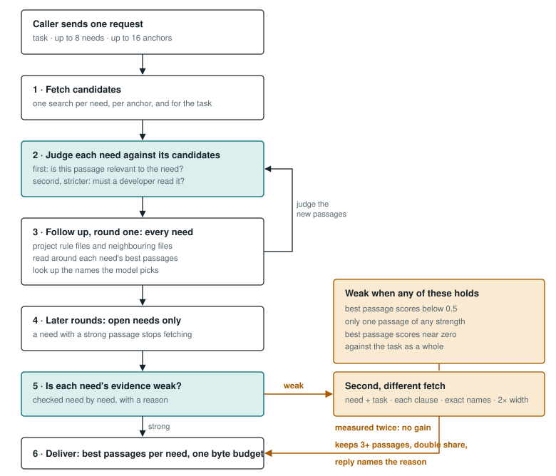

# The Gather Context loop, as prototyped

This page shows how the single-stage Arbiter loop works in the prototype of
26 November 2026, including how it treats a need whose evidence is weak. The
prototype runs outside the AIRK runtime. One model, Qwen3-Reranker-4B in
FP16, does every judging job. The kernel does not work this way yet. The
prototype exists to settle the design before it is built there.
[Prototype tool](../../scripts/arbiter-answer-eval/README.md#single-stage-arbiter-loop-prototype) · [Design](retrieval-strategy-combined.md#windows-cuda-model-comparison-and-iteration) · [Results record](../simplify/one-process-ledger.md)

<picture>
  <source media="(prefers-color-scheme: dark)" srcset="gather-context-loop-dark.svg">
  
</picture>

White boxes are fixed rules and read tools. Teal boxes are judgments by the
model. Amber boxes are the weak-need handling, which two runs showed adds
nothing on these tasks.

## What each part is for

- **Needs from the caller.** The calling agent states what it must learn.
  Each need is searched and judged on its own, so one broad task does not
  hide a specific question.
- **Two judgments by one model.** The relevance score alone saturates: many
  passages of a need score above 0.98, so their order is noise. A stricter
  second question breaks those ties. This is the work of the earlier Focus
  and Context stages, combined.
- **Round one stays open for every need.** One strong passage does not show
  that a need is covered. A run that let needs stop after the first search
  lost three passages in files it had already found.
- **Later rounds go to open needs only.** A need with a strong passage stops
  fetching, so the remaining time goes to the needs that lack evidence.

## Weak needs

A need is weak when any of these holds:

- its best passage scores below 0.5;
- it has only one passage of any strength;
- its best passage scores near zero against the task as a whole.

The rule is broad on purpose. The first weak rule, a best score below 0.2,
flagged one need in thirty, and missed needs whose required passages scored
near zero. It will be tightened from results.

A weak need gets:

- **a second fetch built differently from the first:** the need joined to
  the task text, each clause of the need searched alone, exact lookups of the
  names the need spells out, twice the search width, then a read around its
  new best passages;
- **more of the reply:** it keeps passages down to a third of the usual
  cutoff, at least three of them, and its share of the byte budget counts
  double;
- **a stated reason:** the reply names the needs that were weak and why, so
  the calling agent knows where to look for itself.

## Results so far

Four real tasks, two from each evaluation repository, with 21 required
passages in all. "Delivered" means the reply holds text that overlaps the
required lines.

| Run | Delivered of 21 | Munarium, of 10 | Bookbuilder, of 11 |
| --- | ---: | ---: | ---: |
| Kernel today, model off, with caller needs | 1 | 0 | 1 |
| Prototype, relevance judgment only | 9 to 11 | 6 to 7 | 3 to 4 |
| Prototype, with the second judgment | 12 | 9 | 3 |
| All dynamic rules, needs allowed to stop after the first search | 7 | 5 | 2 |
| Dynamic rules, round one open for every need | 11 | 8 | 3 |
| Same, with the broad weak-need rule and second fetch | 11 | 8 | 3 |
| Same, with nearly every need treated as weak | 11 | 8 | 3 |
| Every passage offered to every need, standing needs, code lane, cited files, structure following | 14 | 7 | 7 |
| The same fetching, about 600 model judgments a task | 12 | 8 | 4 |
| The same fetching, no model: word overlap ranks the passages | 4 | 3 | 1 |

**What the last three rows show.** The fetching needs no model: with none,
14 of the 21 required passages are in the candidate pool, but only 4 are
delivered, because word overlap ranks the rest far too low. The model does
the choosing. About 600 judgments a task, under a minute of judging, keep
most of what 2,300 to 4,250 judgments deliver. The design that follows is
deterministic fetching with the model used only to choose among what was
fetched. The diagram above still shows the earlier loop; the fetching rules
of these rows are being built into the kernel.

**The broad weak-need rule changed nothing.** It flagged one need of 31,
the same need the old rule flagged, and that need stayed weak after its
second fetch. On the Bookbuilder tasks the judge is not unsure. Each need
has a best passage above 0.5, more than one passage of strength, and
passages that fit the task, while required passages in the same candidate
list score far lower: 0.10 and 0.02 for two of them, and 0.0 for a third.
A check built on the judge's own scores cannot see a miss the judge is
confident about.

A further run raised the threshold to 0.95, so that ten of the 31 needs
were weak and each got the second fetch and the wider delivery. It also
delivered 11 of 21. The second fetch found none of the missing passages.
Weak-need handling stays in the prototype as a switch and is not the route
to the missing passages.

## Why the passages are missed

Handing the missed Bookbuilder passages to the judge directly showed that
the judge values seven of the eight when the right need sees them. Scores
are relevance, then the stricter second judgment.

| Missed passage | In the loop | Asked the right way |
| --- | --- | --- |
| Test script, lines 1 to 45 | 0.02, shown only to the front-end tests need | 1.00 and 1.00 for the need about test commands |
| Test script, lines 145 to 170 | never judged | 0.95 and 0.99 for the same need |
| The function with the missing provider case | 0.0, shown only to the need about the handler | 0.84 and 0.86 for the need about places that could throw |
| Project rule in `CLAUDE.md` | 0.10 and 0.0 | 0.93 and 0.89 for "rules a change of this kind must follow" |
| Test project file | never fetched | 0.95 and 0.97 for "the build file that configures which tests run" |
| Router that turns the exception into the user's message | never fetched | 0.70 and 0.70 for "where an exception from this code is caught" |
| List of sampled test classes | 0.0 | 0.27 at best |

Two faults explain most of the misses. A passage is judged only for the
need that fetched it. And the caller's needs do not ask for what every
change needs: the project's rules, the build file, where an error surfaces.
The proposed changes are to show every fetched passage to every need, and
to add standing needs chosen by the deliverable, each with its own fetch.
Neither is built yet.

## What the weak-need handling should show

| Measure | Before weak-need handling | Aim |
| --- | --- | --- |
| Munarium passages delivered | 8 to 9 of 10 | holds |
| Bookbuilder passages delivered | 3 of 11 | rises clearly |
| Follow-up reads an agent still needs, per task | 0 to 4 | 2 or fewer on every task |
| Needs flagged weak | 1 of 31 | some before the second fetch, fewer after it |
| Reply size per task | 5,000 to 82,000 bytes | stays under 100,000 |
| Time per task | 100 to 385 seconds | no worse; it must come down before the product |

If many needs come back weak and replies grow without more required
passages, the rule went too far. Tighten the 0.5 threshold or the
single-passage test first.

## Limits of this evidence

- The four tasks are among the 20 judged tasks, and the prototype's rules
  were adjusted while looking at their results. The numbers will read high
  against unseen tasks.
- The prototype is evaluation tooling. It is not product code and not a
  judged pass.
- A task takes 500 to 2,000 model judgments. That is too slow for the product
  and must come down with fewer judged pairs per need.
