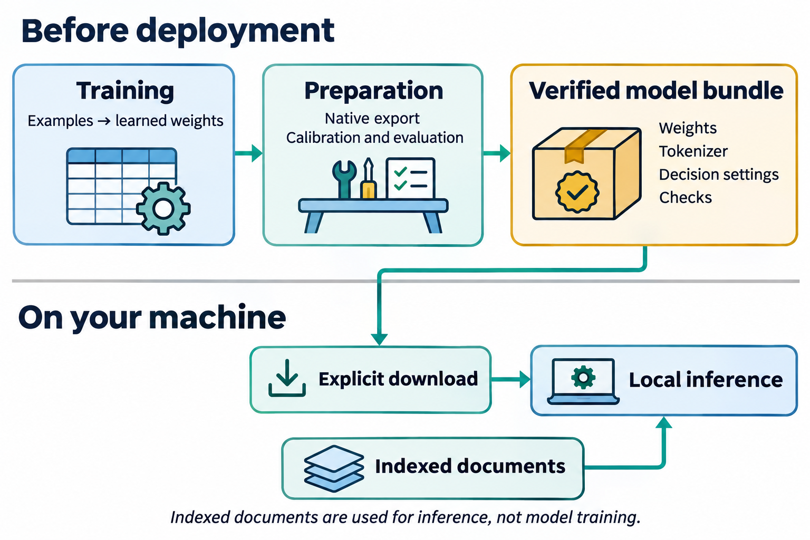
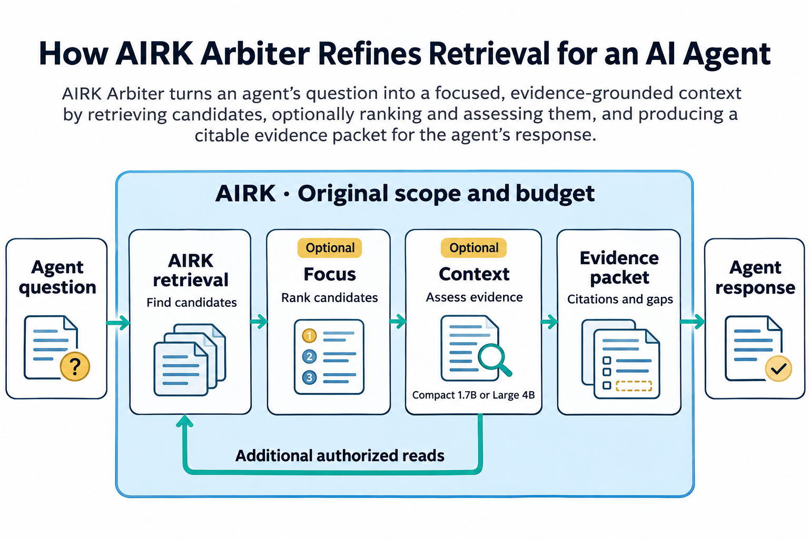

# Preparing AIRK Arbiter: Models, Artifacts, and Evidence for AI Agents

AIRK, the Artifact Indexing and Retrieval Kernel, helps software and AI agents find evidence in indexed source material. Arbiter adds optional local models that can improve which passages receive attention and help gather complementary evidence before a calling agent forms its response.

The design separates three jobs: **retrieval finds candidates, Focus ranks those candidates, and Context assesses what else is worth reading**. The calling AI agent remains responsible for its reasoning, final response, and any subsequent action.

This paper explains where the models' capabilities come from, how they are prepared for AIRK, what the application downloads, and how the Model Context Protocol (MCP) `answer` tool uses them. MCP is the interface through which an AI application can discover and call tools such as AIRK's evidence reads.

**Status as of 15 November 2026:** The selected models and preparation approach described here are present in a local test candidate. Their end-to-end task and release qualification is incomplete. The architecture describes the intended capability; candidate artifact sizes describe actual prepared payloads. Neither establishes a measured improvement in answer quality, fewer agent turns, or final hardware requirements.

## Why retrieval benefits from more than one model

A search system must balance breadth and attention. It needs to find potentially useful material across an index, then decide which of that material deserves closer inspection. A question can also require several pieces of evidence that do not look equally relevant in isolation.

For example, an agent investigating whether a service can safely retry a failed payment may need an operational instruction, an API constraint, and a test describing an ambiguous timeout. A highly relevant instruction to retry is insufficient if the missing constraint requires reuse of the original payment identifier.

AIRK's ordinary retrieval provides the starting evidence. Semantic retrieval uses an embedding model to represent passages and questions as numerical vectors, allowing efficient similarity search; lexical retrieval can contribute explicit words and identifiers. These methods identify candidates without asking a large model to read every document for every request.

Focus applies a more expensive question-and-passage judgment to a bounded candidate set. Context then considers the gathered evidence and the available next reads. This separates broad search from focused assessment while keeping the entire request subject to explicit limits.

## The models and the levels of capability

| Capability | Selected model | Role |
| --- | --- | --- |
| Bundled semantic retrieval | MiniLM | Encodes passages and questions for efficient candidate retrieval. Available independently of Arbiter. |
| Arbiter Focus | Qwen3-Reranker-0.6B | Reads each question and candidate passage together, then scores relevance to improve candidate ordering. |
| Arbiter Context — Compact, the advanced option | Qwen3-1.7B | Assesses a bounded evidence set and helps select justified additional reads. |
| Arbiter Context — Large, the larger advanced option | Qwen3-4B | Performs the same contextual task with greater model capacity and a larger resource footprint. |

The numbers indicate approximate parameter counts: 0.6 billion, 1.7 billion, and 4 billion. Parameters are the numerical values learned during training. They are distinct from the number of documents in an AIRK index or the amount of text a request may read.

Focus and Context have separate enablement and index enrollment. Focus can operate by itself. Context can use ordinary retrieval ordering when Focus is off. When both are enabled for an eligible index, Focus can improve the evidence ordering presented to Context. Only one Context size is selected at a time; Compact and Large are alternatives, not consecutive processing stages.

“Advanced” refers to contextual evidence gathering beyond relevance ranking. Large performs the same kind of work as Compact. Its additional parameters do not establish that it will produce a better decision for every question. That comparison requires measurement on the prepared AIRK profiles and representative tasks.

## Where the learned capabilities come from

Training changes a model's parameters using examples and an objective. Inference applies the resulting parameters to new inputs. AIRK runs inference when it uses Arbiter; enabling the feature does not start a training job.

### MiniLM: learning useful representations

The sentence encoder underlying AIRK's bundled MiniLM was trained to associate related text. Its sentence-level preparation uses contrastive learning: matching texts are encouraged to have nearby representations, while other examples are distinguished. This makes a short question and a relevant passage comparable even when their wording differs.

At indexing time, AIRK applies the encoder to source passages and stores their vectors. Those vectors are derived index data, not new model parameters. Adding a document changes the searchable index; it does not retrain MiniLM. The current candidate retains the original MiniLM weights because an evaluated AIRK adaptation did not meet its improvement threshold.

### Focus: learning question-to-passage relevance

Qwen3-Reranker-0.6B starts with a Qwen3 language-model foundation and receives task-specific supervised training. Examples combine an instruction, a question, and a candidate passage with a relevant-or-irrelevant label. Training rewards the appropriate yes-or-no response. Its published preparation also merges trained checkpoints to improve robustness across tasks.

The reranker learns to assess the relationship between a question and a passage. At inference, the relative yes-and-no outputs supply a relevance score. This differs from comparing two independently computed embedding vectors: the reranker processes the pair together and can consider how particular details answer the question.

A high relevance score is neither a fact-check nor proof of completeness. A passage can be closely related to a question while being outdated, contradicted elsewhere, or missing a decisive exception. Focus also cannot recover a passage that never entered its candidate set.

### Context: adapting general language understanding to bounded decisions

Qwen3-1.7B and Qwen3-4B inherit foundation training on multilingual text, code, mathematics, and other material. Their preparation includes distillation from larger teacher models: the smaller models learn from stronger models' responses and predictions. This transfers useful instruction-following and reasoning behavior into a smaller deployment footprint.

Those capabilities are general. They do not establish familiarity with a particular organization's current documents. AIRK supplies authorized indexed evidence at request time and constrains the model's task to the decisions supported by its prepared profile.

For Context, a useful decision might be that a specific available read could resolve an uncertainty. AIRK presents a finite set of permissible choices and interprets the model's scores for those choices. The service validates the choice before performing any read. This use of a language model does not require an unrestricted generated plan or a free-form answer from the local model.

The selected Qwen artifacts derive from publisher-trained weights. Their preparation for AIRK should not be described as a newly trained AIRK foundation model or as completed AIRK-specific fine-tuning. Further weight adaptation is a separate development activity, justified only if evaluation exposes a gap and an adapted model passes the relevant comparisons.

## From a trained checkpoint to an AIRK model profile

A trained checkpoint is a starting point. A deployable model profile must also specify how text reaches the model, what its outputs mean, which decisions are supported, and which runtime can execute it correctly.

*Figure 1. Model preparation happens before deployment. The installed application acquires prepared inference assets; indexed customer documents are inputs to local retrieval and inference.*

### 1. Pin the model and its text-processing rules

Preparation identifies an exact upstream model revision, its learned weights, architecture settings, tokenizer, and redistribution notices. A tokenizer translates text into the numerical token identifiers the model expects. Its vocabulary and special-token rules must match the weights.

The input recipe matters too: instructions, question boundaries, evidence boundaries, truncation, and permitted decision labels influence the result. Changing that recipe can change behavior even when the weights stay identical. A profile therefore binds the model to its input and output interpretation.

### 2. Export the computation for native inference

Training commonly produces tensor checkpoints such as SafeTensors files. AIRK's current prepared profiles use ONNX, a representation of the model's computation that its native inference runtime can execute.

The export comprises a computational graph and associated weight data. Large tensors can reside in a separate external-data file, so the graph file alone is not the complete model. Export changes how the computation is represented and executed; it does not itself teach the model a new task.

Preparation checks that the exported model reproduces the intended computation within defined numerical tolerances. That includes tokenization, input layout, model outputs, and the score interpretation used for the supported decision.

### 3. Choose and test numerical precision

Quantization represents some model values with fewer bits. It can reduce storage or execution cost, but may also change scores and decisions. Its effects must be measured using the exact export and runtime.

The current Focus candidate uses a W8 export, with selected weights represented at eight-bit precision. W8 does not mean that every byte in the package is one byte per parameter. Graph structure, other tensors, metadata, and execution requirements remain relevant.

The current Compact and Large candidates use FP32 exports, with floating-point weights represented at 32-bit precision. An attempted lower-precision Context export failed its numerical tolerance checks and was not adopted. Consequently, these Context downloads are substantially larger than an estimate based on a small quantized checkpoint would suggest.

### 4. Establish how scores become decisions

Calibration relates raw model outputs to the decisions a product can responsibly apply. For relevance, this includes the interpretation of scores. For Context, it can include when to accept a proposed next read, when to abstain, or whether a supported assessment is sufficiently reliable to report.

Numerical verification of an export and task calibration for a decision serve different purposes. Matching a reference model's numbers does not establish that the model can reliably judge whether evidence is sufficient. A profile qualified for selecting a next read is not automatically qualified for declaring completeness or requesting clarification.

Calibration may fit small decision parameters or establish thresholds without retraining the underlying neural weights. The current Context preparation includes raw numerical metadata; task calibration and qualification remain incomplete. The presence of a calibration file must not be interpreted as proof that every intended judgment is ready.

### 5. Evaluate the complete evidence workflow

Useful evaluation goes beyond model scores. It asks whether the prepared pipeline finds necessary evidence, retains counterevidence, cites sources faithfully, avoids unsupported conclusions, and helps a calling agent complete its task.

Development examples, calibration examples, and held-out evaluation questions serve separate purposes. Final comparisons need the same authorized corpus, downstream agent, task rubric, and total budget. An ordinary retrieval baseline must be allowed its normal follow-up reads.

The evaluation must count internal Arbiter work as well as visible MCP calls. Combining several reads into one tool call is useful only if the resulting quality, latency, and resource tradeoff is worthwhile. Fewer visible calls alone do not establish lower cost or better task completion.

### 6. Package an identifiable, verifiable profile

The deployment profile ties together exact assets, integrity hashes, sizes, supported tasks, input limits, runtime compatibility, and the evidence needed to qualify its use. A hash verifies that bytes match an expected artifact; trust also requires an authenticated description of which artifacts AIRK is meant to accept.

This profile is the unit of deployment. Two packages with the same upstream model name can have different precision, tokenization, output interpretation, resource demands, or qualification results.

## What artifacts result, and which ones reach the application?

Several different kinds of artifact are involved. Keeping them separate helps explain both deployment cost and data ownership.

| Artifact class | Examples | Where it belongs |
| --- | --- | --- |
| Training outputs | Learned checkpoints, experiment records, and optimizer state used to resume training | Model publisher or developer preparation environment. These are not all application downloads. |
| Prepared inference bundle | Native graph, external weights, tokenizer, decision metadata, verification fixtures, and notices | Acquired and verified by AIRK for the selected profile. |
| Qualification evidence | Numerical comparisons, task evaluations, resource measurements, and recovery results | Retained during preparation and release evaluation; compact verification fixtures may accompany the bundle. Private evaluation captures are not shipped as model data. |
| Local index data | Indexed passages, searchable metadata, lexical structures, and embedding vectors | Created by AIRK from the user's authorized source material. Separate from model weights. |
| Request results | Relevance scores, selected evidence, citations, limitations, work accounting, and stop reason | Produced for the requesting client within its authorized scope. |

A full training dataset, teacher model, optimizer, or Python training environment is unnecessary for normal Arbiter inference. Enabling Arbiter does not download a new copy of the user's documents from a model publisher.

### The optional download bundle

The normal installer includes MiniLM for semantic retrieval. Focus and Context weights are optional assets acquired by the AIRK service after explicit provisioning of a selected profile.

Each current optional bundle contains these roles:

| Downloaded item | Purpose |
| --- | --- |
| ONNX model graph | Describes the prepared computation. |
| External weight data | Contains the model tensors required by the graph. |
| Matching tokenizer | Encodes text consistently with the prepared model. |
| Input and decision-binding metadata | Defines how supported inputs and decision symbols relate to the model. This is data interpreted by AIRK, not downloaded executable program code. |
| Relevance or calibration metadata | Binds score interpretation and preparation identity; its contents do not by themselves certify task quality. |
| Numerical verification fixtures | Supplies small reference cases for checking the prepared computation. |
| License and provenance notices | Records attribution, terms, and applicable origin information. |

The catalog describes the exact compatible assets, their identities, and their approved download sources. A generic upstream checkpoint or a community export with the same model name is not an interchangeable substitute.

Large assets may be transferred in parts and reconstructed into their expected files. Transfer packaging does not change which model is selected or remove the need to verify the complete result.

### What each selection downloads

The following sizes describe the prepared **local test candidate on 15 November 2026**, using decimal gigabytes. They are complete per-stage payload sizes, rounded for planning. They are not final release commitments or memory requirements.

| Selection | Prepared format | Optional payload |
| --- | --- | ---: |
| Focus | W8 ONNX graph and associated assets | About 1.13 GB |
| Context — Compact | FP32 ONNX graph and associated assets | About 6.90 GB |
| Context — Large | FP32 ONNX graph and associated assets | About 16.10 GB |

With both stages selected, Focus plus Compact requires about 8.03 GB of these assets; Focus plus Large requires about 17.23 GB. AIRK acquires missing assets for the selected profiles, rather than downloading all three models whenever Arbiter is enabled. Reused verified assets need not be acquired again.

Disk planning must also account for transfer staging, verification, and any retained bundle needed for recovery. Running-memory requirements additionally depend on execution buffers, input lengths, candidate counts, concurrency, MiniLM, indexing, and other applications. Download size is therefore an unsuitable proxy for the RAM a machine needs. The candidate has not established final requirements at its current limits.

## What happens when an agent calls `answer`

The `answer` tool is a bounded evidence-gathering operation. Its output is a contextual packet for the calling agent. The name does not mean that AIRK replaces the agent with an unrestricted local chatbot.

*Figure 2. Context can refine evidence gathering inside the original request's limits. The calling agent uses the returned packet to reason and compose its response.*

1. **Establish scope and limits.** The question arrives with authorized indexes and finite allowances for reads, model input, returned content, and elapsed time. The service checks which optional stages may process each index.
2. **Find initial candidates.** Ordinary AIRK retrieval identifies relevant indexed passages. MiniLM supplies semantic representations independently of Arbiter enablement.
3. **Apply Focus where eligible.** Focus scores the question with each admitted candidate and reranks the candidates by relevance. Any selected subset or truncation remains visible.
4. **Assess the evidence with Context where eligible.** The selected Context model receives bounded evidence and a finite menu of permitted decisions. It can help identify a useful next read; other assessments apply only when individually supported and qualified.
5. **Validate and perform an additional read.** AIRK checks authority, index identity, evidence revision, duplication, and remaining budget before executing the chosen native read. A model suggestion does not create access permission.
6. **Stop under explicit conditions.** Gathering ends when no justified next read remains, a supported stopping assessment applies, progress stops, or a limit or failure prevents continuation. Each extra step consumes the original budget.
7. **Return evidence and limitations.** The packet preserves citations to original locations, source and indexed revision identity, relevant assessments, gaps, stage application status, work used, and the stop reason. Unavailable or unsupported decisions remain distinguishable from successful model work.
8. **Let the calling agent respond.** The agent can inspect citations, request permitted follow-up evidence through other MCP tools, explain uncertainty, and write the final answer. Any edits, commands, or business actions remain outside Arbiter's retrieval authority.

### An illustrative evidence refinement

Consider the payment-retry question. Initial retrieval returns an operations passage saying that transient failures may be retried. Focus places that passage ahead of generic availability material because it directly addresses the question.

Context recognizes that the visible evidence does not establish how duplicate charges are prevented. If an authorized next read is available, it can select the relevant API constraint. That read may reveal that retries must reuse the original idempotency key. A further permitted read could supply a test covering a timeout after the payment was accepted.

The evidence packet now gives the agent a basis for a conditional answer: retry under the documented duplicate-prevention conditions, and distinguish a confirmed failure from an unknown outcome. It also reports any unresolved case, such as the behavior after the key's validity window expires.

This example illustrates the intended workflow, not a measured benchmark result. If the missing constraint cannot be found or the budget expires, the correct result is a visible gap. A model's familiarity with common payment designs cannot substitute for evidence about the indexed system.

## Consent, privacy, and operational control

Focus and Context are optional and off by default. Stage enablement, enrollment of particular indexes, and an agent's permission to read those indexes are separate decisions. Enabling a stage does not enroll every index or grant an agent additional access.

Provisioning authorizes the service to acquire the selected missing assets. An ordinary search, status request, or `answer` call does not authorize a model download. A downloaded bundle must still pass applicable integrity, compatibility, qualification, and resource checks before it is ready for its intended use. A local test profile must remain clearly identified as unqualified.

After complete compatible assets are verified and available, inference runs locally inside the AIRK service. The design requires neither a separate model server nor cloud inference for Arbiter. Enabling it does not authorize uploading indexed material for training or updating the weights from the user's requests.

The calling AI application is a separate privacy boundary. It receives authorized evidence from AIRK and may have its own cloud processing, retention, or sharing policies. Local Arbiter inference does not by itself make that wider agent workflow local.

Disabled or unavailable optional stages preserve ordinary retrieval where the request's normal completeness rules permit it, with the limitation disclosed. They do not silently switch to another model, precision, or external service. Disabling a stage stops new optional work and allows admitted work to drain safely; removing its cached assets is a separate operation. Neither changes the original source documents.

## Evaluating the value for an organization

For software engineers, Arbiter offers a way to gather more useful context before reasoning or editing. Its value depends on the evidence it adds or prioritizes, particularly constraints and counterexamples that an initial search might miss.

For architects, the relevant design properties are explicit authority, local execution, reproducible model profiles, bounded work, and inspectable results. Different models and precisions are deployment choices with measurable consequences, not interchangeable labels.

For business decision makers, the comparison is between the extra local storage and inference cost and any demonstrated improvement in task completion, evidence coverage, or agent interaction. A larger model or fewer visible calls is insufficient evidence of return on investment. Evaluation should include end-to-end latency, resource contention, unsupported claims, citation quality, and the cases where the system must abstain.

Arbiter's intended contribution is better preparation of evidence for the agent: relevance ranking through Focus and bounded contextual gathering through Compact or Large. The strength of that contribution must be established on the exact artifacts, supported platform, and tasks an organization intends to use.
