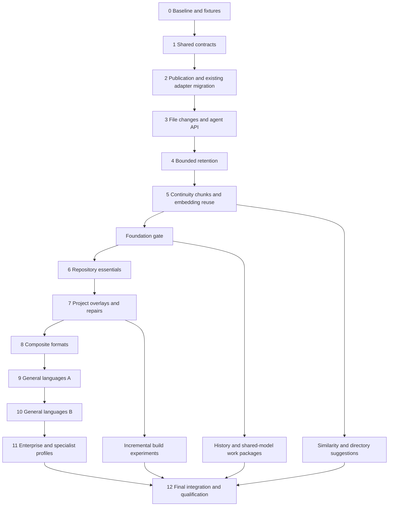

# AIRK architecture v2: implementation guide

Status: proposed, 14 October 2026. No v2 feature is marked implemented by this document. This is the standalone execution plan for both change tracing and language/format expansion. It contains the contracts, complete scope, dependency order, subagent assignments and acceptance criteria needed to implement both efforts without consulting their earlier planning documents.

Use the numbered phases as integration gates, the requirement IDs as the completion checklist, and the work-package rules as delegation instructions. The implementation remains subject to repository contributor guidance. Source links below identify current code and operational contracts; they do not replace requirements specified here. Changes to this plan should record the affected requirement/phase and reason, so omitted work cannot quietly become “complete.”

## 1. Outcome, scope and current baseline

AIRK supplies local, bounded, revision-bound code and document evidence to coding agents. V2 adds reliable answers to “what changed?”, “where did this evidence go?” and “is this remembered evidence still usable?”, then expands the facts available for repositories, mixed-language files and additional languages. Claude Code and Codex share the same read-only MCP contract. AIRK does not own their memory, reasoning, editing, builds or task orchestration.

Retain the independent implementation, source-read-only operation, one native host/container per user or machine, independently scoped collections, Tantivy lexical retrieval, embedded SQLite exact facts and the selected disk-backed DiskANN vector engine. Memory/legacy lexical snapshot adapters remain compatibility paths, not the final vector architecture. Do not add external databases, cloud inference, runtime grammar downloads or source from Munarium, VCP or private reference material.

The implementation baseline was checked in this repository:

| Area | Existing behavior | V2 consequence |
|---|---|---|
| Core/storage | Schema 3, `native-facts/7`, compact inventories, verified content-addressed sources/extractions; path-bearing artifacts | Explicit migration, independently versioned profiles and path-free extraction payloads |
| Publication | Ordinary/full indexing, initialization, SCIP import, local LSP/Ctags and OCR operations publish immutable generations | All writers must use one finalizer and failure contract |
| Reuse | Same-path source hash plus a global extractor version; each scan still reads/hashes eligible sources | Resolve effective profile before content reuse; retain complete scan budgeting |
| Retrieval | Full Tantivy/catalog and optional DiskANN/model builds; chunk embeddings recomputed | Cache metadata/extraction/embeddings before attempting incremental indexes |
| Reads/retention | Cached search, repeated inventory opening for other services; manual pruning protects active/leased generations | Indexed metadata, explicit change windows, policy-driven cleanup and recoverable history conversion |
| Parsers | Tree-sitter 0.25.10; 23 grammar entries including separate TS/TSX; selected native facts | Registry and adapter contracts first; grammar count is not language qualification |
| Existing partial formats | Dockerfile instruction lines, MDX Markdown prose, `.gradle.kts` Kotlin syntax, `.csproj`/`.props`/`.targets` XML structure, Vue/Svelte HTML, SCSS CSS | Enrich or repair these paths; do not describe them as wholly absent |
| Existing code limitations | `.h` selects C; PHP/Ruby already have selected call extraction; SQL selects a few CREATE forms | Add deterministic dialect selection and qualify missing facts instead of replacing known coverage claims with broader ones |

Retire unlimited obsolete-generation accumulation, path/offset-only remembered identities, mandatory broad rereads after edits, path-bound extraction reuse and monolithic adapter growth. Preserve exact citations and conservative evidence provenance throughout.

### Required outcomes

| ID | Outcome |
|---|---|
| A1 | Versioned adapter registry, effective configuration identities, source maps and explicit capabilities |
| A2 | Path-free extraction, bounded chunks, code/document continuity descriptors and content reuse |
| C1 | Collection incarnation, exact publication tokens, monotonic lineage and per-dimension change stamps |
| C2 | Bounded observed-change window, gaps, conservative path resolution and indexed metadata |
| C3 | `airk_changes`, remembered-evidence validation, conditional reads and freshness diagnostics |
| R1 | Bounded searchable retention, recoverable cleanup, quota retry and visible protected state |
| R2 | Optional short historical content, checkpoints, exact historical reads and logical purge |
| O1 | Verified embedding reuse and stable chunking; collection-local shared model objects |
| O2 | Qualified incremental catalog/lexical builds or a recorded measured decision retaining full builds |
| L1–L5 | Every named language/format row in section 11, including existing-profile repairs |
| Q1 | Migration, fault, isolation, performance, actual agent-task and native-platform evidence |

R2 is optional for operators, not omitted from the implementation scope. Similarity/directory suggestions are an optional capability delivered in phase 11. No acceptable grammar or unresolved platform validation is a tracked blocker for the affected item, not permission to claim full completion through UTF-8 fallback.

## 2. What to combine, and what to keep separate

| Area | Combine | Keep separate |
|---|---|---|
| Extraction identity | Adapter, grammar, dialect, effective configuration, mapping and chunk-policy versions drive reuse, invalidation and change reporting | Source hash, extraction identity, bound evidence identity and retrieval/model identity |
| File/code/document identity | One collection incarnation, revision envelope and conservative continuity framework | File handles, symbol handles, document handles, exact syntax IDs and imported producer IDs |
| Adapter outputs | Shared facts, local owner handles, source maps, capabilities and budget accounting | Language parsing, structural overlays, prose cues and optional external producer assertions |
| Mixed-language files | One host artifact and source hash; child regions use the registry and shared mapping/budget infrastructure | Region-local parse coordinates versus original host/document locations |
| Changes and retention | One atomic publication boundary and revision lease protocol | Metadata change coverage versus retained old content versus searchable components |
| Reuse and moves | Shared hashes/profile descriptors | Extraction reuse can succeed for copies; continuity needs independent matching evidence |
| Optimization | Shared chunk/input identities and quota callbacks | Embedding reuse, lexical/catalog updates and DiskANN graph construction have separate correctness tests |
| Agent interfaces | Shared kernel services and MCP schemas for all clients | Client setup, live client qualification and client-owned approvals/memory |
| Implementation work | Frozen contracts, common fixtures and one integrator | Independent adapter modules, store lifecycle work, retrieval work and transport/UI work |

This avoids two incompatible migrations, two identity systems and repeated rewrites of new adapters. It also avoids coupling grammar delivery to optional historical search, compiler resolution or a new vector engine.

## 3. Dependency direction and module ownership

| Crate/component | Responsibility | AIRK dependencies |
|---|---|---|
| `airk-core` | Pure identities, profiles/capabilities, spans/maps, artifact/fact/query contracts and cache/storage traits | None |
| `airk-ingest` | Discovery, bounded native parsing, registry, format overlays, document extraction, chunk descriptors and continuity candidates | core |
| `airk-store` | Objects, manifests, lineage/catalog persistence, reader leases, quota, retention/history/checkpoints/recovery | core |
| `airk-retrieval` | Tantivy, explicit local model inference, embedding reuse through traits, DiskANN provider and fusion | core |
| `airk-kernel` | Collection/root validation, effective policy, common publication finalizer, continuity reconciliation, query and maintenance services | core, ingest, store, retrieval |
| `airk-mcp` | Read-only tool schemas, result conversion and initialization guidance | core, kernel |
| `airk-cli` | Commands, policy/checkpoint mutations, setup and lifecycle | core, kernel, mcp |
| VS Code extension | Thin helper client, capability/pending/error/retention displays and explicit controls | Native helper interface |

Add modules inside these crates. Ingest must not import store for a content-cache lookup; kernel supplies a core trait/callback. Retrieval must not import store for vector caching or charging. Tree-sitter nodes/parsers stay private to ingest. Durable sequence assignment and persistent continuity handles belong to kernel/store, not individual language adapters.

Proposed module layout, created incrementally by the designated owner:

```text
airk-core/src/       identity.rs, extraction.rs, changes.rs, location.rs
airk-ingest/src/     adapters/{registry,profile,embedded,...}.rs
                    adapters/languages/*.rs, adapters/formats/*.rs
                    continuity/{code,documents,matching}.rs, chunking.rs
airk-store/src/      lineage.rs, history.rs, extraction_cache.rs, vector_cache.rs
                    existing blobs.rs/sqlite.rs/retention.rs/quota.rs
airk-kernel/src/     publication.rs, changes.rs, maintenance.rs
airk-retrieval/src/  existing persistent.rs/model.rs/vector.rs plus cache adapter use
```

Names are implementation guidance, not a requirement to split a small function into a new file. Keep existing document/prose/table/spreadsheet/provider adapters where they already have an independent responsibility. Introduce thin compatibility wrappers while moving shared code out of `syntax.rs`; preserve behavior with differential fixtures.

## 4. Invariants and budgets

1. Each response binds metadata, content, locations, redirects and relationships to one exact publication. Multi-call clients must explicitly retain tokens/revision selectors.
2. A failed scan/build/migration does not advance publication, stamps or lineage. Cleanup failure after commit is a separate maintenance result; it cannot turn a committed publication into a failed index.
3. Successful publications record observations, not every save. Intermediate edit/revert activity between scans is unobserved; a scan is not an atomic filesystem snapshot.
4. Missing evidence cannot silently mean deleted, unchanged, resolved or moved. Report extraction omissions, ambiguity, unsupported capability, partial detail and history gaps independently.
5. Active revisions, reader leases and explicit checkpoints win over retention targets. Sources remain untouched, and no collection/root/alias boundary is bypassed.
6. MCP reads do not discover sources, index, execute builds/providers, change policies or prune. Idle scheduler state is not proof that live sources match the index.
7. Runtime parsing never evaluates Make/Gradle/MSBuild/Nix/HCL/JavaScript, expands remote includes, fetches schemas or executes notebook cells. Imported provider assertions stay separate from native syntax/structural evidence.
8. All writers, staging and retained objects participate in logical-byte quotas. A retention target can remain unmet because protected evidence consumes capacity; publish explicit pressure rather than weakening protection.

Preserve current conservative defaults unless a separately measured profile changes them:

| Bound | Default/contract |
|---|---|
| Original source / extracted document | 16 MiB / 4 MiB |
| Eligible source / extracted collection / files | 64 MiB / 128 MiB / 10,000 |
| Discovery entries / pass source reads | 100,000 / 256 MiB, including unsupported candidates |
| Inventory / retained artifact JSON | 128 MiB / 64 MiB |
| Native syntax nodes / facts | 500,000 visited nodes / 10,000 facts per host file |
| Query results / payload | 1..100 / 1..65,536 bytes; existing tools retain their documented accounting |
| Change input | 64 total remembered selectors, 32 KiB serialized selector input, 4,096-byte path/prefix |
| Change metadata window | 10,000 total event/resolver/ancestry records, 16 MiB serialized lineage, 90-day event age |
| Fuzzy matching | At most 10,000 candidate pairs; cooperative 250 ms target with explicit partial detection |

Initial embedded-language limits are a maximum nesting depth of 4, 256 child regions and 100,000 source-map segments per host artifact, all charged within the host's existing text/node/fact limits. Notebook cell descriptors share existing document-unit bounds; enabled code regions also consume the region limit. Count failed and empty-region work. These starting ceilings need adversarial and representative measurement; exceeding them must yield an explicit omission/partial outcome, never apparently complete facts. A policy may lower limits; increasing validated ceilings is separate work.

Preserve specialized format caps: PDF/PPTX 512 pages/slides; OOXML 10,000 entries/paragraphs; DOCX 256 tables, 32 nesting levels and 256 cells per row; XLSX 128 sheets, 10,000 rows per sheet, 100,000 stored cells/shared strings and 16 MiB selected XML. Sparse/merged ranges are not expanded. Native libraries and synchronous filesystem calls are not hard-preemptible wall-time guarantees.

## 5. Unified adapter, configuration and source-map contract

### 5.1 Registry and effective selection

Each registered adapter declares stable adapter ID, family, language/dialect ID, implementation version, grammar identity if applicable, supported fact/relationship kinds, chunk strategy, continuity support and explicit limitations. Capability dimensions are independent: lexical text; syntax definitions/imports/call candidates; structural project relationships; embedded regions; native locations; continuity; optional producer-backed assertions. Never promote a syntax target to resolved merely because a shared interface has a reference method.

Keep pure descriptors/output types in core; implement parsing/extraction in ingest. A native adapter accepts bounded source bytes, selected effective profile, region map/context and a shared budget, and returns local facts/owners, written relationships, chunk candidates, continuity descriptors, diagnostics and coverage. AST ownership and grammar-specific traversal remain internal. Format overlays enrich an existing parser's data using explicit discriminators; they do not parse an entire file once per possible product schema.

Persist collection extraction policy alongside roots/limits, with a version and digest. Proposed policy limits are 128 KiB and 256 override rules. Support exact path and scoped prefix/suffix/basename rules initially; reject ambiguous equal-precedence overrides. Resolve selection in this order: explicit rule, longest applicable scoped rule, known basename/compound suffix, ordinary suffix, bounded content discriminators, UTF-8 fallback. Retain original case and record case-sensitive rules before case-folded defaults. `.S` and `.s`, or `.m`, `.pl`, `.cls`, `.v`, `.h` and `.sql`, must not lose dialect ambiguity through blanket lowercasing.

Selection uses only declared, bounded local configuration inputs. Examples are a configured header dialect or captured project format discriminator. Capture hashes of inputs used, map them to affected profiles, and persist the effective decision. Do not implicitly read all build files or execute a project's build to choose a grammar. Relative references found by overlays remain written candidates unless an eligible same-revision source is explicitly bound. No following includes outside registered roots.

A changed registry does not automatically invalidate every file. Recompute effective selection before reuse; invalidate files whose effective adapter/profile/options changed. Record a scoped profile-change event, preserving unchanged source hashes. Shared extraction schema/mapping changes may require broad invalidation and must report it. Configuration changes become visible with the successful publication that applies them, not through live read-time reinterpretation.

### 5.2 Identities and reuse

Use these separate contracts:

| Identity | Inputs and use |
|---|---|
| `source_hash` (`content_hash` on existing APIs) | Exact original bytes; original-source citation binding |
| `profile_id` | Effective adapter/grammar/dialect versions, extraction options, declared configuration decisions, mapping algorithm and chunk-policy versions |
| `extraction_key` | Source hash plus profile ID; collection-local lookup before extraction |
| `payload_digest` | Canonical path-free extracted text, local facts/owners, intrinsic maps/locations and provenance; excludes publication stamps/assigned continuity handles |
| `evidence_digest` | Selected payload and current artifact/root/path binding plus relevant provider-domain identity |
| `representation_validator` | Evidence digest plus read selectors/options and output representation version; excludes administrative generation/token/timestamps |
| `embedding_key` | Exact model input bytes and complete model/tokenizer/preprocessing/pooling/normalization/dimension identity |

Path-free does not mean path-insensitive selection. Moving identical YAML into `.github/workflows/`, or moving a header under a different configured dialect, can require different extraction. Determine the destination profile first. Actual host offsets/maps are evidence content; only the mapping algorithm version belongs in a reusable child profile. Equal child-region bytes may reuse parsing/vector work while host coordinates are rebound and checked.

Build a bounded prior extraction lookup before scanning. After source read/hash and profile selection, reuse verified compatible output before invoking a parser. Copies can reuse extraction despite ambiguous lineage. Keep one extracted artifact at a time; no full-corpus AST/text cache. Path-bearing legacy artifacts need typed compatibility conversion or re-extraction; never unrestricted string-prefix substitution of IDs. Imported producer evidence is invalidated under its existing source/build contract, not rewritten to fit a move.

### 5.3 Embedded and decoded locations

One host file owns the original source hash and path. Child regions carry local language/profile, bounded region identity, decoded text and a validated mapping to the host. Region ordinals alone are not durable IDs. Bind every emitted span and local owner to the correct region before generating public citations.

Direct script/style regions can use verified offset maps. Dedenting, entity decoding, escaped JSON strings and source arrays require piecewise maps; a constant line offset is insufficient. Maps must be monotonic within each segment, bounds checked, UTF-8 safe and explicit about synthetic/unmappable spans. Suppress unsupported exact-span claims while retaining truthful broader locations and diagnostics. Never return temporary filenames as original sources.

Add versioned location representations for host embedded spans and notebook cells where existing `DocumentLocation` is insufficient. Notebook citations identify original `.ipynb`, cell ID when present, cell position as a current locator, cell-local lines and underlying JSON source spans. Execution count is metadata, not chronology or identity. Index Markdown/code source cells; exclude outputs, attachments and binary payloads by default. Never execute kernels or trust notebook outputs as current program results.

MDX, R Markdown, Razor, Vue, Svelte and Astro preserve prose/markup and supported child-code evidence without double-counting the same region as prose requirements. Unknown child languages remain lexical with explicit capability gaps. A child-region change can preserve unrelated child handles/chunks, while the host source hash still changes. OCR/PDF/Office locations retain page/block/table/sheet/slide semantics; extracted-text lines do not become source-file lines.

### 5.4 Grammar and adapter admission

For each language/format row, qualify a native grammar or a bounded independent structural adapter. Verify primary upstream provenance, license/notices, exact version, Tree-sitter 0.25.10 ABI/build compatibility or a separately reviewed ABI upgrade, scanner/build dependencies, supported dialect and all target native architectures. Freeze the selected dependency through the integrator. No current-maintenance or compatibility claim is inferred from an earlier planning link.

Do not mix incompatible parser runtimes merely to admit a grammar. Prefer existing JSON/YAML/XML/Markdown/Kotlin primitives for structural overlays. If no acceptable implementation can meet a row's contract, retain truthful lexical/partial support, record a blocked row with alternatives/evidence, and continue unrelated work; full scope remains incomplete until resolved or explicitly revised.

## 6. Publication, persistence and migration

### 6.1 Identity and common finalizer

Create a random full 128-bit incarnation at the first successful v2 publication, including initialization. Persist it with collection/root binding. Deletion/recreation creates a new incarnation; supported storage relocation preserves it. Do not reuse quota/usage identities. Tokens are opaque/versioned and contain full incarnation, generation and full revision digest; short display prefixes cannot select evidence.

Every evidence envelope carries revision and token in addition to the existing generation/collection fields. The finalizer assigns one checked monotonic generation and parent equal to the last committed revision. Preserve publication reason/time, but use sequence for order when clocks move. Ordinary unchanged scans do not publish timestamps. Full reindex forces extraction work; publication reasons and evidence changes must remain explicit rather than fabricating source edits. Metadata maintenance may publish a new revision without advancing content/evidence stamps.

All writers pass through this finalizer: initialize, index/reindex, SCIP import, LSP/Ctags publication, OCR, effective root/profile changes and lineage compaction/purge. Operator policies/checkpoints have their own durable mutation receipts and cannot change evidence stamps outside publication. Provider/model changes may be revision-level invalidations with no file-content changes.

Each file state has `artifact_id`, first/path/content/evidence generation stamps, source hash, profile ID, payload reference and current path/root binding. The artifact handle survives same-path edits and supported unambiguous moves; a later re-addition after an observed deletion gets a new handle. Same-path replacement between scans can be indistinguishable from an edit; report observation-level continuity only.

| Stamp | Update rule |
|---|---|
| `first_generation` | First publication observing this handle, not the source's creation time |
| `path_generation` | Last change to citation path or root binding; a compatible rename changes this stamp while preserving source-content history |
| `content_generation` | Last observed change to original bytes, even when normalized extracted text is identical |
| `evidence_generation` | Last change to extraction payload, effective interpretation or provenance; path binding also affects validators through the separate path stamp |

Reuse preserves applicable stamps. Extractor/OCR/profile changes can advance evidence without changing content. A retrieval-model-only publication changes retrieval identity and reports a global event; it does not advance file content stamps. Global provider-domain invalidation is explicit and included in applicable validators rather than disguised as thousands of source edits.

### 6.2 Noncircular digest and publication protocol

```text
verified path-free payloads + effective configuration manifests
    -> final file states + bounded lineage bytes
    -> canonical inventory binding payload/configuration/lineage digests
    -> revision = SHA256(versioned engine/retrieval specification + inventory bytes)
    -> derived catalog/search/vector components
    -> immutable manifest with revision, input bindings and component checksums
    -> root SQLite transaction commits revision, inventory and manifest digests
```

Neither inventory nor its current lineage entry embeds its own final revision/manifest digest. The current lineage entry contains sequence/parent; the enclosing revision supplies identity. Older entries may store completed revision/manifest digests. The catalog stores revision and input digests; its byte checksum belongs to the final manifest, not to its own revision preimage. This ordering prevents self-referential hashes. Reader verification starts from the committed header or durable publication receipt, not from an untrusted manifest alone.

In the pointer transaction, also persist a retained-revision receipt in the root SQLite database binding incarnation, revision, inventory digest and final manifest digest. Keep this receipt for every surviving full/history/checkpoint/leased revision independently of bounded change ancestry. Otherwise an old checkpoint could outlive its manifest verification anchor. History conversion records its verified descriptor binding through the maintenance transaction/intent protocol. Retire a receipt only after its last representation and protected references are gone. Receipt growth/deletion and journals are quota-accounted; selecting the active pointer remains an indexed lookup. A receipt verifies a retained publication but does not restore expired intervening change events or imply complete ancestry.

Stage, charge, sync, reopen and verify all required components before directory publication and the pointer transaction. A crash before commit leaves reclaimable derived staging/orphans; after commit the complete selected revision must be readable. Persist original locations and current profile decisions in that same inventory. Publication identity is separate from reusable component input identity: metadata-only maintenance can reuse unchanged retrieval inputs and cached vectors without invoking inference or pretending files changed.

Suggested layout:

```text
collections/<id>/
  index.sqlite3                   committed pointer, format and retained receipts
  roots.json, limits.json         existing policies
  extraction.json, retention.json proposed policies
  objects/sources/<digest>
  objects/artifacts/<digest>      path-free v2 payloads plus legacy readers
  objects/vectors/<identity>/...  verified collection-local cached vectors
  objects/models/<identity>/...   later shared immutable model assets
  generations/<revision>/
    inventory.json, lineage.json, manifest.json, catalog.sqlite
    lexical/, vectors.bin, model/ or verified model references
  history/<revision>/             verified lightweight historical representation
  maintenance/...                bounded durable recovery intents/receipts
```

Use existing external reader-lock locations so deleting a representation cannot delete its lease. Tokens/cursors select only validated managed identifiers, never arbitrary paths. Quota and usage ledgers retain their existing distinct responsibilities.

### 6.3 Catalog and cached reads

Cache one verified current catalog per kernel process, retaining its lifecycle/revision leases. Recheck the committed header at every outer request; reuse only exact identities and release superseded idle handles. Bound historical/in-flight cache handles and report retained pins. No cache mutex spans parsing or long disk work.

Extend the existing immutable SQLite catalog with indexed files, revision headers, change events, path resolutions and continuity-key projections. Index path, artifact ID, source hash, profile ID and deterministic `(generation,event_id)` order. Warm file metadata/change queries do not deserialize the full inventory. Requested content loads only its verified payload. Textual references remain a separately bounded textual operation, not a resolved reference index.

### 6.4 Migration and compatibility

Version inventory/storage, lineage, catalog, profile/adapter, mapping, chunking, continuity and retrieval contracts independently. Preserve legacy original encoded bytes for digest validation; adding default serialized fields and re-hashing a newly encoded old snapshot can select the wrong revision directory.

The first committed v2 revision establishes the incarnation/baseline and marks earlier change coverage unavailable. Keep old source/root/policy bindings and imported evidence validity. Convert path-bearing payloads safely or re-extract when their format/profile cannot be preserved. Do not require unrelated adapter re-extraction solely because a new language was registered. Build migration privately under quota; failures retain the old pointer.

Advance pointer/storage compatibility versions so old binaries fail closed instead of publishing children that discard lineage. Define mixed-worker restart/upgrade diagnostics, while pinned compatible readers can finish. Downgrading a binary is not a schema downgrade; no automatic state deletion or pointer rewind. A future restore must publish a new child with an explicit reason, not reuse an earlier generation.

## 7. Observed changes and continuity

### 7.1 Bounded metadata window

`lineage.json` contains bounded committed revision headers, observed events and current resolver records, without old source excerpts/full artifacts. Its digest is in inventory. Current live-file stamps persist with the file; old events/removed handles/forwards expire independently of content retention. Events mentioning a source hash do not keep that object alive.

Keep immutable events separate from the next revision's resolver projection. Chain-compress A-to-B-to-C resolution without rewriting what earlier events observed. Record IDs, before/after paths/hashes, dimensions, cause, inference basis and provenance. Reserve budget for global invalidations and gap markers before detailed events. Code/document detail consumes the same bounded record/byte allowance, not an unbounded child array.

Evict whole oldest publication groups where possible. Maintain separate completeness floors for files, code, documents, ancestry and resolution. If one publication alone exceeds the budget, retain an explicit gap and advance the affected floor through it. Age expiry occurs during publication/maintenance; do not mutate active immutable lineage silently.

`since=S` means observed changes in `(S,target]`, coalesced by handle, including edit/revert and artifacts added then removed across publications. It is not an endpoint diff and cannot reconstruct unobserved saves. Complete coverage accounts for all matching events; expiry/overflow returns partial coverage. Outside verifiable ancestry return `baseline_unavailable` plus useful independent validations. Reject malformed/foreign/future/forked tokens. Equal sequence without the correct revision does not establish ancestry.

### 7.2 File disappearance and resolution

| Observation | Classification/behavior |
|---|---|
| Unique removed/added compatible entries with equal source bytes | Exact-content move candidate; preserve handle under the documented rule |
| Duplicate identical source candidates | Ambiguous; filename/directory rank is not identity proof |
| Deleted original with equal bytes at a surviving existing path | Equivalent-content candidate; do not assert a move |
| Empty/tiny/common boilerplate | No automatic hash-only forwarding |
| Different bytes after possible move | Similarity candidate only; no automatic identity transfer |
| Alias removed/rebound, ignored/unsupported/oversize/failed extraction | Removed from index with known reason, otherwise unknown; not proof of source deletion |
| File removed and later recreated at the same path | New handle; path-only lookup chooses the live file |

Exact detection follows a complete eligible scan and independent pre-extraction reuse. Charge a bounded previous-path eligibility/existence reconciliation pass to scan budgets to distinguish known deletion/exclusion; retain unknown cause when not established. Root disappearance/read/pass-budget failures must not silently publish broad deletions. Cross-alias continuity requires both aliases and their canonical root bindings to remain valid. No cross-collection matching.

Native/editor notifications are hints. Resolver records are handle-bound, cycle-checked and bounded; deleted targets become terminal records. Live exact paths win over old forwards. A remembered hash/handle can explain path reuse and locate the earlier artifact separately. Caps/expiry yield unavailable resolution.

Add `follow_moves=false` initially. Opt-in follows only a unique compatible exact-content candidate in the complete resolution window and requested scope, annotating requested/resolved path and basis. A supplied prior hash must match the redirect source. Similarity, equivalent-copy and directory candidates require explicit selection. An unobserved delete/create can resemble a rename, so never claim known filesystem intent.

Later file similarity uses versioned bounded sketches of normalized source/extracted text, not similarity of SHA digests; code may add descriptor overlap. Prefer same profile/language and bounded filename/directory filters. Record compared-pair count and partial detection. Calibrate thresholds with positive/negative fixtures. Directory suggestions require several consistent child matches and validate the actual target; they never create target files or override exact path rules.

### 7.3 Code and document handles

Retain generation-local syntax IDs and imported producer IDs. Add collection-local assigned `symbol_key` and `document_key`, separate from those exact IDs and from hashes of path/ordinal. Match established artifact/region/owner continuity first; then unique compatible qualified-name/kind/profile descriptors. Use untruncated signature/body fingerprints to disambiguate overloads. Preserve a handle through an edit only when remaining evidence is unique; ambiguity/splits/merges/unsupported profile changes create new handles or partial continuity.

Track code name, signature, body, documentation and location dimensions independently. Fingerprints preserve meaningful tokens/literals and are versioned; whitespace stripping must not change string semantics. Compute from complete bounded spans, not shortened display signatures. Cross-file symbol moves and extracted functions are conservative suggestions unless a qualified deterministic rule establishes continuity.

Native relationship sources can carry known handles, but unresolved target strings do not acquire a target handle merely through name equality. Producer reference/implementation assertions remain bound to their complete source/build/producer domain. A native rename matcher never rewrites them.

| Document evidence | Matching rule and limitation |
|---|---|
| Requirement ID | Unique within artifact/category; duplicates or same IDs in different documents are ambiguous |
| Heading/section | Matched parent plus text/kind/context; neither heading path nor ordinal is permanent |
| Paragraph/list/decision/acceptance | Exact normalized text within a matched section initially; repeated/edited prose may be unmatched |
| Table/worksheet/row/cell | Written coordinates plus bounded content matching; row insertion/sheet rename may break continuity; do not invent business keys |
| PDF/PPTX/OCR | Original page/slide/region/provenance and text; layout/recognition changes may invalidate matching |
| Embedded/notebook unit | Host and region/cell evidence; region order, execution count and cell ordinal alone are insufficient |

Report written quantity/date/modality, statement and location changes only where extracted evidence supports them. Do not infer changed intent, fulfilled requirements or code impact. Default deltas return IDs/digests/locations; separate bounded reads return content.

## 8. Agent-facing contracts

Add only one MCP tool, `airk_changes`, bringing the current inventory from fourteen to fifteen. Language support extends existing symbol/code/document/relationship tools and capabilities; do not add one tool per grammar. Back CLI and MCP with the same kernel services and preserve existing tool names/permissions.

### Changes and validation

Accept `since`, remembered `paths`/`citations`/artifact handles/`symbol_keys`/`document_keys`, literal `path_prefix`, `include_symbols=false`, `include_documents=false`, limit/budget and cursor. At most 64 remembered selectors total/32 KiB; no-since requests require at least one selector. A move matches either endpoint of a path filter. Combined incremental and validation requests return separate result lists.

Return exact from/to tokens, collection/incarnation/generation/revision; independent file/code/document/resolution coverage and floors/reasons; revision-level profile/model/provider invalidations; bounded coalesced change records; remembered-evidence outcomes; freshness observation; truncation and cursor. Outcomes distinguish unchanged, modified, move candidate, removed from index, path reused, ambiguous and unknown. `not_found` without a retained deletion observation is unknown.

Charge all serialized change/validation records, including candidates, to `max_bytes`; cap framing separately and include actual serialization in usage observations. A too-small budget returns an actionable bounded error, not an empty non-progressing cursor. Pagination binds incarnation, target revision, baseline, filters and deterministic position. Requests lease that target for their duration; the cursor holds no indefinite cross-request lease. If the required query representation is no longer retained, return `cursor_expired` with the current token, never silently change target. An agent advances its baseline only after consuming the needed pages.

Freshness is a read-only scheduler observation with time, known requested/completed/running work, pause/block/error state and last success. Queue watermarks are not generations. Distinguish unregistered/unavailable from idle. Return `live_source_verified:false`; failure to read scheduler status does not invalidate indexed evidence. Do not promise a recent edit is searchable from an idle queue alone.

### Existing reads and selectors

`read_file`, `context`, `outline` and `file_info` gain representation-specific `if_evidence` and optional move following. Bind validators to profile/payload, root/path, selected region/span/options and relevant imported evidence, excluding administrative tokens/timestamps. Thus unchanged evidence can return a newer publication token without retransmitting content. Raw `known_hash`, if exposed, validates source bytes only; it cannot suppress changed OCR, extraction, mapping or metadata.

Code/relationship selectors distinguish exact `symbol_id` from `symbol_key` with validation. Document selectors use `document_key` where supported. Capabilities expose each adapter's actual fact/embedded/continuity support and selected dialect/provenance. Tool responses must not conflate native syntax, structural candidate and imported assertion bases.

After history support, bounded file/context/outline/info reads accept an exact scoped `revision`, not an unqualified generation. Return served/current revisions, historical flag and original root/location. Unavailable history returns `history_unavailable`; never use live or current bytes as fallback. Historical graph, lexical and vector search are excluded.

Expected missing/ambiguous/expired states are structured bounded outcomes; malformed arguments and corrupt storage are explicit errors. Reject absolute/traversal/foreign alias selectors. Indexed instruction files and all returned text are untrusted evidence. Initialization guidance fits the existing 512-character repository budget and tells agents to save evidence tokens, inspect changes/coverage, fetch focused evidence and verify live bytes before editing. Real client behavior needs actual Claude Code/Codex trials; schema tests alone do not establish it.

CLI mutations are explicit: extraction/retention policy get/set/preview, checkpoint create/list/remove, history availability, prune and purge preview/apply. Checkpoints only pin committed evidence, never capture unsaved sources. Extension controls call these services, show affected collection and protected bytes, and do not overwrite client configuration/instruction files or change tool approvals.

## 9. Retention, historical content and recovery

### 9.1 Policy and accounting

After qualification, new collections use visibly configured automatic retention. Existing collections remain manual until an operator selects automatic mode. Manual mode never silently prunes under quota pressure. Update setup, collection/operation/quota/security documentation and extension controls in the same delivery that activates the default.

| Policy | V2 starting value |
|---|---|
| Searchable revisions | Active plus one committed predecessor; reader leases can protect more |
| Optional history selection | Three newest history packages, union with newest package per hour for the preceding 24 hours |
| History count | At most 12 historical packages, including checkpoint packages; excludes full searchable generations |
| History byte budget | Lesser of 256 MiB and 10% of effective collection quota, including checkpoint history |
| Checkpoints | At most four named committed revisions; fail creation if admission cannot fit |
| Metadata change window | Independent bounds and completeness floors from sections 4 and 7 |

Apply count/byte caps after recent/hourly selection, protecting explicit checkpoints and live leases before newest unpinned history. Count history metadata plus each object referenced exclusively by history once, using content-addressed identity. Active/searchable dependencies still count against total quota. An object becoming history-exclusive can increase history bytes without a new write; checkpoint admission must account for its eventual historical dependency footprint, not only today's exclusive bytes. Report over-target protected storage honestly rather than deleting pins or claiming a hard physical-space guarantee.

Compute searchable and optional-history keep sets from all eligible committed revisions before deleting obsolete full generations, including revisions awaiting history conversion. A selected historical candidate remains protected in its full representation until a verified history package and receipt update commit. Failed conversion cannot fall through to ordinary obsolete-generation deletion. Before history support is enabled, the policy explicitly retains searchable generations only; do not imply a historical window exists.

Checkpoint labels are bounded data, not paths. Create/remove requires CLI/extension mutation, can only pin committed evidence, and does not read Git or install hooks. Policy changes cannot silently revoke checkpoints. Full predecessor retention supplies recovery evidence, not an automatic rollback promise.

### 9.2 History conversion and GC

Never demote by deleting components from a live immutable generation or treating a missing lexical directory as valid history. Missing declared components remain corruption. Create a separate `history/<revision>` containing original verified inventory/lineage/manifest and a versioned capability descriptor binding copied metadata digests. Retain original source/extraction objects in the existing object store; historical file reads do not require historical search components.

Hold lifecycle protection, collection writer lock and the revision's exclusive lease. Record a bounded, charged durable maintenance intent binding incarnation/revision/action/source/destination. Build a private history package, charge/verify/sync and atomically publish it before detaching the full representation. Both representations, if temporarily present, must describe identical evidence. Readers acquire the canonical revision lease before choosing a representation. Resume each transition idempotently after process exit; incomplete conversion must leave full or verified historical evidence readable.

Generalize GC to mark every verified surviving full/history/checkpoint/leased inventory and explicit model/vector-cache dependency manifests. Do not keep source objects alive solely because lineage mentions a hash. Stop object deletion if any surviving root cannot be verified. Account staged/deferred-removal bytes until deletion actually completes. Collection removal and relocation must understand all new roots, policies, intents and receipts.

A history descriptor declares only the source/extraction/metadata dependencies needed for its supported reads. Its retained original manifest documents discarded search components for verification; those optional lexical/vector/model dependencies are not automatically historical GC roots. This prevents lightweight history from retaining entire old search/model payloads accidentally.

Automatic recovery only removes detached `removing-*` entries associated with a validated intent and matching incarnation/revision, after checking the committed pointer and acquiring the canonical lease. Unknown directories, links, malformed markers or foreign identities require inspection. Do not broaden cleanup to arbitrary names or sources.

### 9.3 Scheduling and quota failure

Run bounded postcommit maintenance from the common publication wrapper, covering every writer. Release obsolete local cache/build handles first; use try-exclusive leases. Bound candidates and bytes and check elapsed time cooperatively. Persist unfinished work for subsequent writer/worker maintenance. Ordinary reads/footer repaint never run cleanup.

Preserve lifecycle-before-writer ordering, nonblocking revision leases and short quota-ledger operations; never wait for a reader/writer while holding a quota transaction. Qualify relocation, removal, indexing and cleanup together for deadlocks. Long-lived reader pins may prevent convergence and must be visible.

On typed quota exhaustion in automatic mode, allow one cleanup-and-retry cycle. Abandon failed staging, close every reservation clone, release allocations, clean only policy-eligible state, then acquire a fresh reservation and rebuild/revalidate the candidate. GC may have removed its formerly unreferenced objects. Never retry parser/corruption/arbitrary I/O errors as quota problems or automatically rerun an external provider; retained verified provider output can be republished only when its binding remains valid.

Active data/build headroom, other collections, pins and checkpoints may still prevent a new publication. Preserve the active pointer, report `quota_blocked` with protected/available/needed bytes where known, and retain scheduler failure visibility. Do not prune other collections without their own policy/locks. Persist bounded maintenance counts, reclaimed logical bytes, protected revisions, pending work and errors. A postcommit maintenance failure does not invalidate the published revision; an absent receipt after a crash means maintenance status unknown/pending.

### 9.4 Purge and privacy

Provide separate preview/apply for historical content and optional lineage clearing, with explicit checkpoint removal. Clearing lineage publishes advanced completeness floors; it cannot edit an immutable active inventory. Protected leases delay deletion and must be reported. Purge removes unreferenced AIRK files logically, not SSD blocks, backups, old relocated roots or external copies. An active indexed secret remains until sources are changed and reindexed; deleted paths/hashes can remain in lineage unless cleared. Do not advertise successful complete removal while protected copies remain.

## 10. Chunking and retrieval optimization

Implement and measure in this order, retaining a full-build correctness path:

1. Verified pinned catalog cache and indexed metadata lookups.
2. Profile-aware extraction reuse before parsing, including path-free native payloads.
3. Verified embedding cache; input identity includes exact model input, including path if the model input includes it. Check dimensions, finite values, checksums and complete model/tokenizer/options identity; invalid state fails explicitly or is rebuilt through a diagnosed verified path.
4. Stable bounded chunks: code declaration boundaries with capped splits; document heading/paragraph/table/page units; host/child-region mappings and explicit fallback for oversized/unsupported units. Chunk content identity is distinct from current citation location and generation-local vector ID.
5. Collection-local immutable shared model assets referenced by verified manifests; integrate charging/GC/leases/relocation first. Do not couple lifetimes across collections.
6. Incremental exact catalog via verified charged private copy, replacing affected file/fact/edge/change rows. Budget copy, journals and temporary pages; global schema/adapter/provider invalidation can choose full rebuild.
7. Incremental Tantivy only after proving immutable segment ownership, independent writer metadata, quotas and native portability. No writable hard links or changing quota semantics to count shared inodes as a shortcut. Copy-on-write/segment sharing requires separate measured qualification.

DiskANN initially rebuilds its graph from cached vectors. Avoiding inference does not make graph construction incremental. Mutable graph overlays/deletes/compaction and a new vector engine are excluded from this plan. Whole-component reuse requires complete input identity equality and verified lease/GC ownership.

Preserve deterministic lexical/exact ordering using explicit path/chunk tie-breaks, aliases and Unicode behavior. Avoid accidental omitted/duplicated evidence when chunk boundaries change. Incremental catalogs update dependent rows, but unresolved target spellings do not justify inferred semantic dependency closure. Compare exact/lexical results with full builds; compare ANN recall/work/citation validity where nondeterministic construction prevents byte equality.

For O2, implement bounded prototypes and retain them only if differential correctness, resource limits and representative measurements justify them. A documented measured decision to retain full builds completes the experiment requirement; skipping the experiment does not. Shared model assets, embedding reuse and stable chunking are required delivered features, not experiments silently substituted with that decision.

## 11. Complete language and format implementation manifest

Every row below is pending. Each requires the common adapter acceptance suite in section 15 and its listed facts/limitations. Detection names are explicit implementation scope, not automatic entitlement to interpret every file with that extension. Ambiguous suffixes use the selection contract in section 5. Unsupported constructs retain truthful lexical/partial evidence. All references/dependencies are written candidates unless separately producer-bound; none of these rows requires executing source or accessing a remote system.

### L1: repair existing profiles — phase 7

| ID | Profile/detection | Required bounded evidence and behavior |
|---|---|---|
| L1.01 | C/C++ `.h` | Preserve documented C behavior when no qualified override exists; add explicit configured dialect and bounded captured context selection, with selection provenance/ambiguity. Use existing C/C++ fact kinds; never imply compiler-accurate configuration. |
| L1.02 | PHP `.php` | Qualify functions/methods/classes/interfaces/traits/namespaces, imports and receiver/member/static call spellings; expand current selected calls without dynamic dispatch resolution. |
| L1.03 | Ruby `.rb` | Qualify classes/modules/methods, selected require/include/extend, receiver calls and written mixin relationships; runtime metaprogramming remains unknown. |
| L1.04 | SQL `.sql` | Add SELECT/query scopes, CTEs, joins, written names/aliases, table/view references and procedures/functions/triggers/indexes. Qualify PostgreSQL/MySQL profiles and SQL Server/Oracle integration with L5.05–06; unselected dialect stays explicit, never universal SQL support or database resolution. |

### L2: repository and project formats — phases 6 and 7

| ID / phase | Format/detection | Required bounded evidence and behavior |
|---|---|---|
| L2.01 / 6 | Terraform/HCL `.tf`, `.tfvars`, `.hcl` | Resource/data/module/variable/provider/output blocks, labels/attributes and written dependency/reference candidates; no evaluation, plan or module/provider fetch. |
| L2.02 / 6 | Dockerfile, `Dockerfile.*`, `.dockerfile` | Enrich existing instruction facts with stages/aliases, FROM images, COPY `--from`, ARG/ENV, workdir/ports and multiline directive/command spans; no image resolution/build. |
| L2.03 / 6 | Protocol Buffers `.proto` | Packages/imports, messages/enums/fields/numbers, services/RPCs and type references; no protoc or generated-code inference. |
| L2.04 / 6 | GraphQL `.graphql`, `.gql` | Schema declarations/root-operation mappings, types/interfaces/inputs/enums/scalars, fields/arguments, operations/fragments/spreads and type/reference candidates; no endpoint introspection or runtime validation. |
| L2.05 / 6 | CMake `CMakeLists.txt`, `.cmake` | Targets/sources/libraries/includes, written dependency/link names and variable-expression spans; no configure or generator-expression evaluation. |
| L2.06 / 6 | Make `Makefile`, `.mk` | Targets/prerequisites/variables and recipe spans; expansions remain unevaluated, recipes are evidence. |
| L2.07 / 6 | MSBuild/.NET `.csproj`, `.fsproj`, `.vbproj`, `.props`, `.targets`, `.sln`, `.slnx` | Project/package references, target frameworks, imports/targets/properties and solution membership; XML overlays plus separate `.sln` text parser. Retain conditions/unexpanded properties; no MSBuild evaluation. |
| L2.08 / 6 | GitHub Actions `.github/workflows/*.yml`, `*.yaml` | Triggers/jobs/steps/needs/uses, written permissions and environment/config references; expressions/actions/run content unexecuted. |
| L2.09 / 6 | Compose `compose.yaml`, `compose.yml`, `docker-compose.yml`, `docker-compose.yaml` | Services/images/build contexts/networks/volumes/depends_on and written configuration; no interpolation or runtime reachability claim. |
| L2.10 / 7 | Bazel/Starlark `BUILD`, `BUILD.bazel`, `.bzl` | Rule/target declarations, labels/deps, loads and macros/functions; no Starlark evaluation, repository fetching or evaluated build graph. |
| L2.11 / 7 | Gradle Kotlin DSL `.gradle.kts` | Kotlin facts plus plugins/tasks/modules/configurations/dependencies; effective profile differs from generic `.kts`. Groovy Gradle follows L4.07. |
| L2.12 / 7 | Kubernetes recognized YAML documents | apiVersion/kind/metadata, resources/workloads/services, selectors and references with multi-document locations; candidates do not describe a live cluster. |
| L2.13 / 7 | OpenAPI recognized YAML/JSON | Paths/methods/operations/parameters, schema/request/response facts and `$ref` spellings. Bounded same-document reference traversal; external/cross-file refs remain reported and unfetched. |
| L2.14 / 7 | GitLab CI `.gitlab-ci.yml` | Jobs/stages/needs/dependencies/artifacts and includes; no remote include fetch or expression evaluation. |
| L2.15 / 7 | `AGENTS.md`, `CLAUDE.md`, `.github/copilot-instructions.md` | Written constraints/headings/literal paths and explicitly defined filename/path scope, as untrusted document facts. No obedience engine, inferred client precedence or instruction-file rewriting. |
| L2.16 / 7 | Selected JSON/YAML/TOML manifests | Initial schema registry: `package.json` package/dependency/scripts, `tsconfig*.json` written compiler options/extends/references, `composer.json` package/dependencies, `Cargo.toml` package/workspace/dependencies, `pyproject.toml` project/build-system/tool sections. Reuse native structured parsers; retain expressions/conditions, never resolve packages or execute scripts. Unknown schemas retain generic keys. |

L2.16 makes the otherwise open-ended “meaningful manifests” requirement finite. Further manifest schemas require new explicit rows. Schema/reference traversal uses host budgets plus initial caps of 1,024 traversed same-document reference edges and depth 16; cycles/overflows report partial evidence. Shared schema utilities have one owner and retain duplicates/malformed-value diagnostics rather than silently overwriting conflicting keys.

### L3: composite web and notebooks — phase 8

| ID | Format/detection | Required bounded evidence and behavior |
|---|---|---|
| L3.01 | HTML `.html`, `.htm` | Retain tags; add mapped supported JS/TS script and CSS style regions selected by valid markers. No linked-resource fetch; unsupported script kinds stay explicit. |
| L3.02 | Vue `.vue` | Dedicated host handling, template/component candidates and mapped JS/TS/CSS/SCSS blocks; no template compiler or resolved binding claim. |
| L3.03 | Svelte `.svelte` | Dedicated component/template host facts, script/style regions/imports/members, no framework compilation. |
| L3.04 | SCSS `.scss` | Qualified grammar, selectors/variables/mixins/includes/functions/use/imports; no Sass evaluation. Qualify before enabling SCSS child regions. |
| L3.05 | Astro `.astro` | Frontmatter/import/export/component/template facts and script/style regions; preserve host spans. |
| L3.06 | Razor/Blazor `.razor`, `.cshtml` | Directives/components/routes/injection declarations and mapped C# members/regions; grammar/runtime compatibility must pass admission, no compilation/DI resolution. |
| L3.07 | MDX `.mdx` | Preserve Markdown document facts; add imports/exports/components and mapped JSX/expression regions, no MDX execution. |
| L3.08 | Jupyter `.ipynb` | Code/Markdown cells, supported language metadata, definitions/imports and stored execution metadata; segmented decoded JSON maps and original cell citations. No execution or default output/attachment indexing. |

L3 implements the shared region contract once and reuses existing JS/TS/CSS/C#/Markdown adapters. Qualify malformed hosts, multiple blocks, UTF-8/CRLF, JSON escapes, region overlap and host-line insertion before enabling composite output. R Markdown and literate Haskell reuse this infrastructure in L4.

### L4: general-purpose languages — phases 9 and 10

| ID / phase | Language/detection | Required bounded evidence and behavior |
|---|---|---|
| L4.01 / 9 | Dart `.dart` | Libraries/imports/parts, classes/mixins/extensions/enums/functions/methods/fields and selected calls; no Flutter runtime resolution. |
| L4.02 / 9 | Scala `.scala`, `.sc` | Packages/imports, classes/objects/traits, defs/vals/types and calls; qualify selected Scala dialects explicitly, no compiler inference. |
| L4.03 / 9 | Elixir `.ex`, `.exs` | Modules/functions/macros, arity/guards, aliases/imports/uses/requires and selected calls; no macro execution or OTP/Phoenix runtime inference. |
| L4.04 / 9 | Objective-C/Objective-C++ `.m`, `.mm` | Interfaces/implementations/protocols/categories, selectors/methods/properties/imports and messages; qualify Objective-C++ separately and handle ambiguous `.m` selection. |
| L4.05 / 10 | R `.r`, `.R`; R Markdown `.Rmd` | Function/assignment/package-load/call spellings; Markdown plus mapped labeled R/other supported fenced chunks. Depends on L3 mapping; no R/knitr/render execution. |
| L4.06 / 10 | Perl `.pl`, `.pm`, `.t` | Packages/subroutines/use/require and selected calls; ambiguous suffix selection remains explicit. |
| L4.07 / 10 | Groovy `.groovy`; Gradle `.gradle` | Packages/imports/classes/methods/selected closures/calls plus separate Gradle plugins/tasks/dependency overlay; no execution. Jenkins-specific detection is outside this finite row. |
| L4.08 / 10 | Nix `.nix` | Attributes/bindings/functions and written import/dependency expressions; evaluation unknown. |
| L4.09 / 10 | Zig `.zig` | Functions/types/variables/imports/builtin spellings; no comptime execution. |
| L4.10 / 10 | Julia `.jl` | Modules/functions/types/macros and using/imports; no macro execution or dispatch resolution. |
| L4.11 / 10 | Clojure `.clj`, `.cljs`, `.cljc`; EDN `.edn` | Namespace/require/definition forms and calls with reader-conditional context; EDN is data, not executable declarations. |
| L4.12 / 10 | OCaml `.ml`, `.mli` | Modules/module types/types/values/functions/exceptions/open/include; interface/implementation links are written candidates. |
| L4.13 / 10 | Haskell `.hs`, `.lhs` | Modules/imports/type signatures/data/types/classes/instances/bindings; mapped literate regions; no typeclass resolution. |
| L4.14 / 10 | Erlang `.erl`, `.hrl` | Module/export/import/include/spec/record/function/arity and selected calls; written preprocessor evidence, no execution. |
| L4.15 / 10 | F# `.fs`, `.fsi`, `.fsx` | Namespaces/modules/open/types/members/let bindings, signature/script directives; no interactive/build execution. |

### L5: enterprise and specialist languages — phase 11

| ID | Language/detection | Required bounded evidence and behavior |
|---|---|---|
| L5.01 | Fortran `.f`, `.f90`, `.f95` | Programs/modules/subroutines/functions/use/include/declarations; qualified fixed/free source forms and dialect selections in profile identity. |
| L5.02 | COBOL `.cob`, `.cbl`, `.cpy` | Programs/divisions/sections/paragraphs/data declarations/COPY/written CALL targets; qualify dialect/source form; no unbounded copybook expansion. |
| L5.03 | Visual Basic .NET `.vb` | Namespaces/imports/types/modules/members/properties and selected calls; no compiler resolution. |
| L5.04 | Delphi/Object Pascal `.pas`, `.dpr`, `.dpk` | Units/programs/packages/uses/types/routines/members; explicit dialect and conditional-source limitations. |
| L5.05 | PL/SQL `.pks`, `.pkb`, `.pls`, configured `.sql` | Packages/specs/bodies/procedures/functions/triggers/cursors and written SQL references; share SQL utilities, no Oracle connection. |
| L5.06 | T-SQL configured/qualified `.sql` | Batches/procedures/functions/triggers/table/view/query facts; share SQL utilities, no SQL Server connection. |
| L5.07 | ABAP `.abap` | Reports/classes/interfaces/methods/forms/modules/includes/references; no SAP access. |
| L5.08 | Apex `.cls`, `.trigger` | Classes/interfaces/methods/triggers and selected query/reference candidates; conservative `.cls` detection, no Salesforce metadata fetch. |
| L5.09 | Solidity `.sol` | Contracts/interfaces/libraries/functions/events/errors/structs/imports/inheritance/calls; no execution or security-analysis claim. |
| L5.10 | VHDL `.vhd`, `.vhdl` | Entities/architectures/packages/components/ports/signals/process labels/library/use/instantiation candidates; no elaboration/simulation. |
| L5.11 | Verilog/SystemVerilog `.v`, `.sv`, `.svh` | Modules/interfaces/packages/classes/ports/parameters/tasks/functions/includes/instantiations; no elaboration or preprocessor evaluation. |
| L5.12 | CUDA `.cu`, `.cuh` | Qualified C++ declarations plus CUDA kernels/launch syntax/attributes; explicit header dispatch, no CUDA compiler/runtime requirement. |
| L5.13 | WGSL `.wgsl` | Entry points/functions/structs/globals and written bindings/stages; no graphics pipeline validation. |
| L5.14 | GLSL `.vert`, `.frag`, `.glsl` | Functions/structs/interfaces/uniforms/layout/stage/preprocessor cues; record dialect/stage selection. |
| L5.15 | Assembly `.asm`, `.s`, `.S` | Labels/symbols/directives/sections/includes and qualified branch/call spellings; explicit ISA/syntax/preprocessing profiles; no disassembly or universal architecture inference. |

Keep SQL dialects and shader/assembly/source-form choices in the same selection/capability system, while their parsers and test cases remain separate. Broader framework semantics and evaluated dependency graphs are not implied by these bounded fact sets.

## 12. Sequential implementation phases

Phases below are the integration order. Complete a phase's mandatory exit gate before enabling the next phase's behavior. Within a phase, use the work packages in section 13. Grammar research and original fixture authoring can precede a gate; enabling new language profiles cannot bypass the foundation gate. Baseline status for every phase is **pending**.



Cross-phase packages H/O/F can run beside language phases only after their own prerequisites and within the same three-worker concurrency cap. They do not add hidden workers or allow multiple writers to shared files. They must finish their acceptance gates before phase 12 is complete.

Their intermediate completion dates are scheduling targets, not additional language-wave gates. Record a missed target and revised owner/slot in the ledger; independent adapter phases may continue. Completion of all required packages at the final phase 12 gate is mandatory.

| Phase | Deliverables and implementation order | Exit gate |
|---|---|---|
| 0 — baseline and work ledger | Inventory actual writers, formats, dependencies and current contracts; establish original code/document fixtures and cold/warm benchmark runs; create the 58-row adapter ledger from section 11; record platform/tool availability. Measure catalog caching before changing formats. | Baseline tests/results recorded; source/doc discrepancies documented; each requirement/work package has an owner and dependency; no private corpora/reference implementation imported. |
| 1 — shared contracts and harness | Define pure profile/location/identity/change/capability/cache types, canonical digest test vectors, budget composition and effective selection policy; define neutral adapter APIs and source-map validation harness. Create registry/module boundaries without enabling new support. | One reviewed and frozen interface version and deterministic fixtures; no Tree-sitter/store dependency leaks into core/ingest/retrieval; shared-file ownership frozen for phase 2. |
| 2 — publication/storage and existing adapters | Implement common finalizer, v2 pointer/inventory/lineage/catalog encoding, legacy readers/migration and pinned catalog cache. Convert existing native/document adapters to registry outputs and path-free local IDs, preserving original evidence. Add metadata indexes and effective-profile invalidation. | Successful reopen across normal/full/import/provider/OCR writers; no-op/failure atomicity; original-byte legacy digest validation; existing facts/locations match expected fixtures; unchanged-profile reuse and unrelated-profile stability. |
| 3 — file changes and API | Implement file stamps/events, disappearance reconciliation, unique-content/copy/path-reuse candidates and pre-extraction reuse. Then kernel changes/validation/pagination/freshness, MCP/CLI exposure, representation validators and opt-in redirects. | Complete versus partial delta tests, token isolation/ancestry, cursor expiry, source/evidence/profile invalidation, moved-content parser counts and concurrent reader consistency; CLI/MCP parity. |
| 4 — searchable retention | Add policy validation/keep sets, intent-bound recovery, quota/lease/GC integration and bounded postcommit maintenance; wire status/previews/extension controls and typed single pressure retry. Keep manual upgrades. | 200-edit policy plateau without protected readers, leased/checkpoint-safe behavior where applicable, crash/quota/deadlock matrix and successful publication despite cleanup failure; only then activate new-collection automatic default. |
| 5 — development continuity and reuse | Implement code and document reconciliation separately over shared handles/coverage; qualify region-map primitives on existing languages; declaration/document chunk strategies and embedding cache with explicit GC roots. Deliver shared callbacks and profile/change invalidations. | Unambiguous edit/line/paragraph shifts preserve keys, ambiguity remains explicit, equal embedding input avoids inference, source mapping is exact, full-build comparisons pass. This is the foundation gate. |
| 6 — repository essentials | Enable L2.01–09 in bounded batches: HCL/Dockerfile/Protobuf/GraphQL, CMake/Make/MSBuild, Actions/Compose. Reuse shared structured parsers and capability metadata. Begin H1 when a worker lane frees. | Each row passes the adapter gate, policy/profile-change and move/reuse tests; nine items recorded qualified for exercised platforms with explicit limits. |
| 7 — project overlays and repairs | Enable L2.10–16 and L1.01–04: Bazel, Gradle Kotlin, Kubernetes, OpenAPI, GitLab, instruction documents/manifests, header selection and PHP/Ruby/SQL repairs. Finish shared schema utilities before dependent adapters. | Bounded reference traversal/conditions/schema detection, conservative dialect selection, no execution/external fetch, unchanged generic fallback and precise capabilities. PostgreSQL/MySQL qualified; Oracle/SQL Server completion remains tracked in phase 11. O2 may start afterward. |
| 8 — composite web/notebooks | Qualify SCSS and host mapping first; then L3.01–08 in batches. Keep existing prose/markup evidence while adding child-code evidence. Target H2 and model-sharing completion as lanes free. | Region/cell/escape/UTF-8/CRLF/overlap/limit suites, child-only edits and host movement, no duplicated prose facts or unmapped citations; notebook outputs remain excluded by default. |
| 9 — general languages A | L4.01–04: Dart, Scala, Elixir, Objective-C/Objective-C++. Pin dependencies through the integrator and qualify ambiguous/dialect variants individually. | Meaningful row-specific facts plus full adapter gate, profile/capability receipts and native packaging evidence; no grammar-loading-only completion. |
| 10 — general languages B | L4.05–15 in sub-batches: R/Rmd, Perl, Groovy/Gradle; Nix/Zig/Julia/Clojure; OCaml/Haskell/Erlang/F#. Composite prerequisites precede literate formats; shared syntax-family utilities have one owner. | All eleven rows pass their facts/selection/continuity/location/resource gates; EDN/data separation and unevaluated macro/build forms stay explicit. |
| 11 — enterprise/specialists | L5.01–15 in sub-batches: business/source-form languages; SQL/vendor languages; hardware/GPU/assembly. Finish F and any remaining H/O work before final integration. | Qualified bounded dialect/source-form/ISA facts, ambiguity and preprocessor limitations; full manifest accounted for; no universal runtime/compiler claims. |
| 12 — integration and qualification | Full matrix, installed/mixed-version migration, sustained edit/recovery/scale runs, held-out retrieval judgments and real Claude Code/Codex tasks. Update all public support/operation/security documentation and capability manifests. | Every required feature/adapter has test and qualification receipts; experiments have measured dispositions; unresolved platform/dependency gaps are explicit blockers to corresponding completion claims. No release/publication is implied. |

The foundation gate is phases 0–5, not merely a schema refactor. It requires exact revision tokens, truthful bounded changes, conservative file/code/document continuity, bounded searchable retention, safe migration, profile-aware extraction reuse, working embedding reuse and stable chunk/mapping interfaces. Optional short history, fuzzy candidates and incremental-index experiments do not delay enabling the first new adapters once this gate passes.

### Cross-phase system packages

| Package | Start / target completion | Deliverable and acceptance |
|---|---|---|
| H1 — historical storage | After 5 / by 8 | History descriptor/packages, quota accounting, full-to-history conversion intents, generalized GC and relocation/removal. Fault at every transition; all protected bytes survive and expired unreferenced objects are reclaimable. |
| H2 — historical API/controls | After H1 / by 8 | Exact historical bounded reads, thinning, checkpoint admission/list/remove and purge preview/apply; current/historical labels, unsupported-history errors and privacy documentation. |
| O1b — shared model ownership | After 5 and verified object-reference contract / by 8 | Collection-local immutable model objects, manifest references, readers/leases/GC/quota/relocation; lexical-only operation remains model-free. |
| O2a — incremental catalog | After 7 and stable catalog schema / by 11 | Charged private copy/update prototype and full-build differential benchmark; retain only with documented correctness/resource benefit. |
| O2b — incremental lexical | After O2a's stable changed-file/input contract / by 11 | Safe independent Tantivy staging/segment ownership, deterministic ordering and quota/portability tests; measured adopt-or-retain-full-build decision. |
| F — similarity and directory candidates | After 5 / by 11 | Bounded sketches/candidate scoring/directory suggestions, negative fixtures and calibrated thresholds, explicit partial detection; no automatic identity promotion. |

No later package may mutate a frozen shared schema on its own. A necessary change returns to the integrator for a versioned contract update, updated migration/fixtures and a new handoff before dependent agents continue.

## 13. Parallel subagent execution plan

These are development tasks for the implementing team, not AIRK runtime features. Use one integrator plus at most three active subagents. More work packages can be queued; they are not all concurrent. Agents share a workspace unless deliberately given isolated checkouts, so disjoint file ownership is mandatory even when work is on different conceptual features.

The integrator owns common types/export wiring, crate/module registries, `Cargo.toml`, `Cargo.lock`, dependency notices, central publication integration, shared MCP capability aggregation and top-level documentation. A whole shared module may be handed to one agent for a phase, but the owner must be explicit and the integrator must not edit it simultaneously. Workers propose required central changes through handoff notes rather than applying competing edits.

### Early phases: concrete parallel packages

| Phase | Worker A | Worker B | Worker C | Integrator sequence |
|---|---|---|---|---|
| 0 | Adapter/dependency/format inventory and original extraction fixtures | Publication/lifecycle failure inventory and storage fixtures | Benchmark/instrumentation harness and read-cache measurements | Reconcile receipts, create ledger, freeze scope and test baselines |
| 1 | Draft ingest registry/profile contract and selection fixtures | Draft identity/lineage/catalog formats and digest vectors | Draft source-map/region/budget contract and adversarial fixtures | Resolve shared types first, land one core contract version, then export scaffolding |
| 2 | Existing-adapter registry/path-free conversion in assigned ingest modules | Store encoding/catalog indexes/migration in assigned store modules | Independent migration/reopen/fault tests in a new test module | Integrate finalizer and all writer call sites, then run regression/differential gate |
| 3 | Ingest prior-content lookup, disappearance causes and file matching | Kernel changes/validation/pagination module against frozen store API | MCP/CLI request/result schemas and private contract tests against frozen kernel API | Own `lib.rs`/command registration and end-to-end wiring; land services before enabling tools |
| 4 | Sole lifecycle owner: retention policy/intents/GC/quota interactions | Lifecycle concurrency/crash fixtures in disjoint test files | CLI/extension maintenance previews/reporting against frozen service schemas | Integrate postcommit hook/scheduler, run fault suite, activate defaults last |
| 5 | Code continuity descriptors/matcher and private fixtures | Document/region continuity descriptors/matcher and private fixtures | Retrieval embedding cache use and private fixtures; store cache implementation assigned within this package | Own shared chunk orchestrator/callbacks; serialize any needed core/store exports, then qualify complete gate |

Phase 5 workers supply chunk boundaries for their own evidence family. Only the integrator owns the shared chunk partition/coverage algorithm. The embedding package owns both its new store adapter and retrieval callback use so two workers do not simultaneously change the cache contract; it still cannot add a retrieval-to-store dependency.

For this phase, assign worker A `continuity/code.rs` and its own code fixtures, worker B `continuity/documents.rs` and its own document/region fixtures, and the integrator `continuity/matching.rs` plus module exports. Shared matching orchestration is not a second file jointly owned by both workers.

### Expansion phases: module-level batches

| Phase | Parallelizable batches, scheduled at most three at a time | Ordering/shared resources |
|---|---|---|
| 6 | A: HCL/Dockerfile; B: Protobuf/GraphQL; C: CMake/Make/MSBuild. Next batch: Actions/Compose, H1, remaining qualification | Structured-schema utility owner lands reusable APIs before Actions/Compose; integrator performs dependency/registry changes |
| 7 | A: Bazel/Gradle Kotlin; B: Kubernetes/OpenAPI/GitLab; C: C/C++/PHP/Ruby/SQL repairs. Next batch: instruction/manifests, H2 prerequisites, O1b | One schema utility owner; one SQL utility owner; header configuration API already frozen |
| 8 | First: SCSS + HTML region host, notebook, H2/O1b. Then: Vue/Svelte, Astro/MDX, Razor | Shared mapping engine frozen before host workers; child language support must exist before enabling a host's corresponding regions |
| 9 | Dart, Scala, Elixir concurrently; Objective-C/Objective-C++ next with O2a/F in freed slots | No language worker edits common grammar dispatch or lockfile |
| 10 | R/Rmd–Perl–Groovy batch; Nix–Zig–Julia/Clojure batch; OCaml–Haskell–Erlang/F# batch | Literate work reuses mapping; each worker owns its own module/fixtures; O2/F can replace a free slot, never become a fourth worker |
| 11 | Fortran/COBOL/VB/Delphi batch; PL/SQL/T-SQL/ABAP/Apex batch; Solidity/VHDL/Verilog batch; CUDA/WGSL/GLSL/Assembly batch | Keep SQL shared code under one designated owner; hardware/shader/assembly profile utilities land before dependents |
| 12 | Independent read-only correctness audit, platform/package qualification, paired agent/performance trials | Integrator owns fixes in shared modules; audits report findings, not conflicting rewrites |

Batch labels can cover several sequential rows for one worker. Do not start three worker batches and a fourth history/optimization worker at once. When a package depends on a pending shared utility, it may research/author independent fixtures but must wait to integrate code.

### Work-order and handoff contract

Before delegation, issue a work order containing requirement/phase IDs; exact prerequisite interface revision; allowed files and assigned fixture directory; forbidden shared files; output behavior/limits; required focused commands; and the definition of done. Include any expected API/dependency changes as proposals for the integrator. Confirm existing user changes before editing and preserve them.

Each handoff reports changed files, capabilities actually implemented, dependency/license evidence, original fixtures, passed/failed/unavailable checks, measured limits, known ambiguities, schema/profile bumps and any central registration request. A passing isolated test is not permission to advertise support; the integrator must wire it through indexing, persistence, queries and change/retention behavior.

Shared-file conflicts are resolved by stopping overlapping edits, assigning one owner and re-running affected integration tests. Do not rewrite another worker's files to pass a check. Workers run focused tests and format only owned files; the integrator runs repository-wide formatting/checks to avoid broad concurrent rewrites and cargo build contention. No invented DCO sign-offs, author identities, approvals or external publication/messages are part of these assignments.

## 14. Testing, measurement and integration evidence

### Cross-cutting correctness matrix

| Area | Required original fixtures and assertions |
|---|---|
| Observation/publication | No-op, full rebuild, edit/revert across publications, transient create/delete, unchanged bytes with new profile/OCR/provider/model, all writer entry points, source edit with equal extracted text and failed builds advancing nothing |
| Identity/migration | Legacy original-byte hashes, foreign/recreated collection, same generation with different revision, forked/copied root, supported relocation, unsupported mixed binary, private migration quota failure; retained publication receipts verify history after bounded ancestry expires |
| File continuity | Rename, case-only rename where supported, unique/duplicate/empty bytes, copy/delete, A-to-B-to-C, moved target deleted, path reuse, swaps, alias move/removal/rebinding and destination profile change |
| Missing/partial data | Ignore/unsupported/oversize/extraction omission, root/pass-budget failure, re-admission after omission, ancestry/resolver expiry, one huge delta overflow and separate code/document gaps |
| Continuity | Overload insertion/reordering, ambiguous scopes, signature/body/doc/name edits, line/paragraph insertion, duplicate requirements/headings, row/sheet changes, cell/region moves and unsupported profile transitions |
| Producer evidence | Source/build/profile changes invalidate imported domains; native targets never become resolved keys; OCR option/selection/model changes update evidence even with equal source bytes |
| Reads | Concurrent publication coherence, conditional validators survive unrelated publication but reject changed representation, stable pagination/expiry, historical lease, corrupt/missing payload/catalog/manifest and unsafe selectors |
| Retention | Two readers plus writer, old cache pin, active/checkpoint protection, history exclusivity accounting, failed cleanup after commit, quota before/during build, single retry, crash at each intent/rename/delete/commit step |
| Lifecycle | Collection removal/relocation with active readers/builds/history/intents; no cross-collection cache/GC or source writes; deadlock/failure recovery under lifecycle/writer/lease/quota ordering |
| Optimization | Parser/inference invocation counts, cache corruption/profile/model invalidation, stable chunks/citations, full versus optimized exact/lexical results, vector recall/work and private staging quotas |

Resolve re-admission conservatively: a file returning after an extraction/eligibility omission gets a new artifact/continuity handle by default, with the unsupported interval recorded. A later explicit restoration rule requires independent evidence/tests; do not silently imply continuous observation because the old path/hash reappears.

### Measurements and workloads

Extend the existing scale/code benchmark scripts with 200 successful small-edit publications, 300-file moves, branch-like replacement, mixed documents/code/project schemas, repeated boilerplate, composite/notebook changes and lexical/explicit local-model modes. Stay within selected ingestion limits, recording any deliberately raised profile. Include paused/blocked/failed scheduler and reader-pinned retention runs.

Record cold/warm p50/p95 read latency, scan/hash/extraction/inference/component/publication/cleanup times, parser/inference calls, cache hits, source reads, component writes, staging/retained logical bytes and available CPU/RSS/I/O counters. Distinguish Windows transfer counts from physical I/O. Record hardware/platform, corpus/fixture hashes, policy/model/profiles, methodology and unavailable counters. Establish absolute performance targets from phase 0 baselines; do not invent guaranteed latency or savings.

Structural acceptance is mandatory: warm single-file metadata avoids full inventory parsing; equal compatible content avoids parsing; equal embedding input avoids inference; unpinned storage reaches a policy-bounded plateau; new adapter/profile changes do not gratuitously rebuild unrelated extraction; optimized results retain qualified relevance/citations. Measure shipping binary/package size and clean build time as grammars are added; a larger dependency list is a cost to account for, not a success metric.

Run paired real Claude Code and Codex tasks: orientation, exact symbol lookup, repository build/configuration discovery, document requirement edit, embedded-code edit, session resumption, stale-path recovery and concurrent edits. Check tool visibility/selection, disabled-tool policy, partial coverage interpretation and live-byte verification before edits. Track task completion, round trips and serialized evidence bytes. Token/billing savings require independent calibrated client/provider evidence; bytes alone do not prove them.

### Required repository and platform checks

Run the following at every integration gate, plus focused tests before each handoff:

```console
cargo build --workspace --locked
cargo fmt --all --check
cargo clippy --workspace --all-targets --locked -- -D warnings
cargo test --workspace --locked
pwsh -NoProfile -File scripts/check-repo.ps1
python scripts/license-notices.py --output target/notices
python -m unittest discover -s scripts/tests -v
git diff --check
```

Check new untracked files for whitespace as well. Keep AGENTS.md and CLAUDE.md byte-identical. Preserve source SPDX headers and third-party notices. Do not include private references/index state in fixtures, packages, commits or reports. Human DCO sign-offs belong only to authorized contributors.

For extension changes use the repository-pinned Node/npm environment and extension tests; qualify real installed helper/UI behavior separately. When Docker is available, run its test-stage build and the isolated one-host smoke check. Validate native Windows, macOS and Linux independently, including grammar/scanner builds, long/case-sensitive paths, OS leases, history conversion, relocation and packaging. Network filesystems, physical full-disk races and unperformed power-loss campaigns remain explicitly unqualified.

Unavailable checks remain recorded with cause and required rerun environment. Do not change identities, weaken ignore rules or drop assertions to pass a gate. No publishing, deployment, signing-account action or messaging others is authorized merely by completing this guide.

## 15. Definition of done and durable execution records

Each adapter row must have all of the following before it is marked complete for a qualified platform:

1. Deterministic selection/dialect/schema rules and verified dependency/license/ABI/build provenance.
2. The row's meaningful bounded facts, not only a grammar import or extension name; negative tests for comments/strings/error syntax and unsupported constructs.
3. Exact original locations, deterministic output, malformed-input and resource-limit diagnostics, with shared host/region budgets.
4. Profile-specific invalidation, content/move reuse, chunk behavior and declared continuity capability tested through the complete index/store/query path.
5. Ambiguity and evidence-basis reporting; no unsupported resolved-reference, evaluated-build or runtime semantics claims.
6. Serialization/capability/support documentation, query budget tests and relevant native packaging evidence.

Create an execution ledger during phase 0 in the repository's established documentation format. It must contain all A/C/R/O/Q requirements, all 58 L rows, every numbered phase and H/O/F package. For each record store status (`pending`, `in_progress`, `implemented`, `qualified`, `blocked`), owner, prerequisite revision, changed files, tests/measurement receipts, supported platforms/dialects, outstanding failures and next concrete action. Distinguish implemented from qualified. Update it at handoff/integration boundaries so a later implementing agent can resume without reconstructing decisions from chat.

Maintain concise versioned decision records for format/hash/profile/source-map/continuity/policy changes, linked from the ledger. Link public test receipts rather than private corpora or source contents. Format additions update migration and compatibility fixtures in the same integration change. Feature/schema versions are set by the integrator; agents do not invent conflicting version numbers.

The v2 foundation is complete only when the phase 5 gate passes. The full combined effort is complete only when required A/C/R/O/Q work, optional-for-users history/candidate capabilities, every language/format row and phase 12 evidence are accounted for. O2 requires a completed measured experiment/disposition; unavailable dependencies/platform checks remain blockers for the affected claims. Removing a scope item requires an explicit recorded plan revision, not an implicit fallback to lexical support.

## 16. Boundaries that remain after v2

AIRK still provides observed indexed evidence, not a source-control history, backup, compiler, agent runtime, build evaluator, database/schema server, requirements-compliance engine or live cluster view. No unlimited history, line-level diff service, historical full-text/vector graph search, automatic source rollback, automatic Git hooks, cross-collection lineage, remote inference/provider fallback or dynamic vector overlay engine is included.

The intended development loop is: index a bounded observation; return exact revision-bound evidence; report what changed and what remains unknown; reuse verified work; retain a bounded amount of protected evidence; and let the coding agent choose its next read or edit. New language breadth must strengthen that loop without weakening identity, location, failure or resource contracts.
