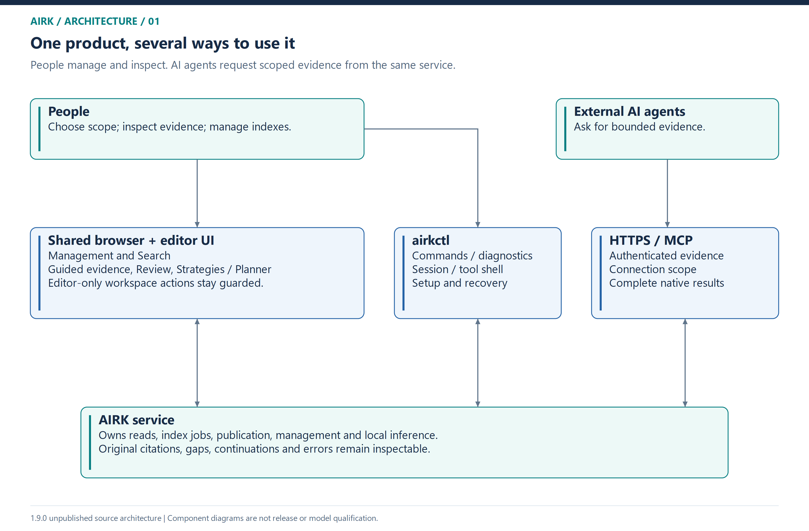
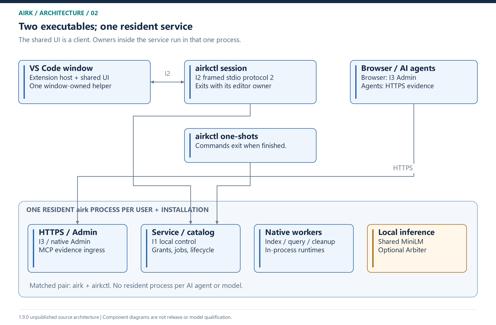
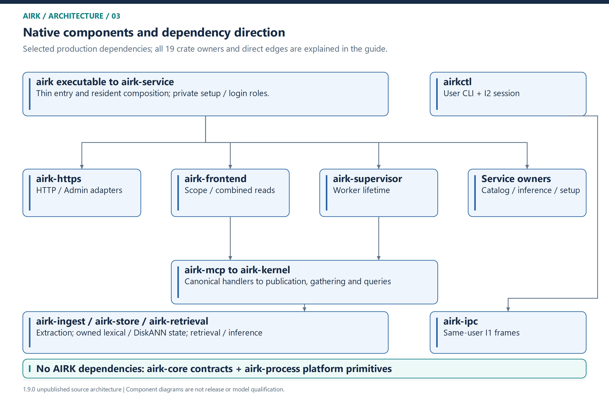
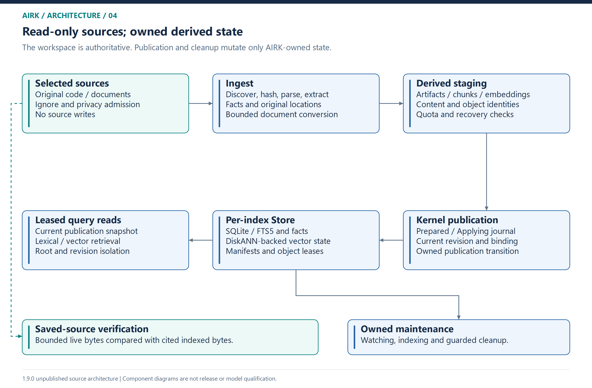
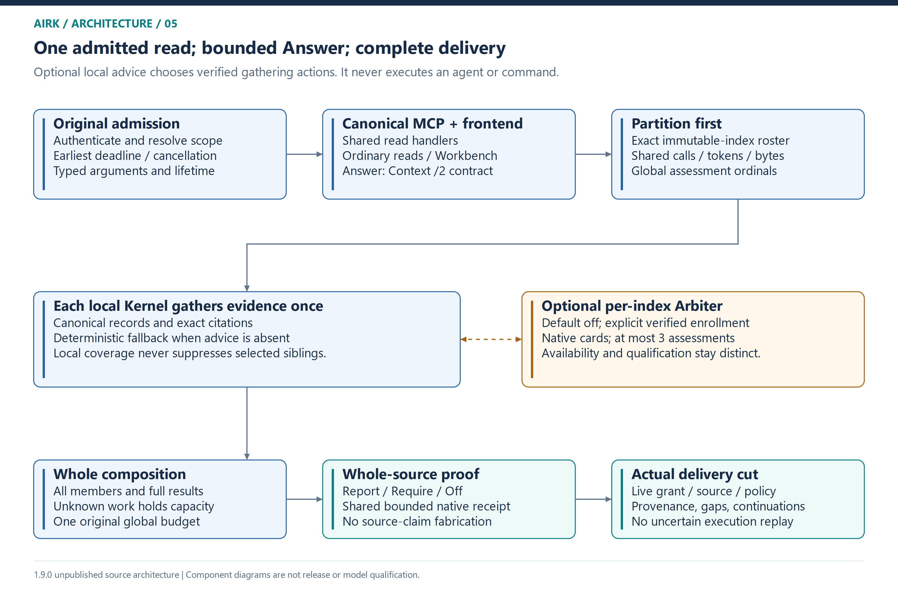
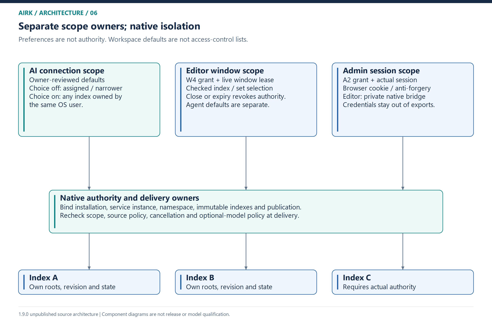

# AIRK Architecture in 1.9.0

This is a source-level map of the **1.9.0 unpublished branch**, reviewed against
the current crate manifests and owning contracts. It describes implemented
owners and request paths, not a released artifact or a claim that all platforms,
models, installed journeys and transports are qualified. The [current release
record](../releases/release-1.9.0.md) and [execution
ledger](../simplify/one-process-ledger.md) carry that evidence separately.

AIRK is a local Artifact Indexing and Retrieval Kernel. Original workspaces are
authoritative; indexes are derived. Users and AI agents obtain scoped evidence
through native service APIs. Optional Arbiter gathering is explicitly enrolled
per immutable index, off by default, and hosted inside the existing service.
It does not execute coding goals, run an agent, route cloud models or give a
client direct access to a store.

The figures use blue for ordinary components, teal for authority/source
boundaries and amber for optional model work. Arrows show the named request,
data or dependency relation, not a count of operating-system processes.

## Principles and vocabulary

AIRK separates **source authority**, **derived state**, **permission** and
**presentation**. Source authority means the user's original files are the
reference bytes. Derived state means extracted text, facts, search postings and
vectors can be rebuilt from those files. Permission means a native service
owner has admitted a particular caller and selection. Presentation means a
client may summarize an admitted result without becoming its authority.

An **index** has an immutable native identity, source roots and an independently
published current view. An **index set** is a named selection of indexes, not a
merged store. A **publication** identifies one observed indexed revision; it
does not mean the live workspace has stopped changing. A **namespace** binds a
catalog to its owning installation/state. A **grant** is native authority to
read a selection under an owner and lifetime. An index name, file path or saved
preference is not a grant.

The boundaries have practical consequences:

- Clients call the service. They do not open SQLite, DiskANN or model assets.
- The service owns jobs after a UI window closes. A canceled caller does not
  prove accepted native work stopped.
- Canonical result bodies preserve source locations, errors and uncertainty.
  A successful transport exchange is not a completeness or freshness claim.
- Budgets limit the original operation; nested calls cannot reset them.
  Unknown work remains charged until its owner observes settlement.
- Destructive operations need actual ownership proof. A familiar pathname or
  executable name is insufficient permission to remove it.

## 1. People, agents and the product



[Open full-size PNG](images/01-product-interaction.png)

The browser and editor share management, Search and guided workflows. The
editor additionally has workspace capabilities such as guarded saves and
opening source locations. Browser imports, downloads and clipboard operations
do not establish an editor workspace save. Review, Strategies and Planner
assemble bounded evidence and human/agent instructions; they do not execute an
agent. Copies and exports retain the complete native results and disclose any
selected subset.

`airkctl` provides commands, diagnostics, setup, an interactive tool shell and
the framed session used by the editor. External agents ordinarily connect
directly to the service's authenticated loopback HTTPS `/mcp` endpoint. A
credential helper is a one-shot, not a resident process per agent.

### Typical journeys

**A person prepares a source.** They install/verify the native pair, create an
index from an explicit source selection, review its setup and readiness, and
run indexing. They then select existing indexes or sets in Search. Changing
Search selection does not create an index. Progress, paused jobs, failures and
actual readiness are exposed by the native job/catalog owners.

**An AI agent asks a question.** The owner configures an authenticated agent
connection and its default selection. The agent calls a listed MCP tool with
bounded arguments. Native admission resolves the current permitted selection;
the query returns cited evidence, metadata and disclosed gaps. The agent may
make an explicitly permitted follow-up read. AIRK does not execute the agent's
proposed code change. With agent choice enabled, the agent may explicitly
select any index owned by that same OS user; defaults are convenience, not an
access-control list (ACL).

**A person reviews evidence.** Search and guided tools expose native results
alongside readable citations. Review can assemble an impact/test checklist;
Strategies can run a closed bounded retrieval recipe and compile a prompt;
Planner can store task dependencies and evidence snapshots. Completed is
reviewed user task state, not proof an autonomous agent ran or that a source
still matches.

**A person changes service state.** Admin or `airkctl` requests a native
management operation. Admission, immutable preparation, confirmation and
recovery belong to that operation's native owner. If submission may have
executed but its reply is lost, the UI retains the original identity and offers
only supported same-operation observation/recovery. A fresh key or automatic
resubmission is not recovery.

Owners: [shared UI contracts](../split/contracts.md), [I2
contract](../../crates/airkctl/src/contract/CONTRACT.md), [I3
contract](../../crates/airk-https/src/admin_plane/CONTRACT.md).

## 2. Processes and protocol planes



[Open full-size PNG](images/02-processes-and-planes.png)

The installed native distribution is a **matched pair: `airk` and `airkctl`**.
`airk` is the service executable. Its ordinary no-argument entry starts or
observes the installed service; user command parsing belongs to `airkctl`.
Exactly one service stays resident per user and installation. Stable, preview
and custom installations have separate ownership. Index, query, cleanup,
source-watch and inference owners run inside that service, with bounded
thread/runtime/resource ownership.

Each editor window owns one `airkctl session` helper that exits with its owner.
Other permitted short-lived processes include CLI/installer one-shots,
the user-opened shell and bounded isolated PDF extraction. There is no public
worker executable, model sidecar, separate database server or agent proxy.

| Boundary | What crosses it | Owning implementation |
|---|---|---|
| I1 | Same-user local control requests, scoped reads and private native Admin calls | [IPC framing and peer admission](../../crates/airk-ipc/CONTRACT.md) |
| I2 | CLI results and protocol-2 framed editor/session requests and events | [airkctl contract](../../crates/airkctl/src/contract/CONTRACT.md) |
| I3 | Browser Admin HTTP authentication, operation admission and envelopes | [AdminPlane](../../crates/airk-https/src/admin_plane/CONTRACT.md) |
| Evidence HTTPS / MCP | Authenticated read tools and their complete canonical results | [Read-surface parity](../read-interface-parity.md), [canonical MCP](../../crates/airk-mcp/src/lib.rs) |

Editor management uses the same native Admin owner through a private I1/I2
bridge; it does not forge browser HTTP credentials. Cookie/anti-forgery custody
stays in Rust and is excluded from public results. The [native Admin
contract](../../crates/airk-core/src/native_admin/CONTRACT.md) defines bounded
chunking, original deadlines, cancellation, session replacement and honest
unknown outcomes. A lost reply does not authorize automatic mutation replay.

Control work and evidence work have separate bounded admission lanes. A slow
optional model must not become the owner of health, ordinary lexical work or
all indexing progress. A worker is an in-process native owner with its own
runtime and leases, not a new public executable. If accepted work cannot be
observed to drain, its circuit can refuse new work while its resources remain
owned. Killing a UI does not make those resources available for reuse.

The protocol planes solve different problems. I1 authenticates the local OS
peer and frames native control. I2 binds the CLI/session caller contract,
request identities, events and exit/error conventions. I3 authenticates the
browser management session and enforces its operation/confirmation rules.
MCP exposes evidence tools to compatible clients. An adapter may carry the
same canonical result across a boundary without creating another query owner.

## 3. Native components and dependency direction



[Open full-size PNG](images/03-native-ownership.png)

The process boundary and the crate boundary are different. `airk-service`
composes the resident product. `airk-https` owns HTTP/Admin adapters;
`airk-frontend` owns scoped client/composition paths; `airk-supervisor` owns
in-process worker lifetime. Catalog mutations, shared inference, installation,
host adapters and endpoint contracts have separate owners. These are Rust
components inside the matched native product, not separately deployed services.

`airk-mcp` owns the canonical read handlers and tool schemas. Kernel owns
collection-scoped execution, publication, gathering and plans. Ingest owns
discovery/extraction; Store owns persisted state and its native filesystem
ownership; Retrieval owns retrieval algorithms, model assets and native
inference primitives. Core and Process have no AIRK dependencies. `airkctl`
depends only on Core, Process and IPC among AIRK crates, and does not open
Kernel stores. The figure deliberately selects edges for readability; the
following inventory records all direct production AIRK edges in these crate
manifests, including optional and target-specific dependencies, excluding
development dependencies. It is not a feature-resolution or linker graph.

### The 19 crate owners

| Crate | Owned responsibility |
|---|---|
| `airk-core` | Shared typed identities, artifacts, budgets, citations, service/catalog, install and Arbiter contracts; pure validators. |
| `airk-process` | Raw native process containment, object/directory identity, bounded platform commands and low-level OS adapters. |
| `airk-host` | Shared host-facing install/layout, checkpoint, native-command and original read-clock adapters. |
| `airk-endpoint` | Endpoint and Admin admission contracts, typed routes and response-boundary definitions. |
| `airk-ipc` | Same-user native endpoints, peer checks and bounded length-prefixed I1 frames. |
| `airk-ingest` | Ignore-aware discovery, hashing, extraction, parsing, chunks and original document locations. |
| `airk-store` | Persisted catalogs/current state, SQLite/FTS5, leases, locks, quotas, journals and guarded filesystem ownership. |
| `airk-retrieval` | Retrieval algorithms, DiskANN primitives, local inference/model assets and optional-model execution primitives. |
| `airk-kernel` | Index-scoped execution, publication, retrieval/rank fusion, bounded gathering and Workbench plans. |
| `airk-mcp` | Canonical evidence handlers, schemas, result conversion and official MCP SDK adapters. |
| `airk-inference` | Shared service inference lifetime and bounded model/session orchestration inside the resident process. |
| `airk-catalog-control` | Native catalog mutations, setup/index jobs and revision/ownership-controlled management. |
| `airk-installer` | Native installation/replacement adapters and predecessor ownership/retirement responsibilities. |
| `airk-supervisor` | In-process worker lifecycle, admission and service execution/resource supervision. |
| `airk-frontend` | Service-side clients, scope resolution, combined composition and canonical read adapters. |
| `airk-https` | HTTPS ingress, browser/native Admin handlers, sessions and bounded response delivery. |
| `airk-service` | Resident composition, native dispatch, source/Arbiter policy and private setup/login roles. |
| `airk-cli` | The `airk` executable entry and role admission; public user commands belong to `airkctl`. |
| `airkctl` | User commands, the I2 session, native client custody and reviewed agent-configuration editing. |

These are code owners, not deployment units. Browser/editor packages consume
Rust-generated contracts and shared presentation/validation algorithms; they
do not implement another native catalog, source authority or model worker.

### Direct production dependencies

<!-- native-dependencies:start -->
| Crate | Direct production AIRK dependencies |
|---|---|
| [airk-catalog-control](../../crates/airk-catalog-control/Cargo.toml) | `airk-core`, `airk-endpoint`, `airk-host`, `airk-inference`, `airk-ipc`, `airk-kernel`, `airk-mcp`, `airk-process`, `airk-retrieval`, `airk-store` |
| [airk-cli](../../crates/airk-cli/Cargo.toml) | `airk-catalog-control`, `airk-core`, `airk-endpoint`, `airk-frontend`, `airk-host`, `airk-https`, `airk-inference`, `airk-installer`, `airk-ipc`, `airk-kernel`, `airk-mcp`, `airk-process`, `airk-retrieval`, `airk-service`, `airk-store`, `airk-supervisor` |
| [airk-core](../../crates/airk-core/Cargo.toml) | None |
| [airk-endpoint](../../crates/airk-endpoint/Cargo.toml) | `airk-core`, `airk-host`, `airk-ipc`, `airk-kernel`, `airk-mcp`, `airk-process`, `airk-retrieval`, `airk-store` |
| [airk-frontend](../../crates/airk-frontend/Cargo.toml) | `airk-catalog-control`, `airk-core`, `airk-endpoint`, `airk-host`, `airk-inference`, `airk-installer`, `airk-ipc`, `airk-kernel`, `airk-mcp`, `airk-process`, `airk-retrieval`, `airk-store`, `airk-supervisor` |
| [airk-host](../../crates/airk-host/Cargo.toml) | `airk-core`, `airk-ipc`, `airk-kernel`, `airk-mcp`, `airk-process`, `airk-retrieval`, `airk-store` |
| [airk-https](../../crates/airk-https/Cargo.toml) | `airk-catalog-control`, `airk-core`, `airk-endpoint`, `airk-frontend`, `airk-host`, `airk-inference`, `airk-installer`, `airk-ipc`, `airk-kernel`, `airk-mcp`, `airk-process`, `airk-retrieval`, `airk-store`, `airk-supervisor` |
| [airk-inference](../../crates/airk-inference/Cargo.toml) | `airk-core`, `airk-endpoint`, `airk-host`, `airk-ipc`, `airk-kernel`, `airk-mcp`, `airk-process`, `airk-retrieval`, `airk-store` |
| [airk-ingest](../../crates/airk-ingest/Cargo.toml) | `airk-core`, `airk-process` |
| [airk-installer](../../crates/airk-installer/Cargo.toml) | `airk-catalog-control`, `airk-core`, `airk-endpoint`, `airk-host`, `airk-inference`, `airk-ipc`, `airk-kernel`, `airk-mcp`, `airk-process`, `airk-retrieval`, `airk-store` |
| [airk-ipc](../../crates/airk-ipc/Cargo.toml) | `airk-core`, `airk-process` |
| [airk-kernel](../../crates/airk-kernel/Cargo.toml) | `airk-core`, `airk-ingest`, `airk-retrieval`, `airk-store` |
| [airk-mcp](../../crates/airk-mcp/Cargo.toml) | `airk-core`, `airk-kernel` |
| [airk-process](../../crates/airk-process/Cargo.toml) | None |
| [airk-retrieval](../../crates/airk-retrieval/Cargo.toml) | `airk-core`, `airk-process` |
| [airk-service](../../crates/airk-service/Cargo.toml) | `airk-catalog-control`, `airk-core`, `airk-endpoint`, `airk-frontend`, `airk-host`, `airk-https`, `airk-inference`, `airk-installer`, `airk-ipc`, `airk-kernel`, `airk-mcp`, `airk-process`, `airk-retrieval`, `airk-store`, `airk-supervisor` |
| [airk-store](../../crates/airk-store/Cargo.toml) | `airk-core`, `airk-process` |
| [airk-supervisor](../../crates/airk-supervisor/Cargo.toml) | `airk-catalog-control`, `airk-core`, `airk-endpoint`, `airk-host`, `airk-inference`, `airk-installer`, `airk-ipc`, `airk-kernel`, `airk-mcp`, `airk-process`, `airk-retrieval`, `airk-store` |
| [airkctl](../../crates/airkctl/Cargo.toml) | `airk-core`, `airk-ipc`, `airk-process` |
<!-- native-dependencies:end -->

The manifests and [boundary gate](../../scripts/dev/boundary_check.py) remain
the enforcement sources; this explanatory inventory creates no new permitted
edge. Source ownership and allowed direction are also described in the
[architecture reference](../architecture.md). Its dated pre-split descriptions
must be read with the current [split decisions](../split/split-plan.md) and
contracts, particularly for extracted crate owners and optional Arbiter.

## 4. Read-only sources and derived publication



[Open full-size PNG](images/04-source-and-publication.png)

A reviewed source root passes native identity, traversal, ignore and privacy
policy checks before capture. Ingest hashes and extracts bounded artifacts,
facts, chunks and original document locations. Derived staging and publication
write only AIRK-owned state. The durable publication journal and current-view
owners govern application and recovery; readers retain scoped publication and
object leases. Maintenance cannot treat a pathname alone as proof that an
object is safe to delete.

The current lexical backend is SQLite/FTS5. The selected vector backend is
**DiskANN**, with its current-provider integration reported by the live
[Kernel runtime](../../crates/airk-kernel/src/current/runtime.rs). SQLite lexical
state is not presented as a substitute for that vector engine. Embeddings and
semantic readiness remain explicit capabilities; an index can expose readiness
and gaps rather than claiming vectors exist.

Original sources remain unchanged. Saved-source verification is a separate
bounded observation of cited files, not permission to write the workspace.
AIRK-private roots and retained agent-edit archives are excluded from evidence
capture and public reads. Read-only indexing does not mean agent-configuration
or installer operations cannot write their separately reviewed owned targets.

Owners: [source admission](../../crates/airk-ingest/src/source_scope.rs),
[source policy](../../crates/airk-core/src/source_policy.rs), [Store filesystem
contract](../../crates/airk-store/src/store_fs/CONTRACT.md),
[current Kernel](../../crates/airk-kernel/src/current.rs),
[retained configuration edits](../../crates/airkctl/src/agents/config/CONTRACT.md).

## 5. Canonical queries, Answer and delivery



[Open full-size PNG](images/05-query-and-answer.png)

CLI/session, MCP, Admin and Workbench read paths converge on canonical native
handlers. Their adapters preserve supported arguments and full outputs:
publication identity, original citations, provenance, readiness, coverage,
continuations, partial results, errors and retry details. A renderer summary
is not the export authority. The [parity
matrix](../read-interface-parity.md) distinguishes handler evidence from actual
transport and packaged-client qualification.

Answer uses the current local `Context /2` contract. Deterministic gathering
returns canonical evidence, paragraphs and explicit gaps. Where an enrolled,
supported optional profile is actually available, native-generated finite
action cards may be scored to choose a verified additional read or a fallible
terminal assessment. This is contextual evidence gathering, not free-form
model command execution. There is no claim that an optional model is qualified
merely because its loader, schema or UI is implemented.

For a combined selection, the frontend partitions calls, tokens, candidates
and bytes **before** optional model work. Members share the original deadline,
cancellation and global assessment ledger; the optional cap is at most
`min(3, requested rounds)`. Each member produces one local packet under its
allocation. A member's coverage or clarification does not stop siblings or
become a whole-selection model judgment. Unqueried, failed, known and unknown
work remain distinct; uncertain native work keeps its reservation.

The combined wrapper retains member results, publication vector, accounting,
ranking and delivery metadata. Source verification has one whole-response
owner and a shared bounded receipt budget, honoring Report / Require / Off.
Complete wrapper bytes must fit the original parent limit. A post-execution
budget/staleness failure is nonreplayable, not permission to regenerate a
fresh attempt. Grant, publication/source and optional-policy guards extend to
the actual delivery cut, rather than relying only on an earlier UI check.

Owners: [canonical Answer handler](../../crates/airk-mcp/src/lib.rs), [Core
Arbiter contract](../../crates/airk-core/src/arbiter/CONTRACT.md), [whole-selection
accounting](../../crates/airk-core/src/combined_context/CONTRACT.md), [frontend
Answer composition](../../crates/airk-frontend/src/combined_frontend/answer.rs),
[original read lifetime](../../crates/airk-mcp/src/read_attempt.rs).

**Qualification remains separate.** MiniLM retrieval and optional Arbiter
models have distinct roles and gates. The original failed model acceptance
evidence remains failed; later development experiments do not rewrite it.
Model quality, downstream task completion/turn reduction, resource/backend fit,
platform behavior and installed/package delivery require their own frozen
evidence. No cloud acquisition or evaluator is implied by this diagram set.

## 6. Scope, trust and isolation



[Open full-size PNG](images/06-scope-and-trust.png)

Agent connection defaults, editor search selection and Admin session selection
are distinct owners. A preference, path, index name or renderer object cannot
grant access. Open agent connections resolve the owner's assigned defaults;
choice is off by default: the agent stays within its assigned default scope or
narrows it. When choice is explicitly enabled, the agent may select **any index
owned by the same OS user**, subject to native admission. Workspace defaults
are not an access-control boundary. Selecting an existing index does not
create one.

The editor's W4 grant binds its live window lease and checked catalog
selection. Admin's A2 grant binds the actual browser/native Admin session.
Lease/session end, replacement, service restart and revocation have explicit
native consequences. The service checks namespace, immutable index, actual
worker authority, publication and source policy. Combined replies retain the
complete member publication vector: permission for one member cannot authorize
another. Optional Arbiter enrollment is also per index; excluded members do
not supply content to optional scoring.

Trusting the local TLS identity, authorizing an evidence scope, confirming a
destructive management action and enabling an optional model are separate
decisions. Neither a valid TLS connection nor shared UI presentation merges
those permissions. See the [split authority
contracts](../split/contracts.md), [Admin admission
contract](../../crates/airk-endpoint/src/admin_contract/CONTRACT.md) and
[native Admin custody](../../crates/airk-core/src/native_admin/CONTRACT.md).

## 7. Installation, updates and offline operation

Installation is a native transaction, not copying a binary over a live store.
The placed payload inventory binds the matched executables, version, platform,
Admin assets, file digests and signing facts. An owner-private setup operation
has one immutable identity. The native install owner verifies locations and
actual predecessor ownership, drains owned processes, verifies placement,
writes the install record and publishes the fixed install pointer last.
Concurrent clients cannot independently repeat that same replacement.

The install record describes what was installed; the pointer selects that
verified installation. Neither file's existence alone proves safe native
ownership: readers also verify exact paths, image bytes, links and applicable
platform signing/permission facts. Startup uses the installed service image;
the optional VS Code extension is a client distributed separately.

For installation/replacement through 1.9.0 inclusive, the recorded policy is a
full owned-predecessor uninstall followed by an empty catalog, including a
same-version reinstall. Original user sources remain untouched. Old index
selections, grants, pending indexing jobs and watching are not automatically
replayed. Ordinary editor reopening reconnects; it does not reinstall or
recreate indexes. An interrupted transaction resumes its original request and
receipt rather than manufacturing a successful cleanup or successor identity.
Unproven or incomplete owned retirement blocks completion and reports preserved
leftovers. An ordinary explicit uninstall follows its requested native
retention/purge rules; retained bytes are not permission to adopt an old catalog
across the stated replacement boundary.

Portable setup uses the same native verification/receipt owners for an
explicitly selected extracted payload. Its defaults disable login startup,
skip trust changes and do not automatically start the service. Standard
wrappers have platform-specific startup, PATH/link and trust behavior with
separate ownership receipts. Consent, unsupported OS facilities and actual
failures remain visible. No diagram claims all of those installed paths are
qualified on every target.

Bundled Help and bundled model assets support offline use where included and
verified. Ordinary reads/startup do not silently download missing optional
models. Explicit optional-model provisioning verifies its approved asset
identity and eligibility; offline absence is reported. A new asset or runtime
profile is not trusted because a matching filename exists. Runtime/package
checks, operating-system trust, signing and publication remain distinct from
source implementation.

## 8. Data, privacy, proof and model limits

AIRK owns derived index/state roots, protected credentials, bounded diagnostic
records and native operation receipts. The user's source workspaces remain
read-only to indexing/retrieval. Explicit agent-configuration editing and
installer operations have their own narrow write targets and ownership rules;
they are not exceptions allowing arbitrary source writes. Source admission
also excludes AIRK-private state, retained edit archives and forbidden alias
paths. Ignore defaults are convenience policy, not a guarantee that all secrets
in arbitrary source files will be detected.

TLS identifies the local HTTPS service. Agent authentication identifies a
connection; scope admission selects what it may read. Browser cookie and
anti-forgery admission authorize its management session. These are separate
checks. Same-OS-user agent choice is intentionally broad when enabled; a
workspace default is not a confidentiality boundary against that choice.
Unknown outcomes, credential errors and expired grants are explicit results,
not reasons to leak private transport responses into public output.

**Source proof is bounded and contextual.** A citation names indexed content
and its original location. Native verification may compare the saved current
file with the indexed bytes, within the request's source-byte, source-count,
receipt-byte and original-time limits. Report discloses the observation,
including missing/truncated/unavailable checks. Require refuses when its proof
requirements cannot be met. Off makes no live-source claim. None of those modes
proves unsaved editor buffers match or that the source cannot change later.
The browser cannot inspect editor buffers and must retain that uncertainty.

**MiniLM and Arbiter do different work.** MiniLM produces retrieval embeddings
used by semantic/vector search. Optional Arbiter helps choose bounded evidence
gathering actions and express fallible coverage/gap assessments. Arbiter is not
the user's coding agent, a general command executor or a replacement for the
canonical query engine. Its per-index enrollment does not admit excluded
indexes into scoring. Profile identity binds model, compiler/policy and
calibration facts; static memory fit, live availability and scientific quality
are three different observations.

Model inputs consume actual reserved/observed token and time budgets.
Unknown native work is not recorded as measured zero. Disconnect/timeout may
suppress a reply while native resources remain pinned until observed
completion. Disable/switch must suppress queued or stale delivery through
native policy owners; a preceding UI status check alone is insufficient.
Ordinary retrieval must remain honest when optional advice is absent.

Routine usage aggregates are bounded and content-free; they do not turn source
text or prompts into external telemetry. Explicit diagnostics, exports and
authorized local evaluation traces can contain original content and need
private handling. AIRK's local architecture implies no cloud provider,
external database or downstream agent service. A user may choose a separate
AI client; that client's own transmission/data policy is outside AIRK's local
store boundary.

**Implementation is not qualification.** A compiled handler, rendered UI,
verified asset or successful smoke test proves only its measured boundary.
Actual transport parity compares complete equivalent inputs/results. Installed
journeys cover real processes, ownership and cleanup on identified artifacts.
Model qualification additionally requires frozen quality/uncertainty,
downstream task, resource and platform gates. The original failed model gate
remains failed; later development work cannot relabel it. This guide makes no
release, universal hardware-support, independent accuracy or turn-saving claim.

## 9. Terms used in this guide

| Term | Meaning |
|---|---|
| Canonical handler | The single native implementation that validates a read and produces its complete result. |
| Scope | The specific native-authorized index selection for the original caller and lifetime. |
| Immutable index ID | An index identity that cannot be replaced by a friendly name or another root. |
| Publication vector | The complete list of selected members and their observed publication identities. |
| Citation | A source location tied to indexed evidence; not by itself a live-file freshness proof. |
| Lease / pin | Held native ownership preventing premature reuse/removal while accepted work still depends on an object. |
| Absolute deadline | The original attempt's expiry; queueing and child calls cannot restart its duration. |
| Reservation | Capacity held for admitted work, including uncertain work whose completion has not been observed. |
| Receipt | A retained native observation/result bound to the original operation/source/artifact; not automatically a replay capability. |
| Journal | Durable transition state used to settle or resume an interrupted owned operation. |
| CAS | Compare-and-swap: publish a mutation only if the expected native revision still matches. |
| FTS5 | SQLite full-text-search indexing for the lexical path. |
| DiskANN | The selected disk-backed vector-search engine, separate from lexical SQLite storage. |
| Calibration | Measured policy/threshold preparation for a specified model/task; not evidence of independent final qualification. |
| Admission / delivery fence | Native checks at work acceptance and at actual result delivery; a renderer cannot replace them. |
| Qualified artifact | An identified build/package with the required checks actually observed, not merely current source. |

## Diagram sources and regeneration

Every image above links to an actual PNG under [images](images/). Editable
vector sources are retained under [images/sources](images/sources/); they
contain no external image, network or private-state reference. The deterministic
[generator](render_diagrams.py) uses Python's standard library and ImageMagick
7's SVG rasterizer with explicit [print layouts](diagram_layouts.py). It emits
3200 x 2100 PNGs with 44-pixel body text and a
[render manifest](images/render-manifest.json) with tool identity, dimensions
and source/output hashes:

```powershell
python docs/architecture/render_diagrams.py
python docs/architecture/build_docx.py
python docs/architecture/inspect_docx.py
```

Use the same renderer version and Segoe UI font for byte-identical PNGs;
fallback fonts can change glyph metrics and raster bytes. SVG layout and
explicit arrow endpoints are reproducible without a layout-engine heuristic.
Regeneration does not build AIRK or open indexes, models, credentials or live
service state. Review the owning source/contracts when changing the diagrams;
updating a picture is not validation of a new capability.

The accompanying [landscape Word edition](airk-architecture-landscape.docx) is
a standalone print/share document.
It embeds all six 3200 x 2100 PNGs, preserves their aspect ratio and gives each
figure its own US Letter landscape page. Body text is 11 pt, with half-inch
left/right and 0.45-inch top/bottom margins, repeated table headers and numbered
footers. The Word builder uses existing Pandoc plus Python's standard-library
OOXML finishing; python-docx and network downloads are not required. Source
references in Word point to the branch's public repository URLs and remain
optional: the operating narrative and glossary are contained in the document.
