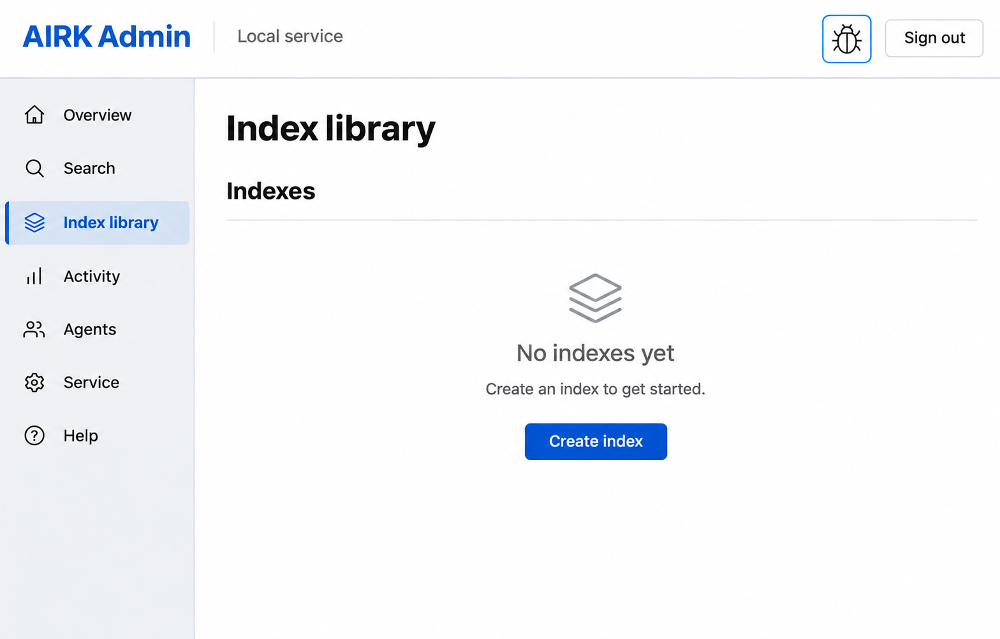
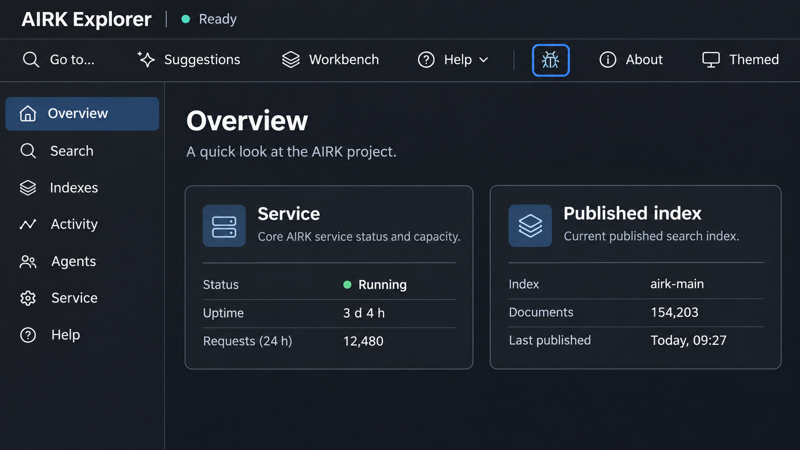
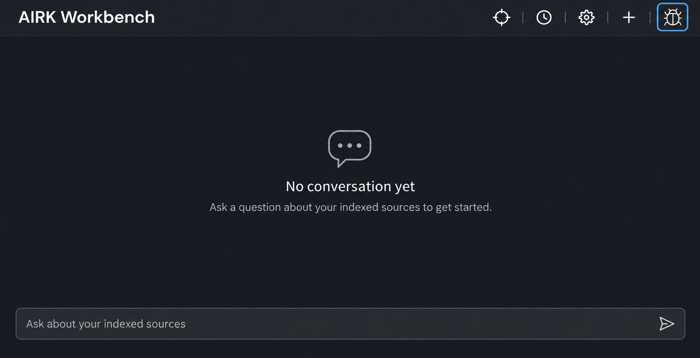

# AIRK "Report a bug" button implementation plan

Revision 4, 19 November 2026. Target `iokaio/airk` on `feat/arbiter-final`, reviewed against `9e2a0656` and source version 1.8.207. Read [AGENTS.md](../../AGENTS.md#execution-identity) and the [validation matrix](../../CONTRIBUTING.md#agent-validation-matrix) before implementation.

## 1. Decision

**Report a bug** copies a plain-text bug report template with a small amount of current UI context. When the copy succeeds, show where users can paste the report. The issues address is `https://github.com/iokaio/airk/issues`. Users choose whether to paste the text into a GitHub issue, email, or local file.

The action uses the clipboard and a local notice. It never starts native work, signs in, makes a request, sends a report, or opens a browser. There is no prefilled URL, attachment, new dependency, or change to native contracts, the Admin operation table, its CSP, or the issue templates. The address can be plain text in every notice.

### Surfaces and placement

| Surface | Control | Clipboard |
| --- | --- | --- |
| Browser Admin | Simple beetle icon before **Sign out** in the header. On the signed-out gate, place it beside **Read offline Help** or the Help region when open. | `navigator.clipboard.writeText` |
| Explorer | The same icon immediately after **Help** and before **About** in `.topbar-actions`. This covers embedded Admin screens as well. | Extension host `vscode.env.clipboard.writeText` |
| Workbench | The same icon after **New session** in `header.toolbar`. | Extension host clipboard |
| Command Palette and sidebar | `airk.reportBug`, titled **AIRK: Report a Bug (Copy to Clipboard)**. Use a text link in the sidebar footer on both the live and first-run presentations. | Extension host clipboard |

Render the header control as an icon-only button. Use a simple monochrome outline beetle, a visible keyboard focus indicator, and `aria-label="Report a bug"` with a tooltip. Reuse the surrounding button styles and mark the icon itself decorative. Embedded Admin gets its reporting control from Explorer.







The highlighted outline in the mockups identifies the proposed placement.

## 2. What gets copied

```text
AIRK bug report

Summary:
What happened:
What I expected:
Steps to reproduce:

--- Context (added by AIRK; edit or delete before sharing) ---
AIRK: 1.8.207
Host: VS Code 1.142.0
OS: win32 x64
Remote: wsl
Screen: explorer › manage/logs
Connection: ready
Index state: available
Error code: REQUEST_TIMEOUT
Captured: 2026-11-18T21:11:00.000Z

Report at https://github.com/iokaio/airk/issues or send this text to the maintainer.
```

| Value | Extension source | Browser Admin source |
| --- | --- | --- |
| AIRK version | The active extension payload version from the host | `productVersion` from the bundled Help manifest |
| Host | Fixed `VS Code` label and the version from `vscode.version` | Fixed `Browser Admin` label |
| OS and architecture | `process.platform` and `process.arch` describe the extension host, which may be remote | Omit |
| Remote kind | Only the recognized categories from `vscode.env.remoteName` | Omit |
| Screen | Fixed surface and optional canonical Explorer route key | Fixed surface and optional `PageId` from the current `PAGES` list |
| Connection, index state, error code | Matching enum values from already-held Explorer state. Omit for Command Palette and Workbench. | Omit |
| Captured | UTC from the caller's `Date.toISOString()` | Same |

Each context field has a specific source and accepted values. Omit unknown values and never truncate an invalid value into a valid one. An arbitrary string can look like a valid identifier, so a character filter alone is insufficient. Exclude file paths, project, collection and index names, identifiers, user names, remote authority and hostnames, endpoints, query text, evidence, error messages and details, and credentials. Ignore route focus, fragments, query parameters, and session or tenant metadata.

## 3. Shared pure builder

Create `packages/vscode/src/bugReport.ts`. The extension host's `rootDir` is `src`, and Admin already bundles pure modules from that directory. Keep this owner dependency-free and move the fixed issues address from `ABOUT_LINKS.issues.url` into it. Have `ABOUT_LINKS` consume the same constant. Keep the existing destination and behavior for About links.

The caller supplies only the appropriate UI-owned route catalog. Explorer uses `ROUTE_KEYS` from `explorerRoutes.ts` and Admin derives page IDs from `PAGES`. Neither catalog can originate from a message, setting, or live project. Use the real Explorer enum vocabulary from `explorerContracts.ts` and test that the report's accepted subset stays compatible.

```ts
// SPDX-License-Identifier: Apache-2.0
export const BUG_REPORT_ISSUES_URL = 'https://github.com/iokaio/airk/issues';
export const BUG_REPORT_COPIED = 'Bug report copied to the clipboard. Paste it into a new issue at '
    + BUG_REPORT_ISSUES_URL + ', an email, or a text file.';
export const BUG_REPORT_COPY_FAILED = 'Could not copy the bug report. Issues: ' + BUG_REPORT_ISSUES_URL;

const SURFACES = ['explorer', 'workbench', 'admin', 'command'] as const;
const OS = ['win32', 'linux', 'darwin'] as const;
const ARCH = ['x64', 'arm64', 'ia32', 'arm'] as const;
const REMOTE = ['wsl', 'ssh-remote', 'dev-container', 'codespaces'] as const;
const CONNECTION = ['connecting', 'ready', 'degraded', 'disconnected', 'incompatible', 'untrusted'] as const;
const INDEX = ['not_registered', 'not_indexed', 'indexing', 'available', 'unavailable', 'unknown'] as const;
const ERRORS = ['REQUEST_TIMEOUT', 'REQUEST_SUPERSEDED', 'CAPABILITY_DISABLED', 'CLIENT_NOT_AUTHORIZED'] as const;
const AIRK_VERSION = /^\d{1,6}\.\d{1,6}\.\d{1,6}$/;
const EDITOR_VERSION = /^\d{1,6}\.\d{1,6}\.\d{1,6}(?:-insider)?$/;
const UTC = /^\d{4}-\d{2}-\d{2}T\d{2}:\d{2}:\d{2}\.\d{3}Z$/;

export interface BugReportContext {
    surface: typeof SURFACES[number];
    route?: string;
    airkVersion?: string;
    editorVersion?: string;
    os?: string;
    arch?: string;
    remote?: string;
    connection?: string;
    indexState?: string;
    errorCode?: string;
    capturedAt?: string;
}

type RouteCatalogs = Readonly<Partial<Record<'admin' | 'explorer', readonly string[]>>>;
const pick = (value: unknown, choices: readonly string[]): string | undefined => choices.find(choice => choice === value);
const matches = (value: unknown, pattern: RegExp): string | undefined =>
    typeof value === 'string' && value.length <= 32 && pattern.exec(value)?.[0] === value ? value : undefined;
const line = (label: string, value: string | undefined): string | undefined => value ? label + ': ' + value : undefined;

export function buildBugReportText(context: BugReportContext, catalogs: RouteCatalogs = {}): string {
    const surface = pick(context.surface, SURFACES) ?? 'command';
    const route = surface === 'admin' || surface === 'explorer' ? pick(context.route, catalogs[surface] ?? []) : undefined;
    const version = matches(context.editorVersion, EDITOR_VERSION);
    const time = matches(context.capturedAt, UTC);
    const when = time ? new Date(time) : undefined;
    const captured = when && Number.isFinite(when.getTime()) && when.toISOString() === time ? time : undefined;
    const platform = surface === 'admin' ? undefined
        : [pick(context.os, OS), pick(context.arch, ARCH)].filter(Boolean).join(' ');
    const fields = [
        'AIRK: ' + (matches(context.airkVersion, AIRK_VERSION) ?? 'unknown version'),
        'Host: ' + (surface === 'admin' ? 'Browser Admin' : version ? 'VS Code ' + version : 'VS Code'),
        line('OS', platform),
        line('Remote', surface === 'admin' ? undefined : pick(context.remote, REMOTE)),
        'Screen: ' + (route ? surface + ' › ' + route : surface),
        line('Connection', surface === 'explorer' ? pick(context.connection, CONNECTION) : undefined),
        line('Index state', surface === 'explorer' ? pick(context.indexState, INDEX) : undefined),
        line('Error code', surface === 'explorer' ? pick(context.errorCode, ERRORS) : undefined),
        line('Captured', captured),
    ].filter((entry): entry is string => entry !== undefined);

    return [
        'AIRK bug report', '', 'Summary:', 'What happened:', 'What I expected:', 'Steps to reproduce:', '',
        '--- Context (added by AIRK; edit or delete before sharing) ---', ...fields, '',
        'Report at ' + BUG_REPORT_ISSUES_URL + ' or send this text to the maintainer.', '',
    ].join('\n');
}
```

Omit missing rows before assembling the template so intentional blank lines survive. Keep the builder free of native APIs, network calls and multiline template literals for the Admin bundle.

## 4. Browser Admin

In `packages/admin/src/app.tsx`, use the existing icon placement above, and define the report component outside the app component so its state survives renders. Follow the clipboard pattern in `agents.tsx` and `SearchScreen.tsx`. Read `productVersion` directly from `packages/ui/generated/help-manifest.json` as `bundledHelp.tsx` does. Build from the current `page` or omit the route on the signed-out gate. Pass no `route.params` or session data.

Use a small `role="status"` region below the header or gate controls. Confirm only after a successful clipboard write. On missing or rejected clipboard access, show a fixed notice with the issues address and the complete template in a read-only, selectable textarea. Let the user dismiss the notice. Guard against duplicate in-flight writes. Use `app.css` for styling.

Keep the action usable on the signed-out gate and in a shell that is already open after the service stops. A fresh browser needs the service to serve the Admin shell. The button itself must work without opening an Admin session or requesting service status.

Build and verify the content-hashed assets in `crates/airk-cli/admin-assets/` as part of implementation. Review the new `manifest.json` and asset names. See the build and smoke checks in section 6.

## 5. VS Code extension

### 5.1 Host helper and command

Add a small host helper that builds from a narrow local context and platform metadata, awaits `vscode.env.clipboard.writeText`, and propagates failure without exposing a raw exception in the UI. Keep the bridge and builder separate. Register `reportBug` in the command table in `serviceExtension.ts` and add it to `contributes.commands` in `package.json` without an `enablement` clause. The command supplies only `surface: 'command'` and host metadata. Ignore any passed command arguments. Use the fixed success or failure notice as appropriate.

The handler must require no trust, project, service, or native-execution authorization. It must not refresh status, launch or check a service process, or wait for readiness. The extension loader and normal activation already run their own startup work. Test the command in Restricted Mode, with native execution disabled, and with the service stopped. Test the first command invocation separately from the already-active path to catch any startup dependency. Keep the existing activation and authorization boundaries.

### 5.2 Explorer

Add `bug.report` to `WEBVIEW_MESSAGES` in `explorerContracts.ts` with a bounded `route` parameter, and classify it in `UNCERTAIN_REQUESTS`, the request-timeout switch if it needs a dedicated message, and the editor-only roster in `fixtures/split/ui/view_messages.json`. Send `routeKey(route)` from `explorerWebview/app.tsx`, without its focus or query string. Require membership in `ROUTE_KEYS` at the host, for example by reusing the generic enum field rule. Reject unknown routes and extra fields. Retain the existing panel generation fence.

Include the action in `managementOrLocal` in `explorerController.ts` so a project selection change cannot invalidate a completed local copy. Read only the already-held connection, index state, and optional notice code. Apply the same local snapshot of selection and status ownership the view uses, so a prior project's status cannot be mislabeled as current. Avoid a new status request, and omit fields without a current observation. Return `{ copied: true }` only after the host clipboard call resolves.

Show a dismissible status near the notices. Use fixed copy-failure wording. For a timeout with uncertain effect, say the copy could not be confirmed and let the user check the clipboard. Never automatically repeat a write.

### 5.3 Workbench

In `workbenchContracts.ts`, add `{ type: 'reportBug' }` to the union and the exact no-argument parser branch. In `workbenchView.ts`, handle it before `this.authorized()`, alongside the local Help action. Use the same clipboard helper and the Workbench local notice mechanism for success and failure. The action needs no session, selected project, input, tool arguments, scope, or cards. Add the beetle to the existing icon map in `workbenchWebview/main.tsx` and send only the exact message.

### 5.4 Sidebar

Add the fixed `airk.reportBug` URI to the explicit `commandUris` allowlist passed to `ExplorerSidebar` in `serviceExtension.ts`. Add the footer link in both `explorerSidebar.ts` and its first-run `serviceDashboard.ts` view. Never interpolate URI arguments.

## 6. Tests

- Builder tests in `packages/vscode/src/test/bugReport.test.ts` compare the complete template with an independently written expected string, including blank lines and the final newline. Include minimal context and the full example in section 2.
- Use literal route catalogs in builder controls. Cover canonical Explorer and Admin routes, and cases where a valid-looking project name, an arbitrary code, a route parameter or an overlength value such as `'x'.repeat(5000)` must be omitted. Include a false calendar date, a version with a trailing newline, and an injected remote authority. Assert the complete forbidden values and their field labels stay out. Admin omits extension-host context, even when supplied.
- Verify the fixed address matches About. Explorer tests cover route membership, extra fields, overlength input, the editor-only roster, selection change during the clipboard write, and an uncertain timeout without replay. Workbench tests cover exact message parsing, a restricted or stopped-service path, and success and failure. Check that the Command Palette and sidebar paths ignore supplied arguments and do not invoke native, network, or browser launch methods.
- Browser Admin DOM tests cover the icon's accessible name, signed-in placement, signed-out gate, embedded rendering, and success, missing API, rejection, and dismissal. Assert the complete manual-copy text on failure. Check that the action causes zero new requests, session operations, or navigation. Exercise narrow toolbar layout and keyboard focus on each UI.
- Use the existing package commands. Run `npm test --prefix packages/vscode` and `npm test --prefix packages/admin`, then `npm run build --prefix packages/admin` and `npm run check --prefix packages/admin`. Review the existing Admin chunk checks in `packages/ui/test/adminChunks.test.mjs`. Compare the regenerated sealed assets and run the selected `airk-https` static route test `static_routes_need_no_session_and_carry_the_contract_headers` and `airk-cli` Admin plane integration smoke `admin_sign_in_reads_and_cross_plane_refusals` using the documented native prerequisites, one Cargo owner, and actual test counts. Report the installed UI verification separately from renderer tests.

## 7. Documentation

Update only the pages whose product instructions change. Start with [SUPPORT.md](../../SUPPORT.md), [Admin pages](../admin-pages.md), [the VS Code extension guide](../vscode-extension.md), and the current Explorer and Workbench guides. Explain the copied template, the user's choice to share it, and the browser's manual-copy fallback. Keep any release-facing text aligned with the implemented version.

If Help source changes, regenerate the shared manifest with `node packages/vscode/scripts/build-explorer.cjs --write-help-manifest` and review the generated bytes before sealing Admin assets.

## 8. Order of work

1. Follow the verified human execution procedure in [AGENTS.md](../../AGENTS.md#execution-identity) and [CONTRIBUTING.md](../../CONTRIBUTING.md#checked-windows-execution).
2. Add the shared builder and privacy tests, then implement the extension, Explorer, Workbench, and sidebar paths.
3. Implement the Browser Admin header and gate, then update the affected support and Help content.
4. Run the UI, asset, repository and whitespace checks in the [validation matrix](../../CONTRIBUTING.md#agent-validation-matrix). Preserve the existing read surfaces and native contracts. Use scoped asset smoke tests for the regenerated bundle.
5. Follow the repository versioning and DCO procedures for the eventual feature. Keep the native and extension versions and lockfiles synchronized if an implementation version bump is due.

## 9. Acceptance criteria

- Admin, Explorer, and Workbench show the accessible beetle control in the positions shown above. Browser Admin's signed-out gate also shows it. The Command Palette and sidebar offer the named command.
- One successful action copies the exact template containing only approved context and shows the issues address. Browser clipboard failures leave the complete template available for manual copying. No failure or uncertain outcome is reported as success.
- The action uses only local presentation and clipboard behavior. It works without project trust, native execution, or a running service when the relevant shell is already available. It starts neither a new service nor an Admin session.
- Private workspace content, paths, credentials, query text, evidence, and arbitrary strings never enter the generated context.
- The expected UI, asset, native smoke, repository, and whitespace checks pass on the implementation. The screenshots are placement references for the proposed feature.
