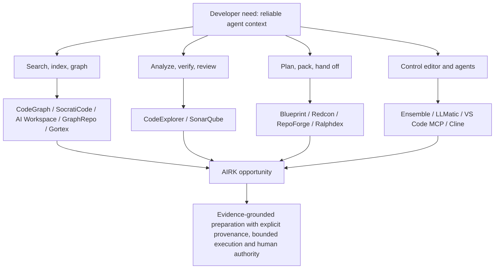
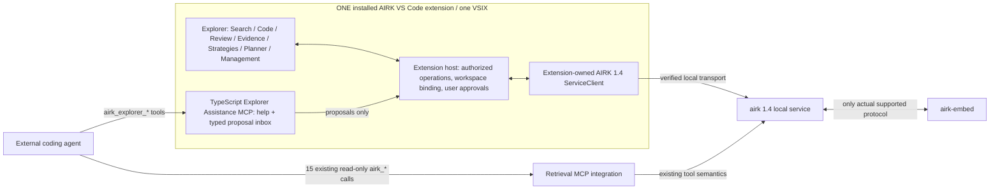
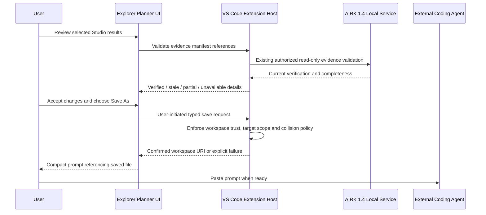

# AIRK 1.4 Competitive Research and Enhancement Opportunity Report

**Subject:** VS Code Marketplace alternatives to AIRK and the planned AIRK Explorer, Strategy Studio, Planner, Review, and Agent Assistance experience\
**Research date:** 25 October 2026\
**Purpose:** Give Codex independently checkable competitor evidence, design patterns to evaluate, implementation hypotheses, and a prioritized backlog of ways AIRK might become more useful and more distinctive.\
**Document type:** Competitive research / design input. **Not** an approved implementation specification.\
**Primary internal companion:** `AIRK_Explorer_Codex_Plan_v1_4.md` (the user's unified implementation plan; check that a copy is available in the working repository).\
**External baseline:** Public VS Code Marketplace listings and selected first-party project repositories, linked in §14.

> **Codex instruction:** This report is a source of hypotheses and design challenges, not permission to change architecture or copy competitors' code. Read the real checked-out AIRK 1.4 source, its tests, and the approved Explorer plan first. Categorize each proposed improvement as **already implemented, planned, new proposal, blocked, or rejected**. Propose small, testable changes and preserve AIRK's explicit boundaries. Do not claim a vendor feature is absent just because it was not mentioned in the materials reviewed.

---

## 1. Executive assessment

### 1.1 Bottom line

The VS Code Marketplace contains **substantial, concrete overlap** with AIRK's current local code-evidence retrieval and proposed Explorer enhancements. “Local,” “MCP,” “code graph,” “semantic search,” “deterministic,” “human-in-the-loop,” “Markdown planning,” and “token reduction” are **not** unique categories. Specific named extensions have already documented pieces of the desired experience:

- **CodeExplorer**: interactive architecture cockpit, OpenCypher queries, 23 MCP tools, 35 architecture/quality gates, and ratchet baselines. The direct threat to an Explorer **Review + architecture rules** pitch. [M01], [G01]
- **CodeGraph**: 42 community MCP tools, tree-sitter coverage of 38 languages, graph-based navigation, persistent memory, Markdown/design checks, and VS Code CodeLens. The direct threat to broad **code intelligence + agent context** messaging. [M02], [G02]
- **SocratiCode**: hybrid search, local/default Docker-based embedding infrastructure, cross-repo and branch-aware graph/impact analysis, and an interactive graph viewer. The direct threat to **local assistant-independent context** messaging. [M03], [G03]
- **AI Workspace**: FTS5 + dependency + Git-change ranking, session delta/summary context, and context-efficiency instrumentation. The direct threat to **“save tokens with indexing”** messaging. [M04]
- **GraphRepo and Gortex**: graphs, code navigation, impact/call chains, IDE-integrated symbol intelligence and local MCP access. The threat to visually compelling **Code** views. [M05], [M06]
- **Redcon and RepoForge**: deterministic token-budgeted context packaging, file selection, agent handoffs and analytics. The direct threat to **prompt/evidence packaging** as the distinguishing element. [M07], [M08]
- **Blueprint, Ralphdex, Ensemble and LLMatic**: editable plans, durable task state, review and/or supervised agent workflows. The direct threat to **Planner and handoff** as an isolated product claim. [M09], [M10], [M11], [M12]
- **VS Code MCP, SonarQube for IDE, Context Engine and the mainstream coding agents**: established expectations for permissioned editor interactions, continuous diagnostics, cross-agent context, and approval-driven edits. [M13], [M14], [M15], [M16], [M17]

**Opportunity thesis (inference, not independently proven market uniqueness):** AIRK can combine **source-exact evidence across both code and Office/PDF documents**, transparent levels of certainty, publication-bound freshness, deterministic Strategy Studio pipelines, a user-approved multi-result Planner, and typed agent-to-Explorer proposals in **one local-first VS Code extension**. The user does not have to trust a generated narrative to inspect a source or reproduce a preparation run. That system-level promise needs to be demonstrated in head-to-head tasks, not asserted.

### 1.2 The competitive landscape in one picture



The diagram groups **documented positioning**, not mutually exclusive product capabilities. Products cross the boundaries.

### 1.3 Method and confidence

1. **Primary evidence** is the publishers' Marketplace descriptions. Selected linked official GitHub READMEs provide added technical context. This is a **documentation comparison**, not an independently executed functional, performance, reliability or security audit.
2. Claims such as “44× fewer tokens,” “37× faster,” and “70–95% smaller” are **publisher-reported benchmarks with specific assumptions**, not validated savings for AIRK workloads or for a user's subscription. Do not place them in AIRK marketing as objective competitor performance or as guaranteed AIRK upside.
3. **Documented (D)** means the feature is explicitly described in a cited source. **Limited (L)** means only a subset, adjacent capability, or a stated caveat is documented. **Unknown (?)** means unverified by the sources examined; it does *not* mean absent. **Proposed (P)** describes AIRK's intended Explorer behavior, not a shipped feature.
4. Commercial plans, licensing, dependency requirements, tool inventories and update behavior can change. Codex must recheck the authoritative source before making a vendor-specific strategic decision.
5. **No competitor extension was installed or benchmarked for this report.** Marketplace installation counts, ratings and monetization were not measured or ranked. Presence in Marketplace is not proof of production reliability.

---

## 2. AIRK comparison baseline and immutable architecture constraints

### 2.1 Verified public starting point versus 1.4 target

**Public AIRK documentation at research time** still describes **AIRK 1.3.1**: a local, open-source, agent-agnostic code-and-document index with cited, bounded search and code/document facts; a VS Code extension; and **15 read-only `airk_*` Retrieval MCP tools**. It uses an authenticated current index, source hashes, original source positions, and independently reported freshness/coverage. Its default local embeddings do not turn syntax facts into compiler-resolved references. [A01], [A02]

**Owner-specified AIRK 1.4 target** (the project's implementation instruction, not a claim about a verified published binary):

- AIRK is split into **`airk`** and **`airk-embed`** behind a local-service architecture.
- The **existing single AIRK VS Code extension / one VSIX** contains Explorer, Strategy Library, Studio, Planner, Review, Reports, Management and the bundled TypeScript Explorer Assistance MCP entrypoint.
- The **extension owns and manages all its interactions with the AIRK 1.4 local service**: connection/discovery, health/status, indexing/control and evidence retrieval through verified supported APIs. It need not necessarily own the OS processes; that must be checked in source.
- `airk-embed` is **not** a second VS Code extension. Embedding capability/readiness is independently observable where the real 1.4 API permits; lexical-only features must not silently require vector inference.
- **The existing 15 Retrieval MCP tool names and their documented request/response semantics remain unchanged.** Do not move the new `airk_explorer_*` help/UI tools into Rust or silently extend the 15-tool contract.
- The separate **Explorer Assistance MCP** is TypeScript/Node, packaged with the same VSIX, and may offer versioned help and typed **reviewable proposals**, not arbitrary code execution, save, indexing actions, VS Code commands or service calls.
- The deterministic Strategy Studio performs bounded evidence gathering, checking, transforms, and prompt rendering; any external coding agent remains separate. The Planner combines multiple Studio results, saves its Markdown plan through the **VS Code extension host** to a user-chosen workspace location, and produces a shorter reference prompt.
- Source material is **untrusted evidence**, not operational instructions. An agent suggestion is **not** a human approval. Handle multi-root and untrusted workspaces explicitly.

The target is documented in the attached unified plan; exact transport, service launch/attach lifecycle, `airk-embed` interface, version negotiation and 1.4 capabilities must be discovered in the actual checkout.

### 2.2 Boundary diagram for Codex



**Prohibited implementation shortcuts:** a second AIRK Explorer extension; direct webview-to-Rust filesystem/service calls; new native retrieval MCP tools masquerading as old ones; an Assistance MCP proxy into `airk` or `airk-embed`; an agent-originated workspace save or repair without the approved host/UI flow; silent automatic dispatch of coding agents; fabricated semantic resolution or total-result counts.

### 2.3 AIRK capabilities to preserve rather than rebuild

- **One coherent current publication** and current-revision evidence semantics; AIRK is not a historical index. Use Git for history and `airk_changes` for remembered-current-evidence validation, as supported by its real schema.
- Bounded retrieval, per-source original locations and hashes, collection scope, exact-versus-candidate terminology, saved-vs-unsaved distinction, validation/status indicators.
- Search and facts from code plus Markdown, PDF text layers, DOCX, XLSX and PPTX. Exact supported location kinds and parser limitations must be confirmed before claims.
- Read-only agent-facing retrieval; user-mediated indexing/repair/management through the extension host.
- Reuse rather than fork the established local-service client and settings/diagnostics infrastructure.

### 2.4 Proposed enhancements in the existing Explorer plan (not shipped by inference)

- Unified seven-workspace navigation, integrated evidence inspector, Search/Code/Review, query-driven deterministic rules, content-fingerprint findings, report/packs views.
- Versioned 25-template Strategy Library; bounded DAG strategy execution; immutable evidence manifests; editable evidence-grounded prompts.
- Task queue and Planner for multiple results with dependencies, preview, real VS Code save/edit/open and a short agent handoff.
- Separate TypeScript Assistance MCP help/search, typed suggestions, Suggestions Inbox, explicit application/receipts.
- Truthful capability-gating in place of features only mocked in historical HTML previews. In particular, optional facets/cursors/exact offsets or batch lookup must not be assumed in the unchanged 15-tool 1.4 compatibility baseline.

---

## 3. Competitor map: what to study first

The **threat/learning priority** is editorial judgment about functional overlap, not market share or code quality.

| Tier | Extension | Dominant overlap | Most informative behavior to inspect | Source |
|---|---|---|---|---|
| A1 | CodeExplorer | Architecture diagrams; deterministic rules and baselines | Gates UI, revision-aware dispositions, bounded graph queries | [M01] |
| A1 | CodeGraph | Semantic graph, MCP surface and persistent context | Function/symbol evidence, CodeLens, documentation linkage | [M02] |
| A1 | SocratiCode | Hybrid search, impact, cross-project graphs | Index life cycle, uncertain relationships, graph presentation | [M03] |
| A1 | AI Workspace | Ranked/delta context and measurement | Context budget policies, instrumentation, changed-file weighting | [M04] |
| A2 | Gortex | Local daemon, native IDE graph affordances | Cursor-aware CodeLens, call hierarchy and daemon diagnostics | [M06] |
| A2 | GraphRepo | Graph views and MCP activity | Graph from current symbol, visual feedback, communities | [M05] |
| B1 | Redcon | Context packing, budgeting and analytics | Pack vs. reference bytes, budget alerts, session reports | [M07] |
| B1 | RepoForge | Deterministic plan/context handoff | Portable artifact format and safe preview | [M08] |
| B1 | Blueprint | Human-led specification authoring | Questions, plan editing, Markdown export | [M09] |
| B1 | Ralphdex | Durable plans, dependencies, agent run records | Handoff lifecycle, reproducible run artifacts | [M10] |
| B2 | Ensemble | Supervised plan/implement/review | User approval and stage controls | [M11] |
| B2 | LLMatic Agent Runtime | Repo discovery and reviewed execution plans | Project plans, proposed repository rules, acceptance criteria | [M12] |
| C | VS Code MCP | Typed, permissioned editor bridge | Security gates, session grants, change attribution | [M13] |
| C | SonarQube for IDE | Continuous static review | Finding identity, severity, explanation, fix UX | [M14] |
| C | Context Engine | Cross-agent + Git/LSP augmentation; hosted model | Integration and service/data-boundary comparison | [M15] |
| C | Continue / Cline | Mainstream editor-agent expectations | Interoperability, approval patterns; avoid reimplementing chat | [M16], [M17] |

**Recommended first hands-on shortlist:** CodeExplorer, CodeGraph, SocratiCode, AI Workspace, Redcon, RepoForge, Blueprint and Ralphdex. Add Gortex/GraphRepo when prioritizing Code visualizations; add VS Code MCP when threat-modeling Assistance MCP.

---
## 4. Direct code-intelligence competitors: expanded dossiers

Each dossier separates **publisher-documented features** from **AIRK implications and proposals**. An unmentioned feature is **unknown**, not absent. Tool counts and prerequisites refer to the cited listing at the research date, not a guaranteed future version.

### 4.1 CodeExplorer: architecture, query languages and ratchet gates

**Marketplace:** https://marketplace.visualstudio.com/items?itemName=vmikhailov.code-explorer-vscode\
**Repository:** https://github.com/vmikhailov/code-explorer\
**Competitive proximity:** **Very high** for Explorer Code/Architecture/Review, medium for Studio/Planner.

**Publisher-documented features [M01], [G01]**

- Embedded local SQLite graph (the listing names `.codeexplorer/graph.db`), OpenCypher 9 query compiler, native bundled analysis engine, interactive topology viewer and 23 MCP tools.
- Architecture map, impact and call-chain queries, database/table lineage, project dependencies, saved parameterized queries.
- “Semantic Invariant Gates,” with 35 built-in rules across architectural boundaries, integrity/security, data lineage and runtime parity; a CLI gate-check path for CI.
- Ratchet baselines distinguishing existing/baselined findings from new violations; graph display choices such as layer tiers, swimlanes, dependency matrices and domain maps.
- The listing publishes a large-enterprise comparison reporting 44× fewer tokens than a particular `ripgrep` baseline. **This is vendor-reported and has not been independently reproduced here.**
- The listing identifies an MIT license. Validate the repository license and any incorporated code before reuse.

**Why this matters to AIRK:** A simple graph view or a deterministic rule evaluator is not differentiating. A baseline-aware system that turns architectural assumptions into continuous, testable invariants is already publicly advertised. AIRK needs *evidence quality* and *source verification* beyond how impressive the picture looks.

**What AIRK can learn (original design hypotheses):**

1. Rule outputs should have a **claim, rule version, source location, finding fingerprint, evidence class, current revision, and uncertainty/coverage note**; a pass based on truncated/absent input cannot masquerade as a proof.
2. Review results should support **new / existing / resolved / stale / unverified** with a shareable committed baseline that does not depend on line numbers.
3. Architecture diagrams should be **bounded, scoped projections** of known edges. Let users expand a node only when needed; make candidate-vs-resolved edge provenance explicit.
4. Rather than build an unrestricted graph query engine immediately, begin with **typed query-driven rule templates** and source-check only matched files. This preserves the reviewed AIRK scalability design.
5. If CI integration is pursued, ensure it uses precisely the same deterministic rule runner and published evidence predicates as the UI.

**Questions for Codex:** Which of these ideas are already specified in the plan? What real AIRK 1.4 facts can support each gate without inventing resolved data lineage or call edges? What would be a valid *not-evaluated* state? Could a cheap rules-first implementation beat a broad graph rewrite on engineering value?

**Hands-on tests:** Search for architecture boundaries in a polyglot fixture; trigger one intentionally illegal import, establish a baseline, move source lines without changing the underlying violation, run CLI checks twice, and inspect whether IDs/labels are stable. Compare AIRK's proposed evidence record and error states rather than tool totals.

### 4.2 CodeGraph: broad MCP tool catalog, symbol context, persistent memory

**Marketplace:** https://marketplace.visualstudio.com/items?itemName=aStudioPlus.codegraph\
**Repository:** https://github.com/codegraph-ai/codegraph\
**Competitive proximity:** **Very high** for index, semantic graph, symbol navigation and agent context; medium for document-adjacent analysis.

**Publisher-documented features [M02], [G02]**

- 42 community MCP tools and a separate paid/pro tool set; code analysis, search, navigation, documentation, memory, indexing and PR-context categories.
- Tree-sitter-based language coverage (the listing names 38 languages); persisted code graph with cross-file imports, call candidates/resolution methods, embeddings and BM25-like retrieval.
- A native Rust server accessible by MCP and LSP interfaces. The VS Code extension offers a checksummed engine download on first use; the engine is not simply bundled inside the VSIX.
- Symbol/memory views and CodeLens/hover counts for callers, related tests and complexity; long-lived graph storage rather than a fresh parse per query.
- Markdown search/indexing, architecture-document generation and design verification in the described tool categories.
- The repository is labeled Apache-2.0. Licensing does **not** override attribution, trademark or third-party dependency obligations.

**Competitive insight:** Tools that combine symbol context, search and lightweight persistent memory can appear more capable than an evidence kernel with fewer public tool names. **Tool count is not a quality metric**, but discoverable user-level workflows matter: developers recognize “show callers,” “find test,” and “review changed symbol” faster than low-level fact schemas.

**AIRK opportunities:**

1. Provide a **small number of task-level Explorer UI affordances**, such as “prepare impact evidence,” “locate related tests,” or “inspect ambiguous symbol.” Keep the existing 15 native retrieval MCP tools unchanged; implement composition in the extension host and Studio.
2. Add a transparent **evidence bundle provenance header** (indexed publication, live hash checks, completeness, candidate vs resolved source, clipped ranges) wherever graphs or prompts are shown.
3. Design a **VS Code language-provider corroboration layer** only where APIs and workspace trust permit it. Distinguish provider-asserted live results from AIRK indexed syntax candidates; never silently merge their certainty.
4. Evaluate *whether* persistent session context/delta delivery helps, without making AIRK into a general agent memory product. A bounded local “already delivered” cache is substantially different from long-term chat memory.
5. Surface CodeLens or hover only if the signal quality is high enough to justify the noise; make it opt-in, cheap, cancellable and theme-aware.

**Questions for Codex:** Can existing `airk_symbols`, `airk_code_facts`, `airk_relationships` and `airk_file_info` compose into useful task-level views within response budgets? Are particular language-provider requests stable and performant? How should the UI label an indexed lexical occurrence versus an editor-reported reference?

**Hands-on tests:** Compare symbol-under-cursor navigation, callers, unresolved dynamic calls, tests and Markdown design drift. Test long-running sessions across edit, save, reindex and branch checkout. Record false positives rather than assuming a graph edge is semantic truth.

### 4.3 SocratiCode: hybrid search, branch/repo context and explicit graph limitations

**Marketplace:** https://marketplace.visualstudio.com/items?itemName=GiancarloErra.socraticode\
**Repository:** https://github.com/giancarloerra/socraticode\
**Competitive proximity:** **Very high** for cross-project code discovery, graph navigation, hybrid search and MCP portability.

**Publisher-documented features [M03], [G03]**

- Dense-semantic plus BM25 retrieval with reciprocal-rank fusion, dependency graph, symbol-level impact and forward call-flow tools, interactive graph viewer and code-adjacent “context artefacts.”
- Cross-project search and branch-aware indexes; the listing explicitly notes that explicitly selected project IDs can alter branch-awareness behavior.
- Default local deployment uses Node/npx with Docker-managed Qdrant and Ollama; other supported remote/local vector and embedding providers can be configured. It is **not** the same installation footprint as AIRK's planned local service.
- A repository benchmark reports ~61.5% less payload bytes and ~37× faster search against one grep/file-read workflow for five architecture questions. This is **not a controlled billing-cost or end-to-end agent-quality benchmark** and should be reproduced on equal tasks before any commercial comparison.
- The repository explicitly notes limits of static call graphs with dynamic dispatch, DI, reflection and frameworks. The core is AGPL-3.0 with a commercial-license path.

**Strategic lesson:** The most useful competitor evidence is not its claim of superiority; it is its **admission of uncertainty**. AIRK can make uncertainty legible as a first-class feature and evaluate whether that improves developer decisions.

**AIRK opportunities:**

1. **Branch/working-tree provenance without pretending to store history**: show current Git commit/branch as context metadata, mark working-tree modifications, and identify whether indexed evidence matches saved source. Never describe AIRK as branch-historical unless the real backend supports it.
2. **Mixed-artifact investigations**: link a requirement candidate in DOCX/PDF/XLSX to source implementations and tests as a user-reviewable relationship, *not* an inferred legal or code-coverage fact.
3. **Unresolved-edge reporting**: report which relationships are lexical, syntax candidates, optional producer-sourced, or language-provider corroborated. Include missing and low-confidence edges in impact analysis.
4. **Search-mode explanations**: lexical for reproducible strategy steps; optional hybrid/vector where capability exists, with local embed readiness and actual measurement presented honestly.
5. **Cross-repository exploration** only with explicit collection trust/binding and data isolation. This likely deserves its own later design decision, not an implicit relaxation of collection scopes.

**Questions for Codex:** Is multi-root collection selection already defined? Can the 1.4 service expose independent current publication identifiers per collection without joining incompatible revisions? How can a cross-document trace express unresolved mappings and human confirmation?

**Hands-on tests:** Repeat exact-identifier and natural-language questions under cold/warm index; use a branch switch and unsaved change; inject dynamic dispatch and ambiguous names; try a mixed `.docx` requirement and a Rust/TS implementation. Compare origin precision, not just relevant search results.

### 4.4 AI Workspace: ranking, delta delivery and honest instrumentation

**Marketplace:** https://marketplace.visualstudio.com/items?itemName=drakonode.ai-workspace-mcp\
**Competitive proximity:** **High** for efficient agent context and low-cost retrieval, lower for rule-based analysis and planning.

**Publisher-documented features [M04]**

- SQLite/FTS5 file and exported-symbol search, import-centrality weighting and Git-diff boosts in context selection.
- Two-level dependency graph for file imports and selected TS/JS symbol relations; project onboarding/navigation shortcuts.
- `get_relevant_context`, `get_context_delta`, `get_context_optimization_report`, `find_symbol` and `search_code` among a documented 13-tool MCP inventory.
- Three context delivery patterns: full, summary and session delta; reports percentage of a repository transmitted and later ranking reuse. It advertises 70–95% reductions for certain repeat/delta outputs, **not general subscription cost savings**.
- Local project index and incremental watchers. Supports Marketplace extension and standalone MCP integration for certain clients.

**Why AIRK should study it:** AIRK's current cited excerpts are already efficient, but output minimization and **session awareness** are separate dimensions. The question is not whether fewer bytes are returned; it is whether the agent still has enough verified evidence to accomplish the task.

**AIRK opportunities:**

1. Add **measured context-delivery profiles** in Studio: source-exact bounded snippets, verified compact summaries of facts, and source-exact expanded evidence. Do not produce generative summaries inside the deterministic compiler.
2. Explore a **session-scoped evidence receipt/delta mechanism** in the extension UI or Assistance experience, without altering the 15-tool retrieval contracts. Deduplicate only against known hashes and publication tokens.
3. Show independent metrics: *indexed original source size*, *actual tool-response bytes*, *estimated input tokens* (if a tokenizer is available and identified), *agent-billed tokens* (only from permitted trustworthy client data), and *answer quality*.
4. Evaluate change-aware file ranking as an **opt-in reordering signal** rather than letting Git activity outweigh authoritative indexed evidence.
5. Make clipping/truncation and omissions visible when a smaller context profile is selected.

**Questions for Codex:** Which response metrics are already exposed in AIRK 1.3.1/1.4 usage? Can the extension observe true agent provider bills? If not, what wording and units prevent confusing source-byte compression with money saved?

**Hands-on tests:** Two-turn and five-turn investigations where unchanged citations repeat; controlled source mutations between turns; same query with and without Git boosts; deliberately omit a key but low-ranked source and measure answer failure.

### 4.5 GraphRepo: interactive structural exploration and agent activity

**Marketplace:** https://marketplace.visualstudio.com/items?itemName=the-muses-ltd.graphrepo\
**Repository:** https://github.com/the-muses-ltd/graphrepo\
**Competitive proximity:** **High** for Code/Architecture visualization; medium for basic MCP search.

**Publisher-documented features [M05]**

- Tree-sitter analysis of several major languages, a graph of files/symbols/imports/calls, Louvain-based code-community clustering, local embedding search and 10 MCP graph-oriented tools.
- Interactive force graph in a VS Code sidebar; current-editor/cursor tracking that focuses the relevant graph node.
- A visible representation of MCP activity, making the graph react when an assistant queries the repository.
- Multiple named projects, with local indexed graph material and setup support for Claude Code.

**AIRK opportunities:**

1. Make evidence navigation **situated**: opening an AIRK hit can focus a relevant code node/outline and the original source span; moving through editor symbols can highlight matching *indexed* symbols if hashes line up.
2. Consider a **small subgraph** as default, with clear why-an-edge-exists tooltips. Large force-layout hairballs are impressive in demos but weak for precise decisions.
3. Show an optional **evidence trace** for a strategy run (“these files/symbols/documents supplied the result”) rather than a distracting animated MCP console.
4. Validate whether structural community detection contributes to actual task recall before adding a graph-clustering algorithm to the service.

**Questions for Codex:** Can AIRK relationships supply reliable node IDs and edge provenance? How can a user move from an indexed code symbol to a dirty VS Code buffer without misrepresenting match locations? What is the minimal graph useful for change impact?

**Hands-on tests:** Navigate from active editor to graph, filter to 2-hop dependencies, click source, count ambiguous edges, and inspect load on a repository with many nodes.

### 4.6 Gortex: local daemon integration, ambient code intelligence and service UX

**Marketplace:** https://marketplace.visualstudio.com/items?itemName=Gortex.gortex\
**Competitive proximity:** **High** for AIRK 1.4's local-service workflow and Code UX.

**Publisher-documented features [M06]**

- A daemon and long-lived MCP-facing process, status polling, tracked repository tree, uptime/memory/session status, and native VS Code navigation integration.
- Call hierarchy, find usages, optional references/implementations/hover/CodeLens hooks, symbol insight, hotspot and dead-code hints, and a click-through blast-radius view.
- Opt-in provider overrides are described because they may shadow language-server behavior. The extension expects a separate `gortex` binary on `PATH` rather than treating that daemon as simply an internal webview component.
- The listing reports low-latency query times, which have **not** been validated for AIRK or other repositories.

**Implications for the 1.4 split:** This is the best Marketplace example in the shortlist of explaining **local service/daemon health as a developer-facing capability**. AIRK should expose the *real* service state and embedding state distinctly, with clear attach, version mismatch, recovery and error paths. However, AIRK should not copy Gortex's installation prerequisite: the owner-specified target is **one AIRK extension**, with verified and supported backend integration.

**AIRK opportunities:**

1. A **single service diagnostic surface**: connected `airk` version/identity, bound collection, current publication, connection/operations errors, and separately reported `airk-embed` readiness (only if exposed by verified 1.4 APIs).
2. **Capability-aware ambient UI** that can be fully disabled and never overrules a more authoritative language provider without opt-in.
3. **Cold-start, attach, restart and multi-window tests** that validate process/data isolation and prevent a UI reconnect from silently changing the active collection.
4. **Measured latency distribution** (p50/p95, call budget, source verification cost) instead of unqualified speed claims.

**Questions for Codex:** Who truly owns the 1.4 process lifecycle? How do workspace extension-host placement and remote/WSL contexts affect addressable local services? What status can be shown without extra backend RPCs?

**Hands-on tests:** Close and reopen VS Code, start two windows on the same root, connect different collections, make embedding unavailable, and verify lexical retrieval remains clearly distinguishable from vector unavailability.

---
## 5. Planning, context-packing and orchestration competitors

### 5.1 Redcon: budgets and the economics narrative

**Marketplace:** https://marketplace.visualstudio.com/items?itemName=redcon.redcon\
**Repository:** https://github.com/natiixnt/redcon\
**Competitive proximity:** **Very high** for context packing, optimization metrics and Strategy Studio presentation.

**Publisher-documented features [M07], [G04]**

- Repository context ranking, compression and packing with explicit token limits; an extension dashboard for per-run trends, budget utilization, ranked files and estimated dollars.
- Manual context packs and apparent run-record synchronization from supported agent/CLI flows, plus configurable context synchronization to different agents.
- Commands to plan file ranking, plan agent workflows, benchmark packing strategies, simulate estimated costs, check token drift and export context.
- A separate Python CLI (`pip install redcon`) is part of the described setup, unlike AIRK's proposed single-extension experience.
- The publisher uses a configurable assumed cost per million tokens, so **displayed dollar estimates should not be interpreted as observed provider billing**.

**AIRK design opportunities:**

1. A **context budget ledger** tied to every Studio prompt: source bytes, rendered prompt bytes, identified token estimation method, omitted sources, evidence completeness, and explicit user-selected limits.
2. A **quality-preserving compression test**: measure whether shortening the evidence packet reduces the agent's ability to correctly cite and implement required behavior. Pack size alone is not success.
3. **Per-task reproducibility**: record selected strategy version, filters, expected evidence count bounds, publication, source hashes and rendering profile. Human edits must be retained as edits, not silently overwritten by recompilation.
4. Report **estimated savings vs. full source transfer** with exact comparison assumptions; never equate those estimates to cloud bill savings unless provider usage is directly observed.

**Codex challenge:** Can an evidence-bounded pack be more reliable than Redcon's context-budget emphasis without losing its appealing operational clarity? Prototype one before/after ledger for a single Studio run and ask whether a non-specialist developer can read it.

### 5.2 RepoForge: local-first deterministic handoff artifacts

**Marketplace:** https://marketplace.visualstudio.com/items?itemName=avlasov-co.repoforge\
**Competitive proximity:** **Very high** for portable Studio/Planner outputs, especially with Codex.

**Publisher-documented features [M08]**

- Local repository scanning, targeted file/symbol/path search, selected context modes (full/snippet/codemap), token budgeting, Git change summaries and saved task profiles.
- Explicitly described **not** as a chat agent. It generates Codex, Local Qwen/OpenCode and Continue-specific handoffs and local Markdown/JSON artifacts.
- Also documents patch preview/apply and validation with explicit confirmation, moving beyond preparation into some controlled code-change workflows.
- Its own listing warns that token estimates are approximate and that some host-level integration tests are not included in `npm test`.

**AIRK implications:** RepoForge is an especially sharp warning against claiming “portable Markdown handoffs without LLM calls” as novel. The next step is **proof-carrying handoff**: an immutable, audit-friendly manifest of why each excerpt was selected and whether it still matches the current source when the agent reads it.

**AIRK opportunities:**

1. **Two artifact modes**: portable evidence-bundled plan and concise plan-file reference prompt. Distinguish a temporary unsaved editor from a confirmed persisted file.
2. A **revalidation receipt** when opening or copying a previously prepared plan: identify outdated source locations and publication changes without silently repairing the plan.
3. A **source inclusion editor** with reason codes: user-pinned, rule-matched, dependency candidate, Git-changed, documentation claim; all with bounded sizes and provenance.
4. Keep any patch application/command execution **outside** the default Explorer scope until separately approved. AIRK's role is evidence governance, not generic IDE automation.

**Codex challenge:** Define a small, interoperable Markdown front matter and JSON evidence sidecar that external agents can consume without importing AIRK internals. Validate all paths/URIs via VS Code host approval.

### 5.3 Imbue Blueprint: planning questions and editable Markdown

**Marketplace:** https://marketplace.visualstudio.com/items?itemName=Imbue.imbue-blueprint\
**Repository:** https://github.com/imbue-ai/blueprint\
**Competitive proximity:** **High** for the user's journey from intention to a plan, especially the first 5 minutes.

**Publisher-documented features [M09], [G05]**

- A guided task-description process using questions and user selections, informed by codebase context, ending in an editable Markdown plan for another coding agent.
- Default and concise output templates; a documented `blueprint/<slug>/plan.md` location; optional agent-compatible skill distribution.
- The Marketplace description characterizes it as especially useful for substantial feature design rather than small polish/debug tasks.

**AIRK opportunities:**

1. Offer a **non-generative Planning Intake** with a small number of optional fields: objective, repo scope, intended behavior, risk constraints, evidence to gather, tests, and “what would falsify this plan?”. Unlike Blueprint, the deterministic version need not invent answers.
2. Provide **starter task structures** derived from a selected Studio recipe, leaving questions visibly unanswered rather than silently filling blanks.
3. Keep the plan editable and distinguish **user assertions, evidence-derived facts, and agent proposals**. This is a credible point of differentiation if implemented consistently.
4. Let an external agent help draft answers through the **typed Suggestions Inbox** only; a suggestion is not a saved plan until accepted.

**Codex challenge:** Sketch a three-screen first-run flow that gets a usable evidence-grounded plan in fewer decisions than a full Studio authoring session. Benchmark task setup friction, not just plan length.

### 5.4 Ralphdex: durable work and traceable agent loops

**Marketplace:** https://marketplace.visualstudio.com/items?itemName=S0l0m0n8und9.ralphdex\
**Competitive proximity:** **High** for task dependencies, human approvals, plan files, agent handoff, runtime artifacts.

**Publisher-documented features [M10]**

- File-backed objective, progress, tasks, prompts, transcripts and provenance bundles under `.ralph/` (with a distinction between committed project state and local runtime artifacts).
- Supports multiple provider CLIs including Codex, Claude and Gemini, with bounded iterations, verification passes, explicit stop reasons and handoff routes.
- Configurable autonomous/supervised operation, prompts, remediation, verification and checkpointing; can drive agent loops, a much broader and riskier execution plane than AIRK's proposed deterministic preparation plane.
- PRD setup and task seeding workflows, status/dashboard and recovery surfaces.

**AIRK opportunities:**

1. Adopt the **clarity of durable artifacts** without adopting Ralphdex's automatic agent loop. Studio evidence results and Planner task snapshots should be portable, self-describing and refreshable under explicit user control.
2. **Immutable preparation record** with source hashes and decisions, plus a human-editable task plan. Keep those separate to preserve provenance when plans change.
3. A **handoff receipt** can record when a user copied/opened the prompt, but must not imply the external agent executed or completed it. Any later execution receipt from a supported client is explicitly third-party asserted until independently verified.
4. Make task dependency cycles, missing inputs, outdated evidence and cross-collection references visible *before* saving a plan.

**Codex challenge:** Define “prepared,” “reviewed,” “saved,” “handed off,” “agent reported done,” and “independently verified” as distinct states. Which transitions can AIRK prove, and which must be attested by external systems?

### 5.5 Ensemble: human-directed stages and review gates

**Marketplace:** https://marketplace.visualstudio.com/items?itemName=j2kenton.vs-code-ai-helper\
**Competitive proximity:** **Medium-high** for workflow UI and review conventions; low for local indexing.

**Publisher-documented features [M11]**

- Task → plan → implementation → review → publish workflow, editable Markdown/JSON artifacts, staged plan reviews, AI-enabled implementation and final checks.
- Configurable provider CLI integrations; optional automatic stage advancement, off by default for certain flows.
- Changes may reach the actual workspace because Ensemble is an agent-orchestration product, not merely a read-only evidence system.

**AIRK opportunities:** Distinguish **preparation approval** from **agent execution approval**. A person can inspect a Studio run, accept an agent-authored draft, approve a plan save, and later run an agent through their chosen client. Those are separate acts, each with its own receipt and failure state. Avoid treating an AI-generated review score as a deterministic correctness gate.

**Codex challenge:** Implement human-visible stage transitions with explicit event names and never let UI rerenders, webview messages or AI tool invocations impersonate a user confirmation.

### 5.6 LLMatic Agent Runtime: structured engineering and repository rules

**Marketplace:** https://marketplace.visualstudio.com/items?itemName=eventnexus.llmatic-agent-runtime\
**Competitive proximity:** **Medium-high** for multi-artifact planning, repository policies and task orchestration.

**Publisher-documented features [M12]**

- Project discovery, reviewed/approved engineering plans, architecture/ADR/test artifacts and task dependency descriptions.
- An external runtime and MCP-connected workflow; repository mapping, recovered Git/work/task context, optional Jira/GitHub/Markdown task sources.
- Repository rules distinguish explicit sourced instructions from inferred conventions; human review is required for proposed new rules.
- Review “lenses” and an integrated chat/runtime make it more of an orchestration workbench than AIRK's proposed deterministic evidence preparation.

**AIRK opportunities:** Implement a **requirements-to-plan trace** that distinguishes normative requirement candidates from inferred conventions and unverified changes. Provide human confirmation of any rule promoted to policy. AIRK should not become a task-system connector or chat host simply to match a competitor's feature count.

**Codex challenge:** Can a Studio recipe generate a *traceability report* with row-level source citations and uncertain mappings before producing a plan? Test with contradictory requirements and out-of-date design docs.

---

## 6. Adjacent competitors, relevant boundaries and ecosystem expectations

### 6.1 VS Code MCP: editor control and permission separation

**Marketplace:** https://marketplace.visualstudio.com/items?itemName=vscode-mcp.vscode-mcp\
**Competitive relevance:** **Very high for security design**, not an AIRK evidence/index substitute. [M13]

Its listing documents direct editor-state and language-service access, bounded file operations, version-checked edits, visible attribution, and separate per-session grants for writes and execution. It explicitly avoids generic shell and arbitrary VS Code commands. Some platform contexts fail closed.

**AIRK lesson:** The Assistance MCP should be **narrower**, not a redundant general-purpose editor bridge. Accept only schema-validated draft suggestions and help requests; enforce workspace identity, user approval and host-only saves. A standalone “save file” or “execute command” tool would erase the very trust boundary AIRK could differentiate on.

### 6.2 SonarQube for IDE: mature static-analysis experience

**Marketplace:** https://marketplace.visualstudio.com/items?itemName=sonarsource.sonarlint-vscode\
**Competitive relevance:** **High** for continuous findings, explainability and source navigation; limited overlap with AIRK's agent retrieval and plan compiler. [M14]

The publisher documents live quality/security issue detection and explanatory code feedback, including integration with broader SonarQube products. AIRK should not promise to replace specialist static-analysis rules. Instead, it can correlate **indexed evidence** and optionally **VS Code provider diagnostics** with clearly separate provenance. An IDE diagnostic is not evidence the AIRK index independently verified.

### 6.3 Context Engine: hosted alternative with richer contextual sources

**Marketplace:** https://marketplace.visualstudio.com/items?itemName=context-engine.context-engine-uploader\
**Competitive relevance:** **Medium** for broad MCP interoperability, live-index synchronization, Git history and language-provider enrichment. [M15]

Its documented setup requires a service account/API key, so it differs materially from AIRK's **local-first** positioning. The listing also describes Git-history uploads and live LSP context enhancement. AIRK can differentiate by minimizing external data and optional infrastructure, but must explicitly state what evidence it *does not* retain or index. No cloud should be required for the normal Explorer workflow.

### 6.4 Continue and Cline: partner/host categories rather than clone targets

**Continue Marketplace:** https://marketplace.visualstudio.com/items?itemName=Continue.continue [M16]\
**Cline Marketplace:** https://marketplace.visualstudio.com/items?itemName=saoudrizwan.claude-dev [M17]

These are AI-agent/editor products with chat, editing and approval UX, not simply replacements for a governed index. Their existence reinforces a strategic non-goal: **do not build another generic coding assistant inside Explorer**. AIRK should be a reusable evidence and planning layer that works with multiple hosts. Test onboarding for Codex, Claude Code, Copilot and other actual compatible MCP clients rather than assuming that a shared configuration file applies universally.

### 6.5 Important caveat on source code and licenses

Public visibility and an OSS license do not automatically grant permission to transplant another implementation into AIRK. Prior to adapting code, Codex must check the precise current license, attribution, dependency notices and compatibility; AGPL and commercial terms deserve special attention. **Analyze interactions, failure modes and ideas; write AIRK implementations independently.** Prefer official VS Code APIs and AIRK's own typed contracts over vendor-specific copied code.

---
## 7. Capability comparison matrices

**Notation:** `D` explicitly documented; `L` limited/adjacent/documented caveat; `?` not established from sources read; `S` public AIRK 1.3.1 capability; `P` feature described in AIRK's unimplemented/proposed Explorer plan. An unknown never means a product cannot do something. The question is whether the publicly reviewed materials support the claim.

### 7.1 Retrieval and code intelligence

| Capability | AIRK | CodeExplorer | CodeGraph | SocratiCode | AI Workspace | GraphRepo | Gortex |
|---|---|---|---|---|---|---|---|
| Local index / local-first operation | S | D | D | D (Docker default) | D | D | D (daemon) |
| Agent-facing MCP code retrieval | S (15 read-only tools) | D (23) | D (42 community) | D | D (13) | D (10) | D (~30) |
| Lexical/structured code search | S | D | D | D | D | D | D |
| Dense / hybrid code search | S (local vector/hybrid) | ? | D | D | ? | D (semantic) | ? |
| Symbol and relationship exploration | S (source-labeled candidates) | D | D | D | L (TS/JS graph) | D | D |
| Cross-repo/project experience | S (isolated collections, not joined) | D (monorepo/service graph) | D (configured paths) | D | ? | D | D |
| Rich architecture visualizations | P | D | L (symbol UI, graph engine) | D | ? | D | D |
| Original positions in PDF/DOCX/XLSX/PPTX | S | ? | ? | ? | ? | ? | ? |
| Exact current-publication/source-hash validation | S | ? | ? | ? | L (file hashing for delta) | ? | ? |
| Unresolved-vs-resolved edge honesty | S for index candidates | ? | ? | D (limitations disclosed) | ? | ? | ? |

**Interpretation:** Graphs and retrieval are crowded. AIRK's documented source-location and current-evidence validation are more promising differentiators, but **their uniqueness is unproven** until equivalent competitor outputs are compared hands-on.

### 7.2 Review, strategies and handoff

| Capability | AIRK | CodeExplorer | Redcon | RepoForge | Blueprint | Ralphdex | Ensemble | LLMatic |
|---|---|---|---|---|---|---|---|---|
| Rule-based deterministic analysis | P | D | L (packing policy) | L (deterministic selection) | ? | L (loop controls) | L (workflow controls) | L (rules) |
| Architectural gate + debt baseline | P | D | ? | ? | ? | ? | ? | L (proposed rules) |
| Explicit token-budgeted context | S (bounded replies); P Studio | ? | D | D | ? | D (prompt budgets) | ? | ? |
| Editable generated Markdown planning | P | ? | L (workflow/context) | D (handoff) | D | D | D | D |
| Multi-result plan task dependencies | P | ? | L (workflow planning) | ? | ? | D | L | D |
| Immutable source evidence manifest per Studio run | P | ? | ? | L (context JSON) | ? | L (run provenance) | ? | L (source rules) |
| Model-free deterministic evidence compiler | P | L (gates; not same) | D (packing) | D (handoff) | ? | L | ? | ? |
| Portable manual agent handoff | P | D (MCP prompt/context) | D | D | D | D | D | D |
| Optional execution of external coding agent | **Not P0** | ? | ? | L (patch apply) | agent does execution elsewhere | D | D | D |

**Interpretation:** Neither prompt handoff nor supervised planning is novel. The AIRK proposition must combine **verifiable selection provenance, deterministic rule execution, multi-source evidence and safe, editable plan composition** in a way that testers can actually use.

### 7.3 IDE trust, usability and operations

| Capability | AIRK target | Gortex | CodeGraph | VS Code MCP | GraphRepo | Blueprint | RepoForge |
|---|---|---|---|---|---|---|---|
| One-install extension-facing experience | P (one VSIX) | extension + daemon prerequisite | VSIX + offered engine download | extension + bundled local server | D | D | D |
| Backend/service health visible in UI | P | D | L | L | ? | ? | ? |
| Live cursor-aware symbol surfaces | P (evaluate) | D | D | ? (read providers) | D | ? | L (current selection) |
| Typed agent-to-UI suggestion inbox | P | ? | ? | L (permissioned tools, not same) | ? | ? | ? |
| User-only plan save through VS Code host | P | ? | ? | D (permissioned edits, different product) | ? | D (plan saved) | D |
| Separate safe help/UI vs read-only evidence MCP namespaces | P | ? | ? | ? | ? | ? | ? |
| Browser mockup counts treated as non-authoritative | required | ? | ? | ? | ? | ? | ? |

**Caution:** “Single extension” is an **installation/ownership promise**, not an assertion that `airk` and `airk-embed` become one executable or that the backend requires no provisioning. Honor verified 1.4 packaging and platform rules.

---

## 8. Where AIRK can have distinct advantages

The following are **strategic hypotheses**. They should be measured and validated before appearing as uniqueness or performance claims.

### 8.1 Wedge A: source-exact cross-artifact engineering evidence

**Proposition:** The same search/review workflow can locate a code symbol, a paragraph in an architecture document, a requirement in a PDF/DOCX, a spreadsheet row/cell constraint and a corresponding test candidate, while preserving original locations and independently indicating which relationships remain unproven.

**Why it matters:** Architects and developers often troubleshoot mismatches between code, specs, contracts, migration plans and test expectations, not only relationships among code symbols. Pure code graphs are insufficient for the full investigative question.

**Distinctive demonstration:** “Which implementation violates the two different response-time targets in these requirements?” AIRK should present both source claims with citations, flag contradictory specifications, locate code candidates and abstain from declaring a violation unless runtime/test evidence actually establishes it.

**Do not overclaim:** AIRK's indexed requirement cue is not a verified requirement; lexical matches do not prove code satisfies it; spreadsheet values are not recalculated; documents can be stale and scanned PDFs without text layer may have no extractable evidence.

### 8.2 Wedge B: source-verifiable, re-runnable prompt preparation

**Proposition:** Studio executes a versioned deterministic DAG, records exactly which read-only calls and allowed host reads supplied the evidence, and compiles an editable, bounded prompt. Another person can inspect the run without relying on an AI's narrative memory.

**Prove it:** Given the same revision, verified local source state, engine/recipe version and limits, the *unmodified* evidence selection and prompt rendering should be reproducible. If live IDE/Git state varies, record it and do not promise bit-for-bit identity across differing inputs.

**Distinctive demonstration:** Produce two prompts for the same refactor, one manually improvised and one from a verified Studio recipe. Compare missing dependency/requirement references, agent changes and completion quality. Cost is secondary to correct outcomes.

### 8.3 Wedge C: honest incompleteness as a useful UX

**Proposition:** A user never confuses **found**, **not found**, **not indexed**, **truncated**, **stale**, **ambiguous**, **syntax candidate**, **provider asserted**, **independently source verified**, and **external-agent claimed**.

**Why it matters:** Many tools favor an apparently complete map. An evidence workbench becomes credible when it makes source, scope and certainty explicit, and when “insufficient evidence” is an acceptable result.

**Distinctive demonstration:** Ask for all callers of a dynamically dispatched method. AIRK gives candidates and coverage warnings, and suggests how to obtain stronger evidence; it does not invent a complete call graph.

### 8.4 Wedge D: an agent can help operate Explorer but cannot govern it

**Proposition:** A coding agent can consult version-matched offline help, propose a search, draft a Strategy Studio recipe or assemble a Planner proposal. The single extension validates, previews and queues it. Only a human can apply drafts, save files, index/recover, or authorize optional external execution.

**Distinctive demonstration:** “Find authentication boundaries, stage two investigations and prepare a plan.” The agent proposes typed drafts; the user sees a legible diff and accepts chosen suggestions; the Planner writes a confirmed file via VS Code, then supplies a brief agent handoff referencing that saved file.

**Do not weaken it:** A generic “run VS Code command” or “write workspace file” MCP tool would undermine the boundary. The native retrieval MCP remains read-only and its 15 existing semantics remain stable.

### 8.5 Wedge E: credible cost and outcome evidence

**Proposition:** AIRK shows what was actually transmitted and what task quality resulted, with transparent cost assumptions. A benchmark can reproduce results across model/provider combinations without pretending all savings originate in one index feature.

**Distinctive demonstration:** Four matched investigations across code and business documents, using baseline agent discovery versus AIRK Retrieval versus AIRK Explorer-assisted preparation. Record actual context bytes, number of operations, user time, evidence recall and factual errors. Include failed cases and costs only when independently measurable.

### 8.6 Wedge F: one local tool, choice of model

**Proposition:** A user can use several MCP-capable coding agents against one bounded local index and one VS Code Explorer UI. No cloud account, proprietary online knowledge base, or new chat platform is required for the core workflow.

**Nuance:** Other extensions are local and agent-agnostic too. Therefore this is a valuable **baseline product property**, not a defensible feature in isolation. AIRK must pair it with the other wedges.

---

## 9. Prioritized AIRK enhancement opportunity register

These are **research/implementation proposals**, not orders to change the 1.4 release scope. Priority uses four qualitative factors: (1) user pain and task value; (2) differentiating potential; (3) evidence/contract readiness; (4) cost and safety risk. `P0` is foundational to the already approved Explorer vertical slice, `P1` is a high-value candidate after foundations, `P2` is conditional/experimental, and `Hold` means do not implement without a separate architectural decision. The actual release scope remains subject to review.

| ID | Priority | Enhancement / research question | Competitor inspiration | Scope / dependency | Proof of value |
|---|---|---|---|---|---|
| E01 | P0 | Single-VSIX 1.4 service boundary and honest health | Gortex | Verified `airk` / `airk-embed` APIs | Multiple windows/reconnects preserve collection; lexical works when embedding unavailable if supported |
| E02 | P0 | Citation freshness/provenance inspector | AIRK capability + CodeGraph | current publication, hashes, original positions | Edited or outdated source shown as stale, never verified |
| E03 | P0 | Query-driven deterministic finding engine | CodeExplorer | existing read-only fact queries | One bounded query per rule, hash-verify matched sources only |
| E04 | P0 | Stable fingerprints and baseline diff | CodeExplorer | findings/host Git | Move finding lines: disposition survives; truly new rule violation flagged |
| E05 | P0 | Real Planner workspace save and short handoff | Blueprint / RepoForge | VS Code host approval | File exists in chosen workspace; small prompt references exact saved path |
| E06 | P0 | Type-checked Suggestions Inbox | VS Code MCP / Ensemble | Assistance MCP + host policy | Agent proposal cannot save, repair or execute; user accepts previewed draft |
| E07 | P0 | Fixed budget/truncation/unknown-state semantics | AI Workspace / Redcon | Retrieval contract, UI | No fake total, cursor or semantic edge; missing evidence is explicit |
| E08 | P0 | Reproducible evaluation harness | every publisher benchmark | fixture repositories + rubric | Same tests run baseline and AIRK with raw event logs |
| E09 | P1 | Source-exact mixed-artifact traceability | SocratiCode context artifacts | document facts + evidence UI | DOCX/XLSX/PDF-to-code links labeled candidates or human-confirmed |
| E10 | P1 | Context-packing profiles + omission ledger | Redcon / RepoForge | Studio renderer | Budget reduction records exactly what evidence is omitted |
| E11 | P1 | Session-safe delta delivery and evidence reuse | AI Workspace | extension-local state; not native MCP change | Repeat source sent once unless hash/revision changed |
| E12 | P1 | Impact subgraph with edge provenance | CodeExplorer / Gortex / GraphRepo | existing relationship tools | Every edge expands to supporting source and class |
| E13 | P1 | IDE language-provider corroboration | Gortex / CodeGraph | trusted VS Code host | Live provider result labeled distinctly from AIRK indexed syntax |
| E14 | P1 | Fast onboarding to evidence-backed task | Blueprint | Library + Studio + Planner | Time to first verified plan and abandonment rate measured |
| E15 | P1 | 25-library template quality gates | Blueprint / CodeExplorer | real operator capabilities | Unsupported recipe cannot claim Run; three initial recipes qualified end to end |
| E16 | P1 | Benchmarked query ranking changes | AI Workspace / SocratiCode | client-side ranking or future verified backend support | Improves recall@k without increasing token/time budgets materially |
| E17 | P1 | Plan evidence revalidation before handoff | Ralphdex / RepoForge | `airk_changes` + source verifier | Invalid plan citation gets explicit warning and refresh action |
| E18 | P2 | Focused symbol CodeLens and cursor-to-evidence | CodeGraph / Gortex | host APIs + opt-in | Under strict latency, no visual spam or wrong line mapping |
| E19 | P2 | CI-consumable baseline and results export | CodeExplorer / SonarQube | safe deterministic rule runner | Same rule ID/findings locally and in CI, reproducible fixture |
| E20 | P2 | User-authored declarative strategy/rule packs | CodeExplorer / Redcon | schema, version, quotas | Invalid or unsafe pack rejected; versioned outputs stable |
| E21 | P2 | Cross-collection comparison without trust leakage | SocratiCode | new explicit scope design | No unexpected root access; provenance per collection preserved |
| E22 | P2 | Retrieval usage and quality dashboard | Redcon / AI Workspace | observable usage sources | Source bytes, response bytes and estimated tokens clearly separated |
| E23 | P2 | Change-impact-to-test suggestion handoff | CodeGraph / SonarQube | evidence classes + rules | Test candidates supported by source; no claim of guaranteed coverage |
| E24 | P2 | Optional portable evidence manifest CLI | RepoForge / Ralphdex | separately approved local export surface | Revalidate a saved manifest without launching a generic agent |
| H01 | Hold | Autonomous code-writing/agent loop inside Explorer | Ralphdex / Ensemble | major permission + product expansion | Not AIRK 1.4's governed-memory/evidence mission |
| H02 | Hold | Arbitrary OpenCypher or unrestricted procedural plugins | CodeExplorer | graph compiler/isolation not established | Prototype only with explicit sandbox and proof of need |
| H03 | Hold | New or changed native `airk_*` MCP schemas | competitors' larger tool catalogs | compatibility promise | Native 15-tool contract remains stable; separately approve any later optional version |
| H04 | Hold | Historical search advertised from current-index store | Context Engine / SocratiCode | new backend history architecture | Use Git/history outside AIRK; do not imply native history exists |
| H05 | Hold | Unattended agent-originated workspace save/repair/dispatch | generic editor MCPs | conflicts with reviewed authorization | Reject by design, not merely by a UI warning |

### 9.1 P0 program: finish the product trust spine first

**E01, E02, E07: service + truthful evidence.** If `airk` is unavailable, distinguish *disconnected*, *wrong version*, *index unavailable*, *collection mismatch*, and *embedding unavailable*. If only a subset of code or documents was indexed, show that coverage. A retrieved code fact is not a resolved call hierarchy merely because a graph UI displays it. Pin output to the exact current publication where available.

**E03, E04: useful deterministic review.** Use query-driven rules; do not iterate every source file for every rule over stdio. Create a content-based fingerprint with rule ID, path/normalized symbol identity, normalized evidence and location-independent values; keep source hash separately for freshness. Validate collision handling and renamed-file behavior. An empty match set is **not** equivalent to a passed rule if scope or tool capability was incomplete.

**E05, E06: Planner and agent help done safely.** Human-visible draft diff, explicit accepted state, direct host save with selected path, open editor, receipt with confirmed URI; reject malicious paths and untrusted/foreign workspaces. An agent can suggest what should be written, but never writes by invoking Assistance MCP directly.

**E08: benchmark first.** Before tuning relevance, demonstrate current search accuracy and false-positive rates. Otherwise AIRK risks repeating the industry habit of touting tiny outputs while omitting quality loss.

### 9.2 P1 design experiments worth parallel investigation

**Experiment A (E09 + E17): “requirement-to-code with receipts.”** Input: two contradicting DOCX requirements, one XLSX bound and a relevant TypeScript function. Produce a claim list with original source locations and an uncertain association to code/test candidates. Save a plan; mutate one document; reopen and show one stale evidence edge. *Success:* no false claims of implementation compliance or current proof.

**Experiment B (E10 + E11): “same evidence, smaller repeat context.”** Run a three-step investigation. Cache exactly delivered source citations by publication token + source hash, and return delta references only if a compatible supported consumer handles them. Compare full-vs-delta answer quality. *Success:* fewer transmitted bytes without materially worse factual correctness or omitted critical citations.

**Experiment C (E12 + E13): “corroborated impact.”** For a symbol with exact textual references and a language provider, show three layers: AIRK syntax candidates, provider-returned live references, and independently verified source locations. *Success:* the user can identify why they differ and no layer is renamed “semantic truth.”

**Experiment D (E14 + E15): “first useful plan.”** A new user chooses a bug/review/test template, fills three inputs, reviews a bounded evidence packet and saves a plan. Instrument time/steps, not content telemetry, and measure whether the output is useful to a separate agent. *Success:* simpler onboarding without invalidating the deterministic model.

### 9.3 P2 gates before expanding scope

- **Cross-repo** demands explicit collection identity and safe joins of differently versioned evidence; avoid treating multiple current revisions as one atomic snapshot.
- **Declarative packs** must be data-only with static schema checks, bounded operator catalog, instruction/data separation and versioned upgrades. Never execute untrusted pack code in the VS Code host.
- **CI** must say “rule evaluated on this exact source state”; CI should fail closed or report inconclusive when sources cannot be validated. It cannot inherit a stale UI cache.
- **Optional agents** need separate adapter-specific permission reviews, process isolation and execution evidence. AIRK 1.4 should not depend on installing or authorizing any one vendor client.

---
## 10. Evaluation and benchmark plan for Codex

### 10.1 Objective and falsifiable hypotheses

A result should test **value to an engineering task**, not merely show that a context engine sends fewer characters than `cat`.

| Hypothesis | Failure condition |
|---|---|
| H-A: AIRK Retrieval improves evidence discovery over unaided grep/file reads | Equal/worse evidence recall and factual correctness on matched tasks |
| H-B: AIRK Explorer's Strategy preparation improves agent completion quality | Fewer source bytes but worse implementation/tests, or substantial extra human review time |
| H-C: AIRK's source verification reduces stale/unsupported claims | Comparable or worse citation correctness, stale detection and uncertainty handling |
| H-D: Planner produces better scoped handoffs than an improvised task prompt | Higher ambiguity, lower success, more backtracking, failed workspace save |
| H-E: AIRK's mixed-artifact support meaningfully helps code-plus-document investigations | No improvement in accurately incorporating DOCX/XLSX/PDF evidence |
| H-F: AIRK 1.4 is operationally simpler without reducing safety | Frequent attach/discovery failures, service misbinding or silent embed-state confusion |

These tests should be conducted as **repeatable experiments**. Document reasons why a result did not improve rather than selecting only favorable tasks.

### 10.2 Test fixtures and source-truth annotations

Prepare four classes of repositories (local only unless the user approves publication or external transmission):

1. **Small polyglot fixture:** Rust + TS + Python, 40–100 source files, exact identifiers, overloaded names, import cycles, dynamic dispatch, at least one deliberately unresolvable call candidate.
2. **Medium real repository:** 500–2,000 files, authentic change history, examples of tests and architecture layers; pin a public commit or use an internal clone with approved handling.
3. **Large repo/monorepo:** multiple services and languages, at least one API/schema integration, synthetic or safe sensitive-file exclusions and multiple independent collections.
4. **Mixed-artifact fixture:** code + Markdown + machine-readable API specs + text-layer PDF + DOCX paragraphs/tables + XLSX worksheet rows/cells + PPTX slide content. Include contradictory requirements, stale documentation, a formula cell with stored result and an intentionally unextractable/scanned page (if relevant).

Build a **golden answer sheet** before benchmarking; do not use the retrieval system under test to manufacture its own ground truth. Record expected supporting and contradicting source locations, acceptable uncertainty, known unresolved relationships, source hashes/commits, and whether the answer is genuinely unknowable from permitted evidence.

### 10.3 Three internal arms and optional external competitors

| Arm | Conditions | What it isolates |
|---|---|---|
| A0: baseline | Same coding agent/model, repo checkout and task, using ordinary permitted file reads/grep | Baseline discovery and reasoning |
| A1: AIRK Retrieval | Same agent/model and task; original 15 `airk_*` retrieval MCP tools | Value of bounded local index, without Explorer Studio |
| A2: AIRK Explorer | Same agent/model; user/approved workflow uses deterministic Studio and Planner outputs | Incremental value of preparation + verified handoff |
| A3: optional peer | Separately installed competitor, verified version/setup, same task/hardware/privacy budget | External comparison, not necessary for initial AIRK tests |

**Controls:** Same model/provider version and temperature where configurable, same repo commit and workspace trust, equivalent task prompt, same task time limit, same hardware except unavoidable tooling overhead, cold/warm index scenarios separated, predeclared allowed tools, recorded retry budget, and randomized arm order where practical. Repeat tasks across runs. For A2, include time spent by the human operating Studio and Planner, or report separately rather than hiding it.

**Privacy:** Do not submit private code/documents to cloud models or outside vendor products for a comparative test without authorization and an approved data-handling plan. Public fixtures make a safer baseline. Do not access competitors' accounts automatically.

### 10.4 Metrics with precise definitions

| Metric | Definition | Why it matters |
|---|---|---|
| Evidence recall@k | Correct relevant evidence units in top `k` / all labeled relevant units | Search coverage, not just plausible top result |
| Evidence precision@k | Correct relevant evidence units in top `k` / `k` units returned | Small packets with useful content |
| Citation validity | Citations resolving to the stated file/hash/original location / all asserted citations | AIRK's core differentiator |
| Freshness detection | Stale citations correctly flagged / all deliberately stale citations | Source changes must not be silently trusted |
| False authority rate | Unsupported “verified,” “all,” “resolved,” “passed,” “safe,” or “complete” assertions / applicable outputs | Measures epistemic safety |
| Agent task success | Human rubric plus reproducible tests for the requested change, per attempt | Actual engineering outcome |
| Total task time | Wall time including tool calls, approvals and manual preparation | User productivity, not just backend latency |
| Tool calls | Number by tool/role/attempt | Helps explain token/time changes |
| Tool-response bytes | Serialized content bytes actually delivered to the agent | Measurable payload reduction |
| Estimated input tokens | Explicit tokenizer/estimation method and its version | Comparable only with caveats |
| Actual provider tokens/cost | Provider usage/billing where available and authorized | Never infer from response bytes alone |
| Index build/refresh cost | CPU, peak memory, disk, elapsed, background interference | Local service viability |
| Cold/warm p50/p95 | Per-tool and complete-workflow duration distributions | Avoid single favorable latency claims |
| Reviewer effort | Manual approval count and time, accepted/rejected drafts | Workflow friction |
| Availability & integrity | Service reconnects, crash recovery, collection misbinds, false ready states | Product trust |

**Avoid misleading baselines:** A comparison of an entire repository file payload to one top-k search result describes **payload concentration**, not an end-to-end billing reduction. A fast tool that omits critical files can make the agent slower or wrong. Do not round 100% graph recall out of an untested partial graph.

### 10.5 Ready-to-run evaluation scenarios

| ID | User task | Correct result / required caution | Strongest competitors to sample |
|---|---|---|---|
| Q01 | Locate definition and relevant calls for a known function | Definition exact; call candidates qualified | CodeGraph, Gortex |
| Q02 | Explain a behavior with no exact matching identifiers | Ranked relevant sources with paths and verifiable excerpts | SocratiCode, AI Workspace |
| Q03 | Find impact of changing an interface method | Separate direct imports/callers, unresolved candidates, out-of-scope dynamic behavior | CodeExplorer, SocratiCode |
| Q04 | Find circular module dependencies | Traceable paths with correct edge types and source lines | CodeExplorer, GraphRepo |
| Q05 | Determine whether a documented API contract matches implementation | Cite both contract and code; abstain on incomplete mapping | CodeGraph, SocratiCode |
| Q06 | Find exact requirement in DOCX table | Preserve table/cell/paragraph provenance | AIRK differential test |
| Q07 | Find numeric bound from XLSX and code using it | Source cell and units; no inferred formula recomputation | AIRK differential test |
| Q08 | Identify contradiction between PDF and DOCX requirements | Show both claims; do not choose authority without evidence | AIRK differential test |
| Q09 | Show status of citation after source is edited | Old claim stale or explicitly revalidated | AIRK internal correctness |
| Q10 | Handle unsaved editor changes | Indexed vs dirty-buffer truth separated | Gortex / VS Code MCP |
| Q11 | Analyze dynamic dispatch | Do not claim exhaustive semantic callers | CodeGraph, SocratiCode |
| Q12 | Generate a scoped bug-fix prompt | Bounded verified sources, test suggestions and omissions | Redcon, RepoForge |
| Q13 | Combine three Studio results into one plan | Correct ordering/deps; real host save and short prompt | Blueprint, Ralphdex |
| Q14 | Agent proposes a plan in untrusted workspace | No silent state change/save; clear refusal | VS Code MCP security pattern |
| Q15 | Index/service restart during plan generation | Controlled failure, no phantom completed run | Gortex |
| Q16 | Embed process unavailable on lexical task | Lexical task behaves as verified by real service capabilities; truthful vector status | AIRK internal correctness |
| Q17 | Candidate review rule matches files | Query-driven bounded verification, stable IDs | CodeExplorer |
| Q18 | Revision change invalidates source | Explicit stale marker, bounded refresh, no silent citation relocation | AIRK internal correctness |
| Q19 | Two collection roots in one workspace | Isolation, explicit selection, no cross-root leak | SocratiCode, Gortex |
| Q20 | Repeated multi-turn task | Smaller repeat packets without missing changed or important evidence | AI Workspace, Redcon |

### 10.6 Benchmark records and reporting artifacts

Proposed JSON lines per run (these are **illustrative benchmark fields**, not a new AIRK backend wire contract):

```json
{
  "schema_version": "airk-competition-eval/1",
  "experiment": "Q09",
  "arm": "A1",
  "repository_id": "fixture-mixed-artifact",
  "source_revision": "fixture-commit-hash",
  "collection_publication": "opaque-token-from-actual-AIRK-response",
  "tooling_version": "record-from-runtime",
  "agent_model": "model-version-if-agent-used",
  "task_time_ms": 0,
  "tool_call_count": 0,
  "response_bytes": 0,
  "provider_usage": null,
  "citation_validity": null,
  "freshness_detected": null,
  "answer_correct": null,
  "reviewer_notes": "fill after blinded evaluation"
}
```

**Files recommended for Codex's experiment proposal**, subject to the repository's actual conventions:

```text
research/marketplace-comparison/
  README.md                  # goals, arms, risks and instructions
  tasks.yaml                # source-pinned task corpus + golden answer IDs
  rubric.md                 # blind accuracy and source-quality scoring
  fixture-manifest.json     # hashes, collection sources, case-specific expected gaps
  observations/*.jsonl      # anonymized event records
  analysis.md               # confidence intervals, caveats, wins and failures
  product-opportunities.md  # recommendations prioritized by measured value
```

**Do not create a `research/` directory or run installs automatically just because it appears here.** Confirm the user's desired repository path and the existing test conventions. This is a proposed output layout for a later approved Codex task.

### 10.7 Minimum useful release decision gate

A proposed AIRK feature should pass all relevant gates:

- Works with the **one-extension, extension-owned 1.4 local service** architecture.
- Preserves **15 unchanged retrieval MCP tool names/semantics**.
- Does not misrepresent syntax candidates as compiler-resolved or static-lint results as runtime truth.
- Honors bounded time/bytes/memory and collection trust.
- Correctly discloses unknown, truncated, stale or source-mismatched cases.
- Has at least one adversarial negative fixture, one normal fixture and one regression test.
- Creates genuine user benefit: higher quality, fewer interactions or demonstrably lower measured cost.
- Does not duplicate a large agent/chat system or introduce autonomy by accident.

---

## 11. Suggested feature specifications to prototype (not API commitments)

### 11.1 Proof-carrying evidence packet

**Purpose:** Give another agent enough material to verify a preparation result after a handoff.

**Illustrative application-level schema**, to be versioned independently of native AIRK tool schemas:

```ts
// Proposal for the VS Code extension application layer; NOT a 1.4 service API.
type EvidenceAuthority =
  | 'indexed-source'           // source text + index provenance
  | 'syntax-candidate'         // structurally suggested, not resolved
  | 'ide-provider-assertion'   // result of a selected VS Code provider
  | 'human-confirmed'         // explicit review decision
  | 'external-agent-assertion';

type EvidenceValidity =
  | 'verified-snapshot'
  | 'stale'
  | 'unverified'
  | 'partial'
  | 'not-supported';

interface ExplorerEvidenceLinkV1 {
  evidenceId: string;
  collectionId: string;
  publicationToken: string;
  path: string;
  sourceHash: string;
  location: { kind: string; start?: number; end?: number; detail?: string };
  authority: EvidenceAuthority;
  validity: EvidenceValidity;
  relation?: { kind: string; toEvidenceId: string; assertedBy: EvidenceAuthority };
  warnings: string[];
}
```

**Implementation caveats:** Original document locations may use pages, worksheets/cells, tables or slides rather than line numbers. The schema must be adapted to actual AIRK citation types instead of erasing those distinctions. Treat source text as untrusted and escape Markdown delimiters in rendered handoffs.

**Acceptance test:** A mismatched `sourceHash` cannot be presented as verified. A purported `ide-provider-assertion` is not automatically promoted to `indexed-source` without source validation. An ambiguous or missing location cannot fabricate an exact range.

### 11.2 Template for a deterministic mixed-evidence strategy

```yaml
# Illustrative extension-side recipe, not a native AIRK service/MCP schema.
schema_version: explorer-strategy/1
id: airk.core/spec-to-implementation-review
version: 1
parameters:
  requirement_terms: ["response time", "timeout"]
  code_path_prefix: "src/"
  max_candidates: 40
mode: deterministic
steps:
  - id: requirements
    operator: search_document_facts
    params: { terms: "${requirement_terms}", limit: 40 }
  - id: related_code
    operator: search_code_candidates
    params: { path_prefix: "${code_path_prefix}", limit: 40 }
  - id: verify
    operator: verify_matched_sources
    input: [requirements, related_code]
  - id: render
    operator: render_reviewable_evidence_packet
    input: [verify]
```

The operator names above **describe design intent only**. Codex must map them to *existing* verified Studio operators and supported AIRK 1.4 client calls, preserve boundedness and refuse unsupported parameters. This recipe must not be run as YAML code or used to bypass trusted source verification.

### 11.3 Context-budget and completeness display

Proposed visible data (not measured example numbers):

```text
Evidence profile: source-exact / lexical
Publication: <actual current token>
Source validation: 12 verified, 2 partial, 1 stale
Returned payload: <measured bytes>
Token estimate: <value and tokenizer, or "unavailable">
Original cited source size: <documented comparison basis>
Omissions: 3 candidates dropped by cap; 1 format unsupported
Claim coverage: INCOMPLETE (reason and remediation)
Agent provider billed input tokens: UNAVAILABLE unless supplied by provider
```

For every “saved X%” claim, require an explicit denominator and a separate task-quality metric. This makes AIRK transparent rather than simply louder than Redcon or AI Workspace.

### 11.4 Revalidation before plan handoff

Proposed sequence:



**No part of this diagram authorizes an agent-originated save**. The agent is outside AIRK; the Assistance MCP may submit a *draft proposal* that the user later accepts in the UI.

---
## 12. Ready-to-paste Codex assignments

Use **Assignment 1** before asking Codex to write code. It forces gap analysis against the actual current AIRK checkout and avoids overlapping work already in progress.

### Assignment 1: independent market-informed architecture review (research only)

```text
Act as an independent product and implementation reviewer for AIRK 1.4.

PRIMARY RESEARCH INPUT:
AIRK_1_4_Marketplace_Competitive_Research_2026-10-25.md

PRIMARY TARGET SPECIFICATION:
AIRK_Explorer_Codex_Plan_v1_4.md (if present in the workspace; otherwise ask
for the file, but continue the repo-source audit without inventing its contents).

Inspect the CURRENT checked-out AIRK source before evaluating recommendations.
Do not assume the 1.3.1 project layout remains correct in 1.4. Identify actual
service interfaces, the `airk` / `airk-embed` split, extension package,
service client, MCP schemas, build/test commands and existing functionality.

ARCHITECTURAL RULES:
1. There is ONE existing AIRK VS Code extension, installed as ONE VSIX.
2. That extension owns all Explorer interactions with the AIRK 1.4 local
   service. Do not introduce a second Explorer extension.
3. Keep the existing 15 Retrieval MCP tool names and request/response
   semantics unchanged. They remain read-only.
4. The separate TypeScript Explorer Assistance MCP is bundled with the same
   extension and can only serve versioned help and typed, reviewable UI proposals.
5. Assistance MCP must not directly invoke the backend, save workspace files,
   run arbitrary commands, dispatch agents or repair indexes.
6. All Planner Save As operations are initiated by a human and executed by the
   VS Code extension host with trust, scope and collision controls.
7. Evidence must retain original source location/hash/publication, source
   validity, uncertainty and truncation state. Do not rebrand syntax call
   candidates as semantic references.
8. Keep the deterministic Studio preparation plane separate from any
   optional, expressly authorized external AI coding agent.
9. Do not install competitors, fetch arbitrary binaries, change or copy third-
   party code, open private data to outside services, or implement product
   changes as part of this research-only pass.

TASKS:
A. Inventory each current feature in AIRK 1.4 and each feature already planned,
   with file paths, symbols, tests and evidence of implementation.
B. For EVERY proposal E01-E24 and H01-H05 in the report, mark:
   ALREADY IMPLEMENTED / IN APPROVED PLAN / NET NEW / BLOCKED / REJECT.
C. Where the report cites a competitor, evaluate what is source-documented vs.
   marketing vs. inference. Verify official current sources if web access is
   permitted; never assume unknown means absent.
D. Assess benefit, user friction, interoperability, architectural fit, effort,
   security, regression risk and effect on the 1.4 delivery schedule.
E. Rank at most 10 concrete improvements and at most 3 short experiments.
   Provide dependencies, code ownership, minimal interface design, negative
   cases and measurable acceptance criteria.
F. Recommend which 1.4 improvements should SHIP, which should be DEFERRED,
   and which should be explicitly excluded as scope creep.
G. Design an independent benchmark plan measuring quality, citation validity,
   stale handling, wall time, real response bytes and actual or clearly
   estimated model usage. Include counterexamples and possible regressions.
H. Create a concise product message that does NOT claim any unverified unique
   feature or guaranteed token savings.

DELIVERABLES (PROPOSALS ONLY):
1. current-state-audit.md
2. feature-gap-matrix.md
3. airk-1-4-opportunity-ranked.md
4. three-experiment-proposals.md
5. risks-and-non-goals.md

For each factual conclusion cite repo paths and source lines or named public
references. If a crucial real 1.4 interface is not present, say exactly what
is missing and propose an adapter design without inventing endpoints.
Do not modify implementation files without a separate authorization.
```

### Assignment 2: challenge the positioning

```text
Using the AIRK Marketplace report and the current code, challenge these three
possible product claims:

1. "AIRK produces verifiable engineering evidence instead of merely relevant text."
2. "AIRK Explorer creates better agent plans using deterministic preparation."
3. "AIRK saves coding-agent time and money."

For each claim identify:
- what is already implemented and testable;
- what the strongest documented competitor already does;
- what evidence AIRK would need to prove real superiority;
- a narrowly scoped experiment with a fair baseline;
- the smallest product improvement worth doing before publishing the claim;
- a rewritten version that remains accurate if the experiment fails.

Do not create marketing claims from vendor-reported benchmarks. Give skeptical
engineering feedback and include reasons not to ship a feature.
```

### Assignment 3: prototype a single differentiation wedge (implementation only after approval)

```text
AFTER the owner selects one approved opportunity from E01-E24:

Create a one-page implementation design for that ONE feature, based on the
current AIRK checkout and the unified Explorer plan. Include exact touched
modules, existing APIs, source provenance implications, negative tests,
performance budget and rollback plan.

Explicitly preserve: one VSIX; extension-owned AIRK 1.4 local service client;
separate airk and airk-embed capability handling; unchanged 15 native MCP tool
contracts; assistance-only agent proposal endpoint; human-only workspace save;
no autonomous agent execution.

Wait for authorization before applying changes. When authorized, implement the
smallest working vertical slice, run repo-approved tests, and report failures
without inventing passing results or API details.
```

### 12.1 Questions Codex should answer before giving a recommendation

1. Which user action or workflow does this feature actually shorten or improve?
2. Does the existing AIRK 1.4 index contain sufficient trustworthy source facts to implement it, or would it require misleading inference?
3. Can it be built entirely as extension-host deterministic composition of the existing 15 tools, or does it need a backend change? If backend change, why now?
4. How will the UI distinguish source evidence from model-generated suggestions and human decisions?
5. What is the impact on indexing, local memory, service latency, disk and startup?
6. What happens when the workspace is untrusted, a file is unsaved, the source hash changed, the index is partial or `airk-embed` is unavailable?
7. Can a malicious document excerpt, HTML injection or agent proposal cross a trust boundary?
8. What exact improvement can be measured versus CodeExplorer, CodeGraph, SocratiCode, Redcon, Blueprint or an unaided agent?
9. Is the feature a permanent differentiated capability or a baseline expectation to execute simply and reliably?
10. Can a user use it without installing or subscribing to another agent vendor?

---

## 13. Product positioning and risks

### 13.1 Recommended product description (working draft)

> **AIRK Explorer turns local, source-verifiable code and document evidence into reviewable engineering investigations and portable agent plans.** It runs alongside the coding agents you already use. Searches, rules and strategy preparation are bounded and inspectable; the user controls changes and workspace saves.

Short alternative:

> **Find the source. Verify the evidence. Prepare the work. Choose the agent.**

This is **proposed copy**, not proof of feature completeness. Remove “document evidence,” “strategy preparation,” “verify,” or other terms if the shipping release cannot demonstrate the corresponding behavior.

### 13.2 Defensible versus weak positioning

| Weak or crowded claim | More precise claim, if demonstrated |
|---|---|
| “A local MCP index” | A local, bounded evidence index whose outputs can be traced to current original source locations |
| “Semantic code understanding” | Explicitly labeled lexical, syntax and provider-asserted facts, with published source validation |
| “Automatic architecture comprehension” | Reviewable architecture evidence with provenance and documented unknown edges |
| “Deterministic AI” | A model-free deterministic preparation and verification plane feeding non-deterministic external agents |
| “Saves 90% of tokens” | A measured task-specific reduction in transmitted context, with task-quality parity and source denominators |
| “AI-proof governance” | Versioned, bounded, user-approved operations whose exact evidence and scope can be inspected |
| “Does everything in one extension” | One familiar VS Code installation that owns its integration with the local AIRK service and optional embedding capability |

### 13.3 Risk register

| Risk | Severity | Mitigation / stop criterion |
|---|---|---|
| Scope balloon: copy every popular competitor feature | High | Ship the evidence→strategy→plan vertical slice first; require measured workflow benefit |
| Stale or incomplete evidence mislabeled authoritative | Critical | Explicit validity states, snapshots, hashes, coverage warnings and abstention |
| 1.4 service topology guessed instead of inspected | Critical | Verify backend APIs, extension ownership, version negotiation and actual process lifecycle first |
| Break 15 MCP compatibility contract | Critical | Contract snapshots and regression tests; isolate additive app-level features |
| Assistance MCP accidentally grants write/repair authority | Critical | Typed allowlist, review-first inbox, host-only saves and adversarial tests |
| Overstated commercial savings | High | Distinguish estimated bytes/tokens from observed billing and task outcome |
| Overly noisy graphs, CodeLens and dashboards | Medium | User opt-in, bounded projection, lazy loading, latency and usability evaluation |
| Procedural packs execute untrusted code | Critical | Keep data-only declarative packs, schema validation and hard quotas; defer runtime scripting |
| Unclear document authority or normative requirement status | High | Treat extraction as evidence candidates and surface source conflicts |
| Unsupported host/remote service interactions | High | Capability checks, workspace trust, secure service discovery and explicit unavailable states |
| Copying competitor code or unsupported licensing assumptions | High | Independent implementation, legal/license check, official APIs and notices |
| Benchmark overfit or favorable selection | High | Predeclared tasks, blind grading, adversarial cases, source-pinned revisions and negative results |

### 13.4 Immediate decision recommendations

1. **Do not rebrand AIRK as a graph database, a generic AI coding agent or a universal orchestration framework.** Those markets are populated and the pivot dilutes its differentiator.
2. **Do not race to increase native MCP tool count.** Build meaningful, correctly bounded workflows on the 15 stable retrieval tools, and quantify what they can and cannot establish.
3. **Treat CodeExplorer as the most instructive deterministic rules competitor,** CodeGraph/SocratiCode as code-retrieval threats, and Redcon/RepoForge/Blueprint/Ralphdex as the biggest warnings that context packaging and planning are not novel by themselves.
4. **Prioritize the provenance-validated mixed-artifact workflow and safe evidence-to-plan experience.** These create a coherent end-to-end story worth testing.
5. **Build the benchmark and publish its limitations.** Independent credibility can differentiate even when features overlap.

---

## 14. Source ledger and reproducibility notes

### 14.1 Marketplace listings (publisher-written descriptions)

All were accessed or retrieved in the 25 October 2026 research session. Individual pages may show an earlier crawl; re-check current contents before drawing shipping/pricing/licensing conclusions.

| Ref | Extension / official Marketplace listing | Scope used in report |
|---|---|---|
| [M01] | [CodeExplorer](https://marketplace.visualstudio.com/items?itemName=vmikhailov.code-explorer-vscode) | MCP, architecture cockpit, gates, ratchet baseline, benchmark claim |
| [M02] | [CodeGraph](https://marketplace.visualstudio.com/items?itemName=aStudioPlus.codegraph) | 42 tools, 38 languages, native engine packaging, CodeLens and doc/memory tools |
| [M03] | [SocratiCode](https://marketplace.visualstudio.com/items?itemName=GiancarloErra.socraticode) | Hybrid retrieval, graphs, branch-aware context, prerequisites |
| [M04] | [AI Workspace](https://marketplace.visualstudio.com/items?itemName=drakonode.ai-workspace-mcp) | FTS5 ranking, Git boost, delta context, usage metrics |
| [M05] | [GraphRepo](https://marketplace.visualstudio.com/items?itemName=the-muses-ltd.graphrepo) | Tree-sitter, community graph, 10 MCP tools, cursor/MCP activity UI |
| [M06] | [Gortex](https://marketplace.visualstudio.com/items?itemName=Gortex.gortex) | Local daemon, MCP, VS Code symbol/hierarchy/diagnostic integration |
| [M07] | [Redcon](https://marketplace.visualstudio.com/items?itemName=redcon.redcon) | Token-budgeted packs, dashboard, cost estimates, export/strategy planning |
| [M08] | [RepoForge](https://marketplace.visualstudio.com/items?itemName=avlasov-co.repoforge) | Model-specific context handoff, token budget, patch preview and validation |
| [M09] | [Imbue Blueprint](https://marketplace.visualstudio.com/items?itemName=Imbue.imbue-blueprint) | Guided planning questions, editable Markdown plan, templates |
| [M10] | [Ralphdex](https://marketplace.visualstudio.com/items?itemName=S0l0m0n8und9.ralphdex) | Durable tasks, provenance, CLI loops, supervised options |
| [M11] | [Ensemble](https://marketplace.visualstudio.com/items?itemName=j2kenton.vs-code-ai-helper) | Stage approvals, plan/code review, multiple optional providers |
| [M12] | [LLMatic Agent Runtime](https://marketplace.visualstudio.com/items?itemName=eventnexus.llmatic-agent-runtime) | Repo discovery, plan approval, rules, task sources and chat |
| [M13] | [VS Code MCP](https://marketplace.visualstudio.com/items?itemName=vscode-mcp.vscode-mcp) | Bounded editor tools, separate write grants, change attribution |
| [M14] | [SonarQube for IDE](https://marketplace.visualstudio.com/items?itemName=sonarsource.sonarlint-vscode) | Static-analysis UX and validation comparison |
| [M15] | [Context Engine](https://marketplace.visualstudio.com/items?itemName=context-engine.context-engine-uploader) | Hosted index, MCP config, Git/LSP enrichment |
| [M16] | [Continue](https://marketplace.visualstudio.com/items?itemName=Continue.continue) | Agent/chat/edit complementary ecosystem |
| [M17] | [Cline](https://marketplace.visualstudio.com/items?itemName=saoudrizwan.claude-dev) | Agent execution permissions and MCP host interoperability |

### 14.2 Selected first-party code/documentation repositories

| Ref | Link | Why checked |
|---|---|---|
| [G01] | [vmikhailov/code-explorer](https://github.com/vmikhailov/code-explorer) | CodeExplorer code and design context |
| [G02] | [codegraph-ai/codegraph](https://github.com/codegraph-ai/codegraph) | Native engine, tool categories, architecture and license |
| [G03] | [giancarloerra/SocratiCode](https://github.com/giancarloerra/socraticode) | Benchmark methodology, static-analysis caveats and AGPL/commercial terms |
| [G04] | [natiixnt/redcon](https://github.com/natiixnt/redcon) | Context optimization product/repository |
| [G05] | [imbue-ai/blueprint](https://github.com/imbue-ai/blueprint) | Planning workflow/source |

### 14.3 AIRK and platform references

| Ref | Link | Role |
|---|---|---|
| [A01] | [AIRK VS Code Marketplace](https://marketplace.visualstudio.com/items?itemName=iokaio.airk) | Public 1.3.1 baseline (not a verified release of 1.4) |
| [A02] | [iokaio/airk](https://github.com/iokaio/airk) | Public code/docs and current released behavior |
| [V01] | [VS Code Webview extension guide](https://code.visualstudio.com/api/extension-guides/webview) | Trust, CSP and host-webview message boundaries |
| [V02] | [VS Code extension capabilities overview](https://code.visualstudio.com/api/extension-capabilities/overview) | Language service/CodeLens, workbench and editor integration |

The owner's **AIRK 1.4 and Explorer architectural decisions** come from the user's approved in-conversation requirements and unified implementation plan. They are **not verified** by a public 1.4 Marketplace listing, so no public source has been cited as proof that those features already ship.

### 14.4 Research limitations and recheck checklist

- The research surveyed **documented Marketplace alternatives**, not the full Marketplace catalog; new entries can appear and competitor descriptions can change daily.
- The competitor descriptions are largely **vendor-authored**, including claims of performance, security, language resolution, cost and “zero setup.” Published benchmark numbers are not independent audit results.
- No installation, runtime benchmarking, code security audit or license legal review was performed. Selected GitHub repository pages were consulted for documentation, not a full source audit.
- Lack of documentation is treated as `?`, **never as proof of absence**.
- Recheck exact Marketplace item name, project version, feature availability, platform support, licenses and pricing before publishing a comparison or writing code informed by a competitor design.
- Check the checked-out AIRK 1.4 repository for real client APIs, process architecture, security policy and test conventions before prioritizing or implementing any candidate.
- Do not use the evaluation fixture output or a proposed TypeScript/YAML sketch as an implicit new retrieval MCP contract.

---

## 15. Conclusions for AIRK 1.4 planning

**Competing on the raw presence of search, graphs, MCP or editable agent plans is a race into an already populated field.** Competing on **verifiable source lineage, honest uncertainty, deterministic preparation, careful mixed-format evidence and explicit human control** is more coherent with AIRK's technical architecture and can be tested against the named competitors.

The most useful next action is **not** to install 17 extensions or mimic their feature sets. Have Codex complete Assignment 1 against the actual 1.4 code and planned Explorer work, select three short experiments, and make the product roadmap conditional on measured task-level results. The first demonstrated advantage should be one end-to-end task that a developer can inspect: source → verified evidence → deterministic investigation → editable plan → user-controlled handoff.

**Release discipline:** AIRK 1.4 remains the local-service and stable-MCP integration target; Explorer enhancements stay inside the one existing extension. Do not let competitor feature pressure destabilize that contract.

<!-- Reference links make the short [Mxx], [Gxx], [Axx] and [Vxx] citations clickable. -->
[M01]: https://marketplace.visualstudio.com/items?itemName=vmikhailov.code-explorer-vscode
[M02]: https://marketplace.visualstudio.com/items?itemName=aStudioPlus.codegraph
[M03]: https://marketplace.visualstudio.com/items?itemName=GiancarloErra.socraticode
[M04]: https://marketplace.visualstudio.com/items?itemName=drakonode.ai-workspace-mcp
[M05]: https://marketplace.visualstudio.com/items?itemName=the-muses-ltd.graphrepo
[M06]: https://marketplace.visualstudio.com/items?itemName=Gortex.gortex
[M07]: https://marketplace.visualstudio.com/items?itemName=redcon.redcon
[M08]: https://marketplace.visualstudio.com/items?itemName=avlasov-co.repoforge
[M09]: https://marketplace.visualstudio.com/items?itemName=Imbue.imbue-blueprint
[M10]: https://marketplace.visualstudio.com/items?itemName=S0l0m0n8und9.ralphdex
[M11]: https://marketplace.visualstudio.com/items?itemName=j2kenton.vs-code-ai-helper
[M12]: https://marketplace.visualstudio.com/items?itemName=eventnexus.llmatic-agent-runtime
[M13]: https://marketplace.visualstudio.com/items?itemName=vscode-mcp.vscode-mcp
[M14]: https://marketplace.visualstudio.com/items?itemName=sonarsource.sonarlint-vscode
[M15]: https://marketplace.visualstudio.com/items?itemName=context-engine.context-engine-uploader
[M16]: https://marketplace.visualstudio.com/items?itemName=Continue.continue
[M17]: https://marketplace.visualstudio.com/items?itemName=saoudrizwan.claude-dev
[G01]: https://github.com/vmikhailov/code-explorer
[G02]: https://github.com/codegraph-ai/codegraph
[G03]: https://github.com/giancarloerra/socraticode
[G04]: https://github.com/natiixnt/redcon
[G05]: https://github.com/imbue-ai/blueprint
[A01]: https://marketplace.visualstudio.com/items?itemName=iokaio.airk
[A02]: https://github.com/iokaio/airk
[V01]: https://code.visualstudio.com/api/extension-guides/webview
[V02]: https://code.visualstudio.com/api/extension-capabilities/overview
