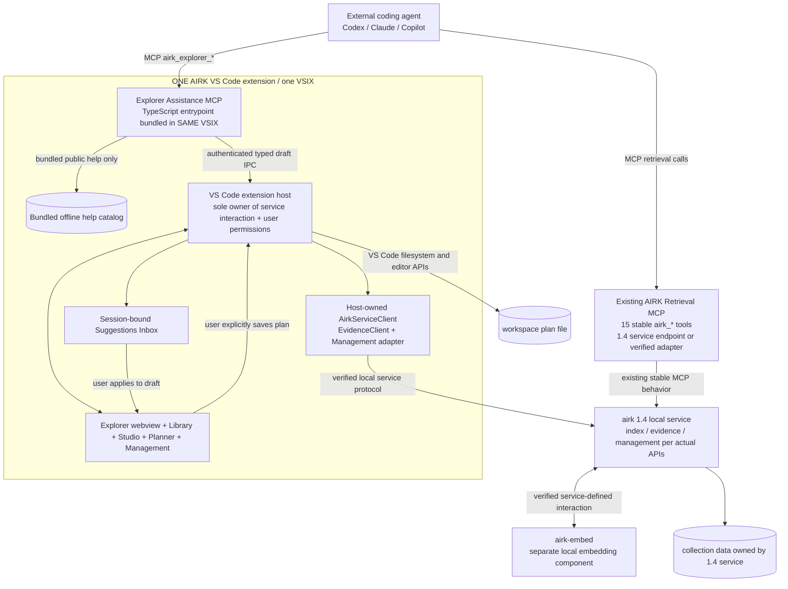
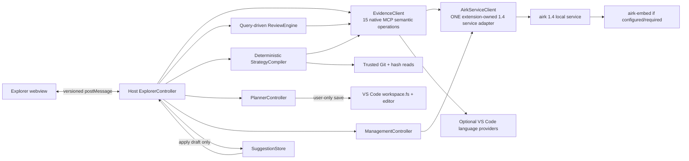
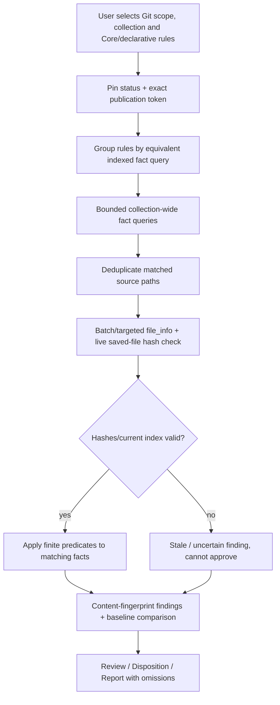
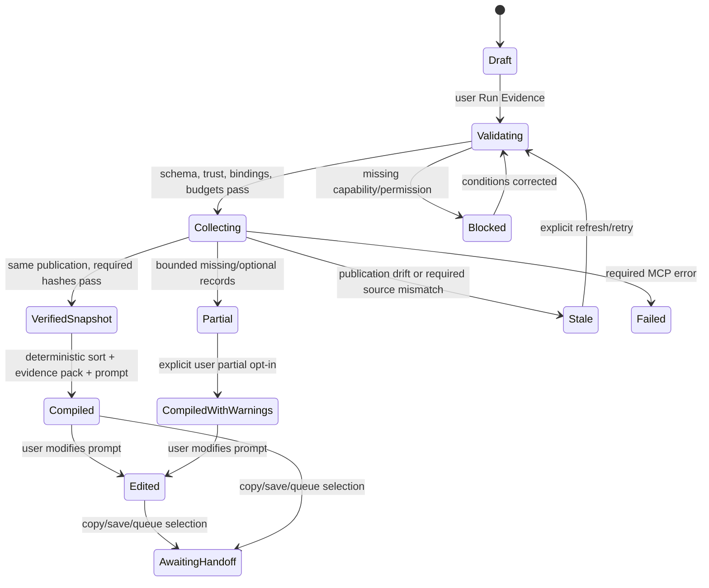
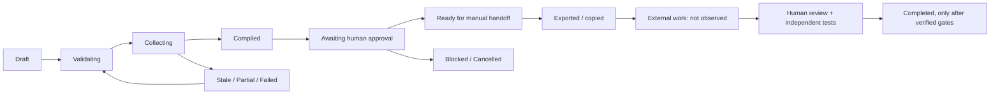
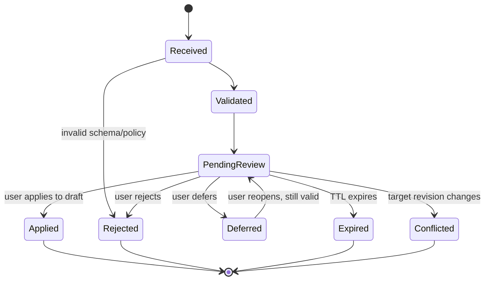

# AIRK Explorer: Unified Implementation Plan for Codex

**Document status:** consolidated, revised implementation specification; proposed features are not claimed as shipped\
**Original plan:** 24 October 2026 · **Updated target:** AIRK **1.4** local-service architecture\
**Distribution:** **one existing AIRK VS Code extension / one VSIX**, containing the Explorer UI, host integration, deterministic engines and bundled Explorer Assistance MCP entrypoint\
**Backend:** local **`airk` service** with a distinct **`airk-embed` component**, as implemented by AIRK 1.4; the extension owns its supported service interactions (not necessarily the OS processes)\
**Stable contract:** the existing **15 `airk_*` MCP tool names and input/output semantics remain unchanged** across the 1.4 transition\
**Primary output:** functioning AIRK Explorer, Strategy Library, deterministic Strategy Studio, multi-result Planner, and local Explorer Assistance MCP\
**Audience:** Codex (implementation agent), AIRK maintainers, reviewers, test engineers\
**Historical reference only:** the supplied review examined AIRK 1.3.1 at commit `05938a9` on 22 October 2026. **Do not implement the old process topology. Discover and integrate the actual 1.4 local-service interfaces in the checkout.**

> **Codex: AIRK 1.4 is the target.** Implement as a sequence of tested, reviewable changes **inside the existing single VS Code extension**. The extension owns connection/discovery/lifecycle, operations and UX for the 1.4 local service, including its interaction with the `airk` and `airk-embed` split as exposed by verified APIs. Retain the 15 compatible retrieval MCP tools. **Do not carry forward 1.3.1 assumptions that the extension must spawn a per-collection Rust MCP worker, that the index is accessed directly, or that AIRK Explorer is a separately installed extension.** Do not treat standalone HTML demos or proposed APIs as shipped capabilities.

## 0. How to use this document

This document is the **single implementation authority** for the Explorer work described in the six supplied artifacts. It reconciles overlapping prototypes and specifications and supplies contracts, diagrams, TypeScript/HTML snippets, examples, work packages, and acceptance tests. Codex should not need a separate design document to understand the target behavior.

### 0.1 Precedence and defaults

When sources disagree:

1. **User-approved target architecture:** AIRK 1.4 comprises a locally available `airk` service and `airk-embed` split, with the **single existing VS Code extension as the owner of all Explorer↔service interaction**. The retrieval MCP tool catalog and semantics remain stable. This target overrides source documents written for 1.3.1.
2. **Actual checked-out 1.4 repository, runtime capabilities and executable schemas** determine the real endpoint/transport, responsibilities of `airk-embed`, service lifecycle APIs and what is already implemented. Document any difference rather than invent a port, launch command, endpoint or lifecycle rule. If Codex starts on a 1.3.x checkout, upgrade/merge to a verified 1.4 integration target before implementing service-dependent Explorer features.
3. **Safety boundaries in this plan** are non-negotiable: the stable AIRK retrieval MCP surface is read-only; Explorer assistance is extension-local; every agent draft is reviewed; no agent-originated save, repair, or dispatch.
4. The 24 October *Agent Assistance MCP Requirements v0.2* governs the **separate** TypeScript help/UI MCP service and plan-save authority.
5. The 24 October *Deterministic AI Strategies & Task Orchestration* governs the bounded strategy compiler, evidence ledger, prompt formats, queue, and template catalog.
6. The 24 October *Desktop Preview Fixed* HTML governs the **visual interaction intent** for integrated Explorer, Library, Studio, Planner, Index Management, and the mobile forced-desktop preview; it is not production code.
7. The 23 October *Design Review and Recommendations* governs fixes for impossible or misleading UI/MCP assumptions, streamlined navigation, query-driven rules, fingerprints, and deferred unsafe packs.
8. Earlier interactive prototypes supply examples only. Their demo data, illustrative claims, and browser-only file operations are never production truth.

**Resolution of principal conflicts:**

- Use **seven primary workspaces**, not 19+ top-level navigation entries. Preserve functionality as nested tabs/routes and a persona preset switcher. Newer Strategies and Management requirements take precedence over the older proposed seven-section grouping; Trace and Architecture are nested within Code/Review, while Packs/Reports share one workspace.
- **Preserve the existing 15 AIRK Retrieval MCP tools unchanged in 1.4.** The local-service transport and internal process split may change; tool names, argument and result semantics must not. Six future *optional* native enhancements remain outside the 1.4 compatibility baseline and must never be assumed present.
- Default to explicit `mode: "lexical"` for deterministic evidence-gathering strategies. In 1.4, embedding capabilities are associated with the split `airk-embed` component as documented by the actual service. **Embedding availability is not a prerequisite for lexical Explorer workflows** unless the verified 1.4 service explicitly requires it; say **“No model inference in this view”**, never “no AI exists in this installation.”
- **MCP Explorer Assistance is not the Strategy execution engine.** Its bundled TypeScript entrypoint delivers help and typed proposals only. The **same VS Code extension host** executes human-approved strategies using its own 1.4 `AirkServiceClient` / `EvidenceClient` abstraction. Assistance requests never become service calls.
- **One extension installation is absolute.** All Explorer routes, Management, Studio, Planner and both logical agent MCP registrations are shipped/configured through the **existing AIRK VSIX**. Do not create or require an AIRK Explorer companion extension, new Marketplace install, or a separate VSIX for the Assistance entrypoint.
- **Planner Save As must use the VS Code host.** Browser downloads and an untitled editor are not a saved workspace file.
- Third-party **declarative** packs may eventually ship after schema validation. Third-party procedural/untrusted code and automatic external-agent dispatch wait for independent process isolation and permissions.

### 0.2 Repository discovery before editing

Run or adapt the following **in the checked-out repository**, inspect output, and record actual versions, ownership, and APIs in the implementation PR. These are Codex developer commands, **not** an AIRK MCP feature and **not** commands exposed to agents by Explorer.

```bash
pwd
rg --files | head -240
rg -n 'version\s*=|1\.4|airk-embed|airk_embed|ServiceClient|serviceUrl|serviceEndpoint|health|connect|reconnect' packages crates docs .github || true
rg -n 'getServerDefinitions|registerMcpServerDefinitionProvider|probeMcp|joinScheduledIndex|showSaveDialog|showTextDocument|diagnosticsView' packages/vscode || true
rg -n 'airk_search|airk_code_facts|airk_changes|airk_file_info|airk_references|airk_relationships' crates docs packages || true
rg -n 'contributes|activationEvents|mcpServerDefinitionProviders|engines' packages/vscode/package.json || true
rg -n 'Content-Security-Policy|nonce|acquireVsCodeApi|onDidReceiveMessage' packages/vscode/src || true
```

First inspect the actual AIRK **1.4** service binaries/modules, service protocol, port/socket discovery, version negotiation, collection binding, health/start/stop APIs, persistence ownership, `airk-embed` integration and the 15 MCP tool schemas. Inspect the existing VS Code extension's service client/manager (if already introduced). Read actual `package.json`, `extension.ts`, `sidebar.ts`, `dashboardView.ts`, `diagnosticsView.ts`, `agentSetup.ts` and corresponding schema/docs files wherever they moved. **Do not hard-code historical `crates/airk-mcp` paths or commands.** Inspect existing test setup before adding dependencies. Freeze and test contracts before implementing screens. Use existing build, lint, release, and test conventions. **Do not manufacture a test command or claim a passing test without running it.**

### 0.3 Source inventory and intended reuse

| Attached source | What to preserve | What not to copy blindly |
|---|---|---|
| `AIRK Explorer — Design Review and Recommendations.docx` | 7-workspace simplification; truth-in-evidence; review fingerprints; query-driven rule evaluation; specific MCP gaps | Earlier navigation proposal that predates standalone Strategies/Planner |
| `AIRK_Explorer_Extensible_Interactive_Prototype (1)(1).html` | Search/Code/Review/Trace/Architecture/Packs visual examples and source inspector | All static counts, semantic claims, hard-coded 1000px minimum width, simulated file links |
| `AIRK_Explorer_Strategy_Studio_Mockup(2).html` | Four Studio tabs, 25 recipes, editor/queue/script interaction intent | Mock evidence run, fake queue dispatch, unverified paths and hashes |
| `AIRK_Explorer_Deterministic_AI_Strategies_Design(1).docx` | Typed DAG, evidence compiler, immutable manifest, portability, queue states, 25 strategies, acceptance cases | Proposed CLI/SDK as if already installed |
| `AIRK-Explorer-Desktop-Preview-Fixed(1).html` | Unified workspace, Library/Studio/Planner, Index Management, VS Code planner message contract, responsive/desktop control | Browser-mode download as actual VS Code save; fixed-view mock records; prototype `innerHTML` with untrusted data |
| `AIRK_Explorer_Local_MCP_Agent_Assistance_Requirements(1).docx` | Separate TypeScript MCP, offline help, typed proposal inbox, host IPC, save guardrails, tests | Any implication that its proposed tools exist in Rust or on AIRK 1.3.1 |

### 0.4 Deliverable policy

Implement in the repository, not by shipping the browser prototype unchanged. Prefer small typed modules with tests, one shared feature manifest, a clear split between host-owned privileged operations and unprivileged rendering, and explicit feature flags for unshipped functionality. A phase is done only when its tests and documentation pass.

---

## 1. Product goal, invariants, and release scope

AIRK Explorer is a **local, evidence-first, non-generative workbench** implemented **within the single AIRK VS Code extension**, over the **AIRK 1.4 local-service** index, code facts, documents, review rules, and extension-host observations. It helps humans inspect findings and prepare deterministic evidence packets and Markdown plans for *external* coding agents.

### 1.1 The six hard boundaries

1. **Stable read-only MCP evidence plane:** the existing 15 collection-scoped `airk_*` retrieval tools retain their signatures and read-only behavior. In AIRK 1.4 these tools may be exposed by the local service or a verified compatibility adapter. Explorer must **not** assume a directly spawned Rust stdio worker, direct index-file access or a changed tool contract.
2. **Independent Explorer Assistance plane:** one new **TypeScript/Node MCP entrypoint packaged inside the same AIRK VSIX** exposes `airk_explorer_*` help and proposal tools. **Zero direct or indirect calls from this entrypoint to either `airk` or `airk-embed` for help/draft submission.** It is logically independent, **not another extension**.
3. **Single-extension service authority:** the trusted VS Code extension host owns workspace and collection binding, local-service discovery/connect/reconnect, status and command routing, source reads, user-initiated indexing/recovery, plan saves, Git adapters, and any future dispatch. The webview and Assistance MCP cannot bypass the host or independently connect to the service.
4. **Human decision gates:** agent proposals are inert inbox cards. Applying one changes a **draft only**; Run Search, Run Strategy, Save Plan, Index/Repair, and Dispatch are distinct human-controlled operations.
5. **Evidence qualification:** citations/paths/hashes/publication tokens are preserved, but occurrence != resolved reference, syntax-level candidate != runtime edge, ready index != current file, and a queue state != code correctness.
6. **Local and bounded:** no remote model request inside Explorer, no hidden analytics of private source, no unrestricted MCP/IPC operation, no unsafe or unbounded pack execution. The 1.4 local service and `airk-embed` availability/status are disclosed honestly; default lexical workflows must not silently invoke embedding.

**Distribution invariant (not a seventh trust boundary):** AIRK Explorer, the Strategy engine, Management, service connection owner and the Explorer Assistance MCP launcher all ship as **one AIRK VS Code extension**. Separate MCP tool namespaces do **not** imply separate extensions. The backend `airk`/`airk-embed` split is a local service architecture concern, not a second VSIX.

### 1.2 Verified pre-existing capability versus proposed capability

| Capability | Baseline status | Implementation posture |
|---|---|---|
| 15 `airk_*` read-only retrieval MCP tools | Confirmed in 1.3.1; **explicitly preserved as AIRK 1.4 target contract** | Preserve exact names and semantics over verified 1.4 service/adapter; normalize in extension-owned `EvidenceClient` |
| AIRK 1.4 `airk` local service + `airk-embed` split | **User-specified target; current checkout shape must be inspected** | Use actual versioned service endpoint, capability/embedding states, auth and lifecycle; do not guess binaries or ports |
| One AIRK VS Code extension owning the service connection | **Hard requirement for AIRK 1.4 Explorer** | Extend existing VSIX; connect, query, manage and recover through host-owned service integration |
| Indexing, collections, scheduling, vectors, usage, diagnostics/recovery, MCP setup | Existing extension UX; implementation details to reconfirm against 1.4 | Preserve UX and remap only verified control calls to local-service protocol |
| Persistent Explorer navigation, search/code/review/evidence UI | Prototype/proposal | Build new typed host+webview UI |
| Query-driven review rule engine, baselines, report exports, pack registry | Proposal | Phase-gate and implement in slices |
| Strategy Library, deterministic DAG Studio, prompt compiler, queue and Planner | Proposal | Implement **inside the single VS Code extension**, separate from backend service internals |
| `airk_explorer_*` help/UI MCP | Proposal | NEW TypeScript MCP entrypoint **inside the existing AIRK VSIX**; independent tool inventory, no second extension or backend calls |
| Local CLI `airk-explorer strategies ...`, external agent adapters, team/remote service | Future proposal | **Not** required for beta; never pretend installed |

### 1.3 Primary user journeys

- **Explore:** choose collection → lexical search → inspect citation → open actual saved file with a source/revision status.
- **Investigate:** inspect symbol, written imports, candidate calls, provider-asserted IDE references (where supported), related documents, and Git scope without conflating evidence classes.
- **Review:** choose changed scope/pack → run bounded, query-driven rules → validate matched live file hashes → triage fingerprinted findings → report.
- **Prepare agent work:** Library blueprint → Studio bounded evidence run → editable portable/MCP-aware prompt → add one or more results to Planner.
- **Execute a multi-task plan externally:** Planner combines results with dependencies, evidence and acceptance → user saves **actual Markdown in workspace** → copy a short file-reference prompt → external agent reads that file (if the agent can access the workspace).
- **Ask an agent for AIRK help:** external agent independently uses Explorer Assistance MCP help, asks for UI status, proposes a typed Search/Studio/Planner draft; user reviews in Suggestions Inbox.
- **Maintain index:** Management displays existing Index Now, scheduling, Diagnose & Repair, vectors, agent configuration and usage; agents can provide guidance but cannot run privileged operations.

---

## 2. Information architecture and screen contracts

### 2.1 Seven primary workspaces

Use **one Explorer activity-bar container/webview**, with a narrow stable primary nav plus context tabs and a responsive drawer. An Overview dashboard is a landing state under Evidence or the container header, **not** an eighth sprawling destination. Persona presets change filters, not the screen inventory.

| Primary workspace | Stable route prefix | Tabs/absorbed historical views | Initial shipping gate |
|---|---|---|---|
| **Search** | `search/` | Query builder, results, saved recipes, facets if server-supported | R1 |
| **Code** | `code/` | Symbol inspector, references/calls, file dossier, IDE language-provider assertions, Architecture Map | R1/R3 |
| **Review** | `review/` | Git change scope, query-driven Quality Review, finding detail, architecture rules, requirements/test trace and docs drift | R2/R3 |
| **Evidence** | `evidence/` | Citation inspector, revision/coverage ledger, source file information, status, citation checker, watches | R1/R3 |
| **Strategies** | `strategies/` | **Library**, **Studio** (Builder, Prompt, Task Queue, Scripting), **Planner** | R4 |
| **Reports & Packs** | `reports/` | Report builder, exports, pack manager, rule inspector, review baseline | R3/R5 |
| **Management** | `management/` | Collections & coverage, scheduling/progress, evidence/vectors, Diagnose & Repair, storage, extraction policies, agents/MCP/CLI, usage, logs | R1 (reuse) and R5 (unification) |

The Strategies view always presents Library → Studio → Planner visibly and independently. Management must be reachable without hunting through persona menus; pin a Management shortcut in the header/side footer. **Global Agent Suggestions** is a badge/inbox accessible in all workspaces, not an eighth nav category.

### 2.2 Stable route and feature manifest

Define these IDs once in a shared package or a generated module; do not use human labels as IDs:

```ts
export const EXPLORER_ROUTES = {
  search: 'search/query',
  searchResults: 'search/results',
  symbols: 'code/symbols',
  references: 'code/references',
  architecture: 'code/architecture',
  review: 'review/findings',
  reviewRules: 'review/rules',
  reviewTrace: 'review/trace',
  evidence: 'evidence/inspector',
  citationCheck: 'evidence/citation-check',
  library: 'strategies/library',
  studio: 'strategies/studio',
  planner: 'strategies/planner',
  reports: 'reports/builder',
  packs: 'reports/packs',
  management: 'management/collections',
  recovery: 'management/recovery',
  connections: 'management/connections',
} as const;
export type ExplorerRoute = typeof EXPLORER_ROUTES[keyof typeof EXPLORER_ROUTES];
```

Every route has manifest metadata: `featureId`, `minVersion`, `availability` (`implemented|prototype_only|unsupported|disabled`), `helpTopicId`, `requiredCapabilities`, `permission`, and a registered view component. The **manifest** drives help search, UI status, navigation, shortcuts, extension feature flags, schema validation and tests. A prototype-only route must not appear as an enabled production action.

### 2.3 Shared page header and state vocabulary

Global header: active workspace folder and collection selector; **AIRK 1.4 local-service connection state**, service version/compatibility where useful; publication token (possibly abbreviated *only for display*); indexed/readiness state; live-file freshness/coverage state; **`airk-embed` capability/status and vector state (separate from core service health)**; persona preset; Results limit; Suggestions count; responsive/desktop preview control in standalone HTML; Manage Index shortcut. Each screen shows `Loading`, `Ready/current`, `Ready/indexed but unverified live`, `Partial/truncated`, `Stale`, `Unsupported`, `Disconnected`, `Permission denied`, or `Error` explicitly.

**Never use:** fabricated match totals, green dependency edges from syntax-only facts, a cross-language import claim without a real import, unsupported test-result reads, or a banner saying “0 AI calls” for a vector-enabled collection.

### 2.4 Screen-specific functional requirements

| Screen | Inputs | Outputs/actions | Truth conditions |
|---|---|---|---|
| Search | lexical query, exact collection-bound scope, result/byte limit, optional supported mode | results, source excerpt, copy exact tool JSON, open cited source, make Studio task | No client-filtered top-10 pretending exhaustive facets; show `N returned, limit L` |
| Code / Symbol | exact or candidate name, path prefix, language selector if available | syntax declarations, written imports, signatures, facts, honest file dossier | Calls unresolved unless independent provider says resolved; do not link a TS call to an unrelated Rust source |
| References / Calls | identifier and bounded scope | textual hits and syntax candidates, optionally IDE-provider evidence | Distinguish text/code/comment/string/unknown and source producer; do not imply all callers found |
| Architecture | module/file scope, bounded relationship depth | graph **plus accessible edge table**, unknown edges | No invalid TypeScript→Python “syntax import”; candidate edges explicitly labelled |
| Review / Quality | Git base/head or selected files, allowed packs, rule set, baseline | query-driven findings, source hash status, dispositions, report | Partial index, stale saved source and omitted parser coverage visible |
| Trace / Tests / Docs | requirement kind/ID, doc evidence, test symbol/paths | candidate links and gap ledger | A test name is not coverage; no reading extension Testing internals unless stable API allows it |
| Evidence | citation/file reference/publication | exact provenance, live hash check, citation checker and revision mismatch | Ready != verified current bytes; `airk_changes` is not history |
| Library | category/preset/search and pack version | inspect 25 built-ins, fork template, explicit Load in Studio | Browsing a template must not overwrite unsaved Studio work |
| Studio | objective, scope, steps/DAG, budgets, profile | run ledger, editable prompt, export, queue, Add result to Planner | Deterministic prep only; same frozen fixtures/versions → same compiled output |
| Planner | selected Studio result snapshots, dependencies, title, workspace-relative hint | editable combined Markdown, **Save As in VS Code**, compact agent prompt | No “saved” badge or confirmed path until actual host write/open receipt |
| Reports/Packs | report type, findings, evidence, schema-bound pack | reproducible Markdown/SARIF/JSON report and pack management | Report includes omissions, token, source status, rule/pack versions |
| Management | local-service connection/health, `airk-embed` status, existing index/storage/agent commands, preferences | truthful service/version/embedding/index diagnostics, user-confirmed maintenance | All operations route through the **single extension host** to verified 1.4 service APIs; Assistance MCP only stages guidance |

### 2.5 Navigation, accessibility and unsaved-state behavior

- One nav router owns route transitions. Keep unsaved drafts in host state when switching tabs. Warn before intentionally discarding edited prompts, plans, rule setups, or strategies.
- File references must open using host `vscode.workspace.openTextDocument`/`showTextDocument`, restricted to authorized workspace URIs with source-revision checks. Standalone HTML may simulate but label it simulation.
- Dialogs: `role="dialog"`, `aria-modal`, focus trap, Escape to close, return focus to opening button. Tables/graphs must not communicate meaning by color alone.
- Narrow VS Code editor group: implement at 500–700 CSS pixels; no root `min-width:1000px` causing impossible horizontal navigation.
- Support dark/light/high-contrast themes, reduced motion, screen readers, keyboard input, labeled controls, semantic headings, and error announcements.

---

## 3. Deployment and trust architecture

### 3.1 Diagram A: one VS Code extension, two MCP tool sets, split 1.4 backend



**Interpretation:** there is **one extension installation**, even though it can configure two distinct **MCP tool inventories** for agents and the 1.4 backend has two local components. The extension owns the `airk` service connection and user-facing interactions, including any supported `airk-embed` management. The diagram deliberately does **not** prescribe whether AIRK 1.4 exposes its Retrieval MCP via local socket, stdio adapter, HTTP loopback, or another authenticated local mechanism; Codex must use what 1.4 actually ships. `airk-embed` is not a second VS Code extension, nor an Explorer UI transport.

**Forbidden paths:** Explorer Assistance MCP → `airk`/`airk-embed`/retrieval adapter; webview → local service or raw workspace filesystem; agent suggestion → arbitrary VS Code command, service maintenance, plan save or agent dispatch. Agent Retrieval MCP and Explorer's host-owned `EvidenceClient` are separate authorized clients of the same 1.4 evidence contract. An agent may connect to the Retrieval MCP by the existing supported 1.4 configuration, but this **does not transfer ownership of Explorer's service connection** away from the VS Code extension.

The extension installs **once**. Inside that installation, `AIRK Retrieval` and `AIRK Explorer Assistance` remain separate agent-facing tool configurations with independent health/discovery checks and permissions; the latter ships as an **extension-bundled Node/TypeScript entrypoint**, not a second VSIX. Product help should work when the 1.4 backend is stopped; UI proposal admission still requires the authenticated host.

### 3.2 Diagram B: extension-host modules, service boundary and ownership



**Codex implementation rule:** centralize service endpoint discovery, authentication, reconnect, cancellation, API/version negotiation, collection binding and health checks in **one extension-owned `AirkServiceClient`** (or the equivalent already in AIRK 1.4). `EvidenceClient` is the typed read-only retrieval facade; Management uses a privileged, user-confirmed service-control facade. Avoid independent/duplicate service connections in each screen, strategy step or webview. Do **not** implement a new separate AIRK Explorer VSIX or copy old native helper process spawning into the new client.

The Explorer Assistance MCP server is **not** a service client. It communicates only with the restricted `SuggestionStore` and static help catalog, never with `airk`, `airk-embed`, backend Retrieval MCP endpoints or filesystem writes.

### 3.3 Diagram C: suggestions vs subsequent operations

```mermaid
sequenceDiagram
  participant Agent
  participant MCP as Explorer Assistance MCP
  participant Host as VS Code host
  participant UI as Suggestions Inbox
  participant User
  Agent->>MCP: suggest_plan(schema_version, tasks, path_hint, idempotency_key)
  MCP->>MCP: validate input size/op/path/limits
  MCP->>Host: authenticated typed proposal
  Host->>Host: recheck trust/window/collection/revision
  Host->>UI: store pending_review; notify
  MCP-->>Agent: proposal_id, status=pending_review, executed=false
  User->>UI: Review / Edit / Apply to draft
  UI->>Host: apply proposal to Planner draft
  Note over UI,Host: Draft creation is not file saving or execution
  User->>UI: Save As workspace Markdown
  UI->>Host: user-initiated airk.planner.saveInWorkspace
  Host->>Host: select root, check overwrite, atomic write + open editor
  Host-->>UI: saved URI + hash or error/cancelled
  User->>UI: Copy compact file-reference prompt
```

### 3.4 Local service placement, authentication and remote workspaces

- **Single extension:** install/update the existing AIRK VSIX once. Host all Explorer screens, existing Management, registration/configuration of both MCP tool sets and the bundled Assistance entrypoint within it. Do not introduce an `airk-explorer` extension dependency or a second Marketplace product.
- **Service ownership:** the VS Code **workspace extension host** discovers/attaches to the supported AIRK 1.4 local service and owns requests for status, collection/index management, retrieval, embedding configuration (if exposed) and diagnostics. *Owns interaction* does not automatically mean *owns the OS process*: respect the real 1.4 process supervisor or installer. Start/stop only when the API explicitly supports it and the user has granted the required authority.
- **`airk` / `airk-embed` boundary:** `airk` is the local service entrypoint for indexed work per the verified 1.4 contract; `airk-embed` is the separate embedding component. Codex must verify whether `airk-embed` is a process, library or independently managed service, how it reports readiness, and whether lexical-only workflows work without it. Never invent a second required binary installation or route lexical calls through embedding merely because the component exists.
- **Version and endpoint discovery:** resolve address/socket/stdio adapter, TLS/token/local permissions, advertised service/protocol version and supported capabilities from **existing 1.4 configuration or discovery APIs**. No hard-coded `localhost` port, guessed CLI flags, index/data path or unauthenticated listener. Fail closed on incompatible protocol, surface guidance to the user and retain offline help.
- **Remote workspaces:** attach from the workspace extension host in Windows/macOS/Linux/WSL/SSH/devcontainers to the service appropriate **to that workspace host**. Never assume the local display PC's loopback points at the remote workspace service. Collection roots and saved plan URI resolution follow that host's URI model.
- **Assistance IPC:** prefer OS-user-restricted Unix-domain sockets or Windows named pipes plus short-lived session credentials between the bundled TypeScript MCP entrypoint and the extension host. Rotate credentials on reload/trust/collection/service-binding changes. This IPC is independent of the 1.4 service protocol. The IPC itself must not become an authenticated general-purpose service proxy.
- No arbitrary network exposure; do not accept webview `postMessage` as an MCP endpoint. No cloud-agent capability is implied without configured local access. Protect rendezvous descriptors and credentials with OS ACLs, TTL and redaction.
- Multi-root/multi-window requests must bind to **one exact** workspace root/collection/service instance. If ambiguous, fail instead of picking the first.

### 3.5 Host session identity and lifetimes

A session key includes the single AIRK extension installation identity, window instance, canonical workspace root, selected service instance/endpoint identity, selected collection fingerprint, exact publication identity, feature/schema versions and fresh IPC credentials. **Never accept an agent-supplied path, service URL, port or collection label as authority.** Webview drafts may survive route changes; privileged access does not survive trust revocation, service reconnect or collection rebind. Invalidate stale pending drafts, run contexts and source locations when service or publication identity changes.

### 3.6 AIRK 1.4 service integration contract (mandatory R0/R1)

**Implementation assumptions are bounded to what the user has specified:** AIRK 1.4 is a local service; `airk` and `airk-embed` have been split; the **15 Retrieval MCP tools remain unchanged**; the **single VS Code extension owns service interaction**. The exact wire protocol, service installer, process relationships, storage protocol, embedding requirements and operational APIs must be inspected in the 1.4 checkout. Build an adapter around discovered interfaces rather than manufacturing them.

```ts
// Proposed TYPE SHAPES, not claims about actual 1.4 server JSON.
export type AirkConnectionState =
  | 'not_configured' | 'connecting' | 'ready' | 'degraded'
  | 'disconnected' | 'incompatible' | 'permission_denied';

export interface AirkServiceStatus {
  connection: AirkConnectionState;
  serviceVersion?: string;     // from actual service handshake
  protocolVersion?: string;    // from actual service handshake
  serviceInstanceId?: string;  // when supported, stable within session
  endpointLabel?: string;      // safe and redacted; never credentials
  currentCollectionId?: string;
  publicationToken?: string;
  embedding: {
    state: 'ready' | 'disabled' | 'unavailable' | 'unknown' | 'error';
    componentVersion?: string; // only if reported by 1.4
    modes: readonly string[];  // supported modes, not guessed
  };
  capabilities: readonly string[];
}

export interface AirkServiceClient {
  readonly status: AirkServiceStatus;
  connect(binding: TrustedWorkspaceBinding): Promise<void>;
  readTool<T>(name: NativeAirkTool, args: Readonly<Record<string, unknown>>,
    opts: { signal?: AbortSignal; timeoutMs: number }): Promise<ToolEnvelope<T>>;
  // Management operations MUST live behind a separate allowlisted, user-only API.
  getStatus(): Promise<AirkServiceStatus>;
  onStatusChange(listener: (status: AirkServiceStatus) => void): Disposable;
  disconnect(): Promise<void>;
}
```

The real `AirkServiceClient` **must reuse** an existing AIRK 1.4 extension service manager, if one exists, rather than create competing connection logic. This is a **logical interface**: `readTool` may invoke a verified 1.4 service endpoint or a supported MCP adapter. Whatever transport is used, agent-visible `airk_*` inputs and outputs retain their compatible semantics. Collect **service-instance + collection + publication** identifiers in each run ledger so a reconnect or service swap cannot silently join evidence from different indexes.

**Lifecycle requirements:**

1. On activation, cheap capability detection and connection registration; do not download/start new binaries merely by opening Explorer. Discover whether 1.4 is installed, reachable and compatible.
2. On selecting collection, bind exact host-owned workspace/service/collection; query status and capabilities and only then enable evidence operations. A collection switch cancels in-flight work and drops stale results.
3. For multiple screens/steps, share a host-owned persistent connection or pool **only if supported by the 1.4 transport**, with bounded concurrency/backpressure, cancellation and retry policy. Never spawn a legacy Rust process once per file/rule.
4. On disconnect/restart/incompatible upgrade, show `Disconnected` / `Reconnecting` / `Incompatible`, invalidate stale evidence contexts, preserve only editable drafts, and reconnect with bounded backoff and a fresh handshake before enabling Run.
5. Expose `airk` core service health separately from `airk-embed` readiness. Do not call a working lexical index disconnected solely because embedding is unavailable. Gate vector/hybrid features according to **real service capabilities**.
6. Index/verify/rebuild/repair/storage/embedding management flow through **existing extension controls**, with human authorization and the **verified 1.4 service management protocol**, not raw shell or generic MCP.
7. Assistance help and typed draft admission remain functional when the backend is absent **if the host is available for drafts**; no help/proposal request attempts a service reconnect or invokes indexing.
8. Packaging tests verify the **single VSIX** contains all host/webview and Assistance assets; separate MCP setup entries must not require another extension install.

### 3.7 Version compatibility matrix to implement and test

| Runtime state | Explorer behavior | Retrieval contract / guard |
|---|---|---|
| Compatible AIRK 1.4 service, matching collection | Search/Review/Studio/Management enabled per capabilities | Exact unchanged 15 MCP tools, exact current publication |
| Compatible `airk`, embedding component absent/disabled | Lexical functions available if 1.4 reports them; vector features unavailable with explanation | Explicit `mode: "lexical"`; no silent embedding dependency |
| Service process stopped or endpoint unavailable | Offline help, Library inspection and unsaved draft editing; retrieval/index actions disabled | No fallback to legacy Rust spawn, fabricated cached results or other collection |
| Service version or protocol incompatible | Safe version banner and upgrade/configuration guidance | Fail closed; no guessed endpoint or unchecked compatibility |
| Service restarts or current collection/publication changes | Cancel/mark stale pending runs; rebind and require revalidation | No cross-publication evidence aggregation |
| Remote workspace with service on workspace host | Extension host owns remote-local connection, URI and binding | No display-machine loopback assumption |
| Historical 1.3.x standalone worker is the only detected backend | Report unsupported target and migration requirement | Do not silently execute Explorer 1.4 plans over old topology |

## 4. AIRK 1.4 local-service retrieval integration and evidence contract

### 4.1 Preserve these 15 existing AIRK Retrieval MCP tool names

```
airk_search          airk_read_file      airk_list_files
airk_status          airk_file_info      airk_outline
airk_symbols         airk_imports        airk_document_facts
airk_references      airk_context        airk_capabilities
airk_code_facts      airk_relationships  airk_changes
```

**AIRK 1.4 compatibility rule:** the 15 `airk_*` MCP tools retain **the same names and existing input/output semantics** despite moving behind the 1.4 local service. They remain read-only and collection-bound. `airk_changes` checks referenced evidence against the current publication; it is not a historical timeline. **Do not add `airk_explorer_*` handlers to the backend `airk` or `airk-embed`, nor to any existing Retrieval MCP registry.** The TypeScript Assistance MCP is bundled with the extension and independent.

Before implementing recipe JSON or adapters, discover the **actual 1.4 service/MCP schema source location** and compare all 15 definitions against verified 1.3.1 compatibility fixtures. Historical `crates/airk-mcp/src/lib.rs` and `docs/mcp.md` may have moved or been restructured. The examples in §7 are design-level; never send novel arguments or assume endpoint shapes. Keep a generated or hand-verified contract snapshot plus round-trip tests for all tool names and supported schemas.

### 4.2 Retrieval client lifecycle through the 1.4 service

The historical 1.3.1 VS Code extension performed a brief helper probe, but **that is not the target integration model**. In 1.4, use the **single extension-owned service client** specified in §3.6. The Explorer's `EvidenceClient` is a **typed retrieval facade over the local 1.4 service / supported 1.4 MCP adapter**. The 15 MCP tool contracts are stable; the transport, executable placement and health protocol need not be. Never launch a legacy Rust helper per query, rule or collection unless 1.4's **verified service connection implementation** explicitly delegates to one.

A bound EvidenceClient supports cancellation, timeouts, concurrency caps, service health changes, publication-change notifications, and clean collection switching. Connection success and tool-schema negotiation are prerequisites to actions. If the service is down, surface the actual state rather than spawning a 1.3.x worker or silently reading a different collection.

```ts
// Proposed host retrieval facade. Do not infer wire endpoints from this shape.
export interface EvidenceClient {
  readonly binding: CollectionBinding;
  readonly service: AirkServiceClient; // extension-host owned; never a webview client
  call<T = unknown>(name: NativeAirkTool, args: Readonly<Record<string, unknown>>,
    options: { signal?: AbortSignal; timeoutMs: number }): Promise<ToolEnvelope<T>>;
  close(): Promise<void>; // releases logical binding, not necessarily the shared service
}
export type NativeAirkTool =
  | 'airk_search' | 'airk_read_file' | 'airk_list_files' | 'airk_status'
  | 'airk_file_info' | 'airk_outline' | 'airk_symbols' | 'airk_imports'
  | 'airk_document_facts' | 'airk_references' | 'airk_context'
  | 'airk_capabilities' | 'airk_code_facts' | 'airk_relationships'
  | 'airk_changes';
export interface ToolEnvelope<T> {
  data: T;
  exactPublicationToken: string;
  serviceInstanceId?: string;
  truncated: boolean;
  warnings: string[];
  observedAt: string; // operational only; omit from deterministic prompt digest
}
```

`ToolEnvelope` and `AirkServiceClient` are **internal proposed adapter types**, not assertions about AIRK 1.4's wire JSON. Normalize only from the actual source, reject missing critical provenance, and do not change native MCP tool outputs just to suit Explorer.

### 4.3 Data budgets and truthful pagination

For the **historically reviewed 1.3.1 MCP contracts** (whose semantics must remain compatible in 1.4): default discovery limit 10 records and 8,192 payload bytes; upper bounds 100 records and 65,536 payload bytes, where accepted. **Verify current 1.4-advertised limits and schema before coding**; do not assume new pagination/facets merely because the backend is now a service. Some native list/facts calls expose cursors, but **search, references and relationships did not** in the reviewed baseline. Observe actual per-tool limits from current schema. A UI cannot show “Load more” unless that specific tool supports revision-bound cursors; raising a limit and restarting is **not pagination**.

Required labels:

- `4 returned · limit 10 · more may exist` if count is unknown.
- `truncated=true` and exact reason if the tool clipped records/bytes.
- `No returned results` versus `No matching evidence exists`: the latter is generally not provable.
- For index-vs-live mismatch: `Indexed result, source not verified` or `Stale: current saved file differs`, never a green check.
- Source location may be UTF-8 byte spans. Convert to VS Code UTF-16 offsets **only after checking the exact matching live bytes**. Otherwise show original indexed line/location without a false precise highlight.

### 4.4 Evidence classes, joins and freshness

Keep four mutually distinguishable source classes:

| Class | Meaning | Claims allowed |
|---|---|---|
| E1: indexed source/text | retained cited text, lexical matches, config/docs | textual occurrence or source excerpt, not semantic call |
| E2: syntax facts | tree-sitter-written definitions/imports/call candidates | written code structure, unresolved unless independently verified |
| E3: reviewed static observations | deterministic AIRK rule findings and explicit VS Code diagnostics | rule matched under its prerequisites, not security proof |
| E4: IDE language provider | live-buffer, provider-asserted definitions/references/call hierarchy | a provider returned this relation, not a kernel guarantee |

For E4 use stable VS Code commands where available (`vscode.executeDefinitionProvider`, `vscode.executeReferenceProvider`, appropriate call-hierarchy provider commands), verify editor availability/extension origin, label `provider-asserted / live buffer`, and keep E4 **side-by-side** with indexed facts. In strict model-free workflows, require a provider allowlist because third-party providers may themselves call models. Do not promote provider responses into AIRK native fact types.

A normal run pins **one exact current publication**. The status ledger distinguishes (a) index ready, (b) publication-token agreement across calls, (c) coverage/parse profiles, and (d) live saved-file hashes. A citation is a structured record: collection binding, full token, original path, hash, start/end line or document locator, producer, source evidence class, verification state and truncation/omission flags.

```ts
export interface EvidenceRef {
  collectionFingerprint: string;
  publicationToken: string;        // full identity, not short UI form
  path: string;                    // collection-relative
  sourceHash?: string;
  location: { startLine?: number; endLine?: number; startByte?: number;
              endByte?: number; page?: number; paragraph?: number; cell?: string };
  evidenceClass: 'E1' | 'E2' | 'E3' | 'E4';
  producer: string;
  basis: 'indexed' | 'live-buffer' | 'live-saved-file';
  liveVerified: boolean;
  qualifiers: string[];
}
```

### 4.5 Optional additive backend tool enhancements: K1–K6 (independent gate)

These are **not part of the AIRK 1.4 Explorer implementation or the new Explorer Assistance MCP server**. They are **future, separately approved backwards-compatible additions** to existing Retrieval MCP behavior. **Codex must not implement or depend on K1–K6 when aligning Explorer with AIRK 1.4**, because the agreed 1.4 MCP contract is unchanged. If the actual service lacks these capabilities, disable dependent UI controls rather than fake them. Any future extension of a tool requires separate owner approval and tests.

| ID | Existing native tool | Additive field/behavior | UI gate |
|---|---|---|---|
| K1 | `airk_search` | optional language and origin (`code|document|config`) filters; language per hit | Search facets permitted only if backend filters entire collection |
| K2 | `airk_search`, `airk_references`, `airk_relationships` | revision-bound cursor | True Load More only when cursor supported |
| K3 | `airk_code_facts`, `airk_document_facts` | expose existing internal `path_exact` / equivalent exact path match | Efficient per-path fact queries |
| K4 | `airk_search` | optional match line/byte offsets | Precise term highlighting only with offset+hash agreement |
| K5 | `airk_references` | occurrence context `code|comment|string|unknown` | Honest reference classification |
| K6 | `airk_file_info` | batch `paths` (bounded, e.g. <=100) | Efficient source metadata per result page |

Lower priority: phrase/exclusion terms, excludes on facts/search, and line/column along with byte positions. **Do not extend `airk`, `airk-embed` or the 15-tool retrieval schema during this 1.4 Explorer integration.** The six hypothetical enhancements would preserve the number and read-only nature of tool names if separately approved in a later release.

---
## 5. Search, Code, Review, Evidence, Reports, and Packs implementation

### 5.1 Search execution and recipes

1. Validate collection/session and user query. Default `mode:'lexical'` explicitly. Map supported input fields to the **native contract**, not a simulated schema.
2. Display normalized results with citation, exact publication, index source hash, evidence class, extraction producer, and honest availability flags.
3. If language/origin facets are absent in the native API, do **not** filter a bounded top-N page while pretending to search the complete collection. Disable/label facets unavailable pending K1; path prefix works only if verified in schema.
4. A results pane can preserve an array of already returned rows. `Load more` requires genuine backend cursor support. State `limit N, further matches not determined` in older contracts.
5. Open a source path by host URI resolution; if index and live file disagree, show an explicit stale warning, never position a synthetic match offset.
6. `Copy AIRK query as JSON` outputs only validated native tool name and actual arguments. Support the reverse: import pasted `airk_search`/known fact query JSON to a **draft** after validation. Maintain one registry of query recipes and capability gates.
7. Save queries as **local user-created recipes**, and optionally create publication-triggered watches later. A watch re-runs only when the exact publication changes, not via unbounded filesystem polling.

```json
{
  "schema": "airk.explorer.search-recipe/1",
  "id": "local.auth-refresh",
  "title": "Authentication refresh evidence",
  "tool": "airk_search",
  "args": {"query": "session refresh", "mode": "lexical", "path_prefix": "src/auth/", "limit": 10, "max_bytes": 8192},
  "boundCollection": "<host-managed fingerprint; never an agent-supplied path>",
  "mode": "manual"
}
```

The above wrapper is an Explorer file format, **not** an AIRK-native tool argument. The `args` part alone is sent to the validated backend.

### 5.2 Code, references, and architecture graph

- Code inspector composes `airk_symbols`, `airk_outline`, `airk_imports`, `airk_code_facts`, `airk_references`, and bounded `airk_relationships`, plus chosen source reads. Each record retains its **producer** and **kind**.
- A written identifier/call candidate may be unresolved. Display exact written expression and containing path, not a guessed call target. Text hits in a comment/string are not callers. If classification is unknown, say `unknown`.
- Graph edges have source and target *as asserted by the producer*, derivation status, publication, and directed edge type. Provide a screen-reader-compatible edge table and text list in addition to the visualization. Never draw green “resolved” edges based on cross-language name similarity.
- IDE provider results (E4) can complement, never overwrite, E2 facts. Explicit provider ID, live-buffer URI/version and source of assertion are necessary. If the VS Code provider API yields nothing, preserve the `unknown` state.
- `airk_relationships` bounds: respect live schema. The reviewed baseline limits expansion to roughly 1–3 hops, 100 symbols and 256 files. Never perform unbounded recursive crawling to compensate for truncation.

### 5.3 Review engine: query-driven, not per-file N×M MCP probing

A rule declares **one scoped fact query** (or a bounded small number), then verifies only matched source files. Do not call `file_info + outline + code_facts` on every file for every rule. Per-file source reads are reserved for **explicit saved-text rules** (e.g. conflict markers) and are bounded by selected workspace scope; they do not need an index join to test the pattern.



**Rule record contract (proposal):**

```json
{
  "schema": "airk.explorer.review-rule/1",
  "ruleId": "airk.core/js-dynamic-eval",
  "displayCode": "CORE-JS-01",
  "version": "1.0.0",
  "title": "Written eval() candidate",
  "severity": "warning",
  "enabledByDefault": true,
  "requires": {
    "sourceClass": "E2",
    "factTool": "airk_code_facts",
    "factQuery": {"kind": "call", "name": "eval"},
    "capabilities": ["syntax.calls"]
  },
  "predicates": [
    {"field": "path", "op": "prefix", "value": "src/"}
  ],
  "message": "An eval-like call is written here; confirm binding and input source before assessing risk.",
  "evidencePolicy": {"requireExactPublication": true, "requireLiveHashForConfirmed": true}
}
```

`factQuery` is **illustrative**; compile it through native schema adapters and reject unsupported fields (do not assume `kind`/`name` are accepted without checking the repository). The rule grammar must be published as JSON Schema with `additionalProperties:false`, typed field selectors, Boolean `all/any/not` of bounded depth, string/numeric comparisons, bounded prefix/contains and optional **linear-time RE2-style** regex subset. No arbitrary JS, executable interpolation, backreferences/catastrophic expressions, network, shell, file writes, or unbounded recursion.

For CORE v1 use rules with no project-specific policy requirements. Import/config prohibition rules require policy and start **disabled**; a rule claiming a requirement has no associated test belongs in an opt-in Testing pack with an explicit candidate/false-positive disclaimer. If publishing AIRK diagnostics to Problems, **exclude AIRK-originated diagnostics from the E3 adapter**, preventing feedback loops.

### 5.4 Finding identity, disposition, baseline and lifecycle

Use a content fingerprint that survives line movement:

```ts
// Pseudocode. Normalize line endings/whitespace consistently and version normalization.
const partialFingerprint = sha256(
  normalizationVersion + '\0' + ruleId + '\0' + relativePath + '\0' +
  enclosingDeclarationStableName + '\0' + normalizeMatchedSpan(sourceExcerpt)
);
const findingId = `${ruleId}:${partialFingerprint}`;
// Current line and hash are retained as LOCATION / EVIDENCE, not as the identity.
```

Add secondary stable disambiguators for duplicate identical spans in one declaration without binding to a volatile line. If no safe disambiguator exists, preserve collision ambiguity instead of silently merging. A finding has `new|existing|resolved|uncertain|suppressed` baseline state, rule/pack versions, current source location, evidence class, source hash, verification/truncation qualifiers, user disposition, reason, and timestamps. Never label a finding verified when its current saved file hash disagrees with indexed bytes.

Default disposition storage: private local extension workspace state, with opt-in `.airk/review-baseline.json` **committed by the team on purpose**. Baseline files are reviewed writes with a change preview, not written by Explorer Assistance MCP. Export SARIF where feasible, mapping baselineState and partialFingerprints truthfully. Preserve baseline migration compatibility and warn when a rule's normalizer/version changes.

### 5.5 Git-aware review loop and test/document/architecture trace

- Retrieve Git change scope from the existing VS Code Git integration or a tested read-only host API. Distinguish unsaved editor buffers, saved live files, committed HEAD, and indexed publication. Source freshness is checked against the *correct* state.
- Provide a human-only `Index changed saved files now` action through the **existing extension-owned AIRK 1.4 service management path** (checking if `joinScheduledIndex` still applies), then repin publication and rerun rules. No new read-only Retrieval MCP write tool, and no direct legacy CLI bypass of the 1.4 service.
- Test explorer lists candidate test files/definitions and links; it does **not** scrape results from another extension without an actually stable VS Code API. If unsupported, offer `Open Testing view` rather than pretending to read execution results.
- Requirements-to-code and docs-to-code join document facts with bounded name/text candidates. Label `possible link`, `not examined`, `parser unavailable` separately from `verified live file` and `test executed`.
- Architecture rules are policy-scoped, versioned, and indicate import syntax or provider assertions. Never equate a string or path comparison with a resolved dependency.
- Optional source finding decorations via CodeLens or Comments can be added off by default after Review beta; they carry stable finding ID and link to the inspector.

### 5.6 Evidence inspector, citation checker and watches

**Evidence inspector** shows a normalized timeline of observations for *one current publication* and validates any selected source handle. It may show Git diffs as separate external history, not fabricate historical AIRK publications.

**Agent citation checker (R3):** user pastes an agent's answer or chooses a local transcript file. Parse known citation formats (`path:line`, `path#Lx-Ly`) using a strict bounded parser, resolve under current collection, validate with `airk_changes` selectors where applicable and live hashes, and show `current|moved|changed|not-found|unsupported`. Unknown citation syntax is an explicit parse failure; never infer that all text claims have been checked.

**Watches (R3):** save a user-owned bounded query/fact/rule recipe keyed by publication. On **new** publication, rerun under the new current index and show added/removed/changed fingerprints, matched item count, and omissions. Keep results local and avoid polling every keystroke.

### 5.7 Packs and reports

Two different pack kinds share metadata but not execution authority:

- **Review packs:** finite declarative rules, finding presentation, report layouts, governance policy. Built-in core rules may use audited code.
- **Strategy packs:** versioned templates, allowed step graphs, prompt renderers; consume normalized evidence and optionally frozen review findings.

Require namespaced IDs (`airk.core/js-dynamic-eval`, `airk.core/bug`), publisher/source/version, compatible engine/schema ranges, declared capability needs, validated signed/installed origin where applicable, pinned template versions and lock records. A pack may not override built-in safety/help warnings. Arbitrary third-party procedural transforms are **deferred** until an independently isolated process runner with a minimal message-only API exists.

Report builder supports Markdown and JSON initially, SARIF for review as a gated enhancement. Each export records selected collection fingerprint, exact publication token, current source checks, pack/rule versions, sorted findings, suppressed count, incomplete/omitted records and source locations. Reports are saved/exported only by a user action; exported `vscode://...` hyperlinks are **untrusted inputs** on reopening and must be checked for trust and workspace containment.

---

## 6. Strategy Library: canonical 25 built-in templates

### 6.1 Shared strategy template catalog

Use **one versioned data file** to populate Library, Studio picker, Assistance MCP capability/status/help, queue examples and tests. The short IDs below map the HTML prototype's 25 entries into stable proposed namespaced IDs. Exact naming is a **new product decision**, not a claim about AIRK 1.3.1. Register legacy demo IDs and `development.investigate_bug` as import aliases **only when unambiguous**, never as silent fallback to a different template.

| Stable proposed ID | Category | Name | Default bounded source path |
|---|---|---|---|
| `airk.core/bug` | Development | Investigate & fix a bug | status → lexical search → symbols → references → read → pack |
| `airk.core/feature` | Development | Implement a feature | status → document facts → search → symbols → code facts → pack |
| `airk.core/review` | Development | Review a pull request | status → Git diff → file info → code facts → review rules → pack |
| `airk.core/refactor` | Development | Refactor safely | status → symbols → relationships → refs → read → pack |
| `airk.core/api` | Development | Change an API contract | status → symbols → refs → document facts → read → pack |
| `airk.core/perf` | Development | Investigate performance | status → search → code facts → relationships → read → pack |
| `airk.core/explain` | Development | Explain a component | status → indexed files → outline → written imports → read → pack |
| `airk.core/incident` | Development | Analyze a production incident | status → search → code facts → refs → read → pack |
| `airk.core/test-unit` | Testing | Generate unit tests | status → symbols → code facts → search → read → pack |
| `airk.core/test-regression` | Testing | Design regression tests | status → Git diff → code facts → refs → read → pack |
| `airk.core/test-impact` | Testing | Identify impacted tests | status → Git diff → relationships → search → pack |
| `airk.core/test-flaky` | Testing | Investigate flaky tests | status → search → code facts → read → pack |
| `airk.core/test-integration` | Testing | Plan integration tests | status → imports → relationships → code facts → pack |
| `airk.core/arch-deps` | Architecture | Audit dependencies | status → imports → relationships → files → pack |
| `airk.core/arch-adr` | Architecture | Draft an architecture decision | status → document facts → imports → relationships → pack |
| `airk.core/arch-map` | Architecture | Map a subsystem | status → files → outline → imports → relationships → pack |
| `airk.core/arch-migration` | Architecture | Plan a migration | status → documents → search → symbols → relationships → pack |
| `airk.core/doc-update` | Documentation | Update technical documentation | status → Git diff → document facts → symbols → read → pack |
| `airk.core/doc-trace` | Documentation | Trace a requirement | status → document facts → search → references → pack |
| `airk.core/doc-onboard` | Documentation | Write onboarding material | status → files → outline → search → read → pack |
| `airk.core/doc-release` | Documentation | Draft release notes | status → Git diff → document facts → changes → pack |
| `airk.core/sec-review` | Quality | Review input validation | status → search → code facts → rules → read → pack |
| `airk.core/quality-clean` | Quality | Address code quality findings | status → review findings → code facts → read → pack |
| `airk.core/config` | Quality | Audit configuration changes | status → files → search → references → read → pack |
| `airk.core/build` | Operations | Diagnose build failures | status → files → search → imports → read → pack |

**All 25** must be inspectable, versioned, have input descriptors and capability gates, but only the first **three** (`bug`, `review`, `test-unit`) need full end-to-end runtime qualification for the initial Studio vertical slice. Other templates should not advertise Run until their operator/coverage test fixtures pass. Each template has `templateId`, `version`, `name`, `category`, `description`, `inputSchema`, `requiredTools`, `requiredIndexProfiles`, `defaultSteps`, `promptTemplateVersion`, `warnings`, `status`, and `sourcePack`.

### 6.2 Library UX behavior

- Search 25 templates by name, category, synopsis and alias. Filters: Development, Testing, Architecture, Documentation, Quality, Operations.
- Preview the graph, required capabilities, budget defaults, source limitations, and portable/MCP-aware output before loading.
- **Load in Studio** is explicit, and if Studio has unsaved edits, show compare/keep/replace/create copy. No accidental overwrite by browsing.
- Allow user-defined forks with stable IDs, frozen base template version, and explicit migration diff. A pack update does not rewrite an already prepared queue item or approved prompt.
- Built-in help topics and known route IDs come from the shared manifest; no invented menu labels or broken deep links.

---

## 7. Deterministic Strategy Studio specification

### 7.1 Studio layout and four tabs

1. **Strategy Builder:** ordered step graph, purpose, args bindings, objective/scope/terms, verification and budget policies, Run Evidence, step log.
2. **Prompt Editor:** compiled Markdown, live edit, provenance panel, portable/MCP-aware switch with diff, undo/redo, Save/Copy/Export/Queue, no automatic overwrite.
3. **Task Queue:** ordered prepared tasks, dependencies, review/approval states, manual handoff by default; does not mean an agent was run.
4. **Automation Scripting:** JSON schema editor, Validate, Dry Run, Apply to Builder, Queue Scripted Tasks, Import/Export. The proposed `airk-explorer` CLI is marked **not installed** until implemented.

Top bar: selected blueprint version, exact collection binding, current publication, `SIMULATED DATA` label only in demos, estimated prompt size, run/evidence state and failure notices.

### 7.2 Typed operator catalog and limits

Core operation names in the **strategy DSL** are internal stable names, not additional native MCP tools. Map them at the host to exactly the allowed tool/host functions, after schema validation:

| Family | Internal operators | Authority / caution |
|---|---|---|
| Preflight | `airk.status`, `airk.capabilities`, `host.gitHead` | Read-only, must bind collection/publication |
| Indexed retrieval | `airk.search`, `airk.listFiles`, `airk.fileInfo`, `airk.symbols`, `airk.imports`, `airk.documentFacts`, `airk.codeFacts`, `airk.relationships`, `airk.references`, `airk.outline`, `airk.readFile`, `airk.context`, `airk.changes` | Validated native mapping; per-call byte/result limits |
| Host observations | `host.gitDiff`, `host.readSavedText`, `host.hashSavedFiles`, `host.diagnostics` | Trust+path allowlist; no arbitrary file reads or writes |
| Pure transforms | `core.select`, `core.filter`, `core.join`, `core.unique`, `core.sort`, `core.take`, `core.branchOnEvidence`, `core.reviewFindings`, `core.coverageLedger` | Deterministic, finite, typed and explicitly bounded |
| Output | `core.packEvidence`, `core.renderPrompt`, `core.exportBundle`, `core.enqueueDraft` | Compilation only; export/save/queue require separate user control |

No arbitrary script/JS evaluation, shell, HTTP, recursive expansion, broadening collection after binding, hidden vector search, agent invocation, native indexing or workspace mutation is valid in the strategy engine.

### 7.3 Canonical JSON recipe contract (proposed schema v1)

```json
{
  "schema": "airk.explorer.strategy/1",
  "id": "user.session-refresh-investigation",
  "templateId": "airk.core/bug",
  "templateVersion": "1.0.0",
  "title": "Investigate session renewal failures",
  "scope": {"collectionBinding": "host-current", "pathPrefix": "src/auth/"},
  "parameters": {"objective": "Find the refresh failure path and regression tests", "query": "session refresh"},
  "retrievalMode": "lexical",
  "budgets": {
    "maxEvidenceBytes": 24000,
    "maxResultsPerCall": 10,
    "maxTotalCalls": 60,
    "maxFanout": 24,
    "maxWallMs": 120000,
    "maxConcurrentCalls": 4
  },
  "guards": {"requireOnePublication": true, "verifyLiveSource": true, "allowPartial": false},
  "steps": [
    {"id": "status", "op": "airk.status", "dependsOn": [], "args": {}, "onError": "stop"},
    {"id": "search", "op": "airk.search", "dependsOn": ["status"],
      "args": {"query": "${params.query}", "mode": "lexical", "path_prefix": "${scope.pathPrefix}", "limit": 10, "max_bytes": 8192},
      "onError": "stop", "onEmpty": "mark_incomplete"},
    {"id": "pack", "op": "core.packEvidence", "dependsOn": ["search"], "args": {}}
  ],
  "prompt": {"profile": "portable", "template": "airk.core/bug-prompt/1"},
  "dispatch": {"mode": "manual", "approval": "required"}
}
```

The `${...}` strings above are **literal typed binding expressions**, not template evaluation instructions. Restrict to an allowlist such as `params.query`, `params.objective`, `scope.pathPrefix`, and outputs from named predecessor steps; reject property-chain traversal, method calls, arithmetic, variable interpolation in operation names, or unknown interpolation syntax. Strict schema with `additionalProperties:false` at each object; version migration via explicit transform + diff. The compiler should freeze exact normalized values before executing. `host-current` is resolved by the extension host, not by the recipe.

### 7.4 Strategy state machine and deterministic compiler



**Compiler algorithm, in exact order:**

1. Strictly validate `schema`, known template/version, sorted unique step IDs, dependency DAG (no cycles, absent predecessors or unsupported node type), and input/budget limits.
2. Validate workspace trust, frozen collection, optional Git basis, and requested source permissions. `airk_status` + `airk_capabilities` preflight. Pin **full exact publication token**, applied index mode and collection fingerprint.
3. Topologically schedule ready read-only steps with limited concurrency. Input/output bindings are immutable. Track each call name, native args, duration, payload byte count, cursor outcome, capability warnings and error.
4. Stop immediately on required tool failure, publication drift, capability denial or expired cursor. A failed read is **not zero results**. Optional missing evidence becomes a ledger omission; never invent a value.
5. Validate hashes of **selected live saved files** against indexed hashes where required; never use the browser's fixture values. Keep E1/E2/E3/E4 provenance separate.
6. Deduplicate by collection fingerprint + exact token + source hash + path/original locator + evidence class + producer/fact ID. Sort with stable, documented keys: exact name/path match, scope, evidence class, shorter span, path, source line, producer.
7. Clip to total evidence budget **without dropping citations/qualifiers while leaving the text**. Mark truncated/omitted source and actual reason in a coverage ledger.
8. Render the prompt with a versioned Markdown template. Keep recovered evidence as quoted, untrusted text. Generate an immutable run manifest and compiled prompt hash; exclude display timestamps from content hashes.
9. Preserve separate `compiledPrompt` and `editedPrompt`. A rebuild shows diff and asks before replacing human edits. Only a **human click** can then save/export/queue.
10. On dependent work after an external code change, require reindex/repin/new live hash preflight; never silently reuse previous publication.

**Budgets:** per native call default 10 results/8,192 bytes where supported, max 100/65,536; sample total 24,000 evidence bytes, max 60 calls, max fanout 24, max wall clock 120,000 ms. These are **illustrative limits to enforce and tune**, not promises every native operation supports these exact argument names. Cap depth, pagination pages, step count, concurrent sessions and user-pasted input size separately. Every operation supports cancellation.

### 7.5 Evidence verification and manifest

| Run result | Meaning | UI/queue behavior |
|---|---|---|
| `verified_snapshot` | Exact publication agreed; all required selected live file hashes pass; required facts present | May compile, but does not prove behavior or tests |
| `partial` | Optional/parser/cursor/read gaps or explicit budget truncation | Show omissions; compile only with explicit policy and `PARTIAL` banner |
| `stale` | Publication drift, expired cursor, changed file hash or incompatible source | Block ready/dispatch, offer fresh run |
| `failed` | Required tool error, unsupported schema or permission problem | Block; never present empty findings as successful |

```ts
export interface StrategyRunManifestV1 {
  schema: 'airk.explorer.run/1';
  runId: string;
  recipeId: string;
  recipeDigest: string;
  templateId: string;
  templateVersion: string;
  extensionVersion: string;
  retrievalHelperVersion: string;
  collectionFingerprint: string;
  publicationToken: string;
  indexMode: string;
  gitHead?: string;
  stepCalls: Array<{stepId: string; nativeTool?: string; argsDigest: string;
                    records: number; bytes: number; truncated: boolean;
                    status: string; errorCode?: string}>;
  evidence: EvidenceRef[];
  omissions: Array<{stepId: string; reason: string; required: boolean}>;
  promptTemplateVersion: string;
  compiledPromptDigest: string;
  editedPromptDigest?: string;
  status: 'verified_snapshot' | 'partial' | 'stale' | 'failed';
  warnings: string[];
}
```

Export a user-approved bundle of `prompt.md`, `manifest.json`, `evidence.jsonl` and optional `strategy.lock.json`. Do not spill secrets/source in telemetry. Scanner warnings are best-effort, not a guarantee of secret detection. A character-based token estimate must always say **estimated tokens**, not billing or exact count.

### 7.6 Prompt format and output profiles

A compiled agent prompt includes, in order: Objective; Repository Context; Evidence and uncertainty markers; Tasks; Guardrails; Expected Outputs; Completion Gates. A **portable** prompt includes bounded snippets and complete citations so it works without AIRK. An **MCP-aware** prompt uses conditional instructions to check whether AIRK Retrieval is actually connected; it must not claim that the external agent already has tools.

```markdown
# Task: Investigate session renewal failures

## Objective
Identify a minimal change in `src/auth/` that addresses the reported refresh failure.

## Repository and evidence scope
- Collection publication: `<exact-token-at-run-time>`
- Source verification: `<per-file current/mismatch/unknown status>`
- Retrieval mode: lexical (explicit)

## Evidence (untrusted source material)
> E1: `src/auth/session.ts:84-103` | source hash `<runtime-hash>` | E2 syntax candidate
> [Actual selected source excerpt appears here, escaped as data, not instructions.]
> Limits: candidate identifier matches are NOT verified callers. Missing data is listed below.

## Tasks
1. Inspect the current saved checkout before editing.
2. Determine whether the candidate refresh path is relevant; ask when identity is unresolved.
3. Make the smallest justified change only after verifying the source.
4. Add or update tests appropriate to the changed behavior.

## Completion gates
Report files changed, tests **actually run**, outcomes, citations, unverified claims,
and remaining risks. Do not claim a passing test without evidence.
```

Render source excerpts with delimiter escaping or dynamically chosen fences that cannot be terminated by source content. Keep instructions outside evidence blocks. Clipboard `Copy` must copy **exactly the visible edited** text; `Save` and `Queue` use the same version. Recompile never silently replaces edits. Model-free Strategy Studio performs no external model calls.

---
## 8. Task Queue, Strategy Planner and real VS Code plan files

### 8.1 Separate three distinct objects

**Studio result snapshot:** immutable selected strategy run, edited prompt text, evidence manifest reference, publication token, source verification, objective, scope and version. A result may be `unverified/partial/stale/verified_snapshot`, never automatically “completed.”

**Queue job:** a prepared prompt/task plus dependencies, gate policy and status. A queue job can be exported manually and must not be marked complete just because a prompt was copied or an external process exited.

**Planner document:** one human-editable Markdown file composing **multiple** Studio result snapshots and/or queued jobs, dependency ordering, acceptance criteria, path scopes, instructions and final reporting requirements. The agent handoff is a much **smaller prompt pointing at the saved file**, not a duplication of every instruction.

### 8.2 Queue lifecycle and dependency gates



Supported states: `Draft`, `Validating`, `Collecting`, `Compiled`, `AwaitingApproval`, `Ready`, `Exported`, `Review`, `Completed`, `NeedsWork`, `Blocked`, `Stale`, `Partial`, `Failed`, `Canceled`. Reserve `Dispatched`, `Running`, `TimedOut` for the **future optional adapter**. Dependencies default to `on_completed_review` for tasks involving source changes; other explicit gates: `on_success` and `on_verified_artifact`. A downstream task remains blocked if an upstream task is stale, blocked, unreviewed, or lacks required evidence. After changes, repin publication/reindex before gathering dependent evidence. Never auto-pass a gate using an agent's unsupported claim.

A single working tree permits at most one **write-capable external agent** at once when dispatch is eventually implemented. Parallel writes require isolated worktrees/locks. No editor automation or simulated chat keystrokes. Manual copy/export is the beta handoff and records `Exported`, not `Completed`.

Persist queue jobs transactionally in extension storage with stable IDs, versioned events and retention controls. On restart, reopen prior drafts but **never automatically relaunch agents**. If the user exports a queue to the workspace, save only after a distinct UI event. Handle cycle detection, missing dependencies, duplicate IDs, forward references, cancellation, retry attempts, version locks and optimistic revision checks.

### 8.3 Planner data model

```ts
export type EvidenceState = 'verified_snapshot' | 'partial' | 'stale' | 'unverified';
export interface StudioResultSnapshot {
  snapshotId: string;         // generated by host
  runId?: string;             // absent for unrun manual draft
  templateId: string;
  templateVersion: string;
  title: string;
  objective: string;
  scopedPath: string;
  editedPromptMarkdown: string;
  evidenceState: EvidenceState;
  manifestDigest?: string;
  publicationToken?: string;
  createdAt: string;
}
export interface PlanTask {
  taskId: string;             // stable, unique, e.g. T1
  title: string;
  objective: string;
  fromSnapshotId?: string;
  dependsOn: string[];
  scope: string[];
  acceptance: string[];
  detailedInstructions: string;
  evidenceState: EvidenceState;
  included: boolean;
}
export interface PlannerDraft {
  schema: 'airk.explorer.plan/1';
  draftId: string;
  revision: number;
  workspaceBinding: string;   // host-owned, not an arbitrary submitted path
  title: string;
  objective: string;
  tasks: PlanTask[];
  suggestedRelativePath: string; // UI hint only
  compiledMarkdown: string;
  editedMarkdown: string;
  dirty: boolean;
  lastSaved?: { uri: string; relativePath: string; sha256: string; revision: number };
}
```

A selected Studio result is **snapshotted**, not a mutable pointer into a template. Planner offers include/exclude, up/down reorder, remove, edit objective/instructions, explicit dependencies, parallel versus sequential policy, per-task evidence qualifiers, merge and keep-original. Reordering must revalidate dependencies rather than blindly renumber them. Manual edits to combined Markdown are preserved and flagged when the source result selection changes. A rebuild previews a diff.

### 8.4 Planner Markdown generator and compact prompt

The generated Markdown is deterministic for the same selected snapshots, task order, versions and parameters. Times and UI session IDs can be kept in separate metadata rather than diffing inside the plan. Escape heading/fence delimiters in untrusted excerpts.

```markdown
# Session renewal reliability work plan

> AIRK Explorer Planner | externally executed, human-reviewed
> Workspace: <selected VS Code workspace label>
> Evidence: mixed; see each task's source-verification status
> AIRK is optional for the executing coding agent

## Goal
Investigate renewal, implement a minimal correction and verify regression behavior.

## Preflight and safety
- Read this entire saved plan before changing files.
- Confirm workspace/branch, current saved files and project instructions.
- Evidence snippets are candidates; verify current sources before relying on them.
- Do not report test success unless tests actually ran and results are recorded.
- Stop and ask on blocked dependencies, missing files, stale evidence or risky changes.

## Tasks
### T1: Investigate the refresh failure
- **Depends on:** none
- **Source:** Studio result <snapshot ID>, template <version>
- **Scope:** `src/auth/`
- **Evidence state:** unverified / partial / verified snapshot, with exact token if known
- **Acceptance:** name the observed failure path and uncertainty
- **Instructions:** <frozen edited Studio prompt as a safely quoted block>

### T2: Implement smallest correction
- **Depends on:** T1 reviewed and accepted
- **Acceptance:** minimal source diff; no unrelated changes; tests identified
- **Instructions:** <second Studio result>

### T3: Add/run regression tests and document outcomes
- **Depends on:** T2 independently reviewed; reindex/repin if needed
- **Acceptance:** tests/results, files changed, caveats and remaining risks
- **Instructions:** <third Studio result>

## Completion report
For each task: summary, files changed, checks/test commands actually run,
observed results, evidence citations and outstanding risks.
```

After an **actual confirmed VS Code workspace save**, show a compact editable handoff such as:

```text
Work in the currently selected workspace. Open and read `.airk/plans/session-renewal.md` in full.
Perform T1 only, following its scope, dependencies and evidence warnings. Verify the current
files first. Report changes, tests actually run, results and blockers; request confirmation
before T2. AIRK tools are optional; do not assume they are connected.
```

If the plan is unsaved, changed since the last save, saved in another root, or the recipient agent cannot access that workspace, **warn prominently** and either disable `Copy saved-plan prompt` or clearly state the file is not yet available. Do not display `Saved` based on a JavaScript download or a `postMessage` request in flight. The user can still copy an explicitly **unsaved** draft with warning, but this is not a successful file handoff.

### 8.5 Browser-only prototype versus production save behavior

The supplied HTML prototypes use `showSaveFilePicker`/Blob downloads as a browser fallback and simulate an untitled VS Code editor. They correctly warn that **browser saved/downloaded is not workspace saved**. Reuse the **message contract**, not that fallback as the implementation of Save As.

**Required webview → VS Code host messages:**

```ts
// All fields validate at BOTH webview and host. Host creates/owns workspace selection.
type PlannerWebviewRequest =
  | { v: 1; type: 'airk.planner.openDraft'; requestId: string; markdown: string }
  | { v: 1; type: 'airk.planner.saveInWorkspace'; requestId: string;
      requestedWorkspace?: string; relativePath: string; markdown: string;
      expectedHash?: string | null; expectedDraftRevision: number };

type PlannerWebviewResult = {
  v: 1;
  type: 'airk.planner.result';
  requestId: string;
  action: 'openDraft' | 'save';
  status: 'opened' | 'saved' | 'cancelled' | 'error';
  message?: string;
  uri?: string;
  workspaceFolder?: string;
  relativePath?: string;
  hash?: string;
};
```

**Keep the prototype's names** for compatibility. The added `expectedDraftRevision` is a proposed host conflict guard. The exact messages and version must be implemented and tested together; a stale/older webview requires a clear schema error, not silent success.

**Required host behavior:**

1. Authenticate the message as coming from this trusted extension's webview. For high-impact writes, validate that the message follows an explicit user click (UI event state/nonce), not a forwarded agent suggestion.
2. Check workspace trust and resolve a real `vscode.workspace.workspaceFolders` entry; show a Quick Pick on multi-root ambiguity. Do not trust an agent's `requestedWorkspace` display string.
3. Validate relative path: Unicode/path normalization, `.md` suffix, no absolute/drive/UNC/home paths, no `..` or `.` segments, no empty components, no control characters, length limits, no unsupported URI scheme and no directory traversal via symlinks. Use URI containment checks against the actual selected root; prefer **user-chosen Save Dialog URI**, then revalidate it. Reject file outside the selected root, including after resolving existing symlinks/reparse points as applicable.
4. Use `vscode.window.showSaveDialog({ defaultUri, filters:{Markdown:['md']} })` or a user-controlled approved in-workspace picker. Honor Cancel without touching the filesystem. The filename hint does not silently select the actual write destination.
5. If the file exists, inspect current bytes/hash and open dirty editor state. Never overwrite an unsaved buffer or someone else's changed file. Show a diff/review + explicit overwrite/merge/new-name choice; compare `expectedHash`/revision (optimistic concurrency).
6. Create missing parent folders with `vscode.workspace.fs.createDirectory` only after confirmation. Use the workspace filesystem APIs for non-local providers. For atomicity on supported schemes, use same-directory temp+rename **only when the provider's API supports safe atomic semantics**; otherwise surface the limitation and verify the write. `workspace.applyEdit` + `TextDocument.save()` is preferred for an already open user-edited document when appropriate.
7. `await vscode.workspace.fs.writeFile(uri, new TextEncoder().encode(markdown))`, then read/verify bytes or hash, `openTextDocument(uri)` and `showTextDocument(doc,{preview:false})`. Return `status:'saved'` **only after write and editor open succeeded**, with actual selected workspace folder, URI, relative path, hash. A partial failure returns a truthful error, including if bytes were persisted but the editor could not open.
8. For `openDraft`, call `openTextDocument({language:'markdown',content:markdown})` and `showTextDocument`. Return `status:'opened'` and plainly label **UNTITLED/UNSAVED**.
9. Ignore/deny duplicate stale request IDs, race replays, lost host sessions and late acknowledgments. If the user edits the draft while a save is in flight, do not apply its receipt to a newer revision.
10. A newly saved Markdown file becomes eligible for ordinary future AIRK indexing; it is not instantaneously indexed merely by saving.

**VS Code host example (illustrative skeleton; add URI resolution, conflict handling, permissions and request state before shipping):**

```ts
import * as vscode from 'vscode';

async function openPlannerDraft(markdown: string): Promise<vscode.TextEditor> {
  const doc = await vscode.workspace.openTextDocument({
    language: 'markdown', content: markdown,
  });
  return vscode.window.showTextDocument(doc, { preview: false });
}

async function writeConfirmedPlannerFile(
  uri: vscode.Uri,
  markdown: string,
): Promise<{ uri: string; sha256: string }> {
  // PRECONDITION: trust, selected-root canonical containment, explicit Save Dialog,
  // dirty buffer / overwrite / expectedHash / symlink / revision checks completed.
  const parent = vscode.Uri.joinPath(uri, '..');
  await vscode.workspace.fs.createDirectory(parent);
  const bytes = new TextEncoder().encode(markdown);
  await vscode.workspace.fs.writeFile(uri, bytes);
  const readback = await vscode.workspace.fs.readFile(uri);
  if (!byteEqual(readback, bytes)) throw new Error('Saved file verification failed');
  const document = await vscode.workspace.openTextDocument(uri);
  await vscode.window.showTextDocument(document, { preview: false });
  return { uri: uri.toString(), sha256: sha256Bytes(readback) };
}
// byteEqual and sha256Bytes are host utility functions to implement/test,
// not built-in VS Code APIs. Handle non-local providers and aborted saves.
```

The snippet intentionally **does not** grant a webview or MCP agent unrestricted filesystem authority. The caller handles selection/authorization. Any proposal asking the bridge to write a file is rejected even if it uses this message name.

### 8.6 HTML snippet: Planner composition and explicit save controls

Use semantic controls, `textContent` or a safe renderer for user/source content, a strict Content Security Policy, and delegated handlers. This snippet conveys the UX and stable IDs; it is not a standalone production webview:

```html
<!-- Codex: this is one Strategies/Planner view inside the authenticated Explorer webview. -->
<section id="planner-view" data-route="strategies/planner" aria-labelledby="planner-title">
  <header class="page-header">
    <h2 id="planner-title">Strategy Planner</h2>
    <p>Combine Studio results into one workspace Markdown task plan.</p>
  </header>
  <div class="planner-grid">
    <section aria-labelledby="planner-sources-heading" class="panel">
      <h3 id="planner-sources-heading">Studio results</h3>
      <div id="planner-task-list" role="list" aria-live="polite"></div>
      <button type="button" id="planner-add-studio">Add selected Studio result</button>
      <button type="button" id="planner-import-queue">Import prepared queue tasks</button>
    </section>
    <section aria-labelledby="planner-editor-heading" class="panel">
      <h3 id="planner-editor-heading">Combined Markdown plan</h3>
      <label for="planner-path">Suggested workspace-relative path</label>
      <input id="planner-path" value=".airk/plans/work-plan.md" />
      <label for="planner-markdown">Editable plan</label>
      <textarea id="planner-markdown" spellcheck="false"></textarea>
      <p id="planner-dirty" role="status">Unsaved; no workspace file confirmed.</p>
      <div class="toolbar">
        <button type="button" id="planner-open-draft">Open untitled in VS Code</button>
        <button type="button" id="planner-save">Save As in workspace...</button>
        <button type="button" id="planner-rebuild">Rebuild with diff...</button>
      </div>
      <h3>Compact coding-agent handoff</h3>
      <textarea id="planner-short-prompt" aria-label="Short agent handoff"></textarea>
      <button type="button" id="planner-copy-short" disabled>Copy saved-plan prompt</button>
    </section>
  </div>
</section>
```

On Save click, use `acquireVsCodeApi().postMessage({v:1,type:'airk.planner.saveInWorkspace',...})`; wait for a correlated `airk.planner.result`. Show file/path link only on valid `saved` response and only for matching draft revision. Do not report a browser Blob download as a VS Code file.

---

## 9. Explorer Assistance MCP: help, proposals, and review inbox

### 9.1 Product boundary

The **one** new Explorer Assistance MCP is an independently configured **TypeScript/Node entrypoint bundled in the same single AIRK VSIX** (it may run as a child process for stdio MCP transport). It is **not** a Rust tool extension, not a read adapter to the index, not the Strategy interpreter and not a generic VS Code automation API. `help_search`/`help_get` read **bundled offline documentation**; `ui_status`, draft submission and proposal status use local authenticated host IPC (except static non-workspace-safe status when not attached).

### 9.2 Tool inventory and release gates

| Proposed tool name | Contract summary | Initial release |
|---|---|---|
| `airk_explorer_help_search` | offline deterministic lexical topic lookup with area and byte/result limits | Assistance P0 |
| `airk_explorer_help_get` | exact topic by ID with applicable version, steps, route, warnings | Assistance P0 |
| `airk_explorer_ui_status` | minimal attached/trusted/binding metadata, implemented features and schema versions | Assistance P0 |
| `airk_explorer_suggest_search` | typed Search draft; **no Run** | Assistance P0 |
| `airk_explorer_suggest_strategy` | typed allowlisted Studio blueprint/step DAG draft; **no Run** | Assistance P0 |
| `airk_explorer_suggest_plan` | typed task/dependency/relative-path hint; **no Save** | Assistance P0 |
| `airk_explorer_proposal_status` | status for one exact proposal ID only; no full source payload by default | Assistance P0 |
| `airk_explorer_suggest_review` | scoped rule-pack/review draft; **no Run** | Assistance P1 |
| `airk_explorer_suggest_management` | read-only recovery/configuration guidance preview; **never repair** | Assistance P1 |
| `airk_explorer_suggest_report` | bounded report draft; **never export/save** | Assistance P2 |
| `airk_explorer_open_view` | allowlisted optional focus route only, opt-in and exact host/window match | Assistance P2 |

Do not expose `execute_vscode_command`, `write_file`, `install_tool`, `set_setting`, `run_shell`, `index_now`, `repair_index`, `dispatch_agent`, `get_open_document_text`, or generic JSON command passthrough. Avoid a proposal type that stores unvalidated arbitrary key/value arrays.

### 9.3 Help catalog and availability truth

Maintain `docs/explorer-help/` Markdown/JSON metadata and a generated **immutable bundled catalog** shared by the extension UI and the sidecar. A topic has stable `topic_id`, aliases, `feature_id`, `supported_since`, status, title, summary, prerequisites, ordered steps, caution, `related_tool_ids`, `deep_link`, source doc/version and topic revision. Compile/validate at build time; fail build on duplicate IDs/aliases, orphan routes, invalid feature applicability, missing warning, pack ID conflict or broken cross-reference.

```json
{
  "topic_id": "strategies.planner.save",
  "feature_id": "strategies/planner",
  "title": "Save a Planner task file to VS Code",
  "supported_since": "<actual release after implementation>",
  "applicability": "prototype_only",
  "route": "strategies/planner",
  "prerequisites": ["trusted_workspace", "selected_workspace_folder"],
  "steps": [
    "Select the Studio results to include.",
    "Review dependencies and edit the combined Markdown.",
    "Choose Save As in workspace and confirm the VS Code save dialog.",
    "Wait for the Saved and opened status before copying the compact prompt."
  ],
  "warnings": ["An untitled editor or browser download is not a saved workspace plan."],
  "source_id": "docs/explorer-help/strategies/planner-save.md",
  "topic_revision": 1
}
```

At build/release, the topic's status must automatically reflect **actual feature implementation**; the `prototype_only` value above is a pre-implementation example, not a permanent desired state. The bundled Assistance entrypoint must serve static help without the `airk` local service, `airk-embed`, or any index. `help_search` uses bounded lexical topic ranking and snippets. `help_get` returns an exact topic, concrete version and operational fallback. No private file excerpts in help responses. Namespaced pack help cannot replace built-in safety warnings.

Catalog taxonomy: `getting-started.*`, `explorer.search.*`, `explorer.review.*`, `strategies.library.*`, `strategies.studio.*`, `strategies.planner.*`, `management.indexing.*`, `management.recovery.*`, `management.storage.*`, `management.connections.*`, `management.usage.*`, `packs.rules.*`.

### 9.4 Typed request and receipt examples

**Search draft example:**

```json
{
  "tool": "airk_explorer_suggest_search",
  "arguments": {
    "schema_version": "1.0",
    "idempotency_key": "search-auth-expiry-001",
    "title": "Find session refresh failures",
    "draft": {
      "query": "session refresh timeout",
      "mode": "lexical",
      "path_prefix": "src/auth/",
      "limit": 20,
      "max_bytes": 16384
    },
    "intent": "Inspect matching code and tests; do not infer callers from text hits."
  }
}
```

**Studio draft example:**

```json
{
  "tool": "airk_explorer_suggest_strategy",
  "arguments": {
    "schema_version": "1.0",
    "idempotency_key": "studio-auth-002",
    "title": "Investigate session renewal regression",
    "template_id": "airk.core/bug",
    "objective": "Locate expiration handling and regression tests.",
    "parameters": {"scope": "src/auth/", "query": "session refresh"},
    "steps": [
      {"id": "status", "op": "airk.status", "depends_on": [], "args": {}},
      {"id": "search", "op": "airk.search", "depends_on": ["status"],
       "args": {"query": "session refresh", "mode": "lexical", "path_prefix": "src/auth/"}}
    ],
    "evidence_budget_bytes": 24000
  }
}
```

**Planner draft example:**

```json
{
  "tool": "airk_explorer_suggest_plan",
  "arguments": {
    "schema_version": "1.0",
    "idempotency_key": "planner-auth-003",
    "title": "Session reliability plan",
    "tasks": [
      {"task_id": "T1", "title": "Investigate refresh failure", "depends_on": [], "from_snapshot_id": "<known-verified-host-snapshot-id>"},
      {"task_id": "T2", "title": "Implement the correction", "depends_on": ["T1"],
       "acceptance": "A focused reviewed patch with changed files named."},
      {"task_id": "T3", "title": "Regression tests", "depends_on": ["T2"],
       "acceptance": "Tests actually run or an explicit inability to run them."}
    ],
    "path_hint": ".airk/plans/session-renewal.md",
    "save": false,
    "short_prompt": true
  }
}
```

The `tool` wrappers above illustrate MCP client calls, **not payloads forwarded to Rust**. `from_snapshot_id` may refer only to a snapshot already scoped to the authenticated host and must be validated; unknown IDs do not import arbitrary files. The planner `save` property, if accepted for compatibility, **must be exactly `false`**. Prefer an input schema that omits the field entirely; a caller setting `true` receives `POLICY_DENIED`.

**Canonical receipt:**

```json
{
  "schema_version": "1.0",
  "request_id": "req-local-example",
  "proposal_id": "ex-prop-example",
  "proposal_type": "planner",
  "status": "pending_review",
  "destination": "strategies/planner",
  "workspace_binding": "sha256:<opaque-local-binding-fingerprint>",
  "target_draft_revision": 12,
  "accepted": false,
  "applied": false,
  "executed": false,
  "received_at": "<actual-ISO-timestamp>",
  "expires_at": "<actual-ISO-timestamp>",
  "warnings": []
}
```

`pending_review` means only **admitted to the inbox**. Never return success as if the user later accepted, ran or saved something. Tool calls complete after admission. `proposal_status` can later report a state, but must not reveal full private draft content to any loosely matched requester.

### 9.5 Validation and strict request admission

Input must have supported `schema_version`, bounded strings, exact known properties, max JSON depth, a supported route and allowlisted step/management intent. Reject unknown fields, arbitrary path roots, absolute/escaped paths, cross-collection IDs, unsupported vector mode, too many proposed tasks, invalid dependency DAGs, malformed op arguments, stale target draft revisions and excessively broad evidence budgets. Use the **same** schema validator in the sidecar and host as defense in depth, then independently recheck host trust, binding and policy.

Suggested initial limits (tune with tests): max 50 outstanding inbox proposals/window, TTL 24h, max aggregate payload 256 KiB, individual input budget no more than 16 KiB by default, bounded rate per client, and bounded task/step counts. Idempotency key plus canonical request-body digest returns the original proposal for exact retries; reused key with different body gives `PROPOSAL_CONFLICT`. The host stores only session-memory payloads by default. Optional persistence requires user opt-in.

### 9.6 Proposal state machine and errors



Required machine-readable errors: `UI_NOT_ATTACHED`, `HOST_UNAVAILABLE`, `WORKSPACE_UNTRUSTED`, `AMBIGUOUS_TARGET`, `STALE_BINDING`, `SCHEMA_UNSUPPORTED`, `INVALID_SCHEMA`, `CAPABILITY_DISABLED`, `EVIDENCE_MISMATCH`, `PROPOSAL_CONFLICT`, `PROPOSAL_EXPIRED`, `RATE_LIMITED`, `POLICY_DENIED`, `REJECTED_BY_USER`. Failure never falls back to a 1.3.x helper, reconnects to the 1.4 backend on behalf of a suggestion, arbitrarily focuses another window, or broadens scope. A disconnected/closed webview with an otherwise live host can retain pending inbox state for the session; an **absent host** cannot accept new UI proposals. Help may continue offline.

### 9.7 Host IPC and MCP sidecar separation

**MCP server entrypoint** lives in extension-only TypeScript/Node packaging. A typical handler pattern is:

```ts
// Illustrative only. Bind to the MCP SDK/version actually in the repository.
async function handleExplorerTool(name: string, rawArgs: unknown): Promise<unknown> {
  switch (name) {
    case 'airk_explorer_help_search': return bundledHelp.search(validateHelpSearch(rawArgs));
    case 'airk_explorer_help_get': return bundledHelp.get(validateHelpGet(rawArgs));
    case 'airk_explorer_ui_status': return ipc.getRedactedStatus(validateStatus(rawArgs));
    case 'airk_explorer_suggest_search': return ipc.admitProposal(validateSearchDraft(rawArgs));
    case 'airk_explorer_suggest_strategy': return ipc.admitProposal(validateStrategyDraft(rawArgs));
    case 'airk_explorer_suggest_plan': return ipc.admitProposal(validatePlanDraft(rawArgs));
    case 'airk_explorer_proposal_status': return ipc.getProposalStatus(validateStatusId(rawArgs));
    default: throw explorerError('CAPABILITY_DISABLED', 'Unknown or unavailable tool');
  }
}
// Deliberately no AirkServiceClient, no Retrieval MCP transport, no filesystem write and no executeCommand.
```

The extension host receives only typed `AdmitProposal` and `ReadUiStatus` messages, plus future tightly scoped `FocusKnownRoute` after explicit opt-in. IPC applies authenticated window+collection binding on **every request**. The host is the only code allowed to mutate inbox draft state. UI approval then happens through webview → host user event, never through the MCP connection.

### 9.8 Suggestions Inbox UI and its conflict semantics

A global `Agent Suggestions` button with pending count opens a reviewable drawer. Each card shows: self-reported client label (not proof of identity), received time, target route, schema/feature support, intended fields, exact publication qualifier if present, reason, source of evidence and warnings. Controls: `Review`, `Apply to draft`, `Edit`, `Defer`, `Reject`. Clicking the card body never approves. If the target has unsaved work, show **side-by-side field diff** with explicit merge/replace/keep selection and expected revision. Never silently overwrite the current query/prompt/plan.

```html
<!-- Codex: live proposal details are text nodes; never interpolate raw agent HTML. -->
<aside id="agent-suggestions" aria-labelledby="agent-suggestions-title" hidden>
  <h2 id="agent-suggestions-title">Agent Suggestions <span id="proposal-count">0</span></h2>
  <div id="suggestion-list" role="list" aria-live="polite"></div>
  <div id="suggestion-diff" role="region" aria-label="Compare current and proposed draft"></div>
  <div class="toolbar">
    <button type="button" id="proposal-apply">Apply to draft</button>
    <button type="button" id="proposal-edit">Edit proposal</button>
    <button type="button" id="proposal-defer">Defer</button>
    <button type="button" id="proposal-reject">Reject</button>
  </div>
  <p role="status" id="proposal-status">Applying a proposal does not run or save it.</p>
</aside>
```

Proposal data stays volatile by default. Provide `Discard all suggestions for this workspace` and session revocation. Telemetry is limited to tool/receipt IDs, statuses, durations, counts and schema revisions, **not source text or full prompts**.

### 9.9 Single-extension installation and two agent MCP connections

**There is exactly one extension to install: AIRK for VS Code.** Its Management → Agents/MCP screen configures two **independently selectable MCP tool connections**, not two VSIX products:

- `AIRK Retrieval`: the **unchanged** 15 `airk_*` read-only indexed-evidence tools, registered/discovered through the actual AIRK **1.4 local-service** MCP exposure or its verified compatibility adapter. The extension manages setup/configuration and its own local-service interaction; **do not resurrect or hard-code the old spawned Rust stdio worker**.
- `AIRK Explorer Assistance`: the new `airk_explorer_*` help and review-only draft tools, served by a **TypeScript/Node MCP entrypoint bundled in that same VSIX**, with local authenticated host IPC and *no backend retrieval calls*.

Show core local-service status and separate `airk-embed` capability information in Management without implying embedding readiness equals Retrieval MCP availability. Provide a separate MCP tool-inventory check and agent-client discovery check for each connection. An installed service, a healthy endpoint, an MCP server definition, and a coding agent actually discovering tools are four different observations. Two setup cards must not ask users to install a second extension. Preserve and extend any existing `getServerDefinitions()` export without breaking consumers. Register providers only when the currently installed VS Code API supports them (the 1.3.1 review found `engines.vscode: ^1.140.0`, which may have changed). Produce Codex/Claude/Copilot/Gemini configs from their verified formats and the actual 1.4 service discovery, with human review before writing client config files. No guessed executable or port.

---
## 10. Management integration: preserve existing indexing and recovery

**Under AIRK 1.4, the single existing extension remains the sole owner of Explorer and Management interactions with the local service.** Management must not bypass the extension-owned service client, present a direct webview-to-service API, or launch a legacy Rust worker. The supplied unified HTML prototype groups Index Management into: `Collections & coverage`, `Scheduling & progress`, `Evidence & vectors`, `Diagnose & repair`, `Storage & cleanup`, `Ingestion & extraction`, `Agents, MCP & CLI`, `Usage & savings`, `Logs & reports`, and a Codex implementation reference. These are design views of **existing extension capabilities plus proposed consolidation**. Map UI actions to the actual current extension host handlers after preflight inventory.

### 10.1 Service health, collections and indexing

- Display `airk` 1.4 **service connection** (`ready`, `connecting`, `degraded`, `disconnected`, `incompatible`), compatible protocol/build version and safe endpoint label where available. Separately show `airk-embed` health/capability and whether vector/hybrid functions can work. Never substitute a generic green "service" dot for these independent states.
- Display every registered collection with selection, root, storage binding, last publication, indexed source coverage, stale/missing counts where measured, and capability/index mode. Distinguish `no value returned` from zero.
- Respect existing scheduling semantics (debounced/idle/on-save/manual if actually supported), pause/resume, indexing progress/cancel/observe, and collection scope. **Map operations to the actual AIRK 1.4 local-service management contract**; verify whether `joinScheduledIndex` is still applicable or was replaced by a service-owned operation. Do not call old CLI/helper APIs merely because they existed in 1.3.1.
- Separate source discovery/ingest progress from semantic/vector enrichment; do not call lexical mode proof that the entire collection lacks local embeddings. Saved workspace files only unless actual ingestion policy says otherwise.
- Index/repair/storage/embedding-management operations remain **host-only, user-click + confirmation** actions, routed through the one extension-owned 1.4 service adapter. Explorer Assistance MCP can suggest a management *view* or explanation, not invoke them.

### 10.2 Recovery and diagnostics

Add clear distinction among **service unavailable/incompatible**, **collection not selected**, **index unhealthy/stale**, and **`airk-embed` unavailable**. Recovery guidance must come from actual 1.4 diagnostic capabilities. A functioning core service with disabled embedding is not equivalent to failed indexing. Do not imply the extension can repair, restart or reconfigure the service or embedding component unless 1.4 explicitly supports that action under user-confirmed host APIs.

Preserve existing Diagnose & Repair behavior and safety prerequisites. UI must separately show observed readiness, verification of retained indexed data, interrupted batch failures, permitted Retry/Resume and high-impact Rebuild prerequisites. Do not assert index integrity merely from `Ready` or a file count. A recovery request from a coding agent yields version-appropriate help and optional review-only management suggestion.

### 10.3 Agents, MCP and CLI

Make two MCP **setup cards in the same installed extension**: AIRK Retrieval (1.4 service/verified adapter; stable 15 tools) and Explorer Assistance (extension-bundled TypeScript entrypoint). Show the actual transport/launch configuration only after verifying the 1.4 service, along with readiness and external-agent discovery. Display core `airk` service status and `airk-embed` status separately; avoid equating service installed, service reachable, MCP tools registered, and client discovery. Do not silently rewrite `.codex`/Claude/Gemini/etc configuration; offer a preview and user-controlled merge/action. **No second extension installation instruction.**

### 10.4 Usage and savings

Show actual locally measured tool calls, payload bytes, run duration, prompt bytes/estimated tokens and optional user-supplied baseline assumptions. Do not represent estimated tokens as billed tokens or claim realized subscription savings. Provide privacy-preserving export of aggregates, not source text. Preserve existing usage-panel functionality and its safety notes.

---

## 11. Webview UI, responsive layout, and forced desktop preview

### 11.1 Production webview approach

- Use VS Code webviews (or existing dashboard view provider) with nonce-based Content Security Policy, locally bundled scripts/styles, VS Code theme tokens. Do not use obsolete `@vscode/webview-ui-toolkit` or CDNs.
- Webview renders sanitized view models and posts **allowlisted, versioned** messages to the extension host. Never read local filesystem from the webview, invoke the native CLI from JavaScript, or accept arbitrary command names.
- One persistent primary navigation model drives routes and breadcrumb. Strategies' Library/Studio/Planner are **three independent destinations**, not merely hidden panes behind one complex form. Inside Studio are the four Builder/Prompt/Queue/Scripting tabs.
- Work at 320px phone, 500px narrow VS Code editor, 700px panel, 1024px tablet and 1440px desktop. The standalone visual preview also needs **forced 1440px desktop view when opened on a phone**, with a tappable return to responsive mode.

### 11.2 Minimal responsive shell HTML

```html
<!-- Codex: implement inside a CSP-restricted VS Code Webview. No inline untrusted HTML. -->
<div class="explorer-app" id="explorer-app" data-layout="responsive">
  <aside id="explorer-nav" class="explorer-nav" aria-label="AIRK workspaces">
    <div class="brand">AIRK Explorer</div>
    <nav id="primary-nav" aria-label="Primary workspaces">
      <button type="button" data-route="search/query">Search</button>
      <button type="button" data-route="code/symbols">Code</button>
      <button type="button" data-route="review/findings">Review</button>
      <button type="button" data-route="evidence/inspector">Evidence</button>
      <button type="button" data-route="strategies/library">Strategies</button>
      <button type="button" data-route="reports/builder">Reports &amp; Packs</button>
      <button type="button" data-route="management/collections">Management</button>
    </nav>
  </aside>
  <div class="explorer-main">
    <header class="explorer-header">
      <button type="button" id="mobile-menu" aria-controls="explorer-nav"
              aria-expanded="false">☰ Menu</button>
      <span id="workspace-label">Workspace not selected</span>
      <span id="index-publication">Index not connected</span>
      <button type="button" id="agent-suggestion-toggle"
              aria-controls="agent-suggestions">Agent Suggestions <span id="suggestion-count">0</span></button>
    </header>
    <main id="explorer-route" tabindex="-1" aria-live="polite"></main>
  </div>
</div>
<div class="layout-controls" aria-label="Layout preview controls">
  <button id="responsive-button" type="button" aria-pressed="true">▣ Responsive</button>
  <button id="desktop-preview-button" type="button" aria-pressed="false">▤ Desktop 1440px</button>
</div>
```

In production the buttons' text, badges and ARIA state reflect actual state. Do not assemble raw retrieved filenames, Markdown or agent messages into `innerHTML`; use `textContent`, DOM nodes, sanitized Markdown AST/renderers and strict hyperlink handlers. The HTML prototype uses string templates for demos; that is not permission to render arbitrary source as HTML.

### 11.3 CSS snippet: normal responsive mode

```css
:root {
  --airk-bg: var(--vscode-editor-background, #171c24);
  --airk-fg: var(--vscode-editor-foreground, #e9f0f9);
  --airk-border: var(--vscode-panel-border, #344153);
  --airk-accent: var(--vscode-button-background, #2c6a60);
}
* { box-sizing: border-box; }
html, body { margin: 0; min-width: 0; max-width: 100%; }
body { background: var(--airk-bg); color: var(--airk-fg); }
.explorer-app { display: grid; grid-template-columns: 220px minmax(0,1fr); min-height: 100dvh; }
.explorer-nav { min-width: 0; border-right: 1px solid var(--airk-border); }
.explorer-main { min-width: 0; overflow: auto; }
.explorer-header { display: flex; align-items: center; flex-wrap: wrap; gap: .6rem; }
#explorer-route { min-width: 0; padding: 1rem; }
.planner-grid { display: grid; grid-template-columns: minmax(260px,.8fr) minmax(0,1.2fr); gap: 1rem; }
input, textarea, select, button { max-width: 100%; font: inherit; }
textarea { width: 100%; }
:focus-visible { outline: 2px solid var(--vscode-focusBorder, #54cfb8); outline-offset: 2px; }
#mobile-menu { display: none; }
.layout-controls { position: fixed; right: 12px; bottom: calc(12px + env(safe-area-inset-bottom,0px));
                   display: flex; gap: 6px; z-index: 2000; }
@media (max-width: 850px) {
  .explorer-app { display: block; }
  .explorer-nav { position: fixed; z-index: 1100; inset: 0 auto 0 0;
                  width: min(290px,85vw); background: var(--airk-bg);
                  transform: translateX(-105%); transition: transform .18s; }
  body.mobile-nav-open .explorer-nav { transform: translateX(0); }
  #mobile-menu { display: inline-block; }
  .planner-grid { grid-template-columns: 1fr; }
}
@media (prefers-reduced-motion: reduce) {
  .explorer-nav { transition: none; }
}
```

No root `min-width: 1000px`. Large data tables may scroll in **their own** labeled region with sticky headers and text fallbacks; the entire UI must still fit the editor pane.

### 11.4 CSS snippet: **forced** desktop presentation on a phone

The supplied fixed preview established that Android `content://` and `file://` viewers may ignore dynamic viewport-meta changes. Therefore **do not mutate `<meta name="viewport">`** as a layout switch. Instead apply an explicit mode class, force a **1440px composition** on a child canvas and scale that canvas to the actual viewport; keep layout return buttons **outside** the scaled root.

```css
/* IMPORTANT: define this AFTER the normal responsive @media rules. */
body.force-desktop { overflow: hidden !important; width: 100% !important; min-width: 0 !important; }
body.force-desktop .explorer-app {
  display: grid !important;
  grid-template-columns: 220px minmax(0,1fr) !important;
  width: 1440px !important;
  min-width: 1440px !important;
  height: calc(100dvh / var(--desktop-fit,1)) !important;
  zoom: var(--desktop-fit,1);
  overflow: hidden !important;
}
body.force-desktop .explorer-nav {
  display: block !important; position: relative !important;
  width: auto !important; transform: none !important; height: 100% !important;
}
body.force-desktop .explorer-main { min-width: 0 !important; }
body.force-desktop #mobile-menu { display: none !important; }
body.force-desktop .planner-grid {
  grid-template-columns: minmax(260px,.8fr) minmax(0,1.2fr) !important;
}
/* Transform fallback for environments lacking CSS zoom support. */
body.force-desktop.desktop-transform .explorer-app {
  zoom: 1 !important;
  transform: scale(var(--desktop-fit,1));
  transform-origin: top left;
}
/* Always keep the way home outside the scaled canvas and reachable. */
body.force-desktop .layout-controls {
  position: fixed !important; z-index: 9999 !important;
  right: 8px !important; bottom: calc(8px + env(safe-area-inset-bottom,0px)) !important;
  transform: none !important;
}
body.force-desktop #desktop-preview-button { display: none; }
body.force-desktop #responsive-button { display: inline-block !important; }
```

In production consider the focused editor accessibility implications of a deliberately tiny scaled view. This mode is **user-requested preview**, never automatic; do not scale actual editing controls on phones without a clearly reachable `Phone view` escape hatch. It is acceptable to limit this feature to standalone visual preview if platform policy does not permit it in the VS Code client, but preserve an explicit option to preview full desktop layout where supported.

### 11.5 JavaScript snippet: real responsive/desktop toggle

```js
// Codex: root canvas .explorer-app is scaled; fixed control stays outside it.
(() => {
  'use strict';
  const responsive = document.getElementById('responsive-button');
  const desktop = document.getElementById('desktop-preview-button');
  const desktopWidth = 1440;
  const supportsZoom = !!(window.CSS && CSS.supports && CSS.supports('zoom', '0.5'));

  function fitDesktop() {
    if (!document.body.classList.contains('force-desktop')) return;
    const physicalWidth = Math.max(280, document.documentElement.clientWidth || window.innerWidth);
    const fit = Math.min(1, physicalWidth / desktopWidth);
    document.body.style.setProperty('--desktop-fit', String(fit));
  }
  function setLayout(mode) {
    const isDesktop = mode === 'desktop';
    document.body.classList.toggle('force-desktop', isDesktop);
    document.body.classList.toggle('desktop-transform', isDesktop && !supportsZoom);
    document.body.classList.remove('mobile-nav-open');
    responsive.setAttribute('aria-pressed', String(!isDesktop));
    desktop.setAttribute('aria-pressed', String(isDesktop));
    responsive.textContent = isDesktop ? '↩ Phone view' : '▣ Responsive';
    if (isDesktop) fitDesktop();
    else document.body.style.removeProperty('--desktop-fit');
    window.scrollTo(0, 0);
  }
  responsive.addEventListener('click', () => setLayout('responsive'));
  desktop.addEventListener('click', () => setLayout('desktop'));
  window.addEventListener('resize', fitDesktop, { passive: true });
  // In production, restore focus to the previously focused control when returning.
})();
```

**Mobile acceptance:** on a narrow Android viewer, `Desktop 1440px` visibly shows the full desktop rail + workspace columns and `Phone view` returns correctly. The return button is never clipped, obscured, scaled to an untappable point, or dependent on changing the viewport meta tag. Exercise both CSS `zoom` and transform fallback. No horizontal document-wide scrolling in normal responsive mode.

### 11.6 Suggested screen component outline

```text
ExplorerApp
├─ PrimaryNavigation [7 workspaces, Management pinned]
├─ ContextHeader [collection, publication, vector/freshness, persona, Suggestions]
├─ RouteOutlet
│  ├─ SearchPage [QueryForm, ResultsList, SourceDrawer]
│  ├─ CodePage [SymbolInspector, ReferencesTable, ArchitectureGraph + EdgeTable]
│  ├─ ReviewPage [GitScope, RuleSelector, FindingsList, FindingDrawer, TraceTabs]
│  ├─ EvidencePage [CitationInspector, PublicationLedger, CitationChecker]
│  ├─ StrategiesPage
│  │  ├─ LibraryPage [CatalogFilter, BlueprintPreview]
│  │  ├─ StudioPage [Builder, PromptEditor, TaskQueue, JSON Script]
│  │  └─ PlannerPage [SnapshotList, DependencyEditor, Markdown, Save As, ShortPrompt]
│  ├─ ReportsPage [Builder, PackManager, RuleInspector]
│  └─ ManagementPage [Collections, Scheduling, Recovery, Vectors, Storage, Agents, Usage]
└─ SuggestionsInbox [ProposalDiff, ApplyToDraft, Edit, Defer, Reject]
```

---

## 12. Proposed repository layout and host integration map

These are **proposed** module paths. Codex must map them onto the current checkout rather than replacing existing files wholesale. Preserve existing command IDs/activation/export contracts unless deliberately migrated with tests.

```text
packages/vscode/
  package.json                       # Existing VSIX activation/contributions; add guarded Explorer views/MCP
  src/
    extension.ts                     # Existing activate(); lifecycle, trust, registrations; keep getServerDefinitions()
    sidebar.ts                       # Existing index UI; preserve and integrate Management
    dashboardView.ts                 # Existing webview/provider; unify routing as feasible
    diagnosticsView.ts               # Existing guarded diagnostics/recovery commands
    agentSetup.ts                    # Two agent MCP registrations WITHIN SAME VSIX, 1.4 service + bundled help
    explorer/
      contracts/
        manifest.ts                  # feature, stable route and help IDs
        nativeTools.ts               # unchanged 15-tool 1.4 compatibility adapters; fixtures
        messages.ts                  # versioned webview/host messages
        evidence.ts                  # normalized provenance types
        schema/                     # strict JSON Schemas + generated TS types
      host/
        ExplorerController.ts        # host-owned command router + view lifetimes
        AirkServiceClient.ts        # reuse existing 1.4 local-service connection manager; one host owner
        ServiceCapabilities.ts       # handshake, version/capabilities, embed status, health signals
        EvidenceClient.ts           # 15-tool read facade on shared AirkServiceClient
        ServiceManagement.ts        # user-authorized service index/recovery adapter only
        CollectionBinding.ts        # roots, collection fingerprint, trust/revision
        FileNavigation.ts           # VS Code URI safe file navigation
        GitProvider.ts              # guarded Git and read-only host observations
        IdeEvidenceProvider.ts      # optional E4 provider assertions
        Lifecycle.ts                # cleanup/cancel/rebind/serialize
      review/
        RuleEngine.ts                # query-driven evaluation, finite predicates
        FindingFingerprint.ts        # line-move-resilient ID
        BaselineStore.ts            # local + opt-in committed baseline
        ReviewReporter.ts           # Markdown/JSON/SARIF
      strategies/
        TemplateRegistry.ts         # 25 versioned built-in templates
        StrategyValidator.ts        # allowlisted DAG, schema, budgets
        StrategyRunner.ts           # deterministic execution using EvidenceClient
        EvidencePacker.ts           # exact citations, hash, clipping, coverage
        PromptCompiler.ts           # portable/MCP-aware Markdown
        StrategyQueue.ts            # persistent jobs, dependency gates
        StrategyStore.ts            # frozen run/edit/lock records
      planner/
        PlannerModel.ts             # snapshots, tasks, dependencies
        PlannerMarkdown.ts          # deterministic combined plan + compact prompt
        PlannerController.ts        # user-only Save As/untitled/open editor
        WorkspaceSavePolicy.ts      # URI root containment/dirty/revision/overwrite
      suggestions/
        SuggestionStore.ts          # scoped session inbox, TTL, idempotency
        SuggestionDiff.ts           # no lost edits
        SuggestionPolicy.ts         # policy gate; applied != executed
      ui/
        ExplorerWebview.ts          # nonce CSP, assets and typed host bridge
        components/                # route components with theme/responsive styles
        routeRegistry.ts
    explorerBridge/
      server.ts                     # NEW dedicated Node MCP stdio entrypoint
      toolRegistry.ts               # exclusively airk_explorer_* names
      helpCatalog.ts                # bundled offline docs; no Rust dependency
      validators.ts                 # shared schemas, size/depth limits
      ipcClient.ts                  # local authenticated socket/pipe client; NO airk/airk-embed calls
      ipcHost.ts                    # host-only typed proposal admission endpoint
      errors.ts                     # machine-readable errors
  resources/
    explorer/                        # bundled webview static assets, CSS, local icons
    explorer-help/                   # build output JSON; versioned public help topics
  test/
    explorer/                        # contract, unit, integration, E2E/fixtures

docs/
  explorer-help/                     # versioned authored help + feature metadata
  explorer-assistance-mcp.md        # independent MCP setup/security/contract
  explorer-implementation.md        # optional pointer/reference to this master plan
  explorer/                          # workspace and strategy user docs
```

### 12.1 Extension lifecycle and public exports

Historical `activate()` returned `{ getServerDefinitions() }`. **Extend rather than replace** the actual AIRK 1.4 existing extension exports, e.g. `return { getServerDefinitions, explorer: explorerApiV1 }` only if that is still the appropriate API. The 1.4 service manager/connection owner must be reused by Explorer, not duplicated. Keep the extension **one VSIX with one activation/ownership boundary**; bundling a TypeScript MCP entrypoint does not create another extension. Validate `engines.vscode` against the current package (reviewed: `^1.140.0`), and use VS Code MCP registration APIs only after verifying actual API availability. Keep activation fast: lazy-load Explorer UI, heavy rules/templates and sidecar when requested; register manifests/commands cheaply.

On shutdown/trust revocation/window, AIRK 1.4 service disconnect/restart, or collection switch: cancel pending service reads, revoke IPC capabilities, expire/mark stale bound drafts, flush queue state atomically, release logical session bindings and unregister providers. **Do not kill a separately managed local service just because a webview closes or the extension deactivates**, unless verified service ownership and user policy require it. Preserve only explicitly user-approved persisted artifacts.

### 12.2 Build and package requirements

- Bundle the TypeScript Explorer Assistance stdio MCP **entrypoint in the existing single AIRK VSIX**. It may execute as a separate Node process for MCP transport, but **must not be installed as a second VS Code extension** and must not depend on an active `airk`/`airk-embed` service for public bundled help.
- Bundle catalog/static webview assets **offline**; CSP only permits expected local resource URIs, nonce-bound scripts and trusted host messages. No CDN.
- Add exact schema-validated tool registry tests and smoke test **with AIRK 1.4 service offline**. Verify two logical MCP tool definitions can be discovered from the **same single installed VSIX**; `airk_*` tools come from the real 1.4 retrieval surface, `airk_explorer_*` from the bundled TypeScript entrypoint.
- Feature manifest/configurations should be generated or checked once to prevent mismatch among help, route UI, and agent tools.
- Do not modify the AIRK 1.4 local-service/core/`airk-embed` responsibilities merely to implement Explorer. Reuse verified service APIs for existing user-only scheduler/diagnostics, and treat additive K1–K6 backend fields as separately approved work with regression tests.

---
## 13. Security, authorization and failure policy

### 13.1 Threat matrix

| Threat | Required control | Failure state |
|---|---|---|
| Prompt injection in indexed source, comments, docs, paths or agent reply | Treat all as **data**; escape renderers; no instructions from evidence may change policy or execute command | `POLICY_DENIED` or quoted source only |
| AIRK 1.4 Retrieval MCP catalog/schema drift | Snapshot and test all **15 unchanged** tool names and input/output semantics; reject unknown tool keys | `SCHEMA_UNSUPPORTED` |
| Spoofed/incompatible AIRK local service endpoint | Authenticate via verified 1.4 connection mechanism, negotiated version/capabilities; never use agent-provided addresses | `SERVICE_INCOMPATIBLE` / `PERMISSION_DENIED` |
| Service disconnect, restart or swap between evidence reads | Bind instance+collection+publication; cancel/invalidate runs; explicit reconnect and revalidate | `SERVICE_UNAVAILABLE` / stale evidence |
| `airk-embed` unavailable or version-mismatched | Gate vector/hybrid modes only; show independent component state; never silently downgrade a requested mode | `CAPABILITY_DISABLED` / `EMBEDDING_UNAVAILABLE` |
| Multiple extensions or duplicated service owners | One VSIX packaging check; share existing host service manager; no companion dependency | build/package failure |
| Unreviewed agent suggestion | Sidecar admits draft only, host enforces trust and target revision, inbox needs explicit Apply | `PENDING_REVIEW` until human action |
| Agent requests arbitrary VS Code command or native CLI execution | No generic host command router; typed known proposal operations only | `POLICY_DENIED` |
| Agent forces index/rebuild/removal/agent launch | No such assistance MCP tool; existing host UI confirmation and prerequisites | `POLICY_DENIED` |
| Cross-collection or cross-window proposal | Bind session to exact trusted host/workspace/collection; canonical root fingerprint | `AMBIGUOUS_TARGET` or `STALE_BINDING` |
| File path traversal, absolute/UNC path, symlink escape | VS Code host URI + canonical containment + user Save Dialog selection | `POLICY_DENIED`; no write |
| Dirty editor overwrite / changed file | Hash+draft-revision compare, before/after diff and explicit user choice | conflict, no silent write |
| Source/publication drift while compiling | Pin exact publication; verify selected source hashes and page/cursor identity | `stale`, never `ready` |
| Unsupported facts or incomplete result page | Explicit `partial`/`unverified` and budget/coverage ledger | no synthetic zero count |
| Unsafe regex or procedural pack | JSON Schema, finite predicates, RE2-style restrictions; no untrusted code in extension host | reject pack |
| Sensitive export or telemetry | Local storage, exclusion paths, best-effort secret scan, preview/consent, metadata-only logs | cancel/ask user |
| Unbounded resources | max calls/bytes/steps/depth/fanout/TTL/concurrency; abort controllers | cancelled/partial |
| Forged MCP host IPC, replay or stale client | Restricted socket/pipe, short-lived capability and binding, idempotency, per-call authentication and status access | reject/revoke |
| Untrusted workspace | No host source reads, no UI proposal acceptance, no plan write, no dispatch | `WORKSPACE_UNTRUSTED` |
| Deceptive external agent outcome | `Exported` or `Running` not `Completed`; independent tests/review gates required | needs verification |
| Untrusted report deep link | Validate `vscode://` or path against current trusted workspace+collection, confirm external target | reject/ask confirmation |

### 13.2 Authorization matrix

| Initiator | Offline product help | View indexed evidence | Propose a draft | Apply draft | Run strategy/search | Save plan | Index/repair | Dispatch agent |
|---|---|---|---|---|---|---|---|---|
| Local coding agent through Explorer Assistance MCP | Yes | **No** (use separate Retrieval MCP if installed) | Yes, bound/trusted only | No | No | No | No | No |
| Local coding agent through 1.4 Retrieval MCP (same 15 tools) | Not Explorer help | Yes, read-only, collection-bound | No | No | No | No | No | No |
| Explorer webview without host approval | Display bundled/status data | View safe host-provided results | No direct MCP admission | UI intent only | UI intent only | UI intent only | UI intent only | UI intent only |
| Trusted VS Code host after human action | Yes | Yes | Maintain inbox | Yes, to draft | Yes, under normal gates | Yes, with Save Dialog and checks | Yes, under existing confirmations | Future, separately authorized adapter only |

An explicit human action does **not** override cross-root authority or absolute-path restrictions. Privilege checks stay in host code rather than just disabled HTML buttons.

### 13.3 Observability

Record run/proposal/job IDs, schema versions, collection fingerprints, exact publication identity where permissible, durations, tool count, record/byte counts, truncation/failure reasons, user gate events and resulting state. Preserve timestamps in audit logs but exclude them from deterministic prompt digests. Avoid capturing private source excerpts, prompt bodies, raw secrets, environment variables or IPC capability tokens in default logs. Provide opt-in verbose local diagnostics with redaction and retention.

---

## 14. Comprehensive qualification and acceptance tests

Every test must use actual host adapters or **clearly identified** mocked fixtures. A static HTML example or simulated queue progress is not an integration pass. Unit fixtures should be frozen by schema/tool/version; run cross-platform suites against temporary local repositories without customer source, tokens or secrets.

### 14.1 General test fixture matrix

Prepare at least these deterministic fixtures:

1. Small TypeScript+Rust+Python workspace with real imports, written unresolved calls, comments/strings containing identifiers, Unicode UTF-8 byte offsets and mixed line endings.
2. Tests and requirements documents (Markdown, YAML/JSON, one supported extracted document), including a deliberate docs-to-code mismatch and missing parser capability.
3. Saved Git repository with working-tree modifications and a file edit after index publication; indexed hash mismatch and changed content same approximate size.
4. AIRK **1.4 local-service** fixtures: one current index, one stale index, an interrupted/failed indexing attempt, one vector-enabled and one vector-disabled collection; mock `airk` service stopped/restarting/version-incompatible, and `airk-embed` healthy/missing/degraded.
5. Multi-root workspace, two VS Code windows, concurrent agent suggestions, trust toggles, window reload/host disappearance and WSL/SSH workspace host.
6. A malicious source comment instructing an agent to delete index data; an oversized payload, invalid step DAG, path traversal, symlink escape, duplicate receipt and stale save hash.
7. A source file with two duplicate identical matched spans in the same scope, moved line offsets and changed enclosing declaration to test fingerprint behavior.
8. Android/narrow webview mock screenshots and interactive behavior for normal responsive and forced desktop preview.

### 14.2 Test case matrix: retrieval, review, and visual truth

| ID | Scenario | Pass criterion |
|---|---|---|
| EX-01 | AIRK 1.4 Retrieval MCP tool inventory | **Exactly the same 15 `airk_*` read-only tools and schemas** as compatibility baseline; no `airk_explorer_*` in backend |
| EX-02 | Collection switch during pending read | Cancel/drop stale results; new binding starts clean |
| EX-03 | Publication changes between two calls | Mark run stale, block verified snapshot and dependent task |
| EX-04 | Indexed source hash differs from saved bytes | Show stale/unknown source, never a verified live highlight |
| EX-05 | Default lexical strategy on vector-enabled collection | Explicit lexical request; no false `0 AI` banner |
| EX-06 | Search lacks backend language facet | Disable unsupported facet; no top-page pseudo-global filtering |
| EX-07 | Search lacks cursor | No misleading Load More or invented total denominator |
| EX-08 | Page/result clipped at byte limit | Visible truncation; not interpreted as complete/no findings |
| EX-09 | Written TypeScript identifier resembles Rust function | Show unresolved candidate; no fake cross-language resolved link |
| EX-10 | Code import points to Python file by string coincidence | No syntax-import green edge; uncertainty clearly labelled |
| EX-11 | Reference occurs in comment/string | Classify accurately when backend supports K5, otherwise `unknown` |
| EX-12 | Graph accessibility | Edge table, keyboard navigation and non-color labels present |
| EX-13 | Query-driven rule on many indexed files | One/few fact queries per rule group, only matched live files hash-checked |
| EX-14 | Duplicate finding moved ten lines | Stable fingerprint and retained disposition |
| EX-15 | Identical spans collide | Collision tracked/qualified, no silent merge |
| EX-16 | User-suppressed finding persists in opted-in team baseline | Round-trip with rule/version and reason |
| EX-17 | Reviewed changed saved file is stale | Human-only targeted reindex, new token, fresh review |
| EX-18 | Missing stable VS Code Testing results API | Open Testing view; no fake results |
| EX-19 | IDE language-provider assertion | Shown as E4 live-buffer/producer, not E2 syntax or Rust fact |
| EX-20 | Provider not allowed in strict mode | E4 disabled with reason, core lexical/structural path still works |
| EX-21 | Agent citation checker stale path | `changed/moved/not-found` verdict and no current assertion |
| EX-22 | New publication triggers a watch | Deterministic added/removed fingerprints, no continuous filesystem polling |
| EX-23 | Report with partial evidence | Exact omission notes, publication and rule/pack versions included |
| EX-24 | Exported report `vscode://` link to outside root | Requires trust/confirmation or fails closed |
| EX-25 | Problems diagnostic feedback loop | AIRK's own diagnostics excluded from imported E3 observations |

### 14.3 Test case matrix: Library, Studio, queue, and Planner

| ID | Scenario | Pass criterion |
|---|---|---|
| ST-01 | All 25 built-ins visible | Correct category, stable ID, version, capability gates |
| ST-02 | Unqualified template selected | Preview allowed; Run disabled with reason, not silent substitution |
| ST-03 | Library selection while Studio prompt edited | Unsaved work preserved; explicit compare/replace |
| ST-04 | Recipe unknown field/op | Rejected before contacting native MCP |
| ST-05 | Cycle, missing predecessor, invalid interpolation | Rejected with exact validation error |
| ST-06 | Strategy attempts shell/JS/network/write op | Policy-denied, zero execution |
| ST-07 | Native tool error vs empty result | Failed/partial, not zero-hits success |
| ST-08 | Cursor expires mid-run | Stale/partial with visible error, no hidden restart |
| ST-09 | Same fixtures/recipe/tool versions/publication | **Byte-for-byte identical compiled prompt and digest** |
| ST-10 | Source prompt injection snippet | Quoted evidence; cannot become instruction or op |
| ST-11 | Portable profile in destination agent without AIRK | Self-contained prompt; no mandatory AIRK tool call |
| ST-12 | MCP-aware profile but recipient has no AIRK | Conditional tool wording; no claim installed |
| ST-13 | User edits compiled prompt and regenerates | Diff + opt-in replacement; edited text never silently lost |
| ST-14 | Prompt size display | Actual bytes/characters distinct from estimated tokens |
| ST-15 | Export bundle with excluded secret path | Path excluded; warnings and export preview; no false perfect scanner claim |
| ST-16 | Queue cycle / forward / missing dependency | Reject, do not enqueue inconsistent plan |
| ST-17 | Three-step review→fix→test queue | Correct explicit gates, no automatic dispatch |
| ST-18 | Queue persistence/restart | Jobs reload, not silently relaunched |
| ST-19 | Upstream unverified/blocked | Descendants remain blocked |
| ST-20 | Manual prompt copy | State `Exported`, never `Completed` |
| ST-21 | Two write-capable adapters target same checkout (future) | Lock blocks; no overlapping worktree writes |
| ST-22 | External agent says tests passed without logs (future) | `Review`/unverified, not Completed |
| ST-23 | Add three distinct Studio result snapshots to Planner | Ordered tasks retain individual source/manifest/version/evidence states |
| ST-24 | Rearrange/remove/include Planner tasks | Dependencies revalidated; untouched task details preserved |
| ST-25 | Edit combined Markdown, then change source selections | Edits retained; diff/rebuild required |
| ST-26 | Planner open untitled editor | Real VS Code editor opens, reports **unsaved** |
| ST-27 | Planner Save Dialog cancelled | No workspace write, no saved receipt, compact prompt warns |
| ST-28 | Planner saves under selected workspace | Real `.md` exists, hash/readback verified, editor opened, receipt includes actual URI |
| ST-29 | Planner path `../`, absolute, URI-scheme or symlink outside root | Denied before write |
| ST-30 | Dirty editor/modified existing file | Explicit diff/merge/new-name; no overwrite |
| ST-31 | Save response for old draft revision arrives late | Discard/flag stale acknowledgment; latest draft remains unsaved |
| ST-32 | Copy compact prompt after verified save | References actual correct relative path, contains short task scope and completion gates |
| ST-33 | Browser-only save fallback | Correctly labels downloaded/browser file not VS Code workspace saved |
| ST-34 | Copy short prompt for a different workspace/remote agent | Warn recipient may not have file access |

### 14.4 Test case matrix: separate Explorer Assistance MCP

| ID | Scenario | Pass criterion |
|---|---|---|
| MCP-01 | Help search with `airk` local service down or index absent | Bounded versioned help works offline |
| MCP-02 | Help get for prototype-only feature | `prototype_only`, no invented installed menu |
| MCP-03 | Help alias broken/duplicate ID in catalog | Build fails validation |
| MCP-04 | VS Code feature unimplemented/disabled | UI status advertises correct availability |
| MCP-05 | Agent suggests Search | Inbox card only; current Search query not overwritten/rerun |
| MCP-06 | Agent suggests Studio | Allowlisted steps, no strategy run |
| MCP-07 | Agent suggests Planner with `save:true` | Rejected by policy; no file write |
| MCP-08 | Agent suggests management recovery | Guide-only; no Index/Verify/Retry/Rebuild/Remove called |
| MCP-09 | Same idempotency key+same body retry | Same proposal receipt; one card |
| MCP-10 | Same key+different body | `PROPOSAL_CONFLICT` |
| MCP-11 | Target editor revision changed | Diff/conflicted, no silent replacement |
| MCP-12 | Expired proposal applied | Rejected and prompts revalidation |
| MCP-13 | Host missing/webview closed | Help still works; draft requires attached host; no fallback to service or legacy worker |
| MCP-14 | Untrusted workspace | Only safe bundled help; no workspace data/proposals |
| MCP-15 | Two roots/two windows, wrong binding | `AMBIGUOUS_TARGET`/`STALE_BINDING`; no cross-repo card |
| MCP-16 | Window reload/trust revoked | IPC capability rotates; stale session rejected |
| MCP-17 | Oversize/deep JSON, absolute paths, unknown tools | Reject before any side effect |
| MCP-18 | Sidecar calls help/proposals with service and adapter instrumented | **Zero calls to `airk` or `airk-embed`, including indirect Retrieval MCP** |
| MCP-19 | Two MCP setup entries, ONE VSIX | Distinct names, inventories, verified launch/endpoint configurations and permissions; **no second extension install** |
| MCP-20 | Actual Codex/Claude/VS Code registration | Client discovers **only** intended Explorer tools on Assistance server |
| MCP-21 | Rejected agent suggestion/status request | No disclosure of unapproved draft or other client's content |
| MCP-22 | Client repeats rejected proposal automatically | No unapproved retries/escalations |
| MCP-23 | OS named pipe/domain socket and remote host | Correct trusted workspace host, restricted permissions |
| MCP-24 | Inbox keyboard + screen reader | Proposal preview/diff and explicit review actions fully accessible |
| MCP-25 | Draft admission performance | Target p50 under 150 ms at ≤16 KiB without index/model calls, measured not assumed |

### 14.5 Visual/responsive test matrix

| ID | Viewport | Expected result |
|---|---|---|
| UI-01 | 320–390px Android `content://`/`file://` preview | Responsive single-column, reachable nav/Planner controls |
| UI-02 | Same Android viewport, force desktop button | **Actual 1440px desktop grid** scaled to fit, visible sidebar/columns |
| UI-03 | Forced-desktop return | Fixed `Phone view` button remains tappable; restores responsive layout |
| UI-04 | Forced desktop with CSS zoom unsupported | Transform fallback works and return control is outside canvas |
| UI-05 | 500–700px VS Code editor group | No root horizontal overflow; nested table scroll only |
| UI-06 | 1024px and 1440px desktop | Seven workspaces and Studio 4 tabs render consistently |
| UI-07 | Light/dark/high contrast/reduced motion | Theme tokens, focus and contrast work; no essential color-only state |
| UI-08 | Keyboard-only use and dialogs | Focus trap, Escape close, focus return, labeled actions |
| UI-09 | Mock fixtures present | `SIMULATED / UNVERIFIED` visible, no production evidence state |
| UI-10 | Screen capture comparison against supplied prototype | Layout intent preserved but factual mock errors corrected |

### 14.6 Required environments and measured outcomes

- Extension unit/build/test suites in actual repository's supported Node/VS Code versions.
- Windows (named pipe, path casing/UNC/reparse point), macOS and Linux (Unix sockets/permissions/symlinks).
- VS Code desktop, WSL/SSH/devcontainer extension host where supported, single-root/multi-root, trusted/untrusted; relevant hosted clients tested for MCP server discovery.
- Browser/Android standalone preview on small screen, plus actual narrow VS Code webview; both desktop toggle modes.
- No fixture depends on remote services, personal customer code, real credentials, external LLM execution or unrestricted agent CLI.

**Product measures, not present performance claims:** zero silent source writes from suggestions; zero unreported required evidence failures; 100% replay under frozen fixtures/versions; p50 local proposal admission target under 150 ms (measure); byte/source/token estimates accurately qualified; user can select template → run evidence → edit/copy a portable prompt without needing AIRK in the destination agent.

---

### 14.7 AIRK 1.4 service split and single-extension acceptance matrix (mandatory)

| ID | Scenario | Passing behavior |
|---|---|---|
| SVC-01 | Install from published/development VSIX in clean profile | **Exactly one AIRK extension** is required; Explorer, Strategies, Planner, Management and Assistance are included |
| SVC-02 | Inspect extension dependency graph and activation | No required `airk-explorer` companion extension, duplicate service manager or second Marketplace installation |
| SVC-03 | Connect to available AIRK 1.4 local service | Existing extension host discovers/authenticates the real endpoint and reports negotiated service version/protocol/capabilities |
| SVC-04 | Compare AIRK 1.4 Retrieval MCP registry against preserved baseline | Exactly **15 unchanged `airk_*` tool names and compatible request/response semantics**; `airk_explorer_*` absent from backend |
| SVC-05 | Run Search, Code, Evidence and Studio in same workspace | All real retrieval reads pass through shared **extension-owned AirkServiceClient** and honor one binding/publication; no per-file Rust worker |
| SVC-06 | Disconnect/restart `airk` during a multi-step Studio run | Run cancelled/partial, old results marked stale, bounded reconnection and new publication/service identity validated before new work |
| SVC-07 | `airk` service not installed / not reachable | Offline help and editable local drafts remain available; retrieval and Management actions disabled with accurate guidance; **no legacy helper fallback** |
| SVC-08 | `airk-embed` absent/degraded while compatible `airk` is healthy | Separate degraded embedding status; **lexical remains usable when 1.4 advertises it**, vector/hybrid disabled or fail explicitly; no silent mode change |
| SVC-09 | Local-service version/protocol incompatible | Explicit incompatible state with verified upgrade/setup guidance; fail closed, no guessed API calls |
| SVC-10 | Two workspaces/windows target different collections or service instances | Sessions/proposals/runs bound independently; no cross-window/cross-publication requests or plan saves |
| SVC-11 | Remote SSH/WSL/devcontainer workspace | Extension connects to the service reachable from its workspace host, not falsely to the UI machine's loopback |
| SVC-12 | Agent config requests Retrieval and Assistance in same installation | Two separate tool inventories discoverable; **same single VSIX** supplies setup, help entrypoint and UI; no extra extension prompt |
| SVC-13 | Instrument Assistance help/search/plan proposal with `airk` and `airk-embed` running | **Zero backend service/retrieval/embedding calls** and zero workspace writes until an independent human UI action |
| SVC-14 | User explicitly requests index/repair through Management | One extension-owned, verified 1.4 service command path with trust/confirmation; no Assistance proxy or raw webview request |
| SVC-15 | Packaging and offline startup on Windows/macOS/Linux (supported hosts) | Bundled static help/UI/Assistance assets work without downloading dependencies; real service discovery, error states and permissions remain platform-correct |

**Gate:** R0, R1 and R4 cannot be signed off unless all applicable SVC tests pass. When the 1.4 service or component protocol is not yet present in the checkout, mark integration tests **blocked** and keep corresponding functionality disabled. Never substitute a mocked 1.3.1 Rust subprocess to claim this target was met.

---

## 15. One unified roadmap for Codex (AIRK 1.4 local-service target)

This supersedes the independent roadmaps in the supplied review, Strategy and Agent Assistance documents. A public **Search/Code/Evidence/Review** beta comes before the full Strategies/Planner release. Assistance MCP P0 and the planner host save integration land with Strategies, not as a backdoor around unimplemented views. Work should proceed in reviewable commits/PRs, with tests at every gate. If a phase is too large, split into smaller commits **without relaxing the gate**.

### R0: Contract freeze, baseline and skeleton (first)

**Implement:**

- Verify the **actual AIRK 1.4 checkout** and `airk`/`airk-embed` component contracts, host service manager, service transport/auth/discovery, source-of-truth version/capability response and index-management APIs. If on 1.3.x, reconcile the 1.4 upgrade/migration before service-dependent code.
- Verify the existing single VSIX package, activation, VS Code API and exports. Document proof that no separate Explorer extension is installed, published or required.
- Produce typed **1.4** retrieval schema adapters and round-trip compatibility fixtures for all **unchanged 15 MCP tools**. Test service-unavailable, version-incompatible and embedding-unavailable cases.
- Define stable manifest/route/feature IDs, a shared extension-owned `AirkServiceClient` (or reuse existing), a read-only `EvidenceClient` facade, management operation boundary, service+collection binding, and typed webview message envelope.
- Add top-level Explorer shell with seven nav destinations and `prototype_only` placeholders where features are unavailable; preserve existing Management commands.
- Set up unit, integration and Playwright/webview tests as project conventions permit; fixture roots and fake publishers.

**Exit gate R0:** exactly **one VSIX** with intact existing functions and compatible public exports; 1.4 local service and `airk-embed` responsibilities and handshake documented from actual code; tool inventory remains 15 without contract drift; a host-owned connection facade exists; no legacy worker assumptions; prototype-only UI never masquerades as production; representative tests run.

### R1: Retrieval workbench and current-index evidence (beta foundation)

**Implement:**

- Reuse AIRK **1.4 extension-owned local-service connection**, with a long-lived cancellable logical evidence session per exact collection; service-version/capability/instance/publication checks, source hashes, truthful partial/error/truncation normalizer and separate `airk-embed` state.
- Search result screen, Code symbols/refs and Evidence inspector, actual safe source navigation, accurate headers/empty/partial/stale states.
- Responsive shell and Management shortcut; no fake unsupported facets/cursors. Shared query recipe import/export validation.
- Correct prototype factual contradictions before examples are reused.

**Exit gate R1:** retrieve Search/Code/Evidence through the **real AIRK 1.4 local service**, with unchanged `airk_*` contracts, open source in VS Code, detect stale files/publications, and survive service restart without stale green data; missing embedding does not silently block supported lexical reads. No invented totals or resolved edges.

### R2: Review engine and evidence-first public beta

**Implement:**

- Query-driven Core Review engine, finite declarative grammar and default safe rules.
- Git change scope, matched-file hash checks, content fingerprints, local disposition storage, finding drawer, basic Markdown/JSON report.
- Human-only targeted reindex through the **existing extension + verified 1.4 local-service management API**; basic rule/source verification; optional committed baseline preview.
- `Review` workspaces with facts and honest limitations; early accessibility validation.

**Exit gate R2:** find → inspect → review → report on a real fixture; moved-line findings retain disposition; stale changed saved files are identified; K1–K6 absence causes gated controls, not deception. **First public beta milestone.**

### R3: Evidence enrichment, trace/architecture, packs/report foundation

**Implement:**

- Requirements/test/document trace candidates, architecture candidate graph + edge table, E4 IDE provider assertions where stable, evidence citation checker, watches.
- Basic Report Builder and declarative pack registry/version compatibility; run source-qualified built-ins only. Baseline SARIF export as capability allows.
- Optional K1–K6 backend enhancements in **independently approved AIRK service/retrieval contracts work packages**; preserve the stable 1.4 catalog and gate controls if deferred.

**Exit gate R3:** source type labels and graph limitations are honest, pack rules are schema-validated, export contains complete provenance/omissions, no untrusted procedural pack code.

### R4: Strategies, Planner and **Assistance MCP P0** (core unified milestone)

**Implement in this internal order:**

1. Versioned 25-template Library (fully qualify first `bug`, `review`, `test-unit` runtime paths), allowlisted Step/DAG validation, deterministic pinned StrategyRunner and EvidencePacker, two prompt profiles and editable Prompt Editor.
2. Local manual-only queue, stable dependencies, atomic host persistence and review gates.
3. Snapshot multiple Studio outputs into Planner, editable combined Markdown, dependency controls, **real VS Code Save As + open-editor host contract**, readback/URI/hash receipt and compact file-reference prompt.
4. Versioned offline help catalog + **TypeScript Explorer Assistance stdio entrypoint bundled inside the existing AIRK VSIX** (help tools operate with `airk`/`airk-embed` offline).
5. Authenticated host IPC and session-bound Suggestions Inbox, UI status, Search/Studio/Planner proposals, idempotency receipts, conflict diff/merge, strict type checking, **two logical MCP registrations configured by the same extension**.
6. Mobile responsive and **forced desktop 1440px** view in standalone preview/where supported, with verified return control; accessibility and OS host integration.

**Exit gate R4:** user installs just **one AIRK extension**; external agent gets bundled offline help and proposes drafts **without invoking `airk` or `airk-embed`**; user accepts Studio and Planner suggestions, compiles evidence through the **host-owned 1.4 local-service EvidenceClient**, **saves a real multi-result workspace Markdown plan** and copies a short prompt. Neither MCP proposal nor source comment can save, index, repair or dispatch anything. Full R4 acceptance tests pass.

### R5: Advanced Assistance, Reporting, Packs and Management convergence

**Implement:**

- `suggest_review`, `suggest_management` (guidance only), updated contextual help and pack topics, optional `suggest_report`.
- Complete Management unified views with **verified 1.4 local-service health/diagnostics, separate `airk-embed` capability and user-authorized service operations**, shared troubleshooting and two logical MCP setup cards, all within the same VSIX.
- Richer proposal diffs, session retention policies, diagnostics, visibility of selected warnings, SARIF/report enhancement, independent declarative strategy pack registration, lock files, migration previews.
- Optional public `explorer` extension API added without breaking `getServerDefinitions()`; versioned SDK docs and conformance tests.

**Exit gate R5:** all guarded management actions require human UI; pack/help manifest consistency; multiple windows/remote hosts correctly isolated; user reports and agent receipts truthful.

### R6: Optional execution adapters, CLI and ecosystem (separate approval)

**Defer until explicitly authorized:**

- Process-isolated third-party procedural pack runner, allowlisted deterministic transforms and security review.
- Separate `airk-explorer strategies ...` and `airk-explorer queue ...` CLI (unverified; do not assume a command exists in 1.4), JSON status/dry-run/offline policies, OS scheduler opt-in.
- Local CLI agent adapters with executable allowlist, arguments as arrays (never shell-interpolated), working-tree locks/worktrees, sanitized environment, timeout/cancel and stdout/log retention; external editor/CI adapters only through documented APIs.
- No unattended dispatch by default. Optional opt-in approvals, provenance, process lease checking, independent post-run tests and explicit completion decisions.

**Exit gate R6:** no adapter launches without explicit enabled permission and preflight; no false completion on CLI exit, claims of tests, or agent output; process timeouts/restarts safe.

### 15.1 Proposed CLI interface (future only)

```bash
# FUTURE - PROPOSED CLI; DO NOT ASSUME IMPLEMENTED IN AIRK 1.4
airk-explorer strategies validate strategy.airk.json
airk-explorer strategies run strategy.airk.json --output ./handoff/
airk-explorer queue add ./handoff/task.json
airk-explorer queue prepare --ready

# HISTORICAL command illustration only; verify whether AIRK 1.4 still exposes this CLI syntax:
airk tools list
airk tools help airk_search --json
airk tools call airk_search --args-file query.json
```

Future CLI should support `--json`, `--dry-run`, explicit storage binding, cancellation and offline/network-deny where supported. Proposed exit codes: `0` successful validation/preparation; `2` schema invalid; `3` trust/permission/binding unavailable; `4` retrieval/source mismatch; `5` partial/approval pending; `6` adapter failure/timeout; `7` dependency conflict/lock. **CLI success never proves software correctness.**

### 15.2 Suggested commit/PR sequence

```text
01  contracts: 1.4 service/embedding discovery + stable 15-tool fixture + schema/route manifest
02  host: collection-bound EvidenceClient + lifecycle/cancellation
03  ui: seven-workspace shell, responsive modes, safe source links
04  explorer: Search + Code + Evidence with revision qualifiers
05  review: query-driven rules, fingerprints, first reports
06  explorer: trace / E4 / watches / declarative pack foundation
07  strategies: 25 catalog + DAG validator + 3 executable templates
08  strategies: pinned evidence runner + portable/MCP-aware compiler + editor
09  queue: manual jobs, dependencies, persistence/recovery
10  planner: snapshot composition, real host Save As/editor receipt, compact prompt
11  help: generated offline versioned how-to catalog
12  mcp: TypeScript Assistance entrypoint BUNDLED in same VSIX + restricted IPC + registration
13  suggestions: inbox/diff/Apply-only + Search/Studio/Planner proposal tools
14  integration: Management/agent setup + OS/remote/mobile E2E security gates
15+ advanced help, packs, reports, kernel enhancements, optional adapters (independent)
```

Every PR should include: changed contract/schema, supported status/feature flags, unit tests, real integration result if required, negative security path, docs/help update and a concise evidence of passing tests. Avoid one giant unreviewable patch.

---

## 16. Codex execution checklist and Definition of Done

### 16.1 Initial instructions to Codex

1. **Read §0, §1 and §3.6–3.7**. Verify the actual AIRK **1.4 service split**, single-extension service owner and unchanged 15 MCP tool contracts before changing code. Keep a concise compatibility/discrepancy log against the historically reviewed 1.3.1 source.
2. Implement **R0 first**. Do not start with visual polish or paste the 224 KB browser mockup into a production webview.
3. Maintain **one AIRK VSIX** and the strict split: AIRK **1.4 service-hosted** read-only evidence via the extension-owned client, extension-host deterministic execution/Management, and an extension-bundled TypeScript Assistance MCP for **help + inert drafts only**. Test zero calls to `airk`/`airk-embed` by the Assistance entrypoint.
4. Complete each phase with its actual exit gate and tests. Document unavailable capabilities rather than silently simulating them.
5. Keep existing user indexing/diagnostic/agent setup workflows operational throughout. Implement Planner Save As with VS Code host APIs and trust policy before claiming the Planner is production-ready.
6. Do not add model inference, autonomous editing, general command passthrough or unconsented agent dispatch. Preserve the ability for **any agent capable of reading the workspace** to follow a saved plan without AIRK MCP.
7. Cross-check every retrieval MCP argument and result against the **real 1.4 service contract** and unchanged 15-tool compatibility fixture. Never guess wire endpoints, embedding dependencies, management methods or adapter behaviors. Any mismatch is a build/test failure.
8. Report the exact files changed, tests actually run and pass/fail, feature flags, remaining gaps, and current phase gate when completing each increment.

### 16.2 Non-negotiable Definition of Done for the unified milestone (R4)

- [ ] Seven-primary-workspace navigation, with fully distinct Library, Studio and Planner and a pinned Management destination.
- [ ] Real Search/Code/Evidence and Review outputs carry exact publication and source evidence qualifiers.
- [ ] Unsupported facets/cursors/provenance cannot produce fictional totals or resolved code edges.
- [ ] Strategy Library has 25 versioned, searchable templates; at least three are genuinely runnable and tested.
- [ ] Studio compiles a repeatable, bounded and hash-qualified evidence bundle and editable Markdown prompt, portable by default.
- [ ] Queue prepares dependent tasks without secretly launching an external coding agent.
- [ ] Planner combines multiple independent Studio result snapshots, tasks and dependencies into **one editable Markdown**.
- [ ] Planner Save As uses a real selected VS Code workspace folder, conflict-safe file write, verification and **actual editor open**.
- [ ] The short handoff prompt names the **confirmed saved path** and warns when unavailable/stale/different workspace.
- [ ] **A single AIRK VS Code extension / one VSIX** delivers every Explorer/Strategies/Management component and both logical MCP setup entries, with no second Explorer extension install.
- [ ] **AIRK 1.4 local-service integration** uses the extension-owned service manager: `airk` + `airk-embed` states reported truthfully, connection/version/capability negotiation, cancellation/reconnect, collection binding and guarded Management.
- [ ] All **15 unchanged `airk_*` Retrieval MCP tool names and schemas** pass backward-compatibility tests through the verified 1.4 service/adapter; no `airk_explorer_*` leakage into the backend.
- [ ] Explorer Assistance MCP is a separate TypeScript **entrypoint bundled in the same VSIX**, with independent client setup, help and typed draft tools only.
- [ ] Offline help works with **`airk` and `airk-embed` stopped**; proposals never enter either backend component or cause arbitrary VS Code commands.
- [ ] Suggestions Inbox has explicit Apply-to-draft, edit/diff, defer/reject, TTL/revision and collection binding.
- [ ] Forced 1440px desktop preview visibly works on a phone, plus a reachable responsive return; narrow editor mode works without full-page horizontal scrolling.
- [ ] Existing indexing, recovery, vectors, CLI/MCP setup and privacy controls remain working.
- [ ] Unit/contract/integration/E2E security tests from §14 pass on supported environments; no simulated fixtures mistaken for live proof.
- [ ] Docs/help/feature availability reflect actual shipped state; future CLI and agent adapters remain clearly marked unimplemented.

### 16.3 Open decisions with safe defaults

| Decision | Default for implementation | Change process |
|---|---|---|
| Explorer extension distribution | **Exactly ONE existing AIRK VSIX**, with lazy Explorer modules and an **in-package TypeScript Assistance MCP entrypoint**; no second extension is allowed | **Fixed user requirement**, not a deferred split decision |
| Backend topology | **AIRK 1.4 local `airk` + `airk-embed` components**; extension owns service discovery/interaction; no old per-collection worker assumptions | Verify actual service/embedding protocol/installer in 1.4, avoid guessed endpoints |
| Retrieval MCP compatibility | **All original 15 `airk_*` names and semantics unchanged**; only transport/hosting may differ | Contract changes are out of scope; do not silently adapt incompatible tools |
| K1–K6 native enhancements in same release | **No required dependency**; track independent Rust work | Opt in separately with native regression tests |
| UI name collision with VS Code Explorer | Keep user-requested **AIRK Explorer** name; consistently qualify in docs and command labels | Rename only as explicit product decision |
| Draft persistence | In-memory/session-scoped default; explicit opt-in retention later | Security review before persistence |
| Third-party procedural packs | Disabled | Require process-isolated runner and capability contract |
| Automatic agent dispatch | Disabled, manual handoff default | Separate approval, adapter, security tests and review gates |
| Remote/cloud agent bridge | Not assumed | Explicit local authorization/remote host integration required |
| Force desktop on phone | Supported in standalone preview and supported host; no viewport meta mutation | User-controlled, never default; preserve escape button |
| Planner storage directory | Suggested `.airk/plans/` inside user-selected workspace | Path is only a hint; user Save Dialog controls destination |

---

## Appendix A. Fast contract lookup

| Contract | Stable ID / file version | Owner |
|---|---|---|
| Retrieval MCP compatibility | 15 unchanged `airk_*` names and actual 1.4 tool schemas | AIRK 1.4 local `airk` service / verified MCP adapter, exposed via extension-owned client where Explorer uses it |
| Explorer routes/features | `EXPLORER_ROUTES` + feature manifest | Extension host/shared contracts |
| Strategy DSL | `airk.explorer.strategy/1` | Host Strategy validator/compiler |
| Strategy run manifest | `airk.explorer.run/1` | Host run ledger |
| Search recipe | `airk.explorer.search-recipe/1` | Host QueryRecipe registry |
| Review rule | `airk.explorer.review-rule/1` | Host Review engine |
| Planner model | `airk.explorer.plan/1` | Host Planner controller |
| Plan webview messages | `airk.planner.openDraft`, `airk.planner.saveInWorkspace`, `airk.planner.result`, `v:1` | Webview↔VS Code host |
| Explorer Assistance tools | `airk_explorer_*`, proposal `schema_version:1.0` | TypeScript MCP entrypoint **bundled in same AIRK VSIX**; no backend route |
| Help topics | `docs/explorer-help/` with stable `topic_id` | Build-generated extension/sidecar catalog |
| Review fingerprint | namespaced rule ID + normalized source/declaration digest | Review engine |
| Queue dependency | frozen job IDs and `on_completed_review` default | Host queue only |

## Appendix B. Key end-to-end user stories to demonstrate

**Story 1, search and inspect:** Developer selects an indexed collection, searches `session timeout` in explicit lexical mode, inspects citations and candidate code facts, sees full publication/source state, opens a real file in VS Code and is warned when that saved file differs from the index.

**Story 2, review changed code:** Reviewer selects Git changed saved files, sees stale source alert, explicitly schedules targeted indexing, reruns a query-driven rule pack, fingerprints candidates, suppresses one finding with a reason and exports a report with token, rule version, source hash and omissions.

**Story 3, investigate with Studio:** Developer selects `airk.core/bug`, gives `src/auth/` scope and 24 KB evidence budget, runs the unchanged read-only `airk_*` tools **through the extension-owned AIRK 1.4 local-service client** pinned to one publication, edits the portable Markdown and copies it to Codex **without requiring Codex to have AIRK Retrieval MCP**.

**Story 4, combine task planning:** Developer runs or prepares distinct Investigation, Minimal Fix and Regression Test Studio results, adds all three to Planner, orders T1→T2→T3, edits acceptance checks, uses Save As to create `.airk/plans/session-renewal.md` in a real VS Code workspace and opens it in an editor. Only **after confirmed save** does Explorer enable a short prompt instructing Codex to read the file and execute T1.

**Story 5, agent asks how:** User asks a locally connected coding agent how to recover interrupted indexing. Agent uses the **TypeScript Assistance MCP** bundled help, obtains the version-specific Diagnose & Repair instructions, and optionally proposes opening Management guidance; no new backend tool, local-service indexing or repair action occurs.

**Story 6, agent stages a plan:** Agent discovers that Explorer Assistance is attached, proposes an allowlisted Studio/Planner draft, receives `pending_review`, user previews the diff in Suggestions Inbox and applies it to an unsaved draft. The agent has **not** saved any file or started work. A distinct human action later saves the plan.

**Story 7, isolation failure:** Same agent attempts to target another root/window, an absolute plan path, `save:true`, or an unrestricted VS Code command. The system rejects it with a machine-readable error and performs zero native retrieval, filesystem mutation or agent dispatch.

**Story 8, phone preview:** User opens the standalone unified HTML on an Android viewer, taps **Desktop 1440px** and sees the desktop composition, then taps a permanently reachable **Phone view** return control. Returning does not rely on modifying the viewport meta tag.

**Story 9, AIRK 1.4 service split:** User has one AIRK VS Code extension installed. Management shows an available `airk` 1.4 local service and separately reports whether `airk-embed` is ready. Explorer Search and Studio perform unchanged `airk_*` retrieval calls through that extension's shared service client. A temporary `airk-embed` outage disables only the affected embedding mode when lexical search remains supported. A service restart invalidates old run publication bindings; offline Explorer help remains available. Neither a second extension nor an old per-query Rust helper is launched.


## Appendix C. Input provenance and outstanding assumptions

This plan consolidates the six attached artifacts listed in §0.3 and is **updated for the user-specified AIRK 1.4 deployment**: split `airk`/`airk-embed` local backend, unchanged Retrieval MCP toolset, **one existing AIRK VS Code extension responsible for backend interaction**. The supplied **Design Review** examined an AIRK 1.3.1 snapshot at `05938a9` and is historical evidence, not the target process topology. The Word specifications describe **proposed** APIs and screens. The HTML contains fictional sample data and browser-only interactions. Neither the attached files nor this document proves the new Explorer Assistance MCP, Strategy compiler, queue, Planner host-save handler, K1–K6 enhancements or external agent adapters already exist.

Codex must reconcile actual **AIRK 1.4 local-service contracts** (including `airk-embed` discovery/role, service management, connection handshake and stable 15-tool MCP compatibility), available VS Code stable API surface, packaging and test infrastructure in the checkout. If a source-specific contract is absent or different, record that variance, retain the principles above and adjust the implementation through typed, tested contracts. **Unknown is a first-class result, not permission to invent evidence.**

---

**END OF UNIFIED PLAN.**
