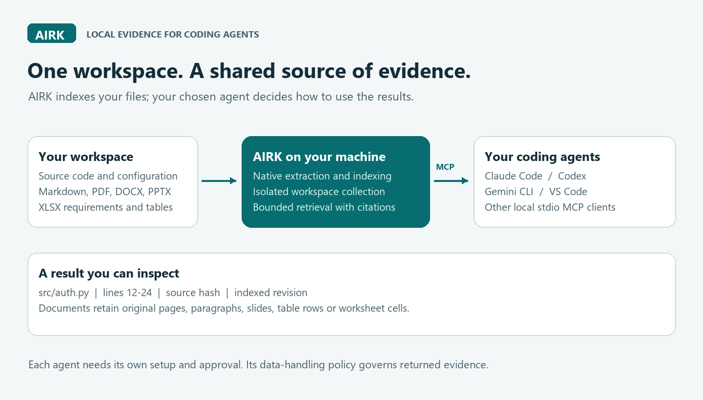
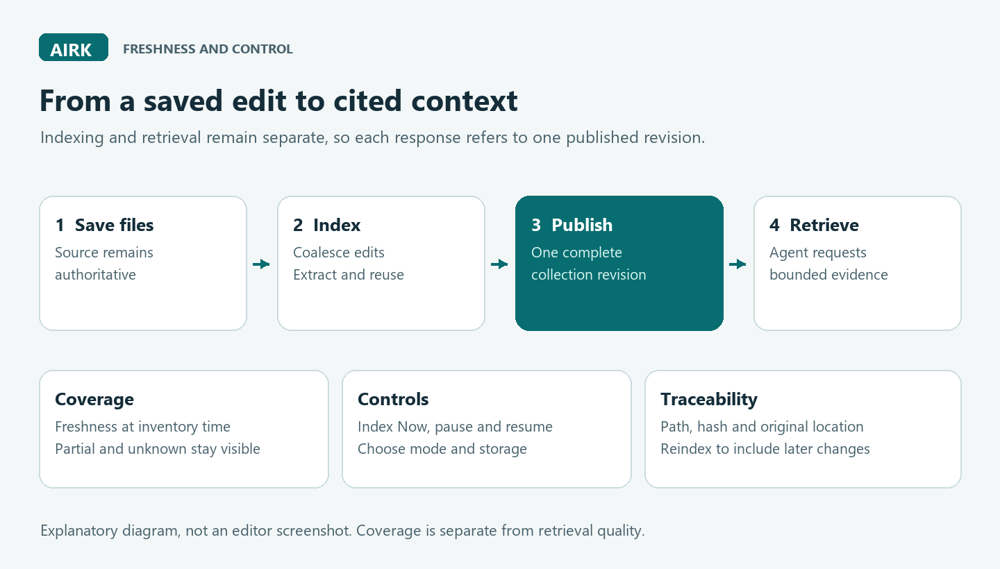

# VS Code extension content and illustrations

This is the content specification for AIRK's extension details/Marketplace page, its first-use guidance and the material shown from its commands for the 1.0.0 stable release. The shipped listing is [packages/vscode/README.md](../packages/vscode/README.md); the command/settings source is [package.json](../packages/vscode/package.json). Review this page against the actual release candidate, then capture editor screenshots for the [1.0.0 release checklist](release-1.0.0.md).

The package includes the two original PNG illustrations and rewrites their listing links to those bundled assets. The installed listing can display them without fetching repository images; package verification includes their exact digests.

The Marketplace icon is [icon.png](../packages/vscode/images/icon.png), a 256×256 transparent PNG rendered from the website's [SVG mark](../site/favicon.svg). The site header, favicon and Marketplace listing share the AIRK mark in Ioka's navy, warm white and gold palette. The separate monochrome activity-bar icon follows the editor theme. The packager explicitly includes both extension icons in its verified payload.

## Lead with the purpose

**AIRK — Artifact Indexing and Retrieval Kernel, the Local MCP Power Tool for Coding Agents**

“Give Claude Code, Codex, Gemini CLI and other coding agents a shared, local index of the workspace. AIRK returns bounded passages and facts with source paths, hashes and original locations. Your agent does the reasoning.”

Explain the benefit in practical terms: an agent can find a definition, inspect the surrounding lines, or retrieve a requirement from a document without first receiving an entire repository or document. AIRK makes the returned evidence inspectable and constrains each response. This is a capability statement; do not turn it into an unmeasured promise of lower bills, better answers or complete language understanding.

Caption: **One collection, several independently configured agents.** Each client launches its own collection-scoped stdio MCP worker using the same root, data directory and collection ID. Display names can differ without creating separate indexes. AIRK's local operation does not prevent the selected agent from sending returned evidence to its model provider under that agent's policies.

## Show what a user can do

Use three short examples beside the overview:

| User's task | AIRK evidence | Why it helps |
|---|---|---|
| “Where is authentication implemented?” | Matching passages, native syntax definitions, scopes and signatures | Start from named source locations; distinguish written syntax from resolved compiler facts. |
| “What timeout does this design require?” | Document requirement/date/quantity candidates with the original page, paragraph, table row, worksheet cell or slide | Inspect the original wording, header context and ambiguity; a cue is not an inferred obligation or proof of compliance. |
| “What changed since this answer's evidence?” | Indexed generation and source hashes, coverage/status, explicit indexing controls | Recognize evidence from a retained revision and update the index after edits. |

Explain code relationships as syntax candidates unless an optional source/build-bound SCIP or live LSP provider supplied an assertion. Ctags declarations remain syntax evidence. The CLI can deliberately run these separately provisioned local providers; the extension has no automatic provider invocation or dedicated provider-setup UI. LSP call edges require actual call-hierarchy evidence, and selected symbol queries do not establish complete resolution.

Describe optional local vector search using either digest-bound static word vectors or the implemented CPU ONNX transformer/WordPiece adapter. Link the [pinned model recipe and numerical qualification](onnx-models.md). State that the small real-model fixture does not qualify production semantic quality, and retain a clear not-ready state without provisioned assets. AIRK's runtime does not download models or fall back to remote inference.

Show a requirements-table example: **Requirements!B14** contains “The API must respond in at most 200 ms,” beside **A14: REQ-9**. AIRK preserves the worksheet, row, addresses and header mapping with the requirement candidate. DOCX tables similarly retain table/row/column context. State that spreadsheet formulas are not evaluated and cached values may be stale; merged cells and candidate headers remain labeled. Link [document indexing](document-indexing.md) for the extraction contract.

Explain explicit local OCR as a native CLI option: separately provisioned Tesseract and local language assets recognize selected PDF pages (with Poppler) or PNG/JPEG/BMP images, preserving the original source hash, page and executable/model provenance. Recognition and reading order can be wrong; unselected pages remain unknown. Native text-layer indexing does not automatically invoke OCR, and the extension does not offer an OCR configuration command.

## First-use sequence

1. Install the package matching the workspace host's OS/architecture. The native helper is bundled; the base runtime needs no Docker, Rust toolchain or API key.
2. Open and trust the intended folder. Each folder has an isolated collection. Untrusted workspaces cannot launch the helper.
3. Choose index storage if needed, then run **AIRK: Index Now**. Show progress and any skipped/failed files rather than claiming full coverage.
4. Run **AIRK: Set Up Coding Agent**. Explain the selected client's configuration location and show its scoped launch specification.
5. Enable/approve the server in that client, then ask for evidence from a small known fixture. **Verify Native MCP Connection** proves AIRK's handshake and tools, while a client-side request proves that particular agent is connected.

Caption: **Saved edits become evidence through indexing.** Coverage describes a measured inventory at a point in time. Unsaved buffers, failed extraction, incomplete scans and pending work must remain visible. A complete inventory does not establish retrieval quality.

## Agent integration copy

The bundled listing's **Coding agent setup** section contains the complete manual instructions for every setup-picker client, plus Antigravity's compatible Gemini-format route. Users can read the merge location, schema, approval/reload steps and connection checks in the installed extension's Details page. The walkthrough points to that section. Keep these instructions synchronized with the version-sensitive matrix in [agent integration](agent-integration.md), with client testing recorded separately.

| Client | What AIRK shows or registers | What the user completes |
|---|---|---|
| VS Code / Copilot Chat | Trusted workspace MCP definition provider and scoped native command | Enable the server in VS Code and approve tool access. |
| Claude Code | A project `.mcp.json` fragment using `mcpServers` | Merge the entry without replacing other servers; approve/load it in Claude Code. |
| Codex CLI / IDE / desktop | A `[mcp_servers.<name>]` TOML entry for shared Codex configuration | Add it to the user config or trusted project's `.codex/config.toml`, then check client discovery. |
| Gemini CLI | A `mcpServers` fragment for project/user `.gemini/settings.json` | Preserve the existing settings and Gemini's trust/tool policy, then reload/check the client. |
| Google Antigravity IDE / CLI | Reuse the `gemini` preview; there is no dedicated picker entry yet | Merge into `.agents/mcp_config.json` or `~/.gemini/config/mcp_config.json`, using the installed client's raw-config view to confirm its location. Follow the bundled connection checks; live-client qualification remains outstanding. |
| Cursor, Cline, Roo, Junie, Copilot CLI, OpenCode and Kilo | The appropriate supported configuration preview, with version guidance | Merge and enable using the client's own MCP controls. |
| Amazon Q and Windsurf/Devin | Command/arguments and guidance tied to the installed client/version | Follow that client's setup UI; do not imply direct registration. |

These routes were checked against [Claude Code's MCP guide](https://code.claude.com/docs/en/mcp), [OpenAI's Codex MCP guide](https://learn.chatgpt.com/docs/extend/mcp?surface=cli), [Gemini CLI's MCP guide](https://geminicli.com/docs/tools/mcp-server/) and the sources in the compatibility matrix on 13 October 2026. Configuration support is distinct from an observed end-to-end client test.

Use **“Preview configuration”** and **“Verify AIRK connection”** accurately. Registering AIRK in VS Code does not configure every other installed agent. Never show a green “Connected to Claude/Codex/Gemini” badge solely because a snippet was generated.

## Information shown inside the extension

| Surface | Required content and purpose |
|---|---|
| Status item and coverage details | Active folder/collection, current versus eligible files, scan time/completeness, stale/missing/failed counts and pending unsaved edits. Unknown stays unknown; zero eligible files is not 100%. Clicking opens grouped controls, including Index Now. |
| Controls | Index/reindex, mode, pause/resume, status, coverage, storage, collections, agent setup, connection verification and output. Describe automatic versus explicit actions. |
| Storage and collection maintenance | Selected data directory, derived bytes, collection identity and removal consequences. Source files are preserved. Changing storage must explain whether it rebuilds or migrates. |
| Usage report | Locally recorded aggregate activity/performance and recording health, measured stages/logical growth and supported host CPU/resource counters. Overlapping or unavailable counters stay unknown. Signed context estimates require a comparable baseline; optional client/session imports, local tokenizer calibration and supplied price scenarios retain provenance labels. State unknown/disabled/partial windows. Provider billing and full prompt usage are unobserved. |
| Output and failures | Bounded diagnostics with actionable failure states, skipped extraction and last successful revision. Never substitute an error for a success notification. |

Do not promise an unimplemented command or setting. Keep this specification, the actual command inventory and the shipped listing synchronized during release review.

## Illustration and screenshot requirements

The two diagrams above are original AIRK illustrations. Their editable source is [render-doc-illustrations.py](../scripts/render-doc-illustrations.py); regenerate with Python and Pillow. They are explanatory diagrams, not fabricated screenshots or measured performance charts. The PNG format is suitable for the extension listing; Microsoft restricts SVG images in extension README content. See [publishing guidance](https://code.visualstudio.com/api/working-with-extensions/publishing-extension).

Before publication, add genuine screenshots from the packaged extension using only the public fictional examples: coverage/controls, a selected agent's configuration preview, and cited results. Exclude personal paths, tokens, private code, `temp/`, index contents and unrelated extensions. Provide alt text, readable contrast and equivalent prose. Test both light/dark editor themes and narrow details panes. The agent names are labels, not endorsements or third-party logo assets.

## Limits shown near installation

State the tested host matrix and current capacity bounds, model readiness, source-read-only behavior, derived-state privacy, remote-host requirement, unsupported browser-only use, signing/publication status and extraction limitations. Link [formats](formats.md), [operations](operations.md), [security](../SECURITY.md) and the [1.0.0 release checklist](release-1.0.0.md). Clearly separate local runtime behavior from the selected agent's network behavior.

The listing may describe configured native ingestion bounds, shared logical quotas and available-drive checks, while keeping the editor's soft storage setting distinct. Current defaults are 16 MiB/source, 64 MiB eligible source, 128 MiB extracted text and 10,000 files. Raising limits is explicit and does not itself establish scale performance. Remote editor hosts require an actual test on supplied infrastructure; a matching package and local helper test alone do not qualify SSH, WSL, Containers or Codespaces.

Helper upgrade copy should explain that cached paths include the actual helper version and digest, so replacing the extension directory preserves existing agent commands. New trusted helper bytes use a new path; regenerate agent configuration when adopting them. The native integration suite exercises two supplied real helpers, verifies each reported version and digest, replaces the extension directory, and probes both the old cached command and the new one. This is helper lifecycle evidence, not a remote-host qualification.
