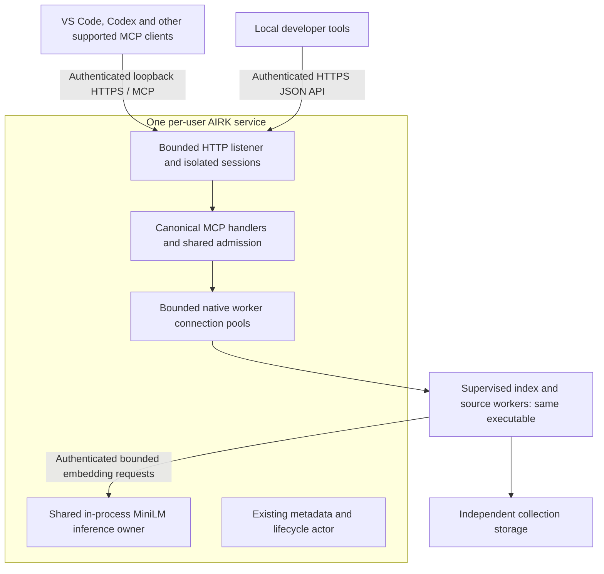

# One AIRK: executable, MCP endpoint and upgrade lifecycle

> **Split Phase 4 (later change; the dated decisions below are unchanged).**
> `airk` is now the service only and `airkctl` is the command-line client.
> Commands this plan names as `airk …` are `airkctl …` where they survive;
> `airk service session` is replaced by `airkctl session`, and `airk mcp`,
> `bridge` and `service console` are retired. See the
> [split plan](split/split-plan.md).

> **User decisions, 10 November 2026: one resident process.** These replace
> §1's "one executable is not a promise of one total OS process" paragraph and
> the worker processes in the §2 diagram.
>
> - **One resident `airk.exe` per user and machine: the service.** Project,
>   cleanup and source-watcher work runs inside it.
> - **Temporary processes allowed.** Each must exit when its job or owner ends,
>   so they never pile up:
>   - one `airk service session` per VS Code window, which exits when that
>     window's extension host closes;
>   - `airk` commands the user types, and installer one-shots;
>   - at most one short-lived PDF parser child for the whole service, created
>     and torn down for each document and kept for its crash and memory limits;
>   - a `tools shell` terminal the user opens.
> - **Agents connect to the service's HTTPS endpoint directly.** No process is
>   started for each agent.
> - **The pre-1.9.0 replacement installer is bound by §3, §9 and §10.3.** It
>   captures and reconnects AIRK agent entries before it removes launchers. It
>   retires the old trust records it owns. It reports typed per-entry outcomes.
>   Explorer warns about broken entries and offers a one-click Reconnect after
>   confirmation.
> - **The 1.8.19 narrowing is reversed.** 1.8.19 decided that agent
>   configurations outside VS Code are not edited. That narrowing was made
>   during implementation without the user's approval.
>
> The plan and evidence are in
> [the one-process ledger](simplify/one-process-ledger.md).

**Implementation plan recorded 7 November 2026; clean-break policy approved
8 November 2026.** The current development version is **1.8.16**. The user
approved a fresh-state/index rebuild for every earlier installation, then normal
supported upgrades within the explicit 1.8.16+ state contract. The line is to be
stabilized and qualified before an eventual public **1.9.0** release. Current
versions and artifact identities remain unchanged until separately authorized.

The [clean-break contract](upgrade-rebuild-fallback.md) supersedes pre-1.8.16
index migration, optional rebuild selection and historical accepted-job engine
adapters. Preserve only reviewed source selections and supported preferences;
original sources remain read-only. Old grants, credentials, index identities and
pending operations are not translated into new authority. Native shutdown,
durable reset recovery and removal of ownership-proven legacy artifacts remain
mandatory. A copied new binary cannot bypass the persisted state-contract check.

The single-executable HTTPS implementation originated at 1.8.14. The
[implementation ledger](research/one-airk-implementation.md),
[1.8.16 working record](releases/release-1.8.16.md) and dated
[1.8.14 record](releases/release-1.8.14.md) distinguish current implementation,
prior experiments, failed attempts and qualification. This plan is not a claim
that the acceptance matrix passed. Earlier migration sections are retained where
they document prior design or compatible-line mechanisms; they do not require
preserving pre-baseline index state.

### How to execute this plan

Use the clean-break policy above for version/state admission. Sections 1–11
remain acceptance contracts except the explicitly superseded pre-baseline
migration portions; section 12 retains the historical execution order.
Proposed type/module names below are design targets, not claims that those APIs
already exist. Reuse the named native owners and their validation rather than
creating competing implementations. Keep a task ledger alongside this plan with
`pending`, `in_progress`, `blocked`, `implemented` and `qualified` states, exact
commit/build identity, commands, evidence paths and unresolved platform limits.
An implementation is not qualified by a mock or by compilation alone.

Before each work package, read its live source, contracts and existing tests;
record predecessor schemas and invariants that must survive. Freeze shared DTOs
before parallel implementation. Keep one editor for each shared contract and one
Cargo owner per checkout. Implement and test a vertical slice before deleting its
predecessor path. Blocking feasibility results must remain explicit; do not trade
away TLS validation, scope, resource proofs or a supported platform to complete a
checkbox. The requested 1.8.16 version is already authorized; do not increment it again
for this policy implementation or relabel earlier binaries.

## 1. Required outcome

- Ship one native AIRK executable for each supported target: Windows x64, Linux
  x64, macOS ARM64 and macOS x64. Ordinary operating-system libraries, notices and
  macOS bundle metadata may remain; AIRK-specific runtime executables, model files
  and inference shared libraries must not be required alongside it.
- Embed the target-appropriate MiniLM weights, tokenizer and configuration, and
  statically link the inference implementation. Remove `airk-embed` and the
  separately deployed ONNX Runtime DLL/dylib/shared object from the final payload.
- Run one continuously available service per user and machine, shared by editor
  windows, agents and independent collections. Keep channel/custom-install
  isolation explicit; a test or managed installation must not seize the default
  installation's endpoint or state.
- Expose standard MCP Streamable HTTP directly from that service. No universal
  launcher, per-install launcher, foreground wrapper, MCP proxy subprocess or
  per-client `airk mcp` process participates in the completed connection path.
- Expose and document a versioned read-only JSON HTTPS adapter for local developer
  tools on the same listener, with the same authorization and complete canonical
  results. Using it must not require MCP, Workbench or an AI agent.
- Run MiniLM inference inside that service with one shared bounded model owner.
  An additional client, window or collection must not load another default model.
- For every pre-1.8.16 installation, perform the required native clean reset,
  rebuild fresh indexes from reviewed sources and supported preferences, and
  retire ownership-proven old processes and artifacts. Discard old index IDs,
  grants, credentials and pending operations; preserve original sources.
- For supported 1.8.16+ state-contract upgrades, stage, quiesce, checkpoint,
  replace and restart through the ordinary native owner. Runtime version alone
  cannot establish state compatibility.
- Reconnect clients with authority appropriate to the resulting namespace. Keep
  incomplete client reconnection and cleanup explicit; a configuration edit
  alone is not successful acceptance.
- Preserve existing **CLI, Workbench and MCP parity**: equivalent reads expose
  the same supported inputs and complete canonical results. Preserve CLI and
  Workbench management access through authenticated native control; moving MCP
  to HTTPS must not remove those interfaces or grant management to evidence MCP.

**One executable is not a promise of one total OS process.** Initially retain
supervised source and index workers where they protect storage ownership and
isolate extraction work. They must execute the same approved native image with
explicit role arguments, without copied role executables. This plan removes the
launcher, per-client frontend and embedding-helper processes. Combining storage
and source workers into the service is a separate architectural decision.

The observed Windows installation had ten MCP chains, each with two resident
launchers and an MCP frontend. Nine chains were children of Codex and one of VS
Code. That observation explains the multiplication; it does not establish that
every connection was still useful or that the resource cost was acceptable.
The new acceptance target for ten connected clients is **zero launchers, zero
per-client frontend processes and zero embedding-helper processes**.

## 2. Target architecture and ownership



The listener, developer JSON routing and service runtime remain in `airk-cli`;
MCP protocol, tool schemas,
response handling and transport-neutral session construction remain in `airk-mcp`.
Shared contracts belong in `airk-core` only where they cross owners. Kernel,
retrieval and store retain their existing dependency direction. Do not add a
gateway process, external database, cloud service or orchestration layer.

HTTP evidence must not queue behind the serialized Management metadata actor.
Use the existing scoped/combined native backends and worker connection pools,
with complete canonical results. The service process will now transport bounded
evidence, whereas the metadata actor remains metadata-only. Update the existing
"evidence never passes through the broker" architectural description explicitly;
do not claim that this boundary remains unchanged.

Implement the listener asynchronously. Model loading, tokenization, inference,
storage access and serialization must not block its protocol executor or health
handler. No request may spawn a CLI subprocess to obtain its answer.

## 3. Endpoint decision and discovery

The proposed default is **`https://127.0.0.1:57421/mcp`**, using standard Streamable
HTTP over TLS. HTTPS is intentional: plain loopback HTTP plus a bearer token does
not authenticate the server during the period when an upgrade releases its port.
Port 57421 is a proposed preference, not an IANA reservation or a guarantee that
the port is free.

1. During first setup, acquire the installation's existing native ownership lock
   and obtain its user SID/UID and catalog/control namespace.
2. Bind explicitly to IPv4 loopback. IPv6 is disabled initially; adding it requires
   explicit `::1` binding, an appropriate certificate and the same tests. Never
   bind to `0.0.0.0`, `::` or a hostname that could resolve elsewhere.
3. On first setup, try `127.0.0.1:57421`. On the OS's typed address-in-use result,
   immediately bind `127.0.0.1:0` and read the actual port assigned by the OS.
   **Retain that bound listener** through TLS startup and descriptor publication;
   never check a port, close it and assume it remains available. An existing
   listener is preserved. Other failures, such as permission or resource errors,
   return their actual cause instead of initiating an unbounded port search.
4. Write a bounded, versioned, owner-protected endpoint descriptor containing
   installation identity, user identity, control namespace, exact endpoint,
   certificate identity, endpoint generation and state. Store secrets separately.
5. Every setup surface resolves that descriptor through authenticated native
   control or verified owner-private storage. It must emit the actual endpoint,
   not independently guess a port or select another local AIRK installation.
6. Ordinary restart and upgrade first try the saved actual port. If it is occupied,
   automatically bind an OS-assigned alternate as above and run the endpoint
   relocation transaction below. Never adopt, probe or kill the other listener,
   or send it credentials. The certificate identifies `127.0.0.1`, not a port;
   relocation does not require weakening TLS or changing the trusted issuer.
7. Publish the selected URL through authenticated native discovery and update
   recognized, owned client entries with exact preimage checks. An unsupported
   host refresh, dirty configuration or conflicting edit remains an explicit
   pending migration. Never claim that a saved client using the old URL has
   reconnected. Explicit repair uses this same transaction, not another allocator.

Named pipes on Windows and owner-private Unix sockets remain the authenticated
bootstrap and management channel. They are not replaced by an unauthenticated
HTTP discovery API. A direct URL client cannot start a stopped service; service
availability is the OS manager's responsibility.

### 3.1 Endpoint relocation transaction

The service that will accept connections owns the bind, under the installation's
single-instance lease. An installer must not reserve a socket, release it, and
then ask the manager to bind it again. Reuse the installation's protected control
namespace for discovery across image upgrades; the binary directory is not the
namespace identity.

Persist an operation key, expected prior descriptor digest/generation, actual
bound address, new generation and config-update receipts. Advance through
`bound_candidate`, `descriptor_published`, `configs_reconciled` and
`complete`/`awaiting_host_reconnect`; include explicit conflict/recovery outcomes.
Publish the descriptor atomically only after TLS/native identity readiness.
Then reconcile clients using the same owned-entry transaction as section 10.
Service readiness and completion of all client migrations are separate facts.

On crash, re-acquire the lease and re-observe the listener/descriptor and config
preimages. Never assume a journaled candidate port remains reserved. If another
bind is necessary, issue a newer generation and reconcile from each entry's
last proven state. Revoke old session generations; preserve unchanged connection
grants and credentials only under their original installation/trust authority.
If a client's authentication binds tokens to an origin/resource audience, renew
or re-enroll that authorization for the new port; do not blindly forward an
old-origin token. An already running client at the stale URL must reject a
foreign listener's identity; its retry must not discover a new server by scanning
ports.

Acceptance includes occupied preferred and saved ports, simultaneous setup,
multiple OS users, a foreign service at the stale URL, descriptor-write failure,
crash between every transition, a user edit during config migration, and clients
that require their MCP session to restart. Every generated example/configuration
must use the actual discovered port, not a hardcoded fallback assumption.

### 3.2 Native contracts to freeze before adapters

Add bounded, versioned contracts inside the existing owning crates. JSON fields
below describe required information; exact Rust naming follows repository style.

| Contract | Required fields and invariants |
| --- | --- |
| `EndpointDescriptorV1` | Schema, installation ID, OS principal, control namespace, actual HTTPS URL, endpoint generation, service instance, approved image/build digest, TLS issuer identity and current leaf fingerprint, lifecycle state and preceding descriptor digest. Only literal IPv4 loopback and `/mcp` are valid initially. No tokens or private keys. |
| `ClientConnectionV1` | Stable connection ID, original native grant/revision and namespace, client/transport adapter version, endpoint reference/generation, trust reference and credential reference. Client labels are informational; the native grant is authority. |
| `EndpointRelocationReceiptV1` | Operation key, old/new descriptor digests and generations, bind observation, per-config preimage/output identities, host-refresh observations, stage and complete typed refusal/recovery details. Never treat file-write success as host-refresh success. |
| `HttpSessionContext` | Authenticated connection/grant, service instance, endpoint and credential generations, negotiated protocol, response preferences and bounded cancellation/admission state. In-memory only; never restored from the upgrade packet. |
| `UpgradeJournalV1` / `CheckpointManifestV1` | Journal transitions and immutable checkpoint references as separated in section 8; operation/predecessor identities, canonical committed data, compatibility decisions, manager/config receipts and resource-drain proofs. No new parallel job database. |

Define numeric bounds, required/optional fields, canonical digest rules, schema
compatibility and refusal enums in Core only where contracts cross components;
keep transport-only/session details in their owning crate. Reject malformed,
oversized, unknown-version or crossed-namespace records before side effects.
Add golden predecessor/current fixtures and malformed-field tests. The descriptor
also identifies the HTTPS origin for the developer API in section 5.3; `/mcp`
remains the MCP URL, not the only allowed route on that listener. No authority
may come from an unverified web response or from an informational digest alone.

## 4. Security implementation

### 4.1 Trust boundary

Treat other local users, arbitrary local programs, browser pages, untrusted
repositories, forged endpoint files and port squatting as threats. Loopback is a
network reachability restriction, not proof of OS identity or authorization.
An attacker already controlling the user's account or an administrator/root is
outside a confidentiality guarantee that a user-owned service can enforce; do
not claim otherwise.

Implement these controls before migrating production clients:

- **Server authentication before credentials:** provision a per-installation TLS
  identity through the authenticated bootstrap channel. Prefer client-specific
  certificate trust/pinning; where the client requires a trust store, use an
  explicitly reviewed per-user mechanism. Verify the exact loopback IP identity
  and certificate before sending authorization headers. A successful TCP connect,
  HTTP health response, random path or MCP session ID is insufficient.
- **Trust provisioning:** document and test the mechanism for each actual client
  version and OS. Preserve existing enterprise/public trust roots. Never disable
  certificate checking, install an unreviewed machine-wide CA, replace a user's
  trust bundle, or use a command wrapper to add missing HTTP support. A client
  without the required trust support remains blocked from migration.
- **Separate keys:** local TLS credentials are independent of Developer ID,
  Windows signing and release-signing credentials. Keep private keys in protected
  native storage. Handle expiry, renewal, revocation, uninstall and authenticated
  trust rotation without accepting an unverified replacement identity.
- **Client authentication:** issue strong, revocable credentials through trusted
  setup. Bind each credential to an explicit client connection and reviewed
  native scope; validate it on every request, including session reconnections.
  Use supported credential references or client-native credential storage.
  Never put live tokens in repository files, URLs, command lines, diagnostics,
  examples, release artifacts or exported connection instructions.
- **Authorization:** map credentials to the original reviewed grant, catalog
  namespace and permitted indexes/source roots. Revalidate policy and revocation
  through native handlers. A URL, workspace path, active Explorer selection,
  OS username or session ID cannot widen access. Preserve independent grants for
  different agents and workspaces.
- **Browser defense:** enforce an exact Host allowlist and validate Origin when
  present. Deny arbitrary browser origins, wildcard CORS, proxy-supplied identity
  and redirects to another origin. A native client omitting Origin still requires
  authentication. Reject unsupported content types and oversized/malformed input.
- **Separate management authority:** keep shutdown, upgrade, model provisioning,
  credential issuance and data deletion on authenticated administrative native
  control. The read-only MCP credential must not authorize those actions.
- **Confidentiality and limits:** return path-safe errors, redact credentials and
  bound logs. Limit unauthenticated handshakes, bodies, streams, session count and
  idle duration before allocating expensive resources. No firewall exception,
  administrator/root service or LAN listener is part of the default design.

The 1.8.14 baseline is a separately revocable, cryptographically random bearer
credential for each reviewed client connection, at least 256 bits of entropy.
Store only its verifier on the service side and use constant-time verification;
protect client-side material with the client's supported secret store/reference.
Define expiry/rotation/revocation and limit verification work before enrollment.
Issue it only through trusted setup, never a public anonymous enrollment route.
Client-native OAuth may be added only with a complete, qualified local
authorization flow; documenting OAuth support in a client does not implement an
AIRK OAuth server. A client needing that flow remains blocked until it exists.
Do not add a persistent credential helper or a new subprocess on every request.
Setup must explain any host-level environment/trust refresh needed; writing a
reference does not magically provision a secret into an already running host.

### 4.2 How AI tools trust the local HTTPS certificate

**AI tools do not ignore an untrusted certificate.** MCP uses the host client's
HTTP/TLS implementation. Setup makes AIRK's local issuer trusted by that client;
normal TLS verification then succeeds without a public/commercial CA signature.
This is an explicit trust relationship, not a TLS exception or an MCP feature.

Use a private CA unique to this user/installation and a server certificate with
`subjectAltName = IP:127.0.0.1` and server-authentication usage. A DNS name of
`localhost` or a certificate Common Name alone does not match the chosen IP URL.
Choose and freeze supported algorithms, issuer/leaf lifetime, renewal window,
clock-skew policy and protected key-storage implementation in P0. Prefer additive
client-specific trust; native AIRK clients may use explicit verified pinning.
Limit CA scope using supported constraints, and qualify those constraints with
the actual client TLS stacks before permitting broader per-user trust. Never
reuse a global AIRK CA/private key across installations or ship one in artifacts.

Trusted setup obtains the issuer's public certificate/fingerprint through native
control after verifying the installation and service identity. It provisions only
that public trust material into a supported client trust mechanism, then performs
a real TLS handshake and scoped MCP call. The client validates the chain or
supported pin, exact IP, validity and usage **before** sending an authorization
header. The private CA key and server key never enter the trust PEM/export or
client config. Leaf renewal under the same issuer should not force every client
to re-enroll; issuer rotation is a separate authenticated, receipt-backed migration
with a bounded overlap and subsequent removal of the old owned trust entry.

| Client/path | Implementation instruction and required evidence |
| --- | --- |
| AIRK Workbench/Explorer native adapter | Resolve the protected descriptor via native control, configure its TLS verifier for that installation and resolve the original scoped credential in the host. Keep hostname/IP verification enabled. Do not mutate a process-global TLS environment to change other extensions' networking. |
| Codex | Official configuration supports MCP `url` and `bearer_token_env_var`/environment header references. `CODEX_CA_CERTIFICATE` (with documented `SSL_CERT_FILE` fallback) supplies a custom PEM trust bundle. Qualify the actual Codex version's MCP path: generic HTTPS CA documentation is not an MCP acceptance test. Preserve pre-existing public/enterprise trust and arrange the actual agent host's environment before connection. |
| Claude Code | Official network guidance documents `NODE_EXTRA_CA_CERTS` for additional PEM trust and runtime-dependent system trust. Test the actual native/npm installation and supervisor environment; a shell export does not update an already running agent. Use its supported HTTP authorization configuration without exporting a live token into a repository. |
| VS Code/Copilot | Verify the real HTTP MCP provider/configuration and its network stack's trust store on every supported OS. General VS Code OS-certificate guidance does not prove extension or agent-harness trust behavior. Supported secret inputs/provider resolution and environment references vary by host; do not assume arbitrary SecretStorage or input-variable forwarding into the portable Copilot harness. |
| Other catalog clients | Record the exact version, OS, connecting process, trust option/store, secret reference and refresh behavior. No universal `ignoreCertificateErrors` option is to be invented. Unsupported trust or auth is a typed compatibility blocker. |

The client trust matrix must cite official documentation and retain installed
client evidence. On Linux, changing system roots commonly requires administrator
access; use supported client trust without elevation or report the limitation.
On macOS, putting a certificate into a Keychain is not proof that every Rust,
Node or embedded client uses it. Do not prescribe `-k`, `--insecure`,
`NODE_TLS_REJECT_UNAUTHORIZED=0`, `strictSSL=false`, or an accept-all verifier.

Trust material is public, while private keys and client credentials are secrets.
Default to owner-protected native key files (0700 directories/0600 files on Unix,
equivalent user-only ACLs on Windows) with safe-file validation and atomic writes;
use supported client secret stores where required. Do not make unattended service
start depend on an interactive keychain unlock. Any optional Keychain-backed
variant must define and test its locked/unavailable state before enabling it.
These controls do not protect a user's secrets from full compromise of that same
user account. They do prevent a different local user or an untrusted network peer
from acquiring them merely by occupying the port.

**Approved implementation decision, 7 November 2026:** use normal HTTPS CA
validation, preserving existing public/enterprise trust, with scoped connection
credentials. The real Codex MCP experiment confirmed that AIRK's local CA can be
trusted and an untrusted issuer is rejected before HTTP. An additive bundle also
accepts another already-trusted issuer's valid certificate for `127.0.0.1`; the
user explicitly accepted normal CA validation after reviewing that result.
This authenticates the endpoint under the client's trusted-CA policy, not an
installation-specific pin. A compromised or misissuing already-trusted CA remains
outside that guarantee. Do not remove existing roots, invent client pin settings,
disable TLS validation or introduce a proxy. Native AIRK clients may additionally
pin their known identity where supported, without requiring other clients to do so.

Sources: [Codex trust](https://learn.chatgpt.com/docs/auth#custom-ca-bundles),
[Codex MCP](https://learn.chatgpt.com/docs/extend/mcp?surface=cli),
[Claude network configuration](https://code.claude.com/docs/en/network-config),
[VS Code MCP](https://code.visualstudio.com/docs/agents/reference/mcp-configuration)
and [VS Code network trust](https://code.visualstudio.com/docs/setup/network#ssl-certificates).

### 4.3 Mandatory adversarial tests

Test anonymous access, wrong/revoked credentials, crossed grants and namespaces,
expired certificates, certificate rotation, hostile Host/Origin headers, DNS
rebinding, invalid session IDs, forged endpoint descriptors, redirects, malformed
JSON, slow readers and connection floods. Run two real OS users concurrently.
During a stopped-service upgrade, bind a fake listener to the saved port and prove
that a client rejects its identity **before exposing a credential or evidence**.
Exercise occupied/no-available-port and IPv4/IPv6 mismatch failures explicitly.

## 5. MCP sessions, parity and resource use

1. Add the pinned SDK's supported Streamable HTTP server features and review new
   dependencies/licenses. The current `rmcp` feature set is stdio-oriented.
2. Extract transport-neutral Bridge/session construction from
   `airk-mcp/src/remote.rs`. Make response preferences and client attribution
   session-local instead of inheriting a frontend process environment.
3. At authenticated initialization, bind a session to the exact client, grant,
   namespace, endpoint generation and current service instance. Keep transport
   session IDs separate from native authorization identities.
4. Route tools to the same canonical handlers used by CLI and Workbench. Preserve
   all inputs and complete results: provenance, publication identity, coverage,
   readiness, continuations, selected subsets, errors and delivery fences.
5. Put global admission above session admission. Keep the configured concurrent
   evidence capacity and reserved status/control capacity shared across all
   sessions; ten sessions must not multiply the worker or memory allowance ten
   times. Add fair per-client queues under the global byte/concurrency budget.
6. Bound body size, aggregate in-flight response bytes, stream duration, queued
   requests, session count and connection pools. Retain capacity while accepted
   blocking/native work remains alive, including after transport cancellation.
7. Close/expire sessions and release their pools deterministically. HTTP disconnect
   alone does not prove accepted native work stopped. Reconnect by initializing a
   new session against the same authorization; do not replay submitted work.
8. Implement the requested **one internal 50 ms retry** for an exact typed
   `selection_busy` safe-read refusal. Retain the original request, explicit
   revision/cursor, deadline, verification allowance, cancellation and grant
   checks. Count one logical usage operation. Do not stack retries in HTTP,
   worker and CLI layers; do not repeat completed combined-read siblings. If no
   budget remains or the second attempt is busy, return the complete typed hint.
   Generic text, `publication_busy`, mutations and uncertain exchanges are not
   newly eligible under this change.
9. Audit the existing native settings retry loop separately so the new policy does
   not silently extend its deadline or add an outer replay. Prove parity through
   actual CLI, MCP transports and Workbench controller paths, not renderer mocks.

### 5.1 CLI and Workbench parity is a compatibility requirement

Transport migration must preserve the contract in
[read-interface-parity.md](read-interface-parity.md). Ordinary one-shot CLI commands
may continue through authenticated native IPC to the same handlers. They do not
need a resident MCP frontend or an internal HTTP-to-CLI subprocess. Workbench's
evidence adapter uses the verified service connection; its trusted management
adapter retains native IPC. Neither interface requires an AI agent to operate.

Maintain a generated audit matrix from the canonical operation/input catalog:
each native handler, MCP public name/alias, `airk tools call`, tools shell,
convenience CLI command, Workbench slash command/form and complete export. Audit
parse/plan execution and nested results as well as direct calls. All supported
filters, selectors, byte/time budgets, continuation tokens, source verification,
reply modes and conditional validators must survive. Keep scoped administrative
reads and mutation receipts available in CLI and Workbench through existing
review/authority; do not add those mutations to the evidence MCP catalog.

Use an actual fixture service with identical collection publications, grant,
selection and input arguments. Compare canonical full results across real HTTPS
MCP, CLI tool-call/shell/convenience paths, Workbench controller and installed
editor exports. Validate raw delivery proofs before any documented transport-only
normalization. The existing negotiated `resultType` distinction and qualified
timing/observation differences require explicit assertions, not a generic filter
that drops changing fields. Never strip unknown fields to make equality pass.

Include status/configuration, lexical/vector/hybrid reads, structured facts,
combined scopes, every paginated operation through its continuation, parse steps,
truncation/selected exports, source mismatch, revoked scope, expired session,
`selection_busy`, unavailable inference and unknown receipt outcomes. Workbench
cards may summarize; **Complete response**, JSON/Markdown copies and exports must
preserve full data or clearly identify an explicitly selected subset. Connection
relocation, upgrade and retry must not clear a session's selected scope or silently
switch it to all indexes. Renderer mocks alone do not satisfy this gate.

### 5.2 HTTP and retry implementation details

Build the transport-neutral session first and exercise it with existing stdio
predecessor tests and the new HTTP adapter. Negotiate the pinned SDK's supported
protocols; retain the documented legacy/inline envelope distinctions. Implement
initialization, tool listing/calls, session headers, POST/GET/DELETE behavior,
notification/cancellation and JSON/SSE responses according to that SDK/specification.
Do not invent a REST wrapper that merely accepts JSON-RPC-looking input. Choose
bounded session resumption or explicitly require reinitialization; do not promise
replayable event history without a bounded store and tested semantics.

Centralize limit constants and their validation: header/body bytes before parse,
handshake/idle/request deadlines, global/per-client session and queue counts,
aggregate queued/request/response bytes, and blocking executor capacity. Retain
the current 4/8/16/32/64 evidence setting (default 16) and reserved status/control
capacity. Freeze remaining numeric limits in P0 against existing native bounds;
queue exhaustion returns a complete typed refusal without allocating another pool.

Implement the 50 ms wait with the async timer and the original monotonic deadline.
Apply it at one canonical safe-read owner, before transport-specific formatting,
so CLI and Workbench obtain the same behavior. Retry only a typed refusal proving
the attempted read was not submitted and no evidence was delivered; keep partial
combined-read siblings intact. Revalidate the original authority after waiting.
Use controlled-clock tests for first-busy-then-success, second-busy, less than
50 ms remaining, cancellation, revocation during wait and uncertain submission.
No unconditional outer retry, new request key or reset deadline is allowed.

### 5.3 Public local HTTPS API and developer documentation

Support ordinary local tools without requiring an AI host, Workbench or an MCP
client library. Add a thin **read-only JSON adapter on the same HTTPS listener**;
it uses the same scoped connection credentials, canonical handlers, admission,
result contracts and 50 ms safe-read retry. It is another transport, not another
query engine, process or management authority. Preserve full parity across this
API, CLI, Workbench and MCP. The TLS identity, actual port and ownership rules
above apply unchanged.

Freeze this versioned route contract in P0 and implement it alongside C5:

| Route | Contract |
| --- | --- |
| `POST /mcp`, `GET /mcp`, `DELETE /mcp` | Standard negotiated MCP Streamable HTTP operations, headers, sessions and supported JSON/SSE behavior. Document which optional methods/features are supported and their explicit refusal behavior. |
| `GET /api/v1/tools` | Authenticated read-only tool catalog and complete argument/result schemas from the canonical catalog. Return supported canonical names, aliases and contract version, with transport-specific differences identified. No independent hand-maintained reduced catalog. |
| `POST /api/v1/tools/{name}` | Invoke one advertised canonical read tool with its exact JSON argument object as the body. Return the complete canonical tool result as JSON, without a JSON-RPC wrapper or display-only projection. Only advertised read operations are callable; no generic CLI/shell dispatch. |

Use the tool route for status, diagnostics, capabilities, search, source reads,
facts, continuations and supported read-only plans. Do not add a public shutdown,
upgrade, enrollment, file-write or arbitrary management endpoint. Unknown paths,
methods and tool names refuse explicitly. A tool's arguments retain their native
scope/selection validation; a caller cannot switch installations or gain indexes
by adding a path/collection field. This API has request-local read contexts rather
than a durable MCP session; revocation and lifecycle admission are checked on
every request. Use the existing response-status/continuation contract explicitly
where a read needs prior context, never an implicit global "current client".

Document transport errors separately from canonical tool results. Authentication,
invalid framing/JSON, size limits and pre-admission overload use documented HTTP
statuses (`401`/`403`, `400`, `413`, `429`/`503`) with a bounded, credential-free
versioned error body. Once canonical execution produces a result, return its
complete result envelope, including a typed native refusal and its `isError`
semantics, as a documented `200` response. Do not turn an unknown/partial native
failure into empty successful data or strip its receipts. Freeze correlation IDs,
retry hints, cancellation/timeout behavior, content types, output limits and
version negotiation in the reference. Losing a connection does not authorize
replaying an uncertain request.

Create **`docs/local-https-api.md`** during implementation and link it from README,
the documentation index, headless CLI, agent integration, Workbench and MCP guides.
Generate/check an OpenAPI 3.1 description for `/api/v1` and the exact JSON schemas
from canonical catalog inputs/results. Document MCP's protocol separately instead
of describing its streaming/session machinery as ordinary REST. The guide must
include:

- A complete endpoint/method/header/status table, supported API/protocol versions,
  maximum sizes/deadlines, authentication and scope semantics, and compatibility
  policy. No developer should have to infer a route from extension source.
- How a reviewed local tool enrolls through the trusted one-shot CLI/native
  management flow, requests only its needed indexes, obtains a credential/trust
  reference and discovers the actual HTTPS origin/port. A URL is not a credential;
  the API cannot enroll an anonymous caller. Include revocation/uninstall.
- Working Python, TypeScript/Node and PowerShell examples for catalog lookup,
  status, lexical/semantic search, exact source read, pagination and typed failure.
  These examples must work without an MCP SDK. Resolve secrets from supported
  private stores/environment references at runtime; never put them in URL,
  shell command arguments, committed config, source code or example output.
- Correct TLS trust and installation-identity verification for each example's
  runtime, preserving other trust. No insecure switch or fabricated fingerprint
  check after credentials were already sent. Explain certificate rotation and
  the difference between a missing local trust root and a rejected identity.
- Equivalent CLI, Workbench, MCP and raw-HTTPS requests/full results using the
  same fixture scope and publication, including canonical structured errors,
  provenance, source verification, continuations, partial results and uncertainty.
- How to rediscover through authenticated local control after restart/port change,
  when to re-enroll credentials bound to an origin, and which retries are safe.
  State WSL/container/SSH namespace and Mac GUI/headless limits explicitly.

Ship the examples in a public example directory with placeholders and synthetic
fixtures only. Run them against the real installed development service and actual
TLS/authentication, including wrong issuer, revoked/crossed grants, overload,
pagination, upgrade and port relocation. Check generated route/schema drift in CI
and compare the direct API's complete results with all existing parity paths.
Doc links and a passing OpenAPI validator alone do not qualify the public API.

## 6. MiniLM and inference in the one executable

This is a deliberate reversal of the current lightweight-main/separate-helper
packaging policy. Update the policy and its assertions coherently; do not merely
delete a dependency check or describe helper reuse as in-process inference.

1. Inventory `bundled_model.rs`, `embed_main.rs`, `embed_pool*.rs`,
   `embedding_pool_*.rs`, `embedding_client.rs`, `embed_request.rs`, the kernel's
   `shared_models.rs`/`vectors.rs`, and retrieval's model/inference adapters.
   Reuse the existing `bundled_assets.rs`/build-time content-hash machinery and
   `onnx.rs` in-memory session loading where applicable; the missing change is
   static engine linkage and service ownership, not merely embedding weights.
2. Preserve target profiles: ARM64 currently uses the signed-int8 MiniLM profile;
   x64 uses its unsigned-int8 profile. Embed the exact approved weights,
   tokenizer/vocabulary, configuration and preprocessing/normalization contract
   with stable content hashes and license provenance. No startup download or
   extraction of another executable/shared inference library is permitted.
3. Replace `ort`'s current dynamic-loading deployment with a reproducible supported
   static inference build. Prove Linux x64, Windows x64 and both macOS targets,
   including runtime/system-library dependencies, minimum supported OS/CPU,
   code-signing and build-license requirements. If a target cannot satisfy this,
   single-executable acceptance is blocked; do not conceal a sidecar fallback.
4. Load the embedded model from executable-backed bytes through an in-memory model
   adapter. Avoid copying the full model for every request or materializing it into
   a writable shared cache to load it. Make model identity independent of whether
   its original bytes were embedded or stored separately.
5. Move the shared embedding owner into the service. Use a bounded executor and
   a controlled number of compatible inference sessions/threads; do not create a
   session per index or HTTP connection. Keep one shared default-model ownership
   domain, including semantic queries and indexing requests.
6. Preserve the existing authenticated worker embedding route, budgets,
   compatibility keys and per-project accounting, replacing its helper-process
   destination with the service's in-process owner. No model/index payload may
   block the metadata actor. Keep lexical/status/control headroom under load.
7. Define start, lazy model load, readiness, cancellation, idle unloading and
   memory-pressure behavior. Continuous service availability does not require
   keeping model working memory resident when idle. Reload from embedded assets
   without a new process or network download.
8. Replace process-reap-based provider drain proofs for this owner with truthful
   in-process ownership proofs: stop admission, account for all accepted requests,
   wait for inference completion and release model references. A timed-out caller
   does not terminate an FFI computation. Never fabricate a worker-reap proof for
   a thread or free native resources still in use.
   Version the old helper/provider-history and worker-resource-drain contracts,
   keeping their original identity through migration. Define a new typed native
   completion-barrier proof rather than relabeling `native_worker_reap`.
9. Record the changed fault boundary: an inference engine crash can now terminate
   the service. Catch recoverable errors, isolate blocking work from HTTP and
   health, preserve durable requests and rely on supervised service recovery for
   process failure. Test the loss of the old helper's crash isolation explicitly.
   Audit `onnx_macos.rs` process-global environment/exit handling for static
   linkage, and prove all sessions and callbacks release before environment
   teardown during ordinary shutdown, interrupted upgrade and signed Mac exit.
10. Preserve existing custom-model policies. The bundled default is embedded;
    externally selected custom data must not be silently overwritten or converted
    to MiniLM. Define support/limits for additional models before migration.
11. Reuse existing vectors only when full model, tokenizer, preprocessing,
    quantization and dimensional identities match. Otherwise record the mismatch
    and schedule a reviewed rebuild; do not mix embeddings or claim no reindex is
    needed. Preserve original indexed publications until replacement is ready.
12. Retire old helper processes, model caches and runtime libraries only after
    their owners and content-addressed references are released. Preserve custom,
    unknown and shared assets. Update model inventory/purge/uninstall ownership.

The executable will be larger and model updates will require replacing it. Measure
build/signing/package costs and service resident/private memory; fewer processes
alone does not establish lower total memory or faster indexing.

### 6.1 Separate model identity, execution identity and runtime ownership

These identities serve different purposes and must not be collapsed:

| Identity | Meaning and upgrade rule |
| --- | --- |
| Model/pipeline digest | Exact model, tokenizer, preprocessing, quantization, dimensions and relevant implementation contract. Determines vector reuse. Equal weights alone are insufficient. |
| Approved execution identity | Authenticated executable/build/inventory that accepted work. Changes with the new single-image payload even when the model digest is unchanged. Existing job authority cannot be rewritten to the new hash. |
| Provider incarnation | One live service instance and in-process provider generation. Authorizes only that live owner; never survives service restart or model-owner replacement. |

Introduce an explicit service-only inference capability. Enabling a Cargo feature
in the shared executable also compiles it into source/index worker roles, but
must not authorize those roles to initialize another ORT engine. Audit
`crates/airk-kernel/src/shared_models.rs`,
`crates/airk-retrieval/src/model.rs`, `crates/airk-kernel/src/lib.rs`
feature-dependent tokenization and custom/nonshared model paths. Preserve remote
worker inference
through the authenticated service route. Test both indexing and semantic queries
over several indexes, not only the default model constructor.

Define a versioned provider identity and inference lease binding the service
instance/execution ID, provider generation, exact worker, accepted job/query,
model digest, scope/fence generation and byte/time/request allowance. The native
owner, not a serialized DTO supplied by a caller, certifies a completion barrier.
Its proof must cover the captured admitted sequence, queued/running work,
canceled-before-start work, callbacks and retained delivery/model references.
Preserve decoders for old helper drain tickets and their bounds until migration
is proven; never accept an old helper ticket as an in-process completion proof.

HTTP admission, native worker reads and inference continuations need distinct
bounded permits under the aggregate resource policy. The path is service HTTP →
worker → service inference: acquiring the same exhausted semaphore on that return
path would deadlock all semantic reads. Reserve bounded continuation capacity
for accepted jobs/queries and status/control headroom, account input/output buffer
ownership once, and specify fair queue order and maximum age. Reused backends
must not try to start/elect their own service or wait on the metadata actor while
holding a permit needed by that actor. Exercise this with all evidence slots busy,
indexing batches, slow clients, cancellation and a simultaneous upgrade fence.

Static-link feasibility must record the pinned ORT/source and toolchain hashes,
reproducible build options, approved model hashes, target minimum OS/CPU, link map
and actual imported libraries on all four targets. No dynamic-loader fallback or
first-run binary extraction qualifies. Test the approved signed image from its
real installed location; count model sessions and private memory separately from
shared executable mappings. Remove dynamic-runtime exit/lifetime handling only
after proving the replacement shutdown order on both Mac architectures.

## 7. Direct service supervision on each OS

The manager must execute the approved native image directly, with explicit service
and control-root arguments. It must not invoke `airk-launcher`, `runtime foreground`,
a shell wrapper or another persistent bootstrap process.

| Platform | Implementation and proof |
| --- | --- |
| Windows | Adapt the user-owned Task Scheduler registration and its normalized ownership verifier/receipt. Bind the action to the approved immutable image and exact arguments. Verify real process ancestry, crash recovery and current-user logon without requiring administrator service installation. |
| macOS | Adapt the per-user LaunchAgent and authenticated native manager adapter. Execute the sealed bundle's `AIRK.app/Contents/MacOS/airk` in place. Never copy or rename its sealed main outside the bundle. Verify GUI/login lifecycle and Developer ID/notarization on ARM64 and x64. |
| Linux | Adapt the user systemd definition and its native verification. Execute the approved image directly. Qualify logon/session availability, crash restart, environment restrictions and explicit Stop. Where no user manager exists, report a supported foreground direct-service workflow; do not install a hidden watchdog. |

Replace the current 180-second on-demand service exit policy for HTTP mode with
continuous manager-owned endpoint availability and bounded idle resource release.
Explicit Stop must remain stopped; HTTP reconnects and automatic restart policy
must distinguish deliberate stop, upgrade quiescence and crashes. Keep a durable
upgrade inhibition state so the manager cannot restart the old version while the
installer is replacing its registration.

### 7.1 macOS bootstrap: one-shot setup, direct launchd service

macOS already uses a signed **SMAppService** adapter. Preserve it; do not replace
it with an arbitrary copied plist or privileged daemon. There are three distinct
operations: a temporary setup command enrolls the installation, launchd runs the
service directly, and private Unix-domain IPC carries management requests. None
requires a resident launcher or a per-MCP-client process.

1. **Resolve and verify installation.** The installer/extension invokes the
   approved `AIRK.app/Contents/MacOS/airk` in place for a bounded setup operation.
   Use `UserPaths::discover` and validated retained layout receipts. Existing
   defaults are under `~/Library/Application Support/AIRK` and
   `~/Library/Logs/AIRK`; they are examples, not permission to relocate a retained
   control/data root. Claim the native install/lifecycle locks and verify the
   complete signed payload, channel, user and namespace before side effects.
   Release/transfer any lock the service needs before waiting for launchd startup
   or readiness; installer exclusivity must not deadlock service election.
2. **Prepare private control and trust.** Reuse the protected native socket
   namespace described below. Prepare owner-only TLS key/issuer storage, the
   endpoint-generation record and enrolled connection grants. A short-lived
   direct CLI setup process may perform these administrative operations; it
   exits when its receipt is returned. It is not inserted into the MCP path.
3. **Capture manager ownership.** Save the exact approved bundle/payload/channel
   intent before SMAppService registration. Its LaunchAgent plist stays inside
   `AIRK.app/Contents/Library/LaunchAgents`, sealed before distribution. Change
   its arguments to a direct service entry that validates that captured intent,
   resolves the retained namespace and calls the service loop in the **same
   process**. Do not invoke `runtime login-foreground`, `runtime foreground` or
   a child service from that entry. Standard root/channel arguments and any
   bundle-safe root resolution must agree with the ownership verifier.
4. **Register and prove readiness.** Use the existing native SMAppService adapter
   and preserve macOS Login Items consent. `enabled` or `loaded` does not prove
   a running endpoint. Verify actual launchd origin/program/arguments, the native
   service lease/incarnation, approved image and HTTPS readiness before setup
   announces success or publishes usable client config. `requires_approval`,
   revoked approval and an unverifiable job remain distinct actionable states.
5. **Connect AI tools.** Trusted control returns the descriptor and authorized
   trust/credential references. Setup provisions the selected client's trust,
   writes its actual HTTPS URL and requests its supported MCP refresh. Normal
   calls go straight to the shared HTTPS listener. The setup process exits;
   closing Workbench, an agent or VS Code does not stop the shared service.

Update these owners in one coherent change:
`service_manager_macos.rs::Manager::plan`,
`service_manager_macos.m`'s `expectedDefinition`,
`runtime_macos_login.rs`'s `job_scope`/`verify_job_scope`,
`runtime_install_commands.rs`, and the sealed plist generator in
`scripts/build-service-runtime.py`. Their current wrapper arguments must not
remain in a verifier after the generated command changes. Construct all bundle
metadata before signing; never edit a plist inside an already sealed artifact.

### 7.2 macOS management channel and lifecycle boundaries

`local_ipc.rs` derives a short socket namespace from the authenticated UID and
canonical control root. It uses a verified `XDG_RUNTIME_DIR` where suitable,
otherwise a protected `/tmp/ak-<hash-prefix>` directory; a full identity receipt
detects a crossed namespace. The control endpoint is `control.sock` inside it,
with the existing portable socket-path length bound. Use this derivation rather
than the working directory or an invented well-known public socket.

`local_ipc_unix.rs` validates same-user 0700 directories and protected ancestors,
and checks the OS-reported peer UID on accept/connect **before decoding requests**.
Reuse the existing elected-owner stale-socket cleanup and inode-checked removal;
never unlink a socket merely because a connection timed out. Add safe-file/link,
ownership and bounded frame/deadline checks for new trust/descriptor records.
Same UID proves user ownership, not Developer ID signing identity. Bind bootstrap
responses to the verified installation, control namespace, approved execution and
expected service incarnation before accepting trust material. Do not treat a PID,
basename or a self-reported hash as executable attestation.

Workbench and direct CLI use this private native channel for status, setup,
credential enrollment/revocation, reviewed management, Stop and upgrade. Preserve
existing administrative authorization and operation receipts; merely knowing the
socket path is not administrative authority. An AI evidence token cannot shut
down the service or issue credentials. If the service is stopped, trusted setup
uses the verified manager adapter and retained local state to start it before
connecting; it does not fall back to an anonymous HTTP startup command.

For 1.8.14, qualify the existing **current-user GUI login** domain first. The
current adapter observes `gui/<uid>` and fixed labels
`io.iokaio.airk.service.stable` / `io.iokaio.airk.service.preview`.
An SSH session may use that user's already running service, but a Mac with no
GUI user domain needs an explicitly run direct foreground service in that user's
session. GUI-agent availability before login or after logout is not promised.
Any always-on headless user-domain support is a separately implemented and tested
manager mode, not a root daemon or hidden watchdog. Document this in setup output.

Fixed launchd labels permit one default registered installation per user/channel.
Custom/test/externally managed installations use isolated direct-service
ownership and control namespaces, or an explicitly qualified external manager.
They must not replace the default label. Current managed-payload registration
restrictions remain explicit; supporting another signed registered identity
requires a pre-signing design and all corresponding verifiers, not just a new
root hash. Two legitimate installations can choose different loopback ports.

For Stop/upgrade, record durable lifecycle inhibition first. Quiesce accepted
work and checkpoint while the old service is still available; unregister only
the captured old app's registration and prove its exact service/worker owners
have exited. Keep the old bundle available for unregister and compatible rollback.
Only after old registration and leases are quiet may the installer save the new
target intent and register the new signed bundle. Start, verify descriptor/TLS
and store recovery, then reopen admission. A registered candidate starts in
recovery-only mode while the durable upgrade fence is present; that fence blocks
the predecessor and public admission, not the authenticated candidate needed to
finish recovery. Explicit user Stop supersedes automatic restart/activation.

Crash recovery policy and restart throttling must distinguish abnormal exit from
Stop and upgrade. Reboot must re-read durable intent; no in-memory flag suffices.
Unknown SMAppService states or changed launchd observation grammar preserve the
captured state and fail closed. Uninstall removes only proven owned registration,
keys/trust and configuration, preserving unrelated trust and retained user data.

Qualify actual GUI login/logout/relogin, SSH without a GUI domain, consent
denial/revocation, crash/reboot versus Stop, locked credential storage, two UIDs,
hostile socket/link replacements, long/non-ASCII paths, damaged bundle metadata,
and interruption around unregister/intent/register. Record actual parent/child
ancestry and Gatekeeper acceptance of Developer ID/notarized ARM64 and x64
artifacts. One Neo run is not a substitute for the Intel or downloaded-artifact
checks. Local TLS keys have no relationship to Developer ID/release-signing
credentials or CI's temporary signing keychain.

## 8. Version/state boundary, reset and compatible-line upgrade

The current boundary is mandatory: any installed predecessor older than 1.8.16
uses the [clean-break lifecycle](upgrade-rebuild-fallback.md). No accepted-work
adapter, old index publication or imported grant bypasses that decision. A
verified 1.8.16+ runtime and supported persisted state contract are both required
for the compatible-line checkpoint path below. Fresh creation and interrupted
reset recovery must establish and verify that contract under the native owner.

Native fresh Genesis atomically qualifies `airk-state-contract.json` in the
selected control root (schema 1, `state_contract: "airk-state/1"`,
`baseline_version: "1.8.16"`, installation/control/namespace binding). Metadata-only
reset capture retains the complete saved selection within 64 indexes/128 KiB;
unsupported source-policy or alias translation refuses before mutation. Every
saved index receives one initial build before restoring pause/watch. Independent
builds proceed if another index is unavailable, while final cleanup waits for
all required replacement readiness. Native deletion guards include every primary
and additional source root, including inactive registrations. External client
configuration/uninstall-receipt cleanup has its own host-owned compare-and-swap
plan prepared before reset; native readiness does not prove those effects.
The in-progress HTTP disposal correction retains a complete bounded original
ownership snapshot and client metadata durably before retirement. Its
purpose-bound predecessor proof cannot substitute for a live grant or renew
credentials; fresh-namespace ownership collisions or unknown observations block
disposal. Only the owning fresh HTTP service initializes its first empty ledger
before endpoint publication. Metadata reads never repair missing authority.

The following checkpoint details apply to compatible-line upgrade and retained
historical mechanisms. Their old-engine migration requirements do not apply to
discarded pre-baseline operations. Reset receipts must report their disposition
without inventing old successful completions.


### 8.1 State packet contract

The requested state packet is a small, versioned **checkpoint manifest** referencing
committed native state. Existing catalog, collection storage and durable job
receipts remain the authority. Do not make a second database snapshot format or
serialize an entire running process.

Define a validated schema covering:

- upgrade ID, schema version, timestamp and exact old/new approved payload/build
  identities, compatibility requirements and checkpoint capture boundary;
- installation/control namespace, state/data-root identities, service instance,
  endpoint generation and authenticated manager-definition identities;
- catalog/storage versions and committed per-index publication/checkpoint
  references, preserving collection and source-root isolation;
- durable job/request IDs, their last known outcomes and existing safe progress
  references, including pending source updates and reconciliations;
- worker/provider ownership and fence settlement observations needed to establish
  quiescence; unknown outcomes remain explicitly unknown;
- references/hashes for saved settings, credential/trust generation and original
  manager/configuration backup receipts, without copying secret material;
- integrity digest, bounded lengths/counts and references to any bounded child
  manifests needed to cover the complete index/job roster.

The checkpoint manifest is immutable after `checkpoint_ready`. The separate
mutable upgrade journal references its digest and carries phase transitions,
expected preceding journal digest and manager/configuration effects. Never
rewrite the checkpoint's historical ownership to match a restarted service.
For many indexes/jobs, use bounded paged child manifests with a complete-count
and digest chain, or refuse before shutdown with a complete typed size limit.
Never truncate the roster and call it a successful checkpoint.

Classify retained operation receipts through their owning typed contracts, not
a shared list of stage names. Completed index setup uses `ready`; completed
split publication retains slot and acknowledgment proofs whose own stage names
do not mean work is still running. Verify each receipt's exact operation,
revision and completed parent before excluding it from unfinished work, while
retaining its original bytes in the checkpoint digest. Unknown or inconsistent
receipts must block. Reuse the existing complete-history capacity and resolve
split acknowledgment parents once per snapshot, avoiding repeated full-history
scans. Test completed setup, incomplete/corrupt receipts and actual completed
split publication before qualifying upgrade readiness.

Write the manifest with owner-only native permissions and safe regular-file/path
validation. Flush committed state first, then write/flush a temporary manifest,
atomically replace it and apply the platform's directory durability requirements.
Validate it against the authoritative stores at startup. A checksum detects
accidental corruption; it is not authentication against an attacker who can
rewrite the owner-private directory.

Resume only at supported durable boundaries. Tokenizer buffers, raw pointers,
threads, sockets, locks, PIDs, outstanding IPC grants and FFI sessions are not
restorable state. A partially processed file may need to be processed again from
its last committed boundary; do not promise instruction-level continuation.

### 8.2 Durable upgrade state machine

Each transition must record expected preconditions and verified postconditions.
Filesystem selection, OS registration and client configuration are separate
effects; they cannot be described as one atomic operation.

A temporary trusted installer/CLI operation coordinates the sequence outside the
service that will stop. It uses the same executable's administrative entrypoint,
not a persistent launcher, and does not need to survive a machine reboot: the
next trusted setup/manager recovery reconciles its journal. Keep installer
exclusivity separate from the service-instance lease and collection locks; do
not hold a lock while awaiting a child that must acquire that same lock.

Stage immutable candidate payload directories. Windows cannot replace an image
still mapped by a running process; activation changes the verified selection and
direct manager action after exit, not the bytes of a running executable. Retained
rollback payloads are allowed only while the upgrade/cleanup transaction remains
unfinished; a completed update removes all ownership-proven superseded payloads.
Only one selected service owns live state.
An updating temporary CLI may keep its old image mapped until it exits; deferred
owned-file cleanup must record that truthfully rather than force deleting it.

| Stage | Required actions and completion condition |
| --- | --- |
| `staged_verified` | Acquire the installer lease; authenticate the complete candidate, model/assets identity, signatures and compatibility. Retain exact prior selection, manager definition and rollback/configuration receipts. Old service may still serve here. |
| `quiescing` | Inhibit manager restart; close external evidence and new-job admission. Tell HTTP clients that an upgrade is in progress. Preserve bounded internal continuation allowances for already accepted jobs until they acknowledge a durable checkpoint; preserve request receipts. |
| `checkpoint_ready` | Settle worker/provider fences, commit storage and durable job progress, write and verify the checkpoint manifest. No surviving writer may be inferred safe from a UI timeout. |
| `old_stopped` | After checkpoint, stop and disable/unregister only the captured old manager registration as required by that OS; on Mac unregister the captured old app before replacing target intent. Request/observe native shutdown and prove registration cannot respawn it, exact service/owned descendant exit, native leases and file locks. A successful shutdown reply alone is insufficient. |
| `activation_prepared` | Install the new direct-executable manager definition and payload selection through receipt-backed transitions. Keep public evidence admission closed and retain recoverable prior identities. |
| `candidate_started` | Manager starts the candidate directly in recovery-only mode under the durable upgrade fence. Validate checkpoint, schemas, approved image/model identity, namespace, actual bound endpoint/TLS identity and storage recovery. Recreate model runtime and fresh worker leases as needed. Public admission remains closed. |
| `committed` | Verify health/readiness and saved scope. Commit the new activation and endpoint generation; reopen admission and resume eligible durable jobs. Clients initialize fresh HTTP sessions against their existing authorized scope. |
| `retiring` | Remove only proven unreferenced predecessor executables, launchers, helpers, obsolete registration and owned assets. Preserve unknown files and retain upgrade evidence. |

Model drain has a bounded cooperative phase. If native inference cannot drain,
record that explicitly; do not kill a thread or unload its library. An optional
whole-service forced stop must use existing authenticated lifecycle authority,
prove process death and recover work from durable boundaries before activation.
It must never be recorded as a successful graceful checkpoint.

Do not close the embedding engine prematurely: an accepted indexing job may need
further embedding batches to reach its next safe checkpoint. Distinguish external
admission from bounded, scope-bound continuation of that exact accepted job.
Require workers to acknowledge their last committed checkpoint and retained
durable intent, then close model admission, drain all queued/running native calls
and prove the completion barrier before writing `checkpoint_ready`. If the drain
budget expires, retain an explicit incomplete/forced-stop recovery state rather
than pretending the checkpoint completed. No continuation allowance may widen a
revoked scope or bypass a native policy fence.

On installer/service crash, inspect the journal and actual OS/storage state before
resuming the same upgrade ID. Do not enqueue a second upgrade or replay an
uncertain mutation with a new key. A normal crash without `checkpoint_ready`
recovers from the previous committed journal/store state.

Rollback restores the verified old payload, compatible state selection, manager
definition and endpoint identity. It is permitted only when the old version can
read the resulting formats. For irreversible migrations, define a validated
backup/restore or forward-repair policy before release; do not promise executable
rollback will undo a storage migration. Never erase unknown or user source data.

### 8.3 Compatible-line accepted-job compatibility and recovery decisions

Current native work deliberately binds accepted requests to their engine.
`airk-core/src/service_configuration.rs::ConfigurationWork` and
`airk-cli/src/project_worker.rs` require that identity to match; source-policy,
split and reference-refresh operations also retain execution identities. Changing
from pair inventories to a single-image seal changes that identity independently
of model compatibility. "Resume everything" cannot mean rewriting saved engine
IDs or silently executing old authority under new code.

Before cutover, enumerate each pending job kind using its canonical owner and
record exactly one supported outcome:

| Outcome | Required implementation |
| --- | --- |
| Finish under predecessor | Bound completion/drain before stop, retain the original accepted receipt and verify its committed result. If it cannot complete, do not invent success. |
| Compatible continuation | Add an explicit versioned native compatibility adapter and migration receipt linking the original request, checkpoint, old/new execution identities and permitted remaining work. Revalidate current scope/policy and obtain fresh worker leases. Preserve immutable original receipt history. |
| Reviewed replacement/recovery | Keep the original job and its known/unknown outcome queryable. Explain why continuation is unsafe and expose the existing reviewed repair/replacement flow in CLI and Workbench. Do not enqueue a replacement under a fresh key automatically. |

Complete this matrix for configure/index updates, source changes, permanent-policy
work, split/retirement, reference refresh and maintenance, including accepted but
not yet submitted jobs. State which formats need an intermediate version. Model
digest equality alone never authorizes engine migration. The release must disclose
which work resumes automatically and which requires review; do not promise pause
and resume for a job kind lacking its adapter and predecessor integration test.

For every journal phase, record an idempotent reconciliation decision using
observed old/new registration, selected image, exact process/lease state,
checkpoint digest and lifecycle intent. Test at least: crash after registration
but before selection commit; two candidate starts; descriptor relocation during
recovery; user Stop during upgrade; unreadable model or missing source/storage;
and rollback after a store migration. Preserve unavailable indexes separately so
one missing source cannot be mistaken for permission to delete or broaden them.
Unexpected/ambiguous states return `recovery_required` with receipts and keep
public admission closed. Timeout is not an observation that work did not happen.

## 9. Setup, reset reconnection and compatible-line configuration refresh

At the pre-1.8.16 boundary, old namespace credentials and grants are discarded.
Owned old connection entries may be retired, but clients require fresh reviewed
authority and reconnection; the historical exact-authority migration procedures
below do not transfer old grants across the reset. Within a supported 1.8.16+
state contract, connection refresh keeps the existing scope and ownership rules.


Create one canonical endpoint/connection contract and explicit serializers per
client. Remove `command`, `args`, `cwd` and launcher environment assumptions only
from the recognized AIRK entry. Preserve client enable/disable, tool approval,
allow/deny and unrelated settings. Never infer HTTP support from a similar JSON
shape or replace an unknown same-named server.

| Surface | Required implementation work |
| --- | --- |
| `packages/vscode/src/model.ts` | Replace process-only `LaunchSpec`/`ServerEntry` transport assumptions; migrate `unifiedEntry`, assistance entries, `serializeServers` and `configFor` to the verified endpoint/credential-reference contract. Preserve exact native scope. |
| `serviceExtension.ts`, `extensionUpdateLoader.ts` | Supply actual HTTP MCP definitions and update the managed API types; retain workspace trust, native-execution controls, manual configuration ownership, generation fences and single Explorer instance. |
| `agentSetup.ts`, `agentConnections.ts`, `agentConfig.ts` | Update Copy/Create/Install/Review/Open flows, Codex TOML and JSON/JSONC serializers, connection guides and verification. Probe the actual authenticated endpoint and tools, not an independently spawned stdio server. |
| `agentMigration.ts`, `unifiedAgentConfig.ts` | Recognize owned old command/argument forms and new endpoint ownership; perform reviewed idempotent stdio-to-HTTP transformations with exact preimage checks and rollback receipts. Preserve dirty editor buffers and conflicts. |
| Native CLI `main.rs` Setup/configuration | Remove `verified_launcher` as the prerequisite for generated setup; resolve the trusted endpoint and produce the same supported client transport/auth formats as the extension. Include headless use. |
| `serviceBootstrap.ts`, `serviceWorkspace.ts` | Replace launcher/`prepare-client` discovery with authenticated endpoint enrollment and direct-service readiness while preserving immutable backing, root/storage identity and native scope. |
| `native.ts`, `mcpStdioSession.ts`, `explorerEvidence.ts` | Replace child-process probes and `EvidenceClient` connection ownership with actual authenticated HTTPS sessions. Closing a client must close only its session and pools, never the shared service. |
| `explorerAssistanceLaunch.ts`, `explorerAssistanceHost.ts`, `explorerAssistance/` | Move unified external access to the HTTP transport while retaining authenticated per-window attachment, capabilities and descriptor-generation fences. Retire owned old assistance stdio entries without exposing an editor-wide command channel. |
| `cliInstall.ts`, `cliRemove.ts`, `extensionUninstall.ts` | Retire owned launcher/PATH requirements and stale process receipts. Preserve an intentional direct interactive CLI, unrelated shell/profile entries and shared consumers. Endpoint URL alone does not prove uninstall ownership. |
| `scripts/setup-local-test.py` | Use the selected verified build's private HTTP service/descriptor and preserve existing scope/storage/tool policies. Stop rewriting commands to helper executables. Never modify user-level config as a shortcut. |
| Bootstrap, local build and installation scripts | Audit generated connection snippets, shell integration, completion/help, sample configuration and installer receipts. CLI installation may install the one executable; it must not restore a persistent launcher. |
| Repository/private connection files | Inventory `.codex/config.toml`, `.mcp.json`, `.vscode/mcp.json` and other recognized files. Do not edit this checkout's live connection as part of writing this plan or publish machine paths/credentials in examples. |
| Tests, fixtures and measurement scripts | Migrate actual installed-editor/agent checks, native smoke tests, service/client fixtures, headless/container setup and benchmark connection creation. Retain authentic predecessor stdio fixtures for upgrade tests, clearly labeled historical. |
| Documentation and Marketplace text | Update current setup, headless CLI, agent integration, MCP, service installation/protocol/model, CI/release and uninstall guides with supported clients, endpoint security, restart behavior and remaining limits. Historical records stay dated. |

The current client catalog includes VS Code/Copilot, Claude Code, Codex, Cursor,
Gemini, Antigravity, Cline, Roo, Junie, Copilot CLI, OpenCode, OpenCode v2, Kilo,
Amazon Q and Windsurf. Build a versioned compatibility matrix for **all fifteen**:
transport field names, URL support, trusted TLS, credential reference/storage,
scope, reconnect behavior, config location and actual tested versions. Existing
Amazon Q/Windsurf detail-only instructions do not establish automatic setup.
The predecessor CLI emitted twelve formats while the extension listed fifteen.
The current 1.8.14 working serializers support Codex, Claude Code and VS Code/
Copilot Chat over HTTPS; other formats return an explicit compatibility refusal.
Resolve or explicitly retain that qualification gap instead of claiming all
listed clients already have a verified HTTP adapter.

Use the supported format for each client, such as Codex `url` and VS Code HTTP
definitions, only after testing the complete TLS/authentication path. Unsupported
clients receive an explicit compatibility result; do not generate invalid HTTP
settings or add a launcher/proxy fallback and claim migration complete.

Successful modern installation requires the complete known owned MCP
configuration migration **and** native removal of ownership-proven old stable
and universal launcher images, receipts and processes, followed by every approved
superseded runtime executable. Require the same complete obsolete-version cleanup
for later modern-to-modern upgrades, including orphaned approved versions beyond
the previous-runtime pointer. Preserve the selected runtime, source files, indexes
and settings. This cleanup is automatic
and mandatory in the VSIX install/update flow, after migration; there is no
optional-retention mode or extra confirmation. Retain old owned files only for
an unfinished transaction, unknown ownership or blocked cleanup, with an explicit
incomplete result and resumable evidence. Preserve unknown/unrelated files and
original scopes; never call their preservation clean migration success.
The scoped developer `setup-local-test.py` helper controls only one Codex file
and uses an explicit retirement option after the operator checks other known
declarations. Without that option, unrequested obsolete-executable cleanup produces an incomplete
status and nonzero exit. That development-tool limitation is not the installer
flow and does not weaken its required cleanup.

For remote SSH, WSL, dev containers and headless installations, localhost means the
host/network namespace where the MCP client actually executes. Install and own the
service there. Do not silently redirect desktop loopback to a remote machine,
publish the listener on the LAN, or expose a token through generic port forwarding.
Document container supervisor ownership separately from desktop login managers.
The current `compose.yaml` uses `network_mode: none`, and
`examples/mcp/docker.json` launches `docker exec -i`. Moving its clients to HTTP
requires a separately tested network-namespace design. Prefer co-located clients
inside the container. Any supported host-to-container connection needs explicit
host-loopback-only publication, authenticated TLS and preserved mount/storage
ownership; it must not silently weaken the existing offline container contract.

### 9.1 File and test sweep required before removing stdio defaults

- Audit all four examples: `examples/mcp/{native.json,vscode.json,codex.toml,docker.json}`.
- Migrate `scripts/check-agent-install.cjs`, `check-native-editor.cjs`,
  `check-vsix-upgrade-editor.cjs`, `native-editor-legacy.cjs`,
  `check-service-clients.py`, `check-service-install.py`, `check-runtime-upgrade.py`,
  `check-runtime-legacy-retirement.py` and `benchmark-mcp-investigation.py`.
  (9 November 2026: `check-runtime-legacy-retirement.py` was removed with the
  in-place catalog upgrade, and `native-editor-legacy.cjs` with the retired
  installed-editor legacy scenario.)
  Audit other benchmark/native CLI consumers for transport and provenance changes.
- Current frontend/session lifetime acceptance belongs to
  `check-service-install.py` (actual HTTPS MCP/JSON reads, shared-service lifetime
  and exact managed Stop/Start), `check-service-clients.py` (canonical reviewed
  setup, reads and inference), and `check-native-editor.cjs` (actual installed
  extension/Explorer journey). On Mac, `check-macos-direct-runtime.py` owns the
  single-image SMAppService/HTTPS journey; see [the Mac guide](macos-build.md).
  Record their actual results; native tests alone do not qualify controller UI.
- `check-service-frontend.cjs`, `check-service-console-client.cjs` and
  `check-service-runtime-transitions.cjs` are historical schema-1 fixtures and
  explicitly refuse current payloads. `check-client-lifetime.py` is called only
  by the predecessor branch of `check-service-install.py`. Preserve those
  historical assertions without counting them as current acceptance.
  The former console fixture's complete Management repair-preview/approval,
  terminal receipt/Copy, trust refusal and damaged-payload repair sequence, and
  the transition fixture's actual controller same-version upgrade/rollback plus
  installer interruption/recovery sequence still need equivalent modern
  end-to-end coverage. Lower-level native lifecycle tests and a different
  installed-editor journey do not establish those complete sequences.
- Update `scripts/check-container.py` and its actual native CLI/MCP parity tests,
  `build-service-container.py`, `local-build.py`, and local VSIX installer guidance.
  Developer prerequisite bootstrap scripts are not user-service installers;
  preserve that distinction while checking their generated instructions.
- Cover extension model/configuration/migration, trust/startup/provider/loader,
  CLI install/remove/uninstall, native transport/retry/smoke, evidence/assistance
  and installed-editor tests under `packages/vscode/src/test/`.
- Cover Python setup/container/service/client/install/package/release tests and
  external editor/receipt/upgrade helper tests under `scripts/tests/`. Keep actual
  historical process tests solely where they verify predecessor migration.
- Sweep `README.md`, `packages/vscode/README.md`, `docs/README.md`,
  `agent-integration.md`, `agent-tool-alignment.md`, `antigravity-mcp.md`,
  `headless-cli.md`, all CLI/MCP references, `service-client-adapters.md`,
  `service-project-setup.md`, `service-configuration.md`, `vscode-extension.md`,
  `operations.md`, architecture and bundled `explorerHelp` instructions. Preserve
  dated release/review/research records and label old command examples historical.

<a id="10-upgrade-path-for-older-multi-process-installations"></a>

## 10. Clean break for older multi-process installations

The user superseded the legacy index migration design on 8 November 2026. The
current requirement is the mandatory clean break for every pre-1.8.16 runtime,
with reviewed source/preference capture, verified process exit, fresh authority,
rebuild and ownership-checked old-artifact retirement. Reconnection does not
preserve old grants. Unknown source ownership or unreadable authoritative source
metadata must remain explicit; reset cannot guess source folders or delete
unowned files. See the [current contract](upgrade-rebuild-fallback.md).

The remaining subsections record the earlier migration design and retained
ownership lessons. Their preserved-index, imported-authority and historical
job-continuation requirements are superseded at this boundary. Keep existing
failed fixtures and historical receipts identifiable.


Migration is a durable native installer operation with a configuration phase and
an observed process-retirement phase. It must handle versions that cannot produce
the new checkpoint manifest as well as versions that can.

The replacement requirement covers direct upgrades from **any previous official
version**, without requiring intermediate installations. Select adapters by
validated installation/state format and capabilities, not a minimum version
whitelist. Cover standalone extension helper caches, managed multi-image layouts
and future single-image HTTPS layouts. A missing or damaged ownership record is
a recovery condition, not permission to delete unidentified files or report a
successful replacement. VS Code owns its extension-package directories; AIRK
owns cleanup of its native installation and helper caches, not arbitrary copies
that a user downloaded elsewhere.

### 10.1 Inventory and classify

1. Read existing installer approvals, launcher/universal pointer receipts, active
   payload inventories, control namespace, manager registration and state roots.
   Authenticate old files without executing a legacy command to discover its scope.
2. Inventory recognized client entries at their supported locations. Bind each to
   original source roots, storage, collection, catalog/combined grant or Explorer
   assistance descriptor. Missing or ambiguous scope requires explicit review;
   do not grant the entire local index library to make migration succeed.
3. Capture native process identity: executable path/hash, install association,
   service instance, parent/child ancestry, OS-owned handle or equivalent lifetime
   identity and creation time. PID or executable basename alone is insufficient.
4. Classify chains: old universal → installed launcher → MCP frontend; direct
   installed-launcher clients; direct historical `airk mcp`; source/index workers;
   embedding helpers; custom/managed installs; unknown/foreign processes.
5. Record the original roster and each migration outcome. Multiple legitimate
   clients are not duplicate service owners; never terminate Codex, VS Code or
   another host merely because it is their parent.

### 10.2 Historical bridge from old durable state — superseded at the baseline

1. Stage and authenticate the new single-image candidate and a migration journal.
2. For a checkpoint-capable predecessor, use the state machine above. For an older
   predecessor, use its supported authenticated drain/shutdown and existing durable
   job/publication receipts. After proven writer exit, build a compatibility
   manifest from that committed state; do not pretend the old version wrote it.
3. Preserve pending/unknown requests with their exact original identity. Reconcile
   receipts after restart. Restart only work whose native state proves it is safe
   and idempotent; otherwise keep a visible recovery requirement.
4. Implement direct transactional adapters for every historical official state
   format. Archive original saved evidence and publication identities unchanged.
   A conversion to a new storage/publication format records its distinct new
   identity and the original-to-new mapping. Missing historical raw bytes,
   extraction profiles or model attestations remain explicitly unavailable;
   never fabricate them or silently reindex the source to claim migration.
   An intermediate installation or automatic destructive rebuild does not satisfy
   replacement. Never launch a known invalid copied macOS app-sealed executable.
5. Capture all recognized original configuration declarations before editing any
   file. For standalone predecessors, the native installer groups declarations by
   the held original collection's filesystem identity and verifies the same saved
   publication, source roots and aliases. Matching path strings alone are not a
   grouping proof. Codex and Claude pointing to one old index must produce one
   immutable archive and one converted index, not a copy per client.
6. Retain every independently verified original configuration, selected entry,
   server name and executable digest in a bounded immutable claim roster. Claims
   for the same complete old scope share its imported native grant; each client
   receives a distinct HTTPS credential and retains its own tool policies. Do not
   append claims after the authority commits or widen scope to combine unlike
   declarations. When one file contains otherwise ambiguous declarations, use
   the exact native origin digest to select the claim. Exercise both separate
   client files and same-file aliases in actual migration acceptance.

Keep immutable archives and validation copies inside protected runtime state.
Converted index data must live outside installation, state, control and log
directories. Use an owner-marked sibling of the explicitly selected state
directory, with its identity bound to the installation, state and native
namespace; explicit or isolated installations must not write to an ambient
default data directory. Verify every group's saved roots and aliases and the
existing native source/data reservations before creating that container or its
owner marker, including registrations whose source is currently missing.
Preserve unknown existing directories and incompatible frozen destination plans.
Create private children through pinned native directories without changing shared
parent permissions. Registry mutations require the held maintenance exclusion;
ordinary saved-registry observations remain read-only and never initialize or
migrate a registry implicitly.

Historical archive copying must not hash every executable for every copied file.
Intermediate callbacks verify held file/directory identity, ownership and change
metadata. Full executable and configuration hashes remain mandatory at admission,
after capture and before publication/authority commits and image restoration.
The bounded cache inventory must accommodate authenticated historical binaries:
the 1.3.1 Windows executable is 281,591,032 bytes and its ARM Mac executable is
270,039,760 bytes. Keep the implemented 512 MiB per-image ceiling and aggregate
budgets explicit; do not silently omit an image that exceeds a limit.

### 10.3 Reconnect clients and retire resident chains

1. Prepare trust and scoped client credentials, then produce before/after config
   reviews. Back up only owner-protected exact files and record their hashes.
2. Commit each recognized entry with guarded file/editor preimage checks. Preserve
   comments, unrelated servers, disabled states, tool policies and user edits.
   Remove obsolete process-specific fields only from that owned AIRK entry.
3. Start and authenticate the new direct service. Verify each endpoint's full tool
   catalog and an actual scoped read, including denial outside its original scope.
4. Use each host's supported MCP disconnect/reconnect or configuration-refresh API.
   Configuration changes do not alter an already running stdio connection. Where
   a host cannot refresh, report that it must restart its AIRK MCP connection or
   session; do not force-close the user's editor or coding-agent parent process.
5. Observe old chain EOF and complete exit. An old wrapper's disappearance alone
   is insufficient if its frontend or helper survives. Retain exact outcomes for
   every originally observed chain.
6. If stale descendants cannot drain, use only the existing approved native
   lifecycle termination capability with verified image/install/lifetime identity.
   Never `taskkill`/`pkill` by name, trust a reused PID, or terminate foreign or
   unidentified processes. Unknown ownership remains a visible blocker.
7. Recheck legacy resurrection: old saved configs, open hosts, startup definitions
   and automation may relaunch old commands. Prevent new old-native admission
   through native upgrade fences. Keep a bounded transitional compatibility state
   only while needed; no new setup may generate a launcher command.
8. After configuration migration and observed retirement, remove
   receipt-verified launcher copies, universal pointers, role copies, old embedding
   helpers, every superseded owned runtime, obsolete extension helper caches and
   owned stale connection records. Include caches no longer referenced by a
   client configuration. Successful completion must not retain an executable
   fallback; rollback retention is transitional while replacement is incomplete.
   Preserve unknown files, source trees, unrelated installations and shared/custom
   model assets.
9. Report `complete`, `awaiting_host_reconnect`, `blocked_unknown_owner`,
   `blocked_client_compatibility` or `recovery_required` with actionable details.
   Do not label a twenty-process installation fixed while old chains remain.

Uninstall must remove only this installation's owned endpoint, direct manager
registration, credential/trust records, recognized config entries and verified
payloads. User data purge remains a separate explicit operation. Reinstall and
rollback must not reactivate an older universal pointer accidentally.

## 11. Packaging, signing and CI changes

- Change `airk-cli` feature/bin definitions, the workspace's dynamic inference
  dependency and build script assertions together. The new main deliberately owns
  inference; remove the helper binary target only after all callers are migrated.
- Update `build-service-runtime.py`, `package-native.py`, `package-extension.py`,
  `ci-runtime.py`, `sign-native.py`, `ci-macos-sign.py`, model provisioning/policy
  scripts and runtime inventory/pair schemas. Replace pair seals with complete
  single-image plus embedded-assets/build identities; version all changed
  contracts and support predecessor inventory decoding for migration.
- Remove Windows/Linux role-image copies from deployment. All worker roles start
  the approved image directly with explicit arguments. Preserve process ownership,
  parent-loss and native fencing guarantees.
- On macOS, construct the bundle, embed all assets/link inference, then sign the
  final main and seal/notarize/staple the final bundle. Remove copied-launcher and
  separate helper/dylib signing steps only when they are no longer in the payload.
  Keep Developer ID identity pinning, protected CI signing, notarization,
  Gatekeeper verification and exact published-artifact readback.
- Retain regression coverage for [issue #66](https://github.com/iokaio/airk/issues/66#issuecomment-6710990197)
  and [issue #67](https://github.com/iokaio/airk/issues/67): no app-sealed main copied
  out of its bundle, and no unsigned/ad-hoc replacement masquerading as the signed
  release. A simpler package does not waive distribution verification.
- Bump the implementation to **1.8.14** once, before the first installable
  candidate, and keep native/extension versions and lockfiles synchronized.
  Keep old 1.8.12 artifacts and records under their original identities. See the
  explicit version and documentation checklist in section 12.2.
- Qualify fresh installs, old-version upgrades and protected-main release outputs
  on all four targets. Local Neo/Windows tests or an Intel ad-hoc candidate alone
  do not establish full platform or published-channel acceptance.

## 12. Ordered implementation work packages

The table defines the original work packages and their acceptance gates. Live
completion states belong to the [implementation ledger](research/one-airk-implementation.md),
with exact source/artifact identities, test commands, elapsed time, failures and
remaining limits. An implemented package is not automatically qualified.

| Phase | Work and dependency | Exit gate |
| --- | --- | --- |
| P0: contracts and feasibility | Record the 1.8.14 version task; freeze endpoint/trust/auth/checkpoint/model identities, process goals and client compatibility matrix. Prove static inference and authenticated HTTPS on each target/client before broad cutover. | Reviewed threat model; no unresolved server-identity bypass; supported single-image inference path for all release targets; accepted-job migration categories and limits frozen. |
| P1: embedded inference | Implement embedded assets, static runtime and shared in-process service owner; update provider drain/accounting and model migration. | Semantic equivalence, resource/fault tests and actual zero-helper process proof. |
| P2: endpoint and sessions | Implement authenticated descriptor/bootstrap, loopback TLS, canonical MCP and developer JSON API adapters, session lifecycle and global fairness. | Actual transport parity/security tests and public API examples; client-count-independent frontend process count. Full semantic qualification integrates P1. |
| P3: direct supervision | Change OS definitions, normalized verifiers/receipts, continuous availability, explicit Stop/crash behavior and direct worker roles. | Actual native manager ancestry/logon/reboot/crash tests on Windows, macOS and Linux, with no launcher/foreground wrapper. |
| P4: checkpoint upgrades | Implement journal phases, worker/model quiescence, atomic manifest persistence, restart/resume, compatibility and rollback. | Crash injection at every phase; consistent collections/jobs after interrupted and successful upgrades. |
| P5: all setup surfaces | Migrate extension/CLI/scripts/client serializers, credential/trust provisioning, probes and instructions using one endpoint contract. | Complete supported client/version matrix, CLI/extension output parity, real scoped connection and denied out-of-scope reads. |
| P6: predecessor migration | Implement old-state adapters, guarded config transformation, client reconnection and verified process/asset retirement. | Authentic old multi-chain installation migrates, survives interruption and cannot resurrect launcher chains. |
| P7: package and release | Retire sidecars/launcher inventories, update signing/provenance and current documentation, build candidates and qualify channels. | All required checks and manual acceptance pass on actual distributed single-image artifacts. |

P1 and P2 source work may proceed independently after P0. P4 depends on truthful
in-process model drain from P1 and direct supervision from P3. P5 uses P2's frozen
contract; P6 depends on P4 and P5. Do not retire predecessor support in P7 before
P6 is exercised. Coordinate one Cargo owner per checkout and preserve timing
reports; do not use repeated broad CI pushes as the debugging loop.

### 12.1 Implementation task cards for Codex Sol

Each row is a separately reviewable deliverable. Read the named source before
editing; module names added for the new design stay inside the owning crates.
After each card, update the ledger with actual tests and the contracts/documents
changed. A later card cannot declare an earlier blocked feasibility gate passed.

| Card / dependency | Source ownership and concrete work | Required proof before handoff |
| --- | --- | --- |
| C0 — baseline and version | Record current Git/dirty-state and approved runtime identities; inventory predecessor formats, configured scope and real process roles. Apply section 12.2's 1.8.14 change once when implementation begins. | Version check and catalog regeneration agree; baseline is reproducible and private paths/tokens are excluded from public evidence. |
| C1 — static inference spike / C0 | `Cargo.toml`, `crates/airk-cli/Cargo.toml`, CLI asset/build modules, retrieval `onnx.rs`/`onnx_macos.rs`, build/package scripts. Produce the smallest real static MiniLM image on each release architecture before a broad refactor. | Exact model/tokenizer hashes and oracle outputs; linker/import inventory proves no external ORT/helper; signed Mac image loads and exits. Record toolchain/license/minimum-target constraints. |
| C2 — client trust spike / C0 | Native bootstrap/TLS owners, `packages/vscode/src/model.ts` and actual supported client adapters. Prove per-install CA or supported pin and scoped credential use with the actual connecting process. | Real Codex, Claude and VS Code/Copilot path evidence plus a classified matrix for all fifteen clients; wrong server rejected before a credential; existing trust preserved. Unsupported paths remain blocked. |
| C3 — contracts / C1,C2 | Core DTOs only where shared; CLI native storage/control; MCP session context. Freeze descriptor/relocation/journal/checkpoint/provider contracts, limits and the job compatibility matrix. | Current/predecessor serialization fixtures, malformed/oversized/crossed-scope rejection and explicit version negotiation; independent contract review. |
| C4 — in-process engine / C3 | `embedding_pool_*`, `embed_pool*`, `embedding_client.rs`, `embed_request.rs`, kernel shared models and retrieval adapters. Introduce service-only ownership, bounded worker callback route and completion barrier. | Actual indexing + semantic query use one model owner; cancellation retains live resources; no slot-cycle deadlock; old helper proofs cannot masquerade as new proofs. |
| C5 — canonical HTTP / C3; full qualification after C4 | `airk-mcp/src/{lib,remote,local,execution}.rs`, CLI unified/combined backends and service runtime. Separate session creation from stdio, add MCP and developer JSON API adapters on one HTTP/TLS listener and the one canonical 50 ms safe-read retry. | Real protocol/error paths, global bounds/fairness and exact retry accounting; source work may parallel C4, but full CLI/Workbench/MCP/JSON API semantic parity requires integration with C4. Keep predecessor stdio fixtures for migration only. |
| C6 — direct manager + endpoint / C3,C5 | `service_manager*.rs`, macOS Objective-C adapter, `runtime_macos_login.rs`, plist/task/unit generators, `process_roles.rs`, `local_ipc*`, install/lifecycle owners. Bind saved/preferred then alternate port, retain socket, publish descriptor and direct manager receipts. | Real single-owner ancestry, startup races, occupied ports, Stop/crash/logon behavior; Mac approval/domain cases and unchanged namespace across image paths. No live manager can recreate a wrapper. |
| C7 — checkpoint/activation / C4,C6 | `runtime_install*`, `runtime_activation.rs`, `runtime_upgrade_stop.rs`, existing Store job owners and Core job contracts. Implement journal reconciliation, immutable checkpoint roster, compatibility adapters and rollback boundaries. | Actual process/storage failpoints at every phase, hung inference, interrupted config/manager changes and exact old accepted-job receipts. Candidate recovery works without reopening public admission early. |
| C8 — every consumer / C5,C6 | All section 9 extension/CLI/config/script owners; Workbench native/HTTP adapters and parity/export controllers. Generate actual verified URL/trust references, refresh providers, preserve reviewed scope and Explorer singleton/update handoff. | Current config ownership/CAS conflict tests, actual installed-client scoped reads, complete input/result parity, and no new launcher command anywhere in current setup. |
| C9 — predecessor retirement / C7,C8 | Native legacy install/process receipts plus `agentMigration.ts`/`unifiedAgentConfig.ts`; actual legacy editor/service scripts. Reconcile old connections, exit proof, resurrection fences and owned asset removal. | Real direct/per-install/universal predecessor chains and old model helpers; interrupted migration resumes; foreign processes/config remain intact; every original chain has a terminal or explicit pending result. |
| C10 — distribution/docs / C1–C9 | Package/inventory/signing/CI scripts, all current docs/help, developer HTTPS reference/generated schemas/examples and Marketplace text. Remove obsolete shipped bins/libraries after caller migration; preserve decoder-only historical fixtures. | Complete single-image artifact seals and 1.8.14 versions, executable public API examples, all required local gates, platform install/upgrade acceptance and independent full-diff/evidence review. Published readback only after separately authorized successful publication. |

Keep production tests close to existing external test modules: CLI
`embed_pool_tests.rs`, `embed_pool_retirement_tests.rs`,
`embedding_pool_shared_tests.rs`, `embedding_pool_shared_native_tests.rs` and
`embedding_pool_bootstrap_tests.rs`; existing native runtime/process integration
targets; extension model/config/migration/native/Workbench/installed-editor tests;
and `scripts/tests/` package/manager/client/upgrade checks. Add a dedicated external
HTTP integration target if existing transport fixtures cannot exercise TLS/session
behavior. Do not validate only a fake renderer, a static config string or a
successfully spawned process.

For implementation iteration, format first, then use
`python scripts/dev-check.py -p <affected-crate> --features <actual-features> --target-dir <persistent-target>`
with the feature set that actually includes the changed production path. That
script already records Cargo timings and disables default features unless selected;
do not accidentally qualify only an inference-free configuration. Reuse the
checkout's existing target, Windows incremental-on/other-host incremental-off
development default, and record scope, exact command, target, incremental setting,
elapsed time and result. Coalesce matching test configurations into one run.

Before optimized runtime freeze, exercise affected process/transport tests against
matched development artifacts. Final qualification still includes the complete
formatting/Clippy/workspace tests, four routinely excluded campaigns and doctests,
extension compile/tests, repository/link/whitespace checks, script tests and actual
runtime/package gates required by CONTRIBUTING. Update obsolete lightweight-main
and inference-helper gates into equally strong single-image/role/embedded-model
gates with explicit coverage mapping; do not simply skip them. Batch Neo checks,
retain artifacts/timings and then clean its Cargo targets, including failed
batches. No new broad Cargo or CI campaign is required merely to review this plan.

### 12.2 Historical 1.8.14 version milestone and current documentation deliverables

At C0, update `Cargo.toml`'s workspace package version, every local `airk-*`
`Cargo.lock` entry, `packages/vscode/package.json`, and the top/root-package entries
in `packages/vscode/package-lock.json` to **1.8.14**. Do not change unrelated
dependency versions. Use the existing `scripts/release-version.py` version helper
logic and validate with:

```text
python scripts/release-version.py check --expected 1.8.14
```

The generated MCP/Explorer catalog also embeds the extension version. Follow
CONTRIBUTING's TypeScript-first catalog regeneration sequence, run
`node packages/vscode/scripts/build-explorer.cjs --write-mcp-catalog`, and review
the generated diff before the normal compile/package checks. Update build/runtime
inventory seals and artifact names through their generators, never by relabeling
a tested 1.8.12 binary. If implementation already has 1.8.14, verify it instead of
incrementing again; if another task moved beyond it, record the conflict rather
than silently downgrading or choosing another release number.

Create `docs/releases/release-1.8.14.md` during implementation, clearly marked
unpublished until publication is verified. Include user-visible changes, direct
HTTP/client compatibility, the developer JSON API/reference/examples, required
trust enrollment and host refresh, automatic
alternate-port behavior, preserved Workbench/CLI parity, model/worker process
counts, upgrade interruption/recovery, supported predecessor versions, Mac login
limits and actual validation. Reference the original
[issue #66 comment](https://github.com/iokaio/airk/issues/66#issuecomment-6710990197)
and [issue #67](https://github.com/iokaio/airk/issues/67); explain that the sealed
main remains inside its signed bundle and that embedded inference removes helper
distribution without waiving Developer ID/notarization. Record failures and
unknown coverage separately from successful tests.

Update documentation with each implemented contract, then perform this complete
reconciliation before a commit/push or packaging cycle:

| Documentation owner | Required revision |
| --- | --- |
| `README.md`, `docs/README.md`, `packages/vscode/README.md`, extension manifest description, release notes | Current implemented version and user behavior; one executable versus retained workers; zero launcher/frontends/helpers; truthful test/release state. Documentation index links the new release and revised setup/security guides. |
| `docs/architecture.md`, `service-protocol.md`, `service-client-adapters.md`, `service-embedding.md`, `service-resources.md` | HTTP evidence flow versus metadata actor, global/session/inference admission, same-image worker roles, static model owner, provider proofs and failure boundary. Remove current claims that require evidence to bypass the service process. |
| `service-installation.md`, `service-configuration.md`, `service-project-setup.md`, `operations.md`, `service-jobs.md` | Endpoint discovery/alternate ports, local CA/authentication, private management, direct OS lifecycle, checkpoint/journal schemas, job compatibility, rollback, old-process migration and owned-only uninstall. |
| `read-interface-parity.md`, CLI/MCP references, `headless-cli.md`, Workbench guides and bundled help | Full supported inputs/results, CLI tool-call/shell/convenience parity, Workbench forms/plans/exports, separate management authority, exact retry semantics and host/network-namespace rules. Preserve historical audit dates while fixing stale text that calls an old build current. |
| New `local-https-api.md`, generated OpenAPI/JSON schemas and public local-tool examples | Complete authenticated endpoint contract and working non-MCP clients as specified in section 5.3; discovery, actual ports, trust, scoped enrollment, methods, schemas, errors, paging, cancellation, upgrades and parity. Link from current developer/setup guides. |
| `agent-integration.md`, `agent-tool-alignment.md`, `antigravity-mcp.md`, `vscode-extension.md`, examples/templates/setup scripts | Every client/version's real URL/trust/secret format, bootstrap and reconnect procedure, unsupported states and least scope. No current launcher, token-in-repo, hardcoded-port or TLS-bypass recipe. |
| `CONTRIBUTING.md`, `docs/versioning.md`, `ci-and-builds.md`, `macos-build.md`, `windows-local-build.md` and release/package instructions | 1.8.16 version/state-contract synchronization, clean-reset acceptance, new feature/static-link gates, artifact provenance/signing, direct Mac SMAppService flow and retained issue regressions. AGENTS/CLAUDE changes, if required, stay byte-identical. |

Unprefixed documentation filenames in this table are under `docs/`. Sweep current
instructions for `airk-launcher`, `airk-embed`, `login-foreground`, stdio `command`
examples, old ports, dynamic ORT deployment and stale "current version" claims.
Review matches rather than globally replacing historical research/release records.
Keep authentic predecessor fixtures and dated evidence identifiable. Run
`scripts/check-repo.ps1` and whitespace checks; manually compare docs with generated
help/configs and actual installed workflows because valid links do not establish
behavioral accuracy. The doc-only review leaves current product documentation at
its implemented version; this checklist is mandatory implementation work.

## 13. Verification and completion checklist

The current pre-baseline acceptance is clean reset, fresh indexing, reviewed
reconnection and exact old-artifact retirement. Historical checklist items that
require carrying imported publications or accepted old-engine jobs into the
baseline are superseded. Keep their records; do not relabel those tests as reset
qualification. Compatible-line upgrades still require checkpoint/state-contract
coverage, and all source-preservation, ownership, security and parity gates below
remain in force.


- [ ] Record current process count, executable verification cost, cold/warm tool
  latency, aggregate private/resident memory, model-load count and idle CPU using
  fixed source, client count, scopes and concurrency. Define measured acceptance
  thresholds before comparing the candidate; no speculative speedup claim.
- [ ] With 1, 10 and 64 actual authenticated clients, prove zero launcher,
  per-client MCP frontend and embedding-helper processes; show remaining service
  and worker roles explicitly. Verify old client disconnects release resources.
- [ ] Compare full canonical HTTP MCP, CLI and Workbench results/input catalogs,
  including raw exports, selected subsets, unknown outcomes and full delivery
  proofs. Exclude only documented transport identities/timing from comparison.
- [ ] Exercise the raw JSON HTTPS API with actual Python, Node and PowerShell
  local tools, without MCP SDKs or Workbench. Verify all documented routes and
  generated schemas, TLS identity/authentication, full parity and endpoint changes.
- [ ] Prove the one 50 ms safe-read retry retains deadlines, usage/budgets, scope
  revocation checks and exact arguments, with no mutation or uncertain replay.
- [ ] Qualify MiniLM numerical/retrieval behavior, tokenization, normalization,
  profile identity, index/query compatibility, model-load sharing and cold/warm
  memory. Test CPU contention, out-of-memory, FFI failure and semantic readiness.
- [ ] Hold an inference call deliberately: HTTP/status must remain responsive,
  capacity/model references stay charged, and upgrade/policy fences remain pending
  until real completion or authorized verified service exit. Test an accepted
  indexing job that needs another embedding batch before its checkpoint. After
  restart, reject old HTTP sessions and old worker/engine grants.
- [ ] Run the adversarial security and two-user/port-squatting matrix in section 4.
- [ ] With preferred and saved ports occupied, bind an actual alternate without
  contacting the occupant; recover descriptor/config transactions and prove each
  client's trust, credential audience and scope after its supported reconnect.
  Repeat on an ordinary service restart without installing an extension update:
  the open extension discovers the new endpoint through native management and
  updates owned saved MCP configurations with exact preimage checks. Preserve
  the same credential and complete selected scope. Report clients that require
  their own reconnect/configuration reload separately from successful discovery.
- [ ] Prove actual client trust enrollment, leaf renewal and issuer rotation with
  validation enabled; preserve public/enterprise roots and distinguish missing
  trust/host refresh from native service readiness.
- [ ] Exercise graceful checkpoint, non-draining inference, manager restart races,
  full disk, corrupt/truncated manifest, stale journal, failed registration,
  unavailable port, incompatible schema, failed health and interrupted rollback.
- [ ] Verify accepted job/request identity survives restart, unknown mutations
  reconcile by original receipt, and workers receive fresh ownership/fences.
  Exercise the per-job old/new-engine compatibility matrix; never alter accepted
  engine identity merely because the model digest matches.
- [ ] Run real predecessor migrations for direct historical CLI, per-install and
  universal launchers, Explorer assistance, many concurrent clients, old embedding
  helpers and unknown foreign processes; preserve source hashes and unrelated
  configuration byte-for-byte where unchanged.
- [ ] Test fresh install, upgrade, rollback, stop/start, crash, logon/reboot,
  reinstall and uninstall on Windows x64, Linux x64 and both Mac architectures.
  Include actual Developer ID/notarized Mac artifacts and the original issue #66
  failure shape without executing a known-invalid copied main.
  Cover the direct signed Mac SMAppService command, approval/revocation, GUI and
  headless limits, fixed-label collisions and durable upgrade/Stop inhibition.
- [ ] Run required formatting, scoped development Clippy and final repository,
  workspace/feature/runtime/package/release checks from CONTRIBUTING. Preserve
  Cargo timings and honest unavailable/failed coverage; clean Neo targets after
  its complete retained test batch as required by repository policy.
- [ ] Update README, documentation index, architecture/dependency boundaries,
  service/MCP/model/setup/headless/security guides, help/templates, Marketplace
  text and release notes so current behavior and historical records are distinct.
- [ ] Verify **1.8.14** across native/extension manifests, lockfiles, generated
  catalogs, artifact inventories and release notes; complete section 12.2's
  documentation reconciliation against actual implemented behavior.
- [ ] Independently review the complete diff and validation evidence before an
  authorized push. Apply DCO and synchronized version policy; do not create a PR,
  publish or claim release completion without the corresponding authorization
  and successful verified workflows.

Completion means actual installed clients use the authenticated shared endpoint,
the single-image service resumes durable work across upgrades, old recognized
process chains have retired, and the declared target/client matrix is qualified.
Writing this plan, passing serializer mocks or observing fewer process names is
not that completion evidence.

## 14. References and current implementation anchors

- [Current architecture](architecture.md), [native installation](service-installation.md),
  [service protocol](service-protocol.md), [embedding owner](service-embedding.md),
  [durable jobs](service-jobs.md), [resource policy](service-resources.md) and
  [interface parity](read-interface-parity.md).
- Native owners: `crates/airk-cli/src/universal_launcher.rs`, `native_process.rs`,
  `runtime_install*.rs`, `runtime_activation.rs`, `runtime_upgrade_stop.rs`,
  `service_manager*.rs`, `process_roles.rs`, `service_runtime.rs`,
  `unified_mcp.rs`, `combined_frontend*.rs`, `embedding_pool_*.rs` and
  `embed_pool*.rs`. MCP owners: `crates/airk-mcp/src/{lib,remote,local,execution}.rs`.
- [MCP Streamable HTTP and security requirements](https://modelcontextprotocol.io/specification/2025-11-25/basic/transports)
  and [MCP security guidance](https://modelcontextprotocol.io/specification/2025-11-25/basic/security_best_practices).
- [Codex MCP configuration](https://learn.chatgpt.com/docs/extend/mcp?surface=cli),
  [Codex custom CA guidance](https://learn.chatgpt.com/docs/auth?surface=cli),
  [VS Code MCP configuration](https://code.visualstudio.com/docs/agents/reference/mcp-configuration)
  and [Claude Code MCP configuration](https://code.claude.com/docs/en/mcp).
  Documentation support is a starting point; actual client trust/authentication,
  upgrade reconnection and resource behavior remain implementation gates.
