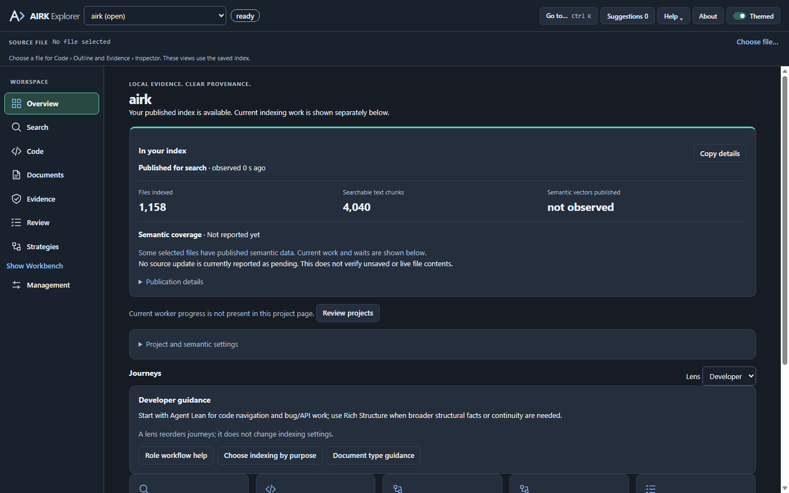

# 1.7.1 local development candidate

Date: 2026-10-30. Native workspace, local Cargo lock entries, VSIX and npm lock entries are synchronized at 1.7.1 for local upgrade testing. This candidate extends the [1.7.0 Workbench implementation](release-1.7.0.md); no publication is claimed.

Workbench opens once after successful trusted setup, including reconnecting a completed installation. Failed or blocked setup does not consume the first-open marker. A pending extension replacement retains Reload to finish update; the native installer cannot bypass VS Code's extension lifecycle.

The original Facet icons use AIRK-inspired angular outlines and chevron accents. The compact header offers project selection, history, settings and new-session icons. A prominent + composer menu holds scope, recipes, plan preparation and tool forms, leaving more vertical space for results. Readiness metadata and session actions remain available on demand. The composer footer states “Local index · Read-only (no generative AI used in AIRK Workbench)”; supported intent parsing still uses the fixed local classifier. Evidence, citations, read-only native execution and explicit proposed-plan review remain intact.

Explorer adds a single Show Workbench / Hide Workbench link immediately above Management. The label follows actual Workbench visibility events. Hide closes the secondary sidebar when Workbench is visible; switching to another tab makes the link offer Show. VS Code owns persisted tab order; forcing AIRK after all existing tabs is not supported by the extension API. The secondary-sidebar contribution remains in place and users can drag the AIRK tab to the far right.

The Marketplace listing and main README now lead with practical code/document retrieval and direct Workbench use, rather than release history. Both include Workbench and Explorer screenshots. The VSIX bundles these original PNGs, the GitHub Pages downloads template shows both, and generated GitHub release notes pin them to their source commit. The stable extension identity remains `iokaio.airk`; the display name is AIRK: Local Search for Coding Agents.

Both images render the compiled UI with fictional host data. They do not establish installed-editor or retrieval-quality qualification.

## Validation

Local Windows validation passed: 1,466 native workspace tests with 17 ignored; 419 extension tests with 15 skipped; 209 script tests with five skipped. Formatting, Clippy, repository, synchronized-version and whitespace checks passed. The rebuilt 1.7.1 native pair passed embedded-model verification, real offline inference/DiskANN checks and native ZIP verification. The VSIX passed allowlisted payload/closure/hash verification and contains both product screenshots with local listing links.

Browser checks covered eight Workbench fixture scenes and menu/source/plan interactions, ten Explorer overview layouts and two website widths with loaded screenshots. The original Explorer renderer's older management fixture is stale; the new screenshot mode exercises the current overview contract and does not claim the older fixture's full management interaction suite. An explicit primary-agent review covered the affected diff and validation evidence; no independent review is claimed.

The final local unsigned VSIX is `artifacts/workbench-review-1.7.1/installer-final/publish/airk-1.7.1-win32-x64.vsix`; exact SHA-256 and sizes are in the adjacent manifest/checksums and the review folder's `review-evidence.json`. The native runtime and VSIX both report 1.7.1. No installed-editor upgrade acceptance, four-core repeated pre-PR qualification, other-platform success, hosted CI or publication is claimed. Three pre-existing license declarations (`adobe-cmap-parser`, `pdf-extract`, `type1-encoding-parser`) remain for release review. Nothing was committed, pushed or installed into the user's VS Code.
