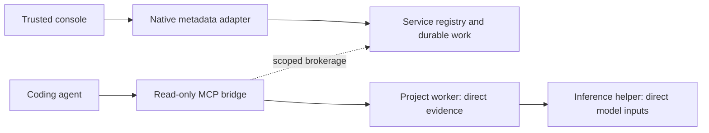

# Trusted service console: native/client foundation

This is an implemented development foundation for the [1.4 plan](airkservice-architecture.md). The extension view, complete lifecycle controls and default adapter cutover remain in progress. The packaged extension and native versions remain 1.3.2 until that cutover; these development receipts do not describe a released VSIX.

## Control and evidence boundaries

`airk service console --runtime-dir <private-control> [--runtime-sha256 <approved-inventory-digest>]` is a persistent, length-prefixed JSON metadata adapter for a trusted parent process. It is separate from stdio MCP and never starts a service or opens project indexes. Frames use the existing four-byte big-endian length prefix and 64 KiB ceiling. One native input item can wait behind the current request. The extension adapter accepts at most eight requests, submits one at a time and closes on malformed framing, crossed request identities or its finite deadline. An active request may have an unknown outcome; unsent queued requests remain distinguishable.

The native adapter checks the service version and actual executable digest before forwarding a request. A trusted launcher can also pin the complete installed runtime inventory digest. A different runtime requires rebinding. Each forwarded management request also carries the verified service incarnation; the receiver checks it before activity accounting, shutdown or dispatch, closing the race between health and mutation. An exhaustive method review refuses `connect`, so evidence bearer credentials never enter the console stream. Native errors return content-free codes. Neither source excerpts, query text nor embeddings pass through this endpoint.

`service rpc --stdin` is also available for one bounded management JSON value without creating a request file or putting its contents in process arguments. `--stdin` and `--request-file` are mutually exclusive. A request exactly at 64 KiB is accepted if otherwise valid; a larger input is rejected before collection access.

## Cached project pages

The `console` control request uses the same revision-bound registered-project cursor as `projects`, with a 1–32 row request limit and a separate 48 KiB serialized page ceiling. Each complete row includes registration, cached source-watch state, progress/job, inspection and maintenance observations. Rows are never split. Byte-budget continuation resumes after the last returned binding, including when richer metadata reduces the number of rows below the registry-only page.

Individual damaged cached observations are named in `failed_observations` while other observations and other projects remain available. Missing observations remain missing. The page does not start closed projects, inspect their sources or create index directories. Inspection values remain explicitly cached; successful transport and service health do not establish current source coverage.

The `workers` control request observes at most 32 distinct project bindings from one cached native snapshot, with a shared observation age. It reports actual resident identities, queued restarts and open startup circuits without brokerage or project activation. This avoids one short-lived native command per displayed field/project.

## Trusted offline bootstrap

The extension runtime client now verifies a schema-2 platform wrapper containing a complete payload under `native/runtime/`. The wrapper pins `airk-install.json` and both executables. The verifier checks version/platform, safe relative names, exact inventory topology, unaliased regular files, bounded depth/nodes/bytes and streamed hashes before the first native invocation. The installed platform VSIX is the declared trusted distribution source; a workspace cannot supply its approval. This is not a publisher signature scheme.

A bounded native self-test must advertise metadata console capability 1. Native user discovery chooses defaults; trusted user/machine settings may select an absolute installation. Discovery does not stage, activate or elect a service. First-use preparation uses the existing native immutable installer, approval and activation transaction. Concurrent preparations within one extension host join; retries retain the same approved inventory and recheck native selection before repeating activation. Existing selected payloads are verified and reused. No PATH or login registration is required.

An explicitly configured organization source requires its independently supplied digest and lifecycle policy. Existing source/pin/lifecycle/state mismatches fail without staging an alternative or changing the policy. The native external-supervisor contract refuses competing startup. Configuration is copied/frozen for an in-flight preparation, and execution authorization is rechecked before and after every asynchronous native invocation.

Job, retry and repair-plan requests expose a complete prepared intent before submission. The extension host must persist that exact caller/key/scope before sending it. Unknown transport or registry outcomes must retain the intent for inspection or exact-key retry; they never cause a fresh mutation key to be generated automatically. The upcoming view/controller supplies that persistent journal and its review controls.

Native main/bridge/project/service roles and the shared inference helper pool now use two Tokio I/O worker threads each. Dedicated inference/extraction budgets remain unchanged; this does not increase model batch parallelism or create another executable. The standalone Unix provider guardian continues to bypass Tokio.

## Development evidence, October 24, 2026

Windows passed all 21 native service tests, including real framed console traffic, exact runtime-pin refusal, credential refusal, closed-project observations, parent EOF, full-size stdin and oversized-input rejection. The registry page fixture exercises complete-row byte paging, revision changes and a corrupt cached inspection without creating source/data namespaces. Windows and non-root Debian 12 x64 each passed all 93 CLI unit tests. Linux passed all 20 native service tests and lightweight all-target Clippy; Windows passed all-feature/all-target workspace Clippy. The extension suite passed 158 tests with six skips, including split framing, nonce/size/queue/deadline failures, durable request-key reuse, bootstrap topology/alias rejection, authorization loss and managed-policy conflict. Local Node was 24.21.0; the repository's pinned CI Node remains a separate environment.

A real Windows bootstrap fixture used the approved offline pair to stage/activate an isolated installation, open a payload-pinned persistent console, index one original fictional source, replay the exact accepted request and preserve original bytes. It then uninstalled only its owned runtime while preserving fixture sources and project data. No login registration, default user installation or VSIX was created by that fixture.

The two-project offline MiniLM fixture also passed after the I/O-thread change: shared model load, direct citations, replacement/retirement, exact helper stop, lexical/source preservation, helper recovery and explicit semantic retry. Development pair `target/airksvc-runtime-stage33` has native source fingerprint `c4c4da4d6d419603d4610b76207cf247e24e355c11eb15b190a06c5cf232d0de` (620 files), main digest `07ef00f372ecfd2747825498e822a6a0d35d95b60369bd5386153b5e2c0a1c2f` and helper digest `5cd1b4f8f5aa49ddfce1a95983cec8b4b7b55d0dc42127cfa52d37624d4fcecc`. Linux review image: `d0bcb97545bd59eabf3d91b921a447956f14bac1218ebee923a298cf9f11f3f1`.

The console view/controller, lifecycle/restart intent integration, complete configuration actions, default adapters and platform/installed-editor qualification remain open. The schema-2 VSIX wrapper is verified by the client but is not yet emitted by the default package script. No service VSIX has been built.

Final instance-fence review: the targeted native console test passed on Windows/Linux after adding `expected_instance`, including a rejected stale shutdown followed by successful live health. All-target Clippy passed again on both platforms, and Windows workspace doc tests passed sequentially. The final Linux image is `a265f5423f10cb167085431a8adf78ab598a246f4119d24fb9895268c3857970`. The runtime pair and earlier full-suite image above predate this final additive control-header fence; inference and evidence framing were unchanged.
