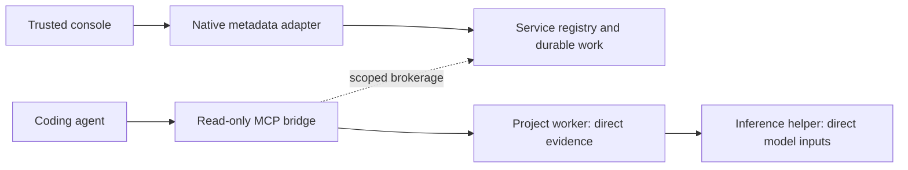

# Trusted service console

This is the development console for the [1.4 plan](airkservice-architecture.md). Its native transport, trusted extension host, view, request journal, guarded project configuration and installed lifecycle are implemented. The extension/public CLI use native service defaults at 1.4.0. Remaining failure/platform qualification is tracked in the completion checklist; these development receipts do not describe a released VSIX.

The [Project settings contract](service-configuration.md) covers typed native preparation, exact incarnation/settings guards, trusted model/root/calibration choices, durable result reservations and explicit uncertain-outcome recovery. The view keeps the last configuration receipt independently of later background progress and supports bounded result Copy while disconnected.

The configuration checkpoint's complete real native/controller workload passed on Windows, including missing-helper repair, with its fixture uninstalled. Windows/Linux checks and exact pair identities are recorded in the configuration contract. Native adapters are now the defaults; installed-editor/native Mac qualification remains open.

## View and trusted host

The Service Console view and command-palette entries expose discovery/connect, explicit start, instance-bound stop/restart, logs, resources and diagnostic preview. Project controls include cached inspection, indexing, pause/resume, exact worker restart, explicit bundled-model setup and persistent source-watching selection. Separate helper controls use the observed helper incarnation; forced helper stopping uses native child ownership. Closed registered projects remain visible. The host accepts fixed actions and visible opaque identities at the current render revision; the webview cannot supply paths, commands, executable approvals or arbitrary RPC bodies.

Service health, project work, cached inspection, source availability, semantic coverage, helper state and process failures remain distinct observations. Unknown totals have no fabricated percentage. Registry pages remain on the user's selected cursor until explicitly reset; expired pages retain their cached observations and report failure. Process logs and retained project events are bounded independently. Polling yields to an active action and reconnect uses capped backoff. User/machine runtime settings ignore repository overrides; changing them invalidates the old host and connection.

One/selected/all repair opens the native plan, retains its identity across reloads and renders guarded actions, estimates, unavailable sources and per-project outcomes. Every preview page must be loaded before approval. A changed preview resets that review; cached execution rows have an explicit refresh action. Native admission and stale-plan checks remain authoritative. Partial failure, cancellation and cleanup are separate from successful project receipts.

Terse remains the default MCP response mode, with a Full choice in the panel. The panel explains that Full adds diagnostic provenance, readiness and coverage, and that agents can request it for one call. Workspace values cannot change the trusted preference. Changing the preference does not itself restart an already connected external coding-agent process.

Diagnostic export captures a bounded versioned metadata report, redacts paths/names by default and previews the exact bytes before Copy. Background refresh preserves the captured preview instead of silently replacing what was reviewed. Native log failures, dropped records and omitted history remain explicit. No report is uploaded.

## Durable requests and lifecycle

Prepared job, retry, plan and global lifecycle intents are persisted before sending. Each complete intent has its own VS Code storage key, scoped by canonical control root and durable registry namespace; windows never overwrite a shared request list. Records are limited to 32 KiB and admission checks a global count of 64. VS Code storage does not provide a cross-window count transaction: simultaneous writers can exceed that admission count, so existing records are paged/preserved rather than discarded. Uncertain or corrupt records never create room through automatic eviction. Exact retries reuse caller, nonce, epoch and scope; forgetting a local record does not cancel native work.

`runtime lifecycle --install-dir <installation>` reads a bounded JSON request from stdin with `action`, `caller`, `key`, `expected_instance`, `runtime` and optional explicit `force`. The native installer verifies the current approved selection, observed service incarnation and startup ownership. The service registry retains the request before effects, with `draining`, `starting`, `complete` and `abandoned` phases. It retains at most 64 native receipts; retiring up to 32 terminal receipts advances the shared request epoch atomically, so an expired key never repeats old work. An additive development registry-schema upgrade preserves existing aliases, namespace and fencing.

Stop persists an explicit-stop preference before drain. Automatic `runtime ensure` and reconnect cannot undo it. `runtime start` is the explicit user action that clears the stop preference. Restart drains old owners before starting the same approved selection; interruption during startup joins the new incarnation instead of draining it again. Exact completed request replay returns the retained receipt without another restart. An approved same-version selection is reused rather than automatically replaced by the VSIX's different digest, preserving explicit rollback/pin choices.

The native installer preserves optional OS startup ownership. Whole-service force escalation requires explicit approval and verified ownership of that OS-managed service; an unowned PID or process name is never a fallback. An on-demand process whose native ownership handle is unavailable cannot be force-killed by guessing its PID. External-supervisor policy disables competing user start/stop/restart. The console can recover a saved native lifecycle intent without a live service connection. `runtime abandon-lifecycle --request-id <id>` explicitly abandons only the recovery intent, preserves running processes and keeps automatic starts disabled until Start.

Cold direct-worker setup has a separate bounded retry budget: at most eight attempts and thirty seconds, with capped backoff for transient admission/transport conditions. Each attempt obtains fresh health and a fresh scoped grant. No query has been submitted during these retries; uncertain submitted queries remain explicit failures. Health and brokerage share one cached startup executable digest so the broker does not rehash its large image on the first cold connection.

## Control and evidence boundaries

`airk service console --runtime-dir <private-control> [--runtime-sha256 <approved-inventory-digest>]` is a persistent, length-prefixed JSON metadata adapter for a trusted parent process. It is separate from stdio MCP and never starts a service or opens project indexes. Frames use the existing four-byte big-endian length prefix and 64 KiB ceiling. One native input item can wait behind the current request. The extension adapter accepts at most eight requests, submits one at a time and closes on malformed framing, crossed request identities or its finite deadline. An active request may have an unknown outcome; unsent queued requests remain distinguishable.

The native adapter checks the service version and actual executable digest before forwarding a request. A trusted launcher can also pin the complete installed runtime inventory digest. A different runtime requires rebinding. Each forwarded management request also carries the verified service incarnation; the receiver checks it before activity accounting, shutdown or dispatch, closing the race between health and mutation. An exhaustive method review refuses `connect`, so evidence bearer credentials never enter the console stream. Native errors return content-free codes. Neither source excerpts, query text nor embeddings pass through this endpoint.

`service rpc --stdin` is also available for one bounded management JSON value without creating a request file or putting its contents in process arguments. `--stdin` and `--request-file` are mutually exclusive. A request exactly at 64 KiB is accepted if otherwise valid; a larger input is rejected before collection access.

## Cached project pages

The `console` control request uses the same revision-bound registered-project cursor as `projects`, with a 1–32 row request limit and a separate 48 KiB serialized page ceiling. Each complete row includes registration, cached source-watch state, progress/job, inspection and maintenance observations. Rows are never split. Byte-budget continuation resumes after the last returned binding, including when richer metadata reduces the number of rows below the registry-only page.

Individual damaged cached observations are named in `failed_observations` while other observations and other projects remain available. Missing observations remain missing. The page does not start closed projects, inspect their sources or create index directories. Inspection values remain explicitly cached; successful transport and service health do not establish current source coverage.

The `workers` control request observes at most 32 distinct project bindings from one cached native snapshot, with a shared observation age. It reports actual resident identities, queued restarts and open startup circuits without brokerage or project activation. This avoids one short-lived native command per displayed field/project.

## Trusted offline bootstrap

The extension runtime client now verifies a schema-2 platform wrapper containing a complete payload under `native/runtime/`. The wrapper pins `airk-install.json` and both executables. The verifier checks version/platform, safe relative names, exact inventory topology, unaliased regular files, bounded depth/nodes/bytes and streamed hashes before the first native invocation. The installed platform VSIX is the declared trusted distribution source; a workspace cannot supply its approval. This is not a publisher signature scheme.

A bounded native self-test must advertise metadata console capability 1. Native user discovery chooses defaults; trusted user/machine settings may select an absolute installation. Discovery does not stage, activate or elect a service. First-use preparation uses the existing native immutable installer, approval and activation transaction. Concurrent preparations within one extension host join; retries retain the same approved inventory and recheck native selection before repeating activation. Existing selected payloads are verified and reused. No PATH or login registration is required.

An explicitly configured organization source requires its independently supplied digest and lifecycle policy. Existing source/pin/lifecycle/state mismatches fail without staging an alternative or changing the policy. The native external-supervisor contract refuses competing startup. Configuration is copied/frozen for an in-flight preparation, and execution authorization is rechecked before and after every asynchronous native invocation.

[Reviewed runtime transitions](service-runtime-transitions.md) now expose bundled upgrade, previous-candidate rollback and exact saved activation recovery. The native installer fences the reviewed predecessor under its lock. Reconnect preserves different-version pins and displays installer metadata while refusing a mismatched console. Installer previews read completed registry state without migration.

Job, retry and repair-plan requests expose a complete prepared intent before submission. The extension host must persist that exact caller/key/scope before sending it. Unknown transport or registry outcomes must retain the intent for inspection or exact-key retry; they never cause a fresh mutation key to be generated automatically. The view/controller supplies the persistent journal and review controls described above.

Native main/bridge/project/service roles and the shared inference helper pool now use two Tokio I/O worker threads each. Dedicated inference/extraction budgets remain unchanged; this does not increase model batch parallelism or create another executable. The standalone Unix provider guardian continues to bypass Tokio.

## Earlier foundation evidence, October 24, 2026

Windows passed all 21 native service tests, including real framed console traffic, exact runtime-pin refusal, credential refusal, closed-project observations, parent EOF, full-size stdin and oversized-input rejection. The registry page fixture exercises complete-row byte paging, revision changes and a corrupt cached inspection without creating source/data namespaces. Windows and non-root Debian 12 x64 each passed all 93 CLI unit tests. Linux passed all 20 native service tests and lightweight all-target Clippy; Windows passed all-feature/all-target workspace Clippy. The extension suite passed 158 tests with six skips, including split framing, nonce/size/queue/deadline failures, durable request-key reuse, bootstrap topology/alias rejection, authorization loss and managed-policy conflict. Local Node was 24.21.0; the repository's pinned CI Node remains a separate environment.

A real Windows bootstrap fixture used the approved offline pair to stage/activate an isolated installation, open a payload-pinned persistent console, index one original fictional source, replay the exact accepted request and preserve original bytes. It then uninstalled only its owned runtime while preserving fixture sources and project data. No login registration, default user installation or VSIX was created by that fixture.

The two-project offline MiniLM fixture also passed after the I/O-thread change: shared model load, direct citations, replacement/retirement, exact helper stop, lexical/source preservation, helper recovery and explicit semantic retry. Development pair `target/airksvc-runtime-stage33` has native source fingerprint `c4c4da4d6d419603d4610b76207cf247e24e355c11eb15b190a06c5cf232d0de` (620 files), main digest `07ef00f372ecfd2747825498e822a6a0d35d95b60369bd5386153b5e2c0a1c2f` and helper digest `5cd1b4f8f5aa49ddfce1a95983cec8b4b7b55d0dc42127cfa52d37624d4fcecc`. Linux review image: `d0bcb97545bd59eabf3d91b921a447956f14bac1218ebee923a298cf9f11f3f1`.

At this earlier foundation checkpoint, the console view/controller, lifecycle/restart integration, configuration actions, default adapters and schema-2 package emission were still open. Those paths are now implemented in 1.4 development. Native platform/installed-editor qualification remains separate, and no final service VSIX has been built.

Final instance-fence review: the targeted native console test passed on Windows/Linux after adding `expected_instance`, including a rejected stale shutdown followed by successful live health. All-target Clippy passed again on both platforms, and Windows workspace doc tests passed sequentially. The final Linux image is `a265f5423f10cb167085431a8adf78ab598a246f4119d24fb9895268c3857970`. The runtime pair and earlier full-suite image above predate this final additive control-header fence; inference and evidence framing were unchanged.

## Console/lifecycle checkpoint, October 24, 2026

Windows passed 60 registry tests, 95 CLI unit tests and 21 native service tests. Non-root Debian 12 x64 passed the same 60 registry tests, 95 CLI unit tests and 20 native service tests. All-feature/all-target workspace Clippy passed on Windows; lightweight all-target Clippy passed on Linux. The extension suite passed 172 tests with six skips, including trusted-setting isolation, prepared-request persistence, selected-plan size, exact report preview and message validation. Local Node was 24.21.0. Python passed 129 tests with four skips; repository/whitespace checks passed. The earlier registry-fix workspace snapshot passed all 1,231 tests with sixteen ignored workloads; that full baseline predates the lifecycle additions, whose affected suites are listed above.

`check-service-console.py` passed against a private Windows installation: two independent source receipts and direct citations, exact restart replay, stale-instance refusal, termination of only its owned installer child after the durable Starting checkpoint, restart recovery without another replacement, persistent stop, explicit start and preserved sources/receipts. The first development attempt exposed a cold direct-connection failure after startup. Shared startup image identity and bounded pre-query setup retry fixed that path; the subsequent fixture completed without adding a query retry to the test.

`check-service-console-client.cjs` also passed using the actual compiled extension controller, native installer and persistent metadata adapter. It exercised persisted source work, real native inspection/planning, exact preview approval, terminal repair receipts, captured redacted Copy, trust refusal and native stop/start acknowledgement. The fixture found and corrected a 64-versus-32 event-page limit mismatch. Both fixtures uninstalled only their owned test runtime and never touched login registration or a default user installation. No editor acceptance or VSIX qualification is inferred.

Private development pair `target/airksvc-runtime-stage35` has native source fingerprint `659d3ec7e68b0c1c551cb984d284de1ea9d3571c3b71d0efbc07aa21294bc04e` (623 files), main digest `184fd8d7702164bc0d8026c91507d92013c386cda4fa28b706c57424bb720b29` and helper digest `07edb7ba7ba7b10765e23d1482901cb1bb90295cf7dc4d1985306e7b3b6eb914`. The Linux lifecycle image is `d7a0b426dd1011554391176d25454c86a7a311f3b6694ce959008dbe9ef63a4f`; its cold-connection follow-up is `a0b2f3d2e4514e7fbae5b47c4880de8bda0e20d43aa3216586694668397fcfdc`. Native macOS, full failure/configuration paths, default cutover and installed/editor qualification remain open. This pair is not a VSIX.

## Down-service and damaged-payload observation

`runtime snapshot --install-dir <owned-installation>` reads saved metadata using the verified distribution executable. It never executes the selected image. Saved inventory/approval still identify the expected main image when executable files are missing or changed. Output explicitly declares `metadata_only: true` and `payload_verified: false`; it cannot authorize startup or direct-client execution. Unknown or redirected approval/state remains a refusal.

The existing registry is opened read-only with query-only enforcement. Missing, incomplete or unsupported registries are never initialized or migrated. Request epochs are observed without pruning. Snapshot pages use the same 1–32 row, revision-bound, bounded complete-row format as live console metadata. Source roots and project indexes remain unopened. Expired cursors retain cached displayed rows and require explicit page reset. Manager output is reduced to fixed ownership/status fields; raw process output is excluded. Independently bound rotated logs remain accessible even if registry authority is unavailable.

Disconnected resource/model/source values become cached observations. Worker identity and progress ages describe their captured sample; a current-generation label requires an observed matching service, worker and fence. Health failure never turns old progress into current work.

Stop can persist a request using the saved namespace/epoch and recorded service instance, then invoke native lifecycle through the independently verified distribution main. Native code checks live version, main digest, complete inventory identity and instance before shutdown; retries retain the original key. Force still requires explicit approval and OS-manager ownership. Restart and Start require complete payload verification; discovery does not silently repair, replace or execute a damaged selection. Modified payload bytes remain preserved.

Snapshot development validation, October 24, 2026: Windows passed 62 registry tests, 100 CLI unit tests, 21 native service tests, all-feature/all-target workspace Clippy, sequential workspace doc tests, and Python contracts (129 tests, four skips). Non-root Debian 12 x64 passed 62 registry tests, 100 lightweight CLI unit tests, 20 native service tests and lightweight all-target Clippy (image `6b8e0bedc30e00b26cbacae32529b432692c38472b51f92e8ecbbc85250ca433`). A later focused Windows regression proves that expired cached-page cursors retain independently usable lifecycle metadata. Read-only registry tests prove missing-state preservation, refusal to migrate and database byte preservation after attempted mutation.

The installed/controller workload is running against debug development pair `target/airksvc-runtime-stage36`: source fingerprint `34e8b0c591b354af47aa9d05423e5cfb345dd948ab901af96625bae93d68e5dc` (625 inputs), main `b8265122222a01aa6227e49f8a821af7068e66c9cb2c5159d0818d7795d1ee67`, helper `98aa2b0edf4493bd3ab16bb1f27c21f739bba6b9f5a3523b811046490453a6c5`. Its source predates the expired-cursor refinement. Intermediate assertions have passed independent source jobs, direct evidence, exact restart replay, and actual controller repair execution; the complete workload is not yet counted as passed. No VSIX was built. Native Mac and installed-editor acceptance remain open.

Development payload repair now requires an exact native preview and stopped owners, preserves the complete damaged slot, resumes interrupted copies and returns an idempotent completion receipt. The trusted console uses the matching approved offline bundle; Start remains explicit and uninstall retains the damaged originals. See [payload repair](service-installation.md#explicit-payload-repair).

The stage36 installed workloads subsequently completed successfully and uninstalled their owned fixtures. The real controller passed missing-helper discovery, cached projects/resources, saved-instance Stop and explicit Start after restoration. The independent two-project fixture passed direct evidence, durable restart with an installer-child crash, exact replay, persistent Stop and source preservation. These complete the previously running snapshot workloads; they do not establish installed-editor or Mac acceptance.
