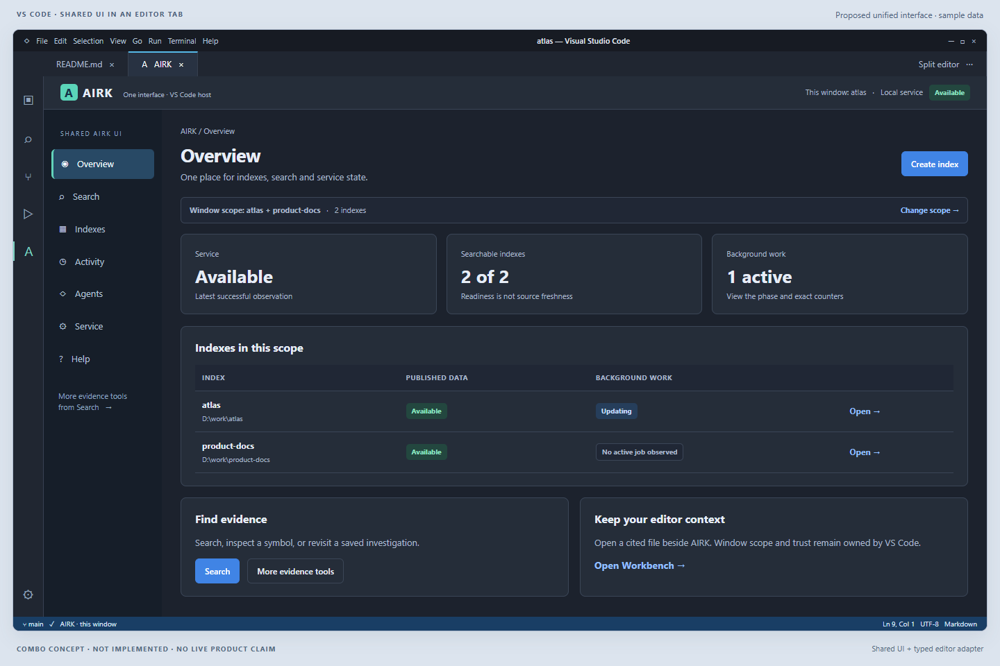
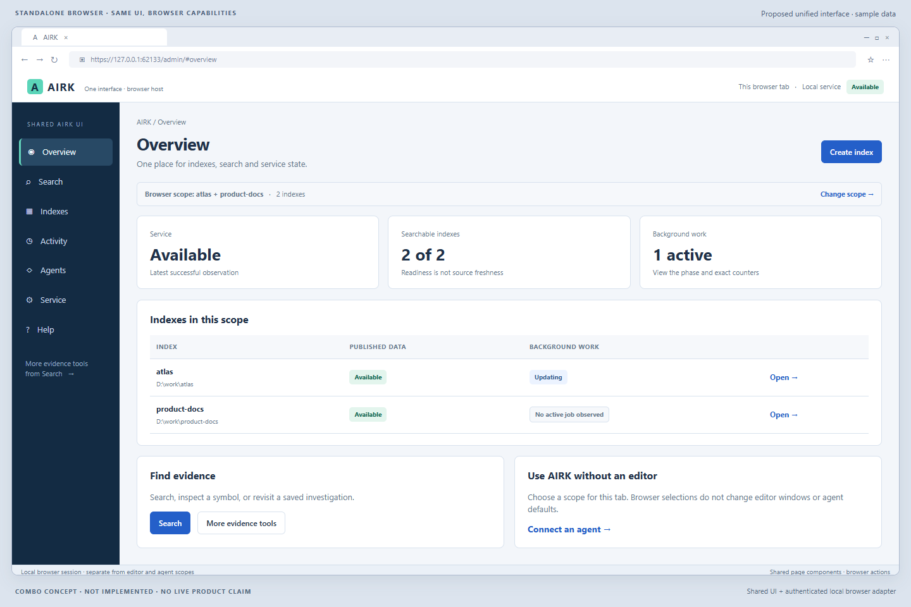

# One AIRK interface in VS Code and the browser

Proposal review · 13 November 2026 · No implementation changes

## Recommendation and decision being explored

**Replace the independently maintained Explorer presentation with a shared AIRK interface, while retaining a small, capable VS Code host.** Use the proposed Admin designs as the starting point for that interface. Keep its browser version a first-class product.

This would let a user learn one way to choose indexes, search, inspect results, monitor work, connect agents and find help. In VS Code, it would appear in an editor tab and retain editor actions. In a standalone browser, the same screens would use browser-appropriate actions and a separate authenticated session.

The important distinction is between eliminating duplicated UI and eliminating Explorer capabilities. Explorer already contains substantial workflows that the surveyed Admin UI does not replace. Removing them would be a product reduction, not simply a presentation cleanup. A literal frame around today's Admin URL also cannot serve as the complete implementation: the Admin endpoint explicitly blocks framing, and a passive browser frame cannot perform the existing editor integrations.

The recommended direction is **one presentation source, two host adapters**. Build the shared interface into the VSIX and the service's browser assets. Keep editor operations and local authority in the extension host; keep browser authority in the existing Admin boundary. This is a proposal to review, not an approved architecture change or authorization to remove any existing feature.

## Scope, evidence and limits

This document builds on the [Admin UX review](codex-admin-review.md), including its emphasis on a compact first screen, task-based Help, truthful status and complete technical details on demand. That review surveyed installed Admin **1.8.34**. The Explorer investigation here reads the current **1.8.35 working tree**, including uncommitted changes and newer agent/scope behavior. Differences between those two evidence sets are not automatically defects in the current product.

The extension's route catalog, screen implementations, controller, host adapters, relevant contracts and focused tests informed the comparison. Two parallel source reviews covered Explorer functionality and host/security boundaries. Source and test presence establish intended behavior; this task did not qualify those behaviors in an installed extension. The new images are designed concepts with simulated VS Code/browser chrome and illustrative data, not screenshots of a working combined product.

AIRK MCP discovery found no available tools or configured server entries in this session. Scoped local source reads were used instead. The earlier Admin captures remain the live visual evidence; this proposal does not replace or relabel them.

The acceptance boundary for this task is this document and ten `combo-*.png` images in [images/admin](images/admin/). Application code, the earlier review, its captures and mockups, and other documents are outside the edit boundary. No implementation, service changes, releases or feature deletion are part of this task.

## What exists today

Explorer is already principally an **editor-tab webview**, not a large application confined to the VS Code sidebar. Its sidebar opens that panel and supplies a small fallback when opening fails. The proposal therefore changes who owns the screens, rather than introducing editor-tab placement for the first time. See [panel ownership](../../packages/vscode/src/explorerPanel.ts) and [sidebar behavior](../../packages/vscode/src/explorerSidebar.ts).

Its [route catalog](../../packages/vscode/src/explorerRoutes.ts) covers Overview; Search and Saved Searches; Code Symbols, References and Outline; Document Facts; Evidence Inspector, Checker and Changes; Review Changes, Impact and Tests; Strategy Library, Studio and Planner; Search scope, Index library and Index sets; Management; and Help.

There is already partial consolidation. Management Overview, Storage, Recovery, Service and Logs use an Admin handoff screen. Activity, Usage and Agents have local screens. Consequently, the savings are uneven: some routes lose only a handoff card, while Search, scope selection, Help and other actual implementations offer larger opportunities. A route marked implemented is not evidence that Explorer independently implements all of Admin. The [screen mapping](../../packages/vscode/src/explorerWebview/workspaces.tsx) makes this distinction explicit.

The separately registered **Workbench** also remains relevant. It is a separate extension surface, not another name for Explorer. This proposal preserves its command and existing behavior unless a later, explicit decision migrates its functions. Replacing Explorer alone does not establish that all AIRK UI duplication has been eliminated. See [extension registration](../../packages/vscode/src/serviceExtension.ts) and [Explorer host integration](../../packages/vscode/src/airkctl/features/explorerHost.ts).

## The alternatives

| Option | What changes | Benefits | Costs or losses | Assessment |
| --- | --- | --- | --- | --- |
| Keep Explorer and Admin separate | Improve both independently | Least migration risk; existing editor workflows remain | Duplicate components, help, terminology and UX fixes continue | Safe baseline, but misses the user's main objective |
| Replace Explorer with an “Open Admin” launcher | Extension opens the standalone browser | Small presentation footprint; browser remains the single management UI | Context switching; unique Explorer workflows disappear unless retained elsewhere; loses integrated source navigation | Reasonable only for a deliberately reduced extension |
| Put the existing Admin URL in an iframe/Simple Browser | Service supplies the complete page | Appears to offer one deployed UI | Current framing policy blocks it; editor integration and unavailable-service guidance are missing; browser and window authority differ | Not a viable drop-in replacement |
| Shared source, bundled in both hosts | Shared pages and components; browser and VS Code adapters supply capabilities | Removes independent screen implementations while retaining integrations and local fallback | Two packages, adapter code, compatibility and integration tests remain | **Recommended direction** |
| Service-hosted UI with a privileged editor bridge | Extension loads changing service content and gives it editor actions | Service could update most presentation without a VSIX update | New trust/version boundary; service-delivered scripts gain a path to editor privileges; difficult outage and compatibility behavior | Higher-risk design requiring separate justification and contract review |

“One UI” should mean one owner for page behavior, copy, forms, result rendering, accessibility and Help. It should not mean one shared credential, identical available buttons, or an assumption that every operation can use the same transport. Nor does it necessarily mean byte-identical JavaScript bundles: each host can package its own adapter and capabilities from the same presentation source.

## Capabilities that must be accounted for

The following is the migration inventory for review. “Preserve” means a requirement for a replacement proposal, not a claim that the feature already exists in browser Admin. A tool callable through Admin's tool runner is not equivalent to a guided workflow with saved state, navigation and review steps.

| Current capability | Proposed shared destination | What must survive / browser implication |
| --- | --- | --- |
| Overview and status | Overview | Keep service availability, published search readiness, source freshness and semantic readiness distinct. A green service badge must not certify all evidence. |
| Search query | Search → Query | Preserve modes, scope, path filters, limits, per-index limits, budgets, continuations, citation handles and complete responses. The current Admin form alone is not the complete replacement. |
| Saved Searches | Search → Saved searches | Preserve recipes, import/export and rerunning their full arguments. Current workspace persistence needs an explicit browser equivalent or a clearly disclosed limitation; do not silently discard recipes. |
| Symbols, References, Outline | Search → Evidence tools → Code | Retain guided navigation and bounded results. References shows textual occurrences, not resolved references/calls; Outline follows selected-source context using saved-index evidence. Do not imply compiler-level language understanding. |
| Document Facts | Search → Evidence tools → Documents | Retain extraction limitations and original document locations. A PDF/Office location is not automatically a text-editor line number. |
| Evidence Inspector | Search → Evidence tools → Inspect | Retain selected citations/files, metadata, revision identity, source-check receipts and changed/dirty/unverified states. |
| Evidence Checker | Search → Evidence tools → Check citations | Preserve validation outcomes and reasons. Failure to check cannot be rendered as a valid or absent citation. |
| Indexed Changes | Search → Evidence tools → Indexed changes | Preserve publication baselines, bounded continuation, coverage, expiration and unsupported cases. This is different from Git changes. |
| Git Changes review | Search → Evidence tools → Review | VS Code supplies repository, staged/worktree and dirty-buffer context. Browser parity needs a separately supported source of that context; it is not present merely because the shared page renders. |
| Impact and Tests review | Review subviews | Preserve bounded evidence joins and candidate lists. “Tests” must not imply tests were executed; “Impact” must not imply complete semantic impact analysis. |
| Strategy Library and Studio | Search → Evidence tools → Strategies | Preserve strategy editing, bounded runs, source checks, prompt compilation, full-run export and manual handoffs. Keep this within retrieval/workflow assistance, without adding autonomous orchestration. |
| Planner | Strategies → Planner | Preserve tasks, dependencies, Studio snapshots, plan import/save and overwrite safeguards. Browser file/download behavior is a separate capability decision. |
| Agent suggestions and handoffs | Contextual suggestions inbox | Keep window identity, draft review, apply-to-form semantics and handoff identity. A global browser page cannot silently adopt a window-bound inbox. |
| Search scope | Persistent scope control | Reuse the selector presentation, but preserve distinct window and browser grants, catalog revisions, explicit clearing and stale-selection handling. |
| Index library and Index sets | Indexes | Share discovery and management forms. Preserve index-now, pause/resume, watching, retry/cancel, exact outcomes and any review step. |
| Activity | Activity | Combine navigation, not meaning: window session events and service activity need visible provenance and scope. |
| Usage | Activity → Usage | Strong candidate for shared rendering, with full structured data and copies/exports. |
| Agents | Agents | Share setup and access explanations. Retain local connect/disconnect, client entry inspection and following-window behavior through the extension's authorized host actions. Browser setup must explain its actual available path. |
| Storage, Recovery, Service, Logs | Service and Activity subviews | Replace existing handoffs with shared pages where appropriate. This primarily removes navigation seams where Explorer already delegates to Admin. |
| Help | Help & guides | One content system with host-specific steps, truthful capabilities and version-matched reference. Keep a bundled startup/trust subset available without the service. |
| Open source, selection, file dialogs and local saves | Host actions attached to shared screens | Retain VS Code APIs and path checks. Browser substitutes must be named honestly; unavailable actions need a reason and a usable next step. |
| Workbench | Existing separate entry point | Preserve unless separately approved for migration. Reuse shared components where justified, without treating this proposal as authorization to remove it. |

The unique workflows are visible in [Search](../../packages/vscode/src/explorerWebview/search.tsx), [Code](../../packages/vscode/src/explorerWebview/code.tsx), [Evidence](../../packages/vscode/src/explorerWebview/evidence.tsx), [Review](../../packages/vscode/src/explorerReview.ts), [Strategies](../../packages/vscode/src/explorerWebview/strategies.tsx), [Planner](../../packages/vscode/src/explorerWebview/planner.tsx), and the [controller](../../packages/vscode/src/explorerController.ts). The current suggestions path also includes [window assistance](../../packages/vscode/src/airkctl/features/windowAssistance.ts); an older assistance module alone is not a sufficient inventory of the active flow.

The proposed navigation groups these capabilities to shorten the main rail. It must not bury them behind a generic tool runner. Evidence tools should open a named hub with Code, Documents, Inspect, Review and Strategies choices, searchable in Help and reachable through retained commands/deep links. Frequent users should be able to return directly to their last subview. The names and discoverability of that hub need task testing before the old navigation is removed.

## What is gained, what is lost, and what still costs work

### Likely gains

- **Less repeated UI work.** One fix to a shared result renderer, scope control, form or Help article can benefit both hosts. Shared tests can cover the presentation behavior once.
- **A more coherent product.** Shared Explorer/Admin management navigation reduces the need to choose between those surfaces before finding an index or understanding an error. Explorer's Admin handoff cards can become ordinary navigation. Workbench remains a separate entry point unless explicitly migrated.
- **Better browser capability.** Migrating reusable evidence workflows can make the standalone application useful beyond administration, without requiring VS Code for every investigation.
- **More consistent evidence.** Common rendering can make limits, provenance, revision, retries and failure details appear consistently, provided complete native results remain available.
- **A stronger Help system.** Task guides, concepts, troubleshooting and reference can share one information architecture, while each host supplies the right instructions.
- **More room for the user.** One navigation shell, short summaries and focused details reduce repeated headings, introductory copy and tall stacked forms. An editor tab gives the application more usable width than a permanent narrow sidebar.

These are expected maintenance and usability benefits, not measured performance gains. No development-time savings percentage or bundle-size reduction is established by this review.

### Losses from a passive frame or browser-only replacement

The largest loss would be **editor context**: active selection, checked opening at a line, unsaved-buffer awareness, Git repository state, native file dialogs and workspace persistence. Browser navigation cannot reproduce those just by displaying the same path. A second loss would be the current guided Search, evidence, review and strategy flows if the narrower Admin feature set became the sole replacement. A third would be useful startup guidance when the service is unavailable, because the service cannot serve its own interface then.

The recommended adapter approach preserves these in VS Code, but deliberately accepts that the browser will not have every editor capability. If full browser feature parity is required, the missing capabilities become additional product work with their own contracts; they are not free consequences of consolidation.

### Tradeoffs even with the recommended design

| Tradeoff | Practical consequence | Design response |
| --- | --- | --- |
| Admin becomes a broader AIRK application | Management users may encounter unfamiliar evidence tools | Keep common tasks prominent; use task hubs and progressive disclosure, not a giant all-features page |
| Host differences remain | Some buttons and steps differ between VS Code and browser | Explicit capability-based actions and a visible host/scope label; shared outcomes and terminology |
| Two distributions remain | Browser assets ship with the service; editor assets ship with the VSIX | Version/capability compatibility checks and reproducible asset receipts |
| Shared defects affect both hosts | One renderer regression has wider reach | Shared component checks plus real adapter/transport checks; preserve rollback paths |
| Editor integration still requires maintenance | A “thin” host is not a zero-code host | Keep a small, documented capability boundary, not arbitrary command execution |
| Full editor tab uses workspace area | Users may prefer code to stay visible | Side-by-side source opening and an optional compact layout using the same components |
| Consolidation can increase initial scope | Porting every unique Explorer feature at once is risky | Incremental feature migration with explicit surviving owners; no premature deletion |
| Stored UI state may not be portable | Recipes, plans and panel state have different owners | Preserve existing workspace data; define explicit import/export and migration behavior |
| Less vertical scrolling can mean more navigation | Detail moves into tabs, dialogs or drill-down pages | Keep common actions visible and preserve position/query state when returning |

## Hosting and authority: why a frame is insufficient

### Current Admin policy prevents literal embedding

The [Admin contract](../../crates/airk-endpoint/src/admin_contract/CONTRACT.md) and [implementation](../../crates/airk-endpoint/src/admin_contract/mod.rs) specify `frame-ancestors 'none'` and `X-Frame-Options: DENY`. Admin also checks loopback Host/origin, fetch metadata and same-user peer identity; its authenticated API is same-origin, with no general cross-origin API access and refused preflight requests.

Therefore, neither putting the URL into a frame nor fetching its API directly from a `vscode-webview` origin is a small presentation substitution. Removing a framing header alone would not solve the origin, session, certificate, grant and editor-bridge questions. This proposal does not recommend weakening those controls to make embedding convenient.

The extension's [Admin opener](../../packages/vscode/src/airkctl/features/adminOpener.ts) currently supports `simpleBrowser.show` and an external-browser fallback. Its [tests](../../packages/vscode/src/test/adminOpener.test.ts) check command arguments, secret handling and fallback behavior using mocks. They do not establish that a framed authenticated Admin journey works under the endpoint's framing policy. That requires an actual host test if the option is pursued.

### A small host should remain

The shared interface should receive narrowly defined operations and observations from its host. In VS Code these include checked source navigation, active selection, workspace/trust state, local file dialogs, scope operations and approved local agent actions. In the browser they include the existing authenticated Admin requests and browser-supported copying/downloads. Both must retain the canonical native result data.

VS Code documents webview message passing, local resource restrictions, content security policy, theme integration and state restoration. These mechanisms fit a bundled shared presentation with a controlled extension adapter. Microsoft also notes the memory cost of retaining hidden webviews; state restoration should be assessed rather than assuming an always-live panel is necessary. This is future design guidance, not a measured optimization here. [Official webview documentation](https://code.visualstudio.com/api/extension-guides/webview)

The existing [Explorer panel](../../packages/vscode/src/explorerPanel.ts) already has a local asset policy, disabled command URIs and validated messages. Preserve that discipline. Do not add an arbitrary `executeCommand`, shell, filesystem or HTTP-proxy bridge. A source link should ask the host to open a checked citation/location, not pass unrestricted executable instructions.

The host must also retain lifecycle ownership: one intended panel per window, correct disposal, late-reply suppression, restored route/form state, and safe reopen/reconnect. A shared UI package does not take ownership away from the extension session. Existing [panel lifecycle tests](../../packages/vscode/src/test/explorerPanelLifecycle.test.ts) and [boundary tests](../../packages/vscode/src/test/explorerBoundaries.test.ts) are relevant preservation evidence, not proof that a new adapter already works.

### Share presentation without flattening the contracts

The extension's local control path and the Admin HTTP path have different authority and review semantics. In particular, Admin review/grant tokens must not be replaced with a UI-only confirmation, nor treated as interchangeable with extension requests. Admin owns mutation request identities and session-held review state. The editor adapter must preserve native keyed/journal and unknown-outcome semantics; it must not invent automatic UI retries for uncertain mutations. The owners remain the [local control contract](../../crates/airkctl/src/contract/CONTRACT.md) and the Admin contract.

Use shared native definitions and supported generated projections where available. Do not create another reduced, handwritten response contract simply to make the two hosts look alike. Equivalent reads must preserve inputs and complete results: provenance, readiness, coverage, continuation, error/retry details and explicit limits. Summaries can be compact; full JSON/Markdown copies and exports must not silently drop fields. Equivalent CLI, Workbench and MCP behavior also remains part of any future read-contract audit.

## Scope is the most important UX boundary

Use three distinct labels throughout the shared UI:

| Label | Meaning | Must not imply |
| --- | --- | --- |
| **This VS Code window: atlas** | The current window's checked selection and native session grant | Authority for another editor window, browser tab or every agent |
| **This browser tab** | Selection within the current Admin browser-session authority | Adoption of a VS Code window's grant or its following-agent behavior |
| **Agent connection defaults** | The assigned/default access of the selected client connection | That changing a search form automatically rewrites client configuration |

These are user-facing labels. The authoritative browser boundary is the Admin session; the wording “this tab” is not a claim of a new independently secured per-tab credential. Any relationship between tabs sharing a session needs explicit implementation behavior and tests.

The [window scope owner](../../packages/vscode/src/airkctl/features/windowScope.ts) checks catalog revisions, maintains a checked selection and reacquires authority through the native session. A remembered selection is not a reusable grant. Preserve explicit clearing, stale-catalog refusal and a meaningful reselect path. Do not silently widen to every index when a selection fails.

Selection can also have side effects. Applying some index choices can create a matching index set through the existing local command. Current following-agent behavior can update connections that explicitly follow this window. The shared scope review must disclose those effects before applying and report partial outcomes honestly. A successful scope change does not establish that every following connection update succeeded. See [scope/agent tests](../../packages/vscode/src/test/windowScopeAgents.test.ts).

The Agents screen should distinguish assigned defaults from **“Agent can choose other indexes.”** Enabling choice permits discovery/search across every index and index set; disabling it retains the assigned scope while allowing narrowing. Explain that reach before enabling the option, and keep it visibly separate and off unless explicitly selected. “Follow this VS Code window” is a local relationship, not a browser convenience toggle. Browser scope changes must not silently become editor or agent changes.

Admin grants remain bound to their browser session and revocation/expiry lifecycle. They are not transported onto the local control pipe. An editor-to-browser handoff may carry validated non-secret navigation targets or prefill data, but it must acquire the browser's own authority. Launch URLs, cookies, CSRF values, grants and review tokens must not be copied between UI hosts or persisted as navigation state.

## Different hosts, useful equivalents

| Task | VS Code | Standalone browser |
| --- | --- | --- |
| Open a result | Open checked original source beside AIRK, at a valid location | Copy path/citation; inspect the supported indexed passage |
| Work with unsaved changes | Host can observe dirty editor state and warn | No active editor or unsaved-buffer knowledge; state that limit |
| Start from selected text | Host supplies explicit selected text/context | User enters or pastes a query |
| Review Git changes | Existing VS Code Git integration provides context | Requires an explicitly supported input path; otherwise explain unavailability |
| Save a recipe or plan | Preserve workspace storage and checked file operations | Define supported storage/import/export; no assumed filesystem access |
| Connect an agent | Reviewed local host action and client inspection where supported | Version-matched local terminal instructions where Admin lacks that mutation |
| Follow window scope | Explicit relationship to the current window | Not available as an equivalent browser setting |
| Handle a missing service | Bundled local status/trust/startup guidance | A fresh load cannot display a page the unavailable service cannot serve |
| Browse Help | Shared content plus bundled startup subset | Shared content while Admin is reachable; separate documented startup path |

For source opening, preserve the checks in [workspace I/O](../../packages/vscode/src/explorerWorkspaceIO.ts): original locations, supported document behavior, path boundaries and disclosure when context differs. “Open in VS Code” from the browser could be a later explicit handoff, but it is not assumed in these designs and must not target an arbitrary local window.

A valid Admin browser session is also not proof that a VS Code workspace is trusted. Retain the native-execution setting and workspace trust gates in the [extension](../../packages/vscode/src/serviceExtension.ts). Opening Admin as a fallback from an editor-initiated action must not quietly bypass those gates.

### Unavailable service and remote environments

Keep startup, trust and compatibility guidance bundled with the extension. Distinguish stopped, not installed, unverified, incompatible, disabled, untrusted, checking and unreachable states. Offer Start only when the observed state supports it; an unreachable endpoint alone does not prove the service stopped. Do not automatically install, repair or download as a consequence of opening a shared screen. The [status guidance](../../packages/vscode/src/airkctl/status/guidance.ts) provides the existing classification context.

The browser needs an honest out-of-band startup path, such as documented local launch instructions, when the server is down. A cached or already-open browser page may show a disconnect state; this is not equivalent to a fresh browser load successfully serving the application.

Remote VS Code adds a separate question: the renderer, extension host and AIRK service may be on different machines. Microsoft documents that `localhost` in a webview can refer to the user's machine rather than the remote extension host, and recommends message-based integration for many remote cases. Available URI/port mapping mechanisms do not themselves satisfy AIRK's loopback and same-user policy. [Official remote extension guidance](https://code.visualstudio.com/api/advanced-topics/remote-extensions)

These concepts target a local desktop editor and a local standalone browser. Remote SSH, WSL, containers, Codespaces and a browser on another machine are **not qualified by this proposal**. Service location, supported URI schemes and source-location mapping must be established before promising them. Port forwarding is not an automatic workaround for an authority boundary.

## A shared layout with less scrolling

Use a consistent shell with seven main destinations: **Overview, Search, Indexes, Activity, Agents, Service and Help**. Put related technical workflows in named subviews. Keep the current host, service identity and scope visible without a tall repeated status dashboard on every page.

The proposed layout rules are:

1. **Fit the common decision into the first viewport.** Overview shows concise state, scoped indexes and useful actions. Search shows the query, scope, effective limits and initial results. Agents shows access choices beside the connection steps.
2. **Use width before adding height.** Pair related information in two columns where space allows. Avoid a vertical sequence of introductions, status cards, explanations and then the actual form.
3. **Keep important evidence visible.** Readiness, freshness uncertainty, failed/partial outcomes, scope and applied limits are not “advanced.” Move verbose raw details behind a clearly named disclosure with complete copies/exports.
4. **Give long collections bounded navigation.** Use server-supported continuation/paging and a visible result count/limit. Prefer a focused details view over embedding an unbounded record beneath every row. Do not fake a total when the response supplies only bounded coverage.
5. **Avoid multiple competing scroll areas.** Use one main scroll region per view. A bounded results area is justified only when keyboard focus and its scroll behavior are clear. Avoid independently scrolling cards within a scrolling page.
6. **Preserve return state.** Closing an inspection or Help article should return to the same query, selection and position, without forcing the user to reconstruct the task.
7. **Keep the full app out of a narrow sidebar.** The editor tab is primary. A compact Search/status view is optional and must reuse the same components; complex tasks open the full tab.
8. **Allow content to grow accessibly.** Short pages are a design target, not a reason to clip text, shrink type excessively or lock the viewport. Reflow and ordinary scrolling must remain possible at high zoom and small window sizes.

The mockups show the initial, collapsed state at **1440 × 960 pixels**, including illustrative host chrome. All ten rendered concepts fit that canvas without measured vertical overflow in their main content containers. This confirms the illustrated state fits; it does not prove every result length, translated label or error state will. A future implementation must also be checked at 1366 × 768, narrow editor splits and 200% zoom with keyboard and screen-reader use. High-contrast colors, visible focus and theme-aware controls are part of the host design, not optional polish. [Official VS Code webview UX guidance](https://code.visualstudio.com/api/ux-guidelines/webviews)

### Help deserves a shared redesign, not just a move

The previous review's Help recommendations remain the foundation. A shared Help landing page should offer a short task entry, a search box, three frequent tasks and a compact category list. The concepts show Create an index, Connect an agent and Find missing results. Technical reference remains easy to reach, but it should not dominate the first screen.

Use the same article structure in both hosts: **outcome → prerequisites → short numbered steps → expected result → recovery path → reference**. Expand advanced explanations only where needed. Keep a single topic open at a time rather than stacking the entire manual into one long page. Show the current topic in navigation, support deep links and preserve the user's place on return.

Host-specific steps should be explicit. “Open at line” and “Use this window's scope” belong in VS Code guidance. “Copy path” and “Choose this browser's scope” belong in browser guidance. Where agent connection changes require a local command, the browser article should provide the supported command path rather than displaying a disabled duplicate of an editor-only flow with no explanation.

Help search across guides, reference and error codes is a **proposed capability**, not a claim about current Help search. Fix inaccurate or misleading content before making it more discoverable. Match articles and command examples to the installed capabilities, preserve useful Explorer evidence/strategy guides, and provide the startup/trust subset with the VSIX so troubleshooting does not depend on the server being available.

Consolidating Help should also reduce duplicate maintenance: one explanation of index versus index set, scope versus agent access, readiness versus freshness, and indexed versus live source. Each screen can link directly to the relevant paragraph or task. Avoid copying those explanations into every form, which recreates both scrolling and content drift.

## Visual proposal

All images below use sample data. The dark/light colors illustrate host theming, not a requirement that VS Code be dark or browsers light. Shared controls should support both themes. The overview and Help concepts emphasize compact landing pages; Search and Agents show where host capabilities differ.

| Scenario | VS Code concept | Standalone browser concept | Review focus |
| --- | --- | --- | --- |
| Overview | [Open image](images/admin/combo-vscode-overview.png) | [Open image](images/admin/combo-browser-overview.png) | Same navigation and scoped summary; browser scope is independent |
| Search and source evidence | [Open image](images/admin/combo-vscode-search.png) | [Open image](images/admin/combo-browser-search.png) | Native source beside the editor UI versus copy/inspect actions in browser |
| Help landing page | [Open image](images/admin/combo-vscode-help.png) | [Open image](images/admin/combo-browser-help.png) | Task-first entry, short category list, host-specific instructions |
| Agent connection | [Open image](images/admin/combo-vscode-agents.png) | [Open image](images/admin/combo-browser-agents.png) | Local connection action versus terminal guidance; explicit following-window distinction |
| Optional compact view | [Open image](images/admin/combo-vscode-compact.png) | Not a second browser layout requirement | Preserve code visibility using the shared Search component |
| Service unavailable | [Open image](images/admin/combo-vscode-unavailable.png) | Fresh load depends on the server | Explain why a bundled extension host remains useful |

The Search mockup deliberately shows separate “Indexed revision,” “Freshness unavailable” and “Saved bytes matched” information. A saved-source check is not certification of an unsaved editor buffer. The example result is illustrative, not a real source observation.

VS Code overview:

Standalone browser overview:

These ten images explore the combined host experience; they do not replace the per-screen mockups in the earlier review. The remaining Admin screens can adopt the same shared shell using that review's proposed layouts. The additional Explorer evidence and strategy screens still require detailed interaction design before migration.

## Conditional migration and review gates

This is a sequence to consider if the direction is accepted, not work started by this document. It must be reconciled with [the simplification plan](../simplify-plan.md), its active milestone, open decisions and compatibility/deletion rules. No new crate, wire format, persisted schema, broad extraction or stopped installer repair is authorized here. Stop at the applicable milestone gate rather than treating this list as permission to run through later stages.

| Gate | Concrete outcome to review | Evidence required before proceeding |
| --- | --- | --- |
| 1. Agree on the product boundary | Retained workflow inventory, intentional losses if any, browser capability expectations, Workbench decision | Every current route/command has a surviving owner or an explicit retirement decision; no implicit deletion through navigation changes |
| 2. Define the host boundary | Shared presentation responsibilities and narrow capability interfaces | Current I2/I3 and scope contracts mapped; trust, review, source navigation, secrets and version behavior preserved; any needed contract change reviewed separately |
| 3. Try one bounded pilot | A shared read view in browser and VS Code, using existing canonical operations | Complete result equality where equivalent, actual transport evidence, correct scope, errors and unavailable-state behavior; no renderer-only parity claim |
| 4. Review the pilot at the applicable structural milestone | Measured benefit, unresolved risks and smallest next scope | User review before later restructuring milestones; no assumption that a pilot authorizes wholesale replacement |
| 5. Migrate approved workflows in coherent groups | Shared Help/management first where appropriate; preserve richer workflows as they move | Existing user data, commands, deep links, source checks and outcome reporting reproduced; both hosts remain usable |
| 6. Retire duplicate implementations only with evidence | One surviving presentation owner for each migrated capability | Approved compatibility inventory, passing surviving-owner checks, safe cleanup and rollback; a file's “legacy” name is not deletion evidence |

A useful first pilot would pair a compact read view such as Usage with the shared Help shell. It should not begin with broad credential or control-protocol changes. This makes the duplication benefit reviewable before moving Search, planner persistence or agent scope effects. The pilot selection itself must fit the approved structural track and milestone.

For any future implementation, freeze and review the relevant source before one scoped validation batch. Presentation tests should cover the common behavior; host tests should cover the differences. Required native/transport parity evidence must compare full results and supported inputs, not just screen text or a list of passing mocks.

Critical acceptance journeys include: two VS Code windows with different scopes; a browser session alongside them; stale/cleared selections; a following-agent update that fails after scope succeeds; trust/native-execution refusal; opening changed, missing and non-text source; service disconnect/reconnect; panel close/reopen; recipe/plan preservation; and full result copy/export. Test the common tasks at the smaller viewport and zoom targets above, including long errors and populated results.

The packaging boundary also needs explicit evidence. Admin already uses [built asset manifests](../../packages/admin/build.mjs) and [asset sealing](../../scripts/build-admin-assets.py). Shared source must feed both packages reproducibly. Older/newer service and VSIX combinations need a visible compatibility outcome, without silently loading changing service JavaScript into a privileged editor bridge. Browser and VSIX release lifecycles remain distinct even if their UI source is shared.

## Task ledger and validation limits

| Item | Result / classification |
| --- | --- |
| Initial review checkpoint | Source review established that unique Explorer workflows and the current framing policy prevent a passive frame from being a complete replacement |
| Smallest proposal boundary | Shared presentation, two host adapters; preserve existing canonical owners and editor integrations |
| Required implementation blockers | Framing/origin incompatibility for the literal-frame option; missing browser equivalents for some Explorer workflows; scope/host authority and packaging compatibility must be designed before implementation |
| Follow-ups | Detailed designs for migrated evidence/strategy screens; optional compact view; any browser Git, plan persistence or explicit editor handoff capability |
| Unconfirmed hypotheses | Amount of maintenance saved, startup/bundle performance, user preference for the new evidence hub, and remote-host feasibility |
| Source-review evidence | Route/screen mapping, relevant host and scope flows, contracts, and focused existing tests reviewed; parallel Explorer and host-boundary reviews incorporated |
| Visual evidence | Ten purpose-built concepts, 1440 × 960; inspected for composition, host distinctions and compact initial layouts |
| Artifact checks | All ten PNGs passed signature, dimensions, chunk checksum and decompression checks; all 44 local document links resolved; whitespace/conflict-marker checks passed |
| Earlier artifacts | All 214 earlier current/proposed image hashes matched their existing capture manifest; the earlier review and other documents were not edited by this task |
| Qualification boundary | No installed combined UI exists. No new code tests, builds, service mutations, credential operations, browser framing journey or cross-platform qualification were run for this proposal |

The decision offered for review is whether AIRK should have one shared application presentation with a retained editor host. The main benefit is eliminating independent screen implementations and inconsistent explanations. The main condition is preserving the richer Explorer workflows and the authority boundaries that make its editor integration useful.
