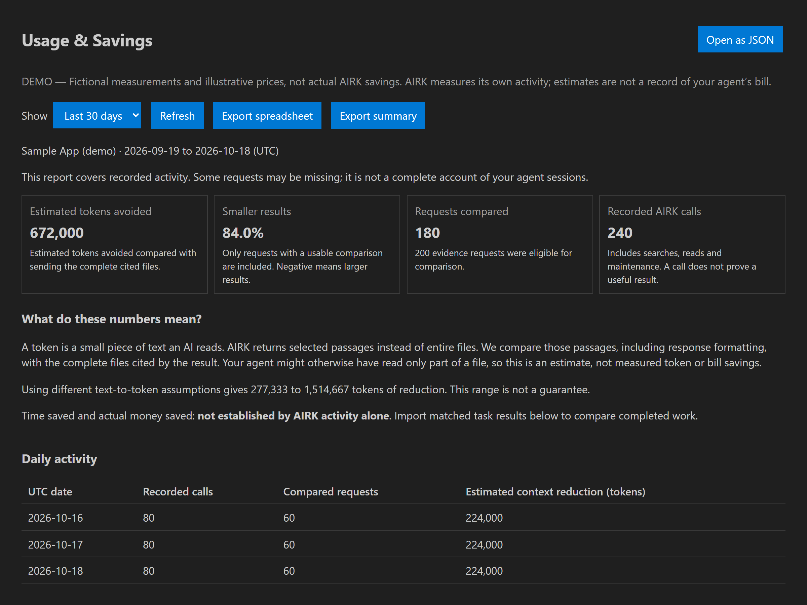

# Usage & Savings UI previews — 1.1.3

These PNGs render the implemented reporting and sidebar HTML/CSS on `feat/usage`, using fictional measurements and illustrative prices. They show the current interface, not measured AIRK savings. The fixture includes one task where only the alternative passed so the comparisons also show why task quality matters.

Rendered October 18, 2026 with local headless Microsoft Edge and VS Code theme colors. These are webview renderings, not installed-editor screenshots. Editor tabs, file pickers, confirmation dialogs and price-entry prompts are outside these captures. No source files, private indexes or real agent sessions supplied the displayed numbers.

## Overview

The opening view explains tokens, compares selected passages with complete cited files, and keeps the limitations beside the headline numbers.



## All PNGs

Images use 2× resolution for legible text. Sizes below are CSS pixels; PNG pixel dimensions are twice as large. Overview and narrow images show a viewport; the full report includes the rest of the scrollable page. Section captures are crops of that same rendered page, and also use fictional measurements.

| Preview | Layout | What to review |
|---|---|---|
| [Dark overview](images/usage-overview-dark.png) | 1200 × 900 | Headline estimates, plain-language explanation and daily activity |
| [Light overview](images/usage-overview-light.png) | 1200 × 900 | The same report in a light palette |
| [Full report](images/usage-full-report.png) | 1200 wide, full page | Daily history, cumulative progress, imports, comparisons, costs and recording controls |
| [Task and cost comparisons](images/usage-task-and-cost.png) | 1200 wide, section crop | Supplied token/time measurements, task quality and hypothetical cost differences |
| [Developer details](images/usage-developer-details.png) | 1200 wide, expanded section crop | Operations, indexing work, resources, recording gaps and feedback |
| [Narrow report](images/usage-narrow.png) | 420 × 1200 | Wrapping controls and summary cards in a narrow editor pane |
| [First use](images/usage-first-use.png) | 1200 × 900 | Guidance before activity exists; missing estimates stay “Not measured” |
| [Sidebar entry point](images/usage-sidebar.png) | 360 wide, full panel | Per-collection Usage & Savings button, cached summary and report shortcut |

## Regenerate

From the repository root, with the extension's development dependencies installed:

```console
npm run compile --prefix packages/vscode
node scripts/render-usage.cjs
```

The [rendering script](../../scripts/render-usage.cjs) calls the compiled product renderers directly, supplies theme variables and a mock VS Code message bridge, and captures the local pages through Chromium's screenshot API. It adds a demo explanation through the report's existing explanation field. It does not change the product layout or replace its labels. The optional developer section is opened before its capture.

Set `AIRK_BROWSER` to a local Chromium, Chrome or Edge executable if Edge is not installed in its standard Windows location. Node.js 24 is the repository development baseline. The browser runs hidden with its own profile and fixture HTML under ignored `artifacts/`; only the PNGs in this directory are documentation assets. Rendering uses no external pages or analytics data.

The capture run checks for page-level horizontal overflow in every scene and clicks each report's Refresh button or the sidebar's Usage & Savings button to verify the expected webview message. Wide detail tables can scroll within their sections. This verifies rendering and the button bridge, not native accounting, installed-editor behavior or actual savings; those limits and checks are recorded in [1.1.3 qualification](../releases/release-1.1.3.md). See [the usage guide](../usage-evaluation.md) for interpreting the report.
