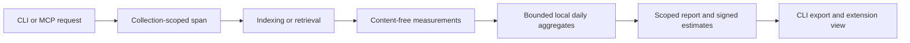

# Local usage, performance and estimated context reduction

AIRK records content-free local daily aggregates by default. CLI and MCP adapters measure one outer request, including serialized response bytes, and write a separate bounded ledger under the selected collection. Native scheduler jobs record their actual indexing work once under the job collection. Recording failure never changes a retrieval result. There is no network telemetry, provider credential, remote analytics service or external database.

The tracker measures AIRK's work and delivered context. Its hooks cannot observe an agent's complete prompt, provider token accounting, cached-input discounts, model responses, task completion or bill. Optional local imports accept explicitly supplied numeric client/session and paired-task observations, labelled separately from AIRK's own measurements. A nonempty retrieval is not evidence that the result was useful.

[Workspace indexing coverage](index-coverage.md) measures indexed/eligible workspace files, inventory completeness and freshness. Coverage is neither retrieval quality nor estimated savings.

## Commands and editor controls

Commands use the usual `--root`, `--data-dir` and `--collection` scope. Reusing a collection name cannot combine another root's history.

```console
airk usage report --days 7
airk usage report --days 30 --format csv
airk usage report --days 30 --format markdown
airk usage configure --mode disabled
airk usage configure --mode aggregates-only
airk usage configure --mode diagnostic-events
airk usage feedback REQUEST_ID --usefulness useful
airk usage import measurement.json
airk usage calibrate --tokenizer tokenizer.json --baseline baseline.json --returned returned.json --generation 1 --content-kind code
airk usage calibrate --tokenizer tokenizer.json --baseline baseline.json --returned returned.json --generation 1 --content-kind code --record
airk usage report --price-scenario prices.json
airk usage clear
```

`report` writes JSON by default; CSV and Markdown are bounded exports to stdout. Shell redirection chooses an export destination. UTC whole-day windows range from 1 to 30 days and include today. Partial-day filtering is unavailable because default recording discards individual request measurements.

`configure` changes the collection policy. Disabling prevents subsequent retrieval hooks from reading or writing the history ledger; an already running worker checks policy before its next write. `AIRK_USAGE_MODE=disabled` bypasses policy/history access for request recording. Explicit report/configuration/clear commands remain available for existing history. Clearing removes usage diagnostics, feedback, session links, daily and cumulative aggregates while preserving source files and the index. Already started spans cannot repopulate cleared history.

Successful JSON result objects include an opaque `request_id` when recording is enabled. Feedback accepts `useful`, `partly-useful` or `not-useful` against a retained ID; repeated feedback replaces its prior selection. Unknown/expired IDs fail explicitly. Feedback is a bounded recent-request sample, not a relevance or task-success score. Absent feedback remains unknown.

The extension's selected-collection **Usage & Savings** view reads the same report and offers 7/30-day history, recording controls, CSV/Markdown exports, import preview, explicit feedback and cost assumptions. [The measurement guide](usage-evaluation.md) explains the user workflow, supported client-counter adapters, matched-task evaluation and longer-term totals. The extension does not maintain a second accounting database.

## Ownership and data flow

| Component | Responsibility |
|---|---|
| `airk-core::usage` | Content-free contracts, bounded dimensions, signed estimates and aggregate merging |
| `airk-store::usage` | Daily transactions, retention, quotas, replay protection, feedback and lifecycle safety |
| `airk-kernel::usage` | Scoped spans, bounded comparable-source baselines, reports and exports |
| CLI / MCP | One span per outer request and measurement after response serialization |
| VS Code extension | Selected-collection summaries, history, exports and controls |



Small redb transactions in `usage.airk` are separate from index transactions and the index writer lock. Multiple workers update shared daily aggregate rows atomically. This directly implements bounded multiworker accounting: no file per request, detailed events off by default, and no complete-history rewrite on each call. An OS file lock coordinates writes, clear and collection deletion; a crashed process releases it automatically. Usage operations wait up to two seconds for brief contention, while collection deletion retains fail-fast acquisition. Callers within one process queue in arrival order for each lock path, preventing a returning worker from repeatedly overtaking waiting workers. Local queuing and OS-lock polling share the same two-second budget; ordering across processes is still controlled by the OS lock. A random ledger incarnation rejects late spans after history clearing or collection recreation.

## Measurements

| Area | Recorded / reported | Interpretation and limits |
|---|---|---|
| Activity | Calls by operation, normalized client, content kind; daily history | No queries, symbols, paths or arbitrary client labels |
| Results | Success, empty, failed and truncation | Current adapters classify operation errors as failed; contracts also support not-ready/cancelled/capacity categories |
| Latency | Monotonic duration through serialization; fixed buckets; index scan/extraction and publication stage totals | Includes accounting setup, excludes provider work and final ledger flush. Stage samples are counted separately; missing stages remain unknown |
| Context | Serialized response bytes and same-current-revision full-source baseline when available | CLI logical JSON and MCP tool-result JSON are distinct |
| Indexing | Changed, reused, removed, skipped, processed source bytes; logical index disk samples and signed growth | Reuse saves extraction; it does not establish avoided hashing/I/O. Disk inventories stop at 10,000 entries or a 50 ms check budget; linked/inaccessible/partial scans remain unknown |
| Supplied evidence | Numeric client/session, alternative-context, paired-task and local tokenizer measurements | Separate provenance, model/tokenizer identity and category limits; never increment AIRK request counts |
| Feedback | Useful, partly useful, not useful for retained request IDs | Explicit and optional |
| Accounting | Duplicate IDs, retained daily coverage, ledger bytes, process-local drops | Historical losses across crashes/workers are unknown |

Client labels default to CLI or unknown MCP. `AIRK_CLIENT` can declare a known family: `vscode`, `claude`, `codex`, `gemini`, `cursor`, `cline`, `roo`, `junie`, `copilot-cli`, `opencode`, `kilo`, `amazon-q`, `windsurf`. Labels normalize to fixed categories, authorize nothing and never retain arbitrary supplied strings. Content kinds come from successfully compared sources; mixed sources stay mixed and unavailable comparisons stay unknown.

Latency boundaries are 1 ms, 5 ms, 20 ms, 100 ms, 500 ms, 2 s and 16 s, followed by overflow. Exact percentiles are not reported. Cache outcomes remain unknown unless measured; adapters do not infer cache hits from latency.

Actual native source and semantic turns are recorded once with the fixed `native_scheduler` client family, including reuse and failures on an existing managed collection. Full service replacement records its actual source work as `reindex`, against the same collection/root ledger. This measures performed work; the durable rebuild/repair job separately reports whether later verification and manifest handoff completed. A worker serving another collection records against that job's scope. Acceptance, joined waiters, idle/busy polls and coverage reconciliation add no duplicate indexing observations. Jobs that fail before a valid scoped kernel/ledger exists remain visible in native job receipts without inventing a usage scope. Disk-growth history requires complete before/after inventories and excludes usage files/locks; current and temporarily unreferenced objects contribute to logical sizes.

## Process resources

CLI/MCP/native-job spans sample the current process before work and before usage persistence. Supported counters have explicit measurement coverage in each operation and in the combined `resources` report. Missing counters are absent, never implicit zeros. Windows/Linux/macOS CPU counters include process threads, but not separately spawned provider processes. Background work may contribute to process-wide deltas; overlapping AIRK spans suppress counter attribution for all affected intervals to avoid double counting. Peak RSS is the largest observed process-lifetime high-water mark, not summed per-request memory.

| Host | CPU/RSS | I/O semantics |
|---|---|---|
| Windows | `GetProcessTimes`, `GetProcessMemoryInfo` | `GetProcessIoCounters` read/write transfer bytes include other devices and are not physical disk bytes |
| Linux | `getrusage` | `/proc/self/io` separates syscall bytes, OS storage read/write bytes and cancelled writes; these are not hardware-device telemetry |
| macOS | `getrusage` | `proc_pid_rusage` v2 disk-I/O counters; runtime qualification requires the Mac host |

Old retained reports deserialize with no resource samples. Counter totals use decimal strings and include their sample counts. Counter resets, unsupported probes and failed probes remain unknown. The compatibility `physical_io_bytes` field stays null rather than relabeling transfer counters. Best-effort usage admission can drop observations on large or busy data roots; independent scale measurements capture child-process counters without assuming ledger completeness. Disabled usage does not probe or persist these counters.

OS definitions: [Microsoft IO_COUNTERS](https://learn.microsoft.com/en-us/windows/win32/api/winnt/ns-winnt-io_counters), [Linux proc I/O documentation](https://docs.kernel.org/filesystems/proc.html), [Apple resource definitions](https://github.com/apple-oss-distributions/xnu/blob/main/bsd/sys/resource.h).

## Honest estimates

The implemented live baseline is **full returned sources**: unique sources actually cited in the response, from the matching current revision and content hashes, rendered as normalized text chunks with original locations. PDF/DOCX/XLSX/PPTX use extracted text rather than compressed bytes or images. Repeated citations deduplicate the source before counting its chunks. This is a counterfactual context scenario; it does not assert that an agent would otherwise read every whole source.

The current authenticated map stores per-source counts for serialized full-text hits and the additional JSON escaping used by MCP. These content-free rows are measured from the same bound chunks used for retrieval, including source paths and document locations; the usage ledger receives only aggregate counters. Unchanged-source measurements survive unrelated edits. Baseline framing and commas are counted once when combining unique cited sources.

Comparisons validate the exact current publication token under a request gate and read at most 100 size rows of at most 1 KiB each. Root, collection, current sequence and source hashes must match. A newer head never substitutes for the response's revision: an expired token makes the comparison explicitly unavailable. There is no production fallback to a historical catalog. The existing usage schema field `generation` carries the current commit sequence for accounting; it does not make that sequence a historical read selector.

Reports expose fixed `baseline_unavailable` reason counts: missing citations/revisions, excessive source counts, unavailable or mismatched revisions/sources, bounded comparison limits, or verification errors. No error text or source identity is stored in the ledger. Old daily records without reason counts remain readable and display their unclassified remainder as not recorded. Earlier missing comparisons cannot be reconstructed from aggregates. Conditional not-modified/missing responses contain no evidence payload and receive no comparison credit.

Responses are counted after serialization. MCP includes the tool-result envelope and text content, but excludes the JSON-RPC envelope and subsequent model prompt. Full-source comparisons use the corresponding JSON representation. Indexing, administrative commands, failures and empty results receive no context-reduction credit. Reports do not estimate their own output as saved context; nested kernel helpers do not record separately. Argument/schema rejection before a handler is entered and interrupted requests are not observed; partial accounting remains explicit.

The estimator is `utf8-byte-assumptions/1`: four nominal bytes per token, with two-to-six-byte sensitivity assumptions. These are scenario assumptions, not a model tokenizer, accuracy guarantee or confidence interval. Code, Unicode, prose and JSON tokenize differently.

```text
nominal baseline tokens = ceil(baseline UTF-8 bytes / 4)
nominal returned tokens = ceil(serialized response UTF-8 bytes / 4)
estimated context reduction = nominal baseline tokens - nominal returned tokens
```

A fictional 48,000-byte baseline and 4,800-byte result produce 10,800 nominal tokens of reduction and an assumption range of 5,600–23,200. An 80-byte baseline and 400-byte result produce **80 additional nominal tokens**. Estimates stay signed and are calculated per request before aggregation to preserve rounding.

Live hooks supply only full-returned-source comparisons. The `supplemental` report field separately contains observed-alternative and user-supplied comparisons, client/session counters and calibration; these never enter the native request total. `report.provider_token_usage_observed` remains false for AIRK hooks and `estimated_bill_savings` remains null. Explicit client reports are self-reported evidence, not independently verified provider records.

## Explicit client and session inputs

`usage import FILE` reads one UTF-8 JSON object of at most 16 KiB. Unknown fields are rejected, including free-form notes, prompts and source content. The collection/root comes from the normal CLI scope, not from the input. A current indexed collection and enabled recording are required. There is no background client log scraping or automatic external connection.

Example structure below uses fictional numeric observations. Replace `event_id` with a fresh random 32-digit hex ID, `unix_ms` with the observation's UTC milliseconds within retention, and identity digests with the model/tokenizer revision identities actually used. A digest identifies the definition or model revision; do not hash prompts, queries, paths or sample text.

```json
{
  "schema_version": 1,
  "event_id": "00000000000000000000000000000001",
  "unix_ms": 0,
  "client": "codex",
  "content_kind": "code",
  "provenance": "client_reported",
  "context": {
    "baseline_kind": "observed_alternative",
    "generation": 1,
    "representation": "logical_result_json",
    "baseline_utf8_bytes": 80,
    "returned_utf8_bytes": 400,
    "tokens": null
  },
  "session": {
    "model_revision_sha256": "aaaaaaaaaaaaaaaaaaaaaaaaaaaaaaaaaaaaaaaaaaaaaaaaaaaaaaaaaaaaaaaa",
    "requests": 2,
    "input_tokens": 120,
    "cached_input_tokens": 20,
    "output_tokens": 12,
    "elapsed_ms": 1000,
    "tool_round_trips": null
  },
  "paired_task": null
}
```

Use `provenance: user_supplied` with `baseline_kind: user_supplied` for a scenario rather than an observed alternative. `full_returned_sources` is reserved for native hooks. Each context pair asserts one generation and one representation for both sides; AIRK cannot independently verify imported context comparability. Optional `tokens` contains `baseline_tokens`, `returned_tokens`, and `tokenizer` with `algorithm: client_reported`, `definition_sha256`, and `model_revision_sha256`. Both counts must use that same tokenizer definition and framing. Different tokenizer/model identities and provenance stay in separate bounded strata. Missing counters are `null`, never an implicit zero. Cached input cannot exceed total input.

Optional `paired_task` contains `same_task_and_model: true`, `with_airk` and `without_airk` session objects using the same model revision, and `with_airk_result` / `without_airk_result` values `passed`, `failed` or `unknown`. Reports retain numeric session totals and five quality bins: both passed, only AIRK passed, only the alternative passed, both failed, and unknown. This records an explicitly supplied paired evaluation; it does not prove causation or comparable experimental conditions. No task description or session name is retained.

Supplemental imports keep daily aggregates, at most 16 strata per UTC day and 256 opaque recent replay IDs. Once an ID is evicted, older timestamps are rejected rather than counted twice. All supplemental storage shares the existing collection/root quota. Capacity, stale-time and invalid-input failures fail the explicit import atomically and do not change native totals. Repeated IDs return `duplicate: true`; clear/delete/recreate invalidate old writers. Disabled recording rejects import and `calibrate --record` before opening history.

## Offline tokenizer calibration

`usage calibrate` reads two comparable logical-result JSON files, at most 256 KiB of UTF-8 each, and a local tokenizer definition up to 1 MiB. Without `--record` it only prints a transient calculation. With `--record` it retains aggregate counts, content kind and tokenizer/model identities, never the files' names, content or hashes. `--generation` is the explicitly supplied generation of the comparable samples. Supply independent held-out samples for each content family being evaluated; one successful sample does not establish general accuracy.

Schema 1 supports `utf8-byte-bpe/1`: all 256 byte symbols are implicit, followed by at most 8,192 ranked merges of hexadecimal byte strings. Each merge combines prior symbols into at most 256 bytes. Lowest rank wins, with leftmost ties. This compatibility format has no normalization, pretokenization, special tokens or chat framing.

Schema 2 uses the offline Hugging Face `tokenizers/0.23.2` pipeline, supporting BPE, WordPiece, Unigram and WordLevel plus the supplied normalizer, pretokenizer and postprocessor. The sibling tokenizer JSON is limited to 32 MiB and SHA-256 verified. Padding and truncation are disabled so the entire measurement is counted; stochastic BPE dropout is rejected. Prefix/suffix framing is explicit, at most 16 KiB combined. Special-token handling is explicit. The definition fingerprint binds the manifest, tokenizer digest, framing and runtime version; incompatible definitions stay separate. This counts the specified local contract and does not infer provider chat compatibility.

```json
{
  "schema": 2,
  "model_revision_sha256": "aaaaaaaaaaaaaaaaaaaaaaaaaaaaaaaaaaaaaaaaaaaaaaaaaaaaaaaaaaaaaaaa",
  "tokenizer_file": "tokenizer.json",
  "tokenizer_sha256": "bbbbbbbbbbbbbbbbbbbbbbbbbbbbbbbbbbbbbbbbbbbbbbbbbbbbbbbbbbbbbbbb",
  "add_special_tokens": true,
  "framing": {"prefix": "Document evidence:\n", "suffix": "\nEnd of evidence."}
}
```

Replace the fictional digests with those of the exact model/tokenizer being measured. `scripts/check-tokenizer-calibration.py` compares 12 fixed original multilingual/code/document cases with an independent Python pipeline, including inputs beyond the inference window. These test exact counting and byte-heuristic error, not representative client billing or causal task savings.

Schema 2 admits explicitly supported stages with at most 32 stages, depth four and 16 children per sequence. Opaque precompiled normalizers, regex/expanding replacements and templates that duplicate an input sequence are rejected before loading. A conservative per-input expansion estimate must fit 4 MiB of intermediate work; some inputs below the 256 KiB source limit can therefore be refused. Standard BERT/MiniLM pipelines are covered by fixtures. These are admission bounds, not a hard process-RSS or wall-clock guarantee. Unused decoder, padding and truncation configurations are removed before loading the counting pipeline.

```json
{
  "schema": 1,
  "model_revision_sha256": "aaaaaaaaaaaaaaaaaaaaaaaaaaaaaaaaaaaaaaaaaaaaaaaaaaaaaaaaaaaaaaaa",
  "merges": [["68", "65"], ["6865", "6c"], ["68656c", "6c"], ["68656c6c", "6f"]]
}
```

This fictional definition merges `hello`. JSON `"hellohello"` has four tokens (two merged words and two quotes), and `"hello"` has three. Reports include exact signed token reduction, per-side absolute error of the four-byte heuristic, and the number of reductions outside the stated two-to-six-byte assumptions. The tokenizer definition's SHA-256 and the supplied model revision are retained so incompatible counts cannot silently mix. Supplied client counts can use the same comparison fields but retain `client_reported` provenance.

## User-supplied price scenarios

`usage report --price-scenario FILE` reads at most 4 KiB of local JSON. The scenario is ephemeral: no price is fetched, inferred, silently saved or treated as a bill. Rates use fixed decimal arithmetic with at most six fractional digits; signed results retain twelve decimal places.

```json
{
  "model": "fictional-model",
  "currency": "USD",
  "rate_date": "2026-10-14",
  "input_price_per_million": "2.500000",
  "cached_input_treatment": "separate_rate",
  "cached_input_price_per_million": "0.250000",
  "context_assumes_uncached": true
}
```

This fictional rate converts an 80-token context expansion to `-0.000200000000` USD of hypothetical input-cost reduction. It is not estimated bill savings. Set `context_assumes_uncached: false` to omit context-price counterfactuals. Cache treatment can be `unknown`, `uncached_rate`, or `separate_rate`; only the last accepts a separate cached price. Session input is priced only where the client explicitly supplied its cache split. Missing splits and missing input counters remain unpriced, and missing cached rates remain unknown. An optional `output_price_per_million` converts supplied output counts into a separate hypothetical output-cost equivalent; missing rates or counts remain unknown. It does not establish output-cost savings. Scenario model compatibility and experimental causality are not inferred.

## Scope, retention and capacity

Default policy retains 30 UTC daily buckets, reserves at most 1 MiB per collection and 32 MiB per data root, and disables detailed diagnostics. The native ledger validates decoded row bounds separately from physical file growth and reserves its remaining configured allowance before mutation. Usage quotas conservatively reserve 1 MiB per existing ledger, allowing at most 32 default collection ledgers even when individual files are smaller. Ledger mutations also reserve their bounded additional redb footprint under the shared managed-storage quota; exhausted shared capacity drops implicit accounting or rejects an explicit import. Clear removes the selected native usage ledger under its lifecycle lock, preserving source/index evidence; it does not read or import a retired SQLite ledger.

The ledger contains fixed categories, aggregate counters, a root-binding digest, opaque replay IDs and optional content-free diagnostic measurements. It never stores queries or their hashes, symbols, source paths/text, prompts, arguments, credentials, raw errors or free-form notes. Collection/root ownership is validated against indexed metadata. A mount-path digest cannot establish host-project identity; retain the managed collection precautions in [collections](collections.md).

Replay protection retains at most 4,096 IDs. After eviction, a timestamp floor rejects older delayed observations rather than counting replays again. This deliberately favors dropped accounting over inflated totals. Feedback uses the same bounded retained ID set. Opt-in diagnostics retain at most 128 content-free events with a 24-hour allowance and prune on later recording. Reports immediately filter logical retention; physical pruning runs on the next successful recording transaction. Idle collections can retain expired bytes until recording or explicit clearing resumes.

Writers serialize behind a cooperating native lifecycle lock. Usage operations retry lifecycle-lock contention for up to two seconds. Opening an existing ledger only reads its scope and incarnation; it does not reserve storage or rewrite the schema. Creation also waits up to two seconds on the data-root usage-admission lock. Implicit ledger mutations retry shared-quota lock contention and check inventory work against a separate two-second budget; only lock contention is retried, while capacity, corruption and other errors fail closed. Explicit imports/configuration can use ordinary quota checks. Individual filesystem calls and synchronous commits cannot be preempted, so these checks are not a hard wall-time guarantee. Busy/full/corrupt ledgers drop accounting and emit a process-local notice without failing retrieval. Drop counters only survive the current process. Nonempty reports consequently say `partial`, empty reports say `empty`, and disabled reports say `disabled`; history is never certified lossless.

Large byte/time/token sums serialize as decimal strings so JavaScript does not round them. CSV includes operation totals and a quoted `details_json` column for supplemental/scenario rows. Markdown adds signed comparison and supplemental summaries plus any explicit scenario. JSON includes policy, daily history, comparison coverage, feedback, supplemental strata and health.

## Validation and remaining release work

Tests cover signed sensitivity and overflow, excluded/missing/mismatched comparisons, root/window isolation, wide-number exports, worker merging/deduplication, disabled no-history writes, clear/deletion/recreation safety, stale/busy drops, redb quota-failure rollback, root quotas, diagnostic opt-in and feedback. Kernel fixtures check one outer observation, matching-revision baselines, reports not counting themselves, absence of fictional query/source content from the ledger, and actual scheduler jobs attributed once to their own collection with disabled history unchanged.

Tests additionally cover exact signed monetary arithmetic, invalid dates/rates, cache splits, client import deduplication and category caps, paired-quality bins, local byte-BPE counts including Unicode byte fallback, unknown input fields, clear/disabled behavior and no retained calibration text. Release qualification still requires actual full-disk and process-kill fault injection on each supported platform, sustained worker load and overhead measurements, and representative held-out calibration/paired-client evidence. Local Windows tests do not qualify macOS, Linux, network filesystems, provider savings or retrieval usefulness.

## 1.1.3 additions

Reports now include `lifetime`, a bounded native rollup beginning with new recorded observations, without backfilling earlier daily history. It survives daily expiry and resets with clear. Supplemental/session evidence retains its separate daily window. Both updates share the same deduplication transaction and quota.

`usage import FILE --preview` validates the content-free schema without recording. Optional `airk_request_ids` links at most 100 retained local requests to one final session import; unknown or previously linked IDs reject the import atomically. Association is supplied, not a causal claim. The replay ID and original observation time must be stable across retries.

CSV now includes comparison, recording-health and cumulative-native rows as quoted JSON details. JSON and Markdown also expose cumulative recording. The [evaluation guide](usage-evaluation.md) documents supported counter conversion, paired-task summaries, explicit output pricing and independent overhead measurement.
