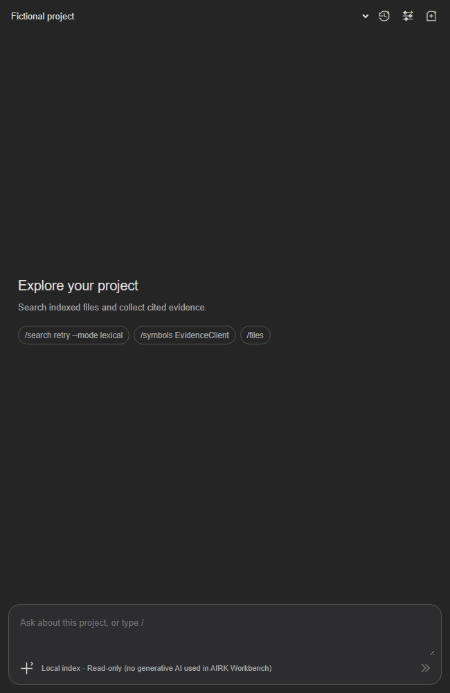
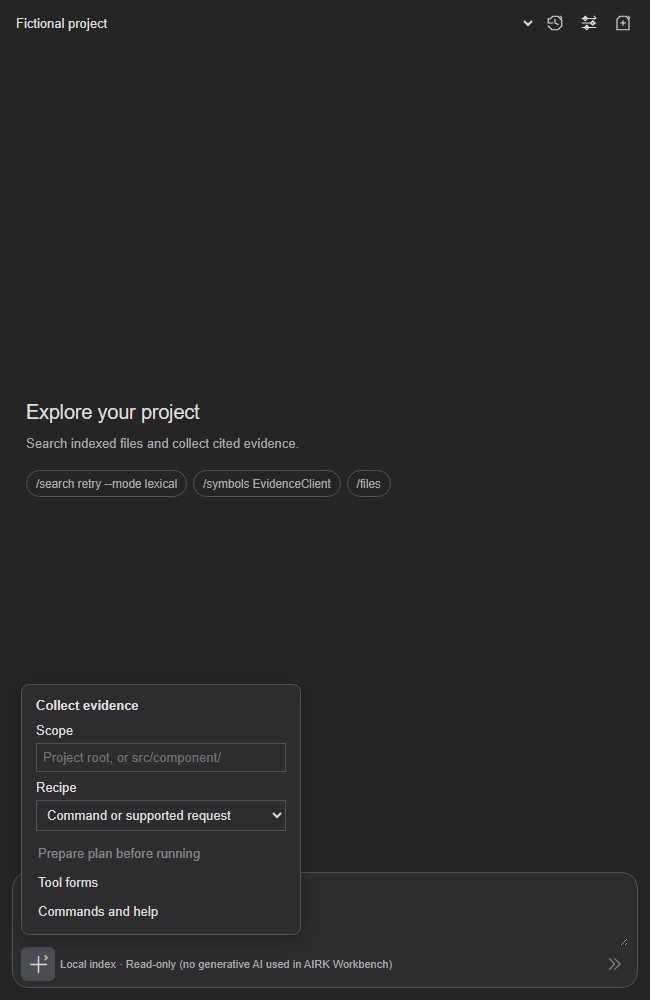
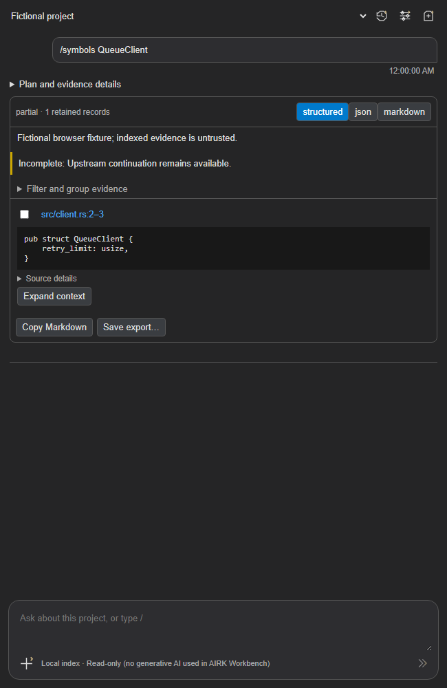

# Workbench development branch

Historical prepublication implementation record on `feat/workbench`, 2026-10-30. Current packaging/release changes are recorded in [1.7.6](../releases/release-1.7.6.md). At this checkpoint, native and extension versions are synchronized at 1.7.2, as requested for this feature branch. This record preserves the dated 1.6.4 release record and does not establish publication or platform qualification.

The Workbench contributes an AIRK tab in VS Code's secondary sidebar. Use **AIRK: Open Workbench**, choose a registered project and enter a slash command or choose an evidence recipe. Scope is a literal collection-relative prefix. Prepare shows the inert normalized plan; Run collects bounded indexed evidence. Plan details expose arguments, publication, budgets and digest, with JSON editing and explicit execution. Re-running appends a new turn and resolves against current evidence.

Implemented commands cover search, definitions, textual references, reads, outlines, inventory, file information, imports, file facts, changes with an exact baseline, status, diagnostics, capabilities, context, relationships and help. Deterministic requests such as “who calls the queue client” can resolve bounded spelling candidates against indexed definitions. Other phrasing can produce inert proposed plans; choose **Review proposed plan**, check the operation and arguments, then **Run plan**. Unsupported or ambiguous inputs return choices and suggestions. Default source-read windows are bounded to the indexed line count and source hash; explicit ranges remain exact. Textual occurrences and candidate relationships remain labeled; no resolved-call or complete-impact claim is made.

Recipes collect definition context, document statements, possible impact, test mentions, component inventory/imports and readiness. Choose a test path scope for test mentions; no tests are executed. Evidence cards preserve original document locations and source hashes. Filter or group retained records, open sources, expand context and copy selected evidence. JSON/Markdown exports retain warnings and completeness. Copy refuses outputs over 1 MiB instead of slicing JSON; Save export supports larger local artifacts. Copy All preserves each turn's separate publication.

Sessions are local to extension storage, with ten recent sessions per project, a 200-turn/4 MiB cap, atomic saves and revision-conflict rejection. Recent, rename, fork, delete, clear, copy and export actions are available. `airk.workbench.persistSessions` and `airk.workbench.persistResults` control persistence; disabling them cleans up the selected project's saved sessions/results. Save failures leave in-memory work available for retry or export. An abandoned exclusive writer file is refused rather than removed speculatively; export remains available. Project removal and extension uninstall include guarded session cleanup.

## Agent and CLI interface

The unified MCP catalog adds `parse`, for 28 public tools. Native `airk_parse` remains the compatibility alias. An editor attachment is unnecessary. `schema` is `airk.parse.request/1`; `mode` defaults to `prepare`. Supply exactly one of `text`, `recipe` or `plan`. `plan.steps` contains stable IDs, public operation names, argument objects and optional bindings to earlier steps. The kernel owns validation and execution; it does not recursively call MCP.

```json
{
  "schema": "airk.parse.request/1",
  "mode": "execute",
  "path_prefix": "src/",
  "recipe": { "id": "definition", "parameters": { "name": "QueueClient" } }
}
```

Agent connections with several configured projects must also supply their authorized `project` ID. Prepared plans bind collection, publication, catalog, scope, budgets, output and digest. Edited plans must be prepared again with their old digest cleared; stale publications are rejected without silently selecting current evidence. Dependent location and symbol bindings are finite and capped. Plan-only `path` on fact operations selects an exact file through the kernel; it is not an extra argument on the existing direct MCP fact tools.

`airk parse '/symbols QueueClient'` prepares; add `--execute` to run. `--request request.json` accepts structured input; `--request -` reads bounded JSON from stdin. `--project` on parse aliases the global `--service-project`; conflicting selections fail. Global root options retain their normal source binding. Plans run with at most six steps, twelve reads, twelve fan-out targets and 512 KiB of materialized payload. The deadline is checked between synchronous reads; it does not forcibly terminate an admitted read. Stop fences queued and late replies without claiming native work was undone. Whole execution requests are not automatically replayed after uncertain transport failures.

## Remaining qualification and design differences

The local review build embeds the broader offline classifier: 40k supported examples, 6k original unsupported tasks and 2k attributed public assistant requests, with separate phrase-family validation/calibration and public test splits. It reaches 146/150 (97.33%) on the retained utterance fixture, with no wrong accepted classifications there. Raw rejection still accepts one of 20 curated unsupported requests and four of 1,000 public unsupported requests; calibration abstention is 14.7%, above the 10% target. Full automatic-execution qualification therefore remains incomplete. Supported learned inputs produce inert proposed plans with `requires_input`; review the operation and arguments, then explicitly submit the plan to collect evidence. Commands, recipes and explicitly submitted plans use the normal runner. A kernel regression confirms all 20 unsupported requests perform no automatic evidence execution. The [training record](../../tools/parser-train/TRAINING.md) records prior failures, pins, attribution, model identity and label-review limits. Generated examples and provenance are saved under ignored `target/parser-train/` and content-addressed `.parser-train/` copies outside Cargo's cleanup directory.

The baseline uses rich native kernel records in one bounded envelope; it does not promise transport-byte equivalence with separate terse MCP reads. Native execution is serial within existing worker admission. Source-file checks occur explicitly when opening evidence, separately from index freshness. Longer-lived historical snapshots, automatic agent handoffs, per-project training and open-ended task orchestration are excluded.

Native schema-generated forms and guarded conversion/save of compatible inputs to the existing Strategy library are implemented. Conversion refuses selectors or arguments it cannot preserve, with native-plan export available instead. Explicitly remembered accepted-input shortcuts exclude evidence and revision handles, remain bound to project/scope/catalog and are always revalidated natively. Available cursor continuations require an explicit click and consume remaining call/byte allowance in a new turn; expired cursors never silently restart. Installed-editor visual/accessibility validation and cross-platform qualification remain separate from local unit tests and browser fixtures.

## Local validation

On Windows, the full all-feature workspace run passed 1,466 tests with 17 ignored. Review changes then passed three focused kernel tests and an additional real CLI/public-MCP prepare/execute parity test. Formatting and all-target/all-feature Clippy passed. Extension compilation/tests passed 415 with 15 skipped; script contracts passed 207 with five skipped. Repository, whitespace and synchronized-version checks passed. Fresh normal-feature debug and final release runtime pairs passed native client/model and managed-frontend smokes, including project isolation, all 28 public tools, reconnects and preserved source bytes. An initially stale smoke-script catalog expectation was corrected after auditing related callers; whole-plan execution is excluded from automatic retry helpers.

Historical 1.7.0 measurements: the component sizes are 852,116 bytes for the embedded intent asset and 47,917/5,382 bytes for Workbench JavaScript/CSS bundles. The final release main/helper executables are 176,263,680/55,316,992 bytes; the verified Windows x64 VSIX is 69,439,170 bytes (66.22 MiB). Same-profile before/after native-size acceptance has not been measured. The [1.7.0 candidate record](../releases/release-1.7.0.md) records remaining qualification and release-license review. No installed-editor, cross-platform, hosted or publication success is inferred from these local results.

The historical 1.7.0 local unsigned review installer is saved at `artifacts/workbench-review-1.7.0/extension/publish/airk-1.7.0-win32-x64.vsix`, with installation steps in the review folder's `README.md`, checksums in `extension/publish/SHA256SUMS` and validation receipts in `review-evidence.json`. VSIX SHA-256: `2f16f24b75a3850b8b779dbd3ea2d34e06b5e9811174de0e62751c4a3146f29d`. The package was verified without installing it into the user's VS Code.


## 1.7.1 interface and first opening

Successful trusted setup opens Workbench once per extension storage profile, including the completed-install reconnect path. The marker is saved after opening succeeds; failed setup, untrusted workspaces and pending extension replacement do not consume it. Later startup and folder changes preserve the hidden state. VS Code can require Reload Window to replace the old extension; the runtime installer cannot activate new extension code in its place.

Original Facet icons use angular outlines and chevrons inspired by the AIRK mark. History, settings and new-session icons share a compact header. Scope, recipes, plan preparation and tool forms move into the composer’s + menu. Index metadata and session actions remain available in settings. Menu dismissal supports Escape and outside clicks. Results keep their citation, plan-review and explicit-run controls. Explorer has a Workbench button immediately left of Help in the toolbar; its pressed state follows WebviewView visibility events, including switching to another tab or closing the secondary sidebar. Clicking while Workbench is visible closes the secondary sidebar; clicking while hidden reopens Workbench. The project dropdown appears inside Overview and Management, with one selection shared across Explorer screens. VS Code owns saved container order and exposes no extension API for enforcing the far-right position; drag the AIRK tab once if needed.

See the [1.7.1 candidate record](../releases/release-1.7.1.md) for validation.

The composer footer reads “Local index · Read-only (no generative AI used in AIRK Workbench)”. Supported intent parsing still uses the fixed local classifier; this label makes no claim that all machine learning is absent.

### Rendered 1.7.1 previews

These are screenshots of the compiled browser bundle with fictional host data, not installed-editor qualification.






