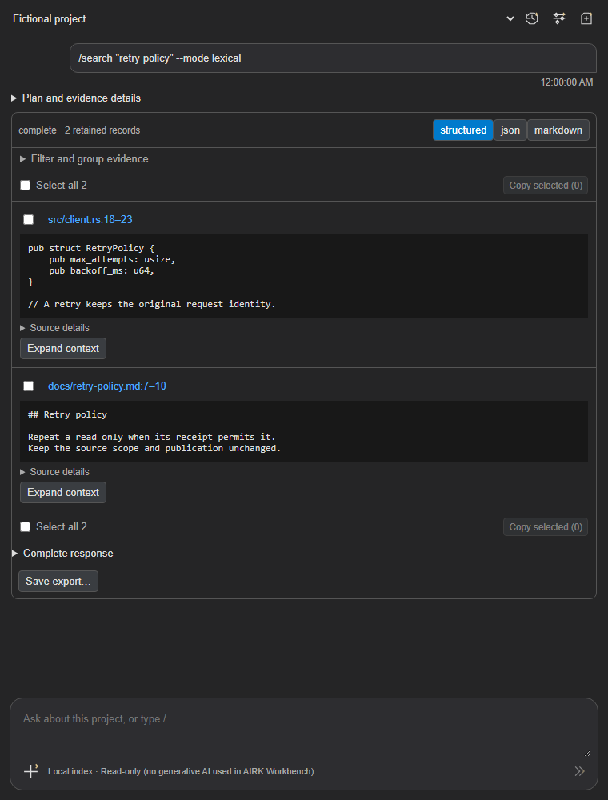
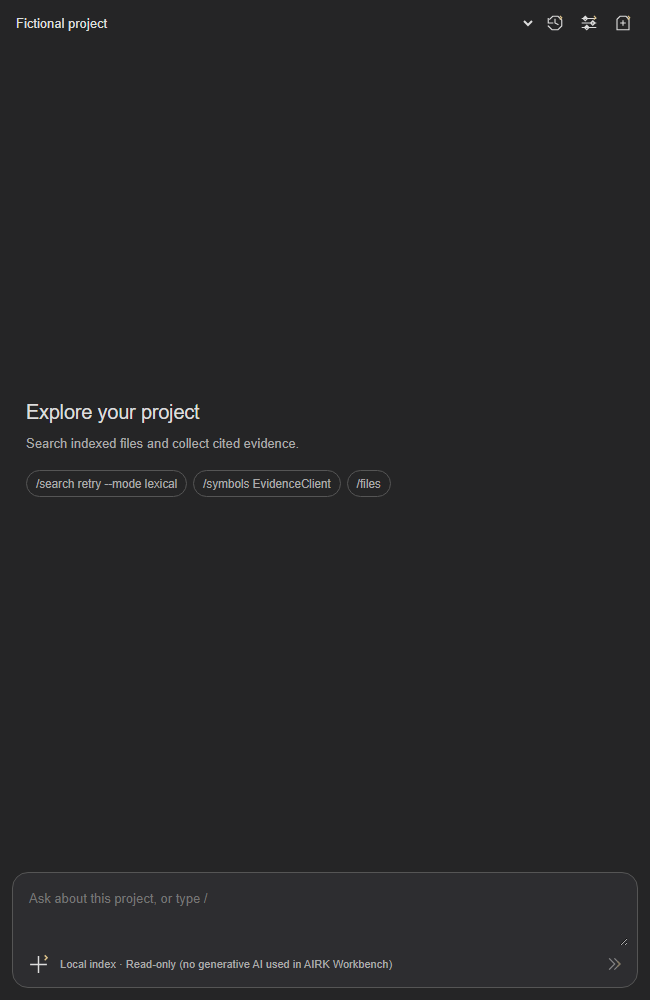
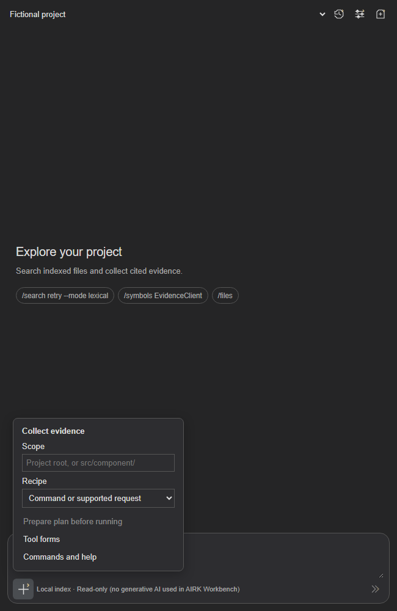
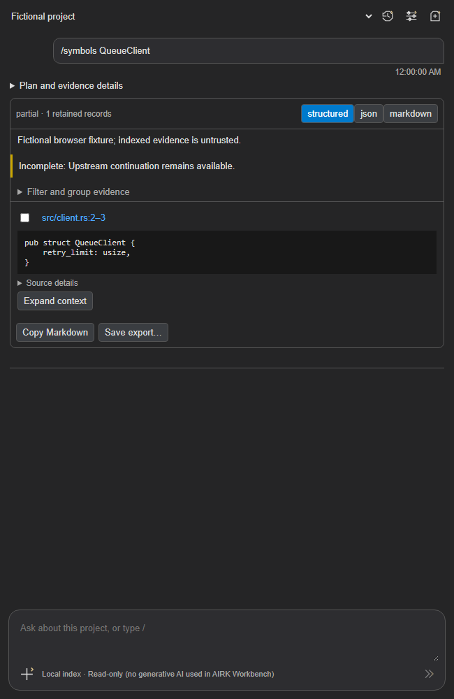

# Workbench development branch

P7 adds explicit reviewed combined sessions, unique-index execution, shared
budgets and complete member-qualified results. [Combined-read contracts](../combined-reads.md)
record selectors, discovery, publication vectors, plan verification and the
current qualification boundary. Legacy source bindings retain their one-index
meaning. Use the actual connection catalog for supported inputs.

**1.8.8 P6e working change:** Workbench orders publication generations only
within the same host-captured backend authority, collection and index incarnation.
Different scopes and inconsistent same-generation digests receive qualified
messages; saved or unknown observations receive no ordering claim. Generation
order proves neither ancestry nor live-source freshness. Comparisons reuse
existing observations without another status request, and complete/selected
exports retain the original result data. Qualification and remaining limits are
in the [ledger](../research/implementation-v190.md).

**1.8.8 P4 development:** [Saved-source verification](../source-verification.md) defaults to Report for evidence reads, with bounded native checks and explicit Off/Require choices. CLI, MCP, Workbench and Inspector/Checker retain dated outcomes and uncertainty. Phase acceptance and performance qualification remain in the [ledger](../research/implementation-v190.md).

The 1.8.8 working build supplies optional [evidence guidance](../evidence-guidance.md)
from returned metadata. Advice is bounded and inert; CLI/MCP/Workbench and
complete/selected exports retain applicable reasons without additional reads.

## 1.8.8 independent replies

Tool forms expose **Reply detail** (Default/Lean/Rich) from the native operation
catalog. Slash commands accept `--reply-detail lean|rich`. Default retains rich
facts and focused search; explicit selection is independent of retained indexing
detail. Session drafts, structured details and complete/selected exports retain
choices without triggering a query on selection. See [reply semantics](../reply-detail.md)
and the [candidate record](../releases/release-1.8.8.md) for actual validation.

## 1.8.7 full MCP response parity

All 17 native read commands use the MCP handlers inside the outer bounded plan lifetime. Workbench requests full response data and explicitly retains rich facts unless compact is selected. Completed status/diagnostics steps include configured `query_concurrency` from the outer admission observation. Fact records use `items`; capabilities, help, provenance, readiness, conditional reads and continuity options use their canonical MCP contracts. Forms and slash flags expose the native read inputs, with JSON arrays for change selectors. Structured results offer **Complete response**, and full JSON/Markdown copies and exports retain the entire response even when cited cards are present. User-selected evidence exports remain explicitly selected subsets. Saved old turns retain the bytes originally returned; rerun to obtain newly implemented fields.

See the [consolidated 1.8.7 record](../releases/release-1.8.7.md) for current validation and dated development evidence.

## 1.8.4 bounded discovery controls

Workbench consumes the native operation catalog rather than duplicating a separate retrieval implementation. **+ → Tool forms** exposes search/reference extraction filters, symbols/code-facts matching and qualified counts, reference ordering/file summaries and continuation controls. Enum selectors and optional Default/Yes/No controls retain JSON types; empty controls stay omitted. Catalog length/number limits are applied by the actual webview form and independently enforced natively. Supported slash commands include `/code-facts` and the same filter/matching/paging flags; boolean flags accept optional true/false.

Choose **Compact results → Yes** (or `--compact true`) for a small declaration inventory before expanding one candidate. Workbench preserves its preceding rich-result default when the option is omitted; native MCP compact/minimal defaults remain separate. Compactness changes representation, not indexed evidence or response-mode provenance.

Tool-form choices belong to the session. Closing the menu or switching operations preserves each tool's field values independently. Saved history restores the active operation, its per-tool values, and the shared Scope/Recipe choices through the existing session-input persistence pipeline; disabling persistence keeps those choices in memory only. New, Clear and Fork create a fresh preference set: Search, empty fields, empty shared scope and no selected recipe. Fork can copy the transcript without inheriting its tool preferences.

The counterclockwise **Reset this tool form** icon restores only the active tool's fields to omitted/default values. It keeps the selected operation, other tools' values and shared Scope/Recipe. Omission retains existing native defaults: 10 results, an 8 KiB per-tool payload allowance, exact symbols/code-facts matching, count/file summaries off and Workbench compact off; import matching and saved collection search policy retain their own preceding defaults. Editing, selecting and resetting use bounded project/session/epoch/revision-fenced draft messages and never submit a native evidence request. Scalar draft acknowledgments preserve result bodies and ignore stale edits/acks.

Revision-bound literal syntax/provider IDs can be followed against their retained publication, but cannot be remembered, saved as portable strategy inputs or refreshed through an old literal plan after publication identity is stripped. Use stable names/paths, durable keys where supported, or IDs freshly bound from a current definition step for reusable investigations.

Prepare/Execute also requires the original publication for retained literal IDs, including pasted or raw-text forms: preparation cannot attach today's token to bless an old ID; stored text stays intact, while retained **Inspect** or a fresh name/current binding supplies the supported path forward.

Structured result details show top-level fact count precision, nested reference page summaries/incomplete reasons, same-publication definition pointers and qualified written method targets. Summary counts describe matching lines or declaration records as labeled, not compiler-resolved uses or distinct types. Explicit **Inspect**/**Find callers** actions are checked against the retained source metadata, a completed executed source step and its exact publication. A successful step within a partial envelope can be followed. Failed/uncertain/unexecuted metadata, invented targets/paths and mismatched publications are refused. Exact definition inspection retains symbol ID and exact path; follow-up call-candidate queries retain the intersection of original plan and narrower step scope.

Continuation detection understands both flattened discovery cursors and nested reference page cursors. **Fetch next page** preserves selectors and publication. A resumable complete-record budget refusal displays its required bytes; explicit continuation may raise that step's text allowance only within the original remaining aggregate budget and supported maximum. Terminal record/scan limits remain incomplete and cannot create an endless continuation loop.

The host retains full results and JSON exports. Markdown exports include discovery summaries, count precision, pointers, qualifiers and continuation metadata even when evidence cards are present. Selected JSON/Markdown copies retain minimal qualification for their selected source-step IDs, labeled `original_source_request`; full page summaries, hints, arguments and counts remain in complete exports. Selected citations and publication identity stay intact. Scalar status/save updates retain existing ownership and do not replace those bodies. Native processing remains in Kernel/Store; the extension renders bounded display projections and sends explicitly chosen read-only follow-ups. See the [1.8.4 release/qualification record](../releases/release-1.8.7.md#candidate-1-8-4).

## 1.8.2 conversational evidence requests (unpublished)

A finite conversational grammar recognizes complete simple evidence requests before classifier fallback. Explicit typed or quoted single identifiers and requests for the definition or declaration of a name use the existing bounded definition recipe, including “I want to know about struct Owner.” Symbol extraction preserves `Owner` as the requested name rather than treating `struct Owner` as one identifier. Untyped capitalized, snake_case or qualified identifiers collect both symbol candidates and text search; capitalization alone cannot distinguish a symbol from a topic such as Rust. Ordinary lowercase or multiword topics use text search. Supported complete forms include “Find the…”, “Tell me about…”, “I want to know about…”, “What is…”, polite/modal variants, a type word before or after its name, and dotted or `::` qualified names. Unsupported operations and compound requests still require clarification or an explicit reviewed plan. General symbol requests may return multiple cited candidates without choosing a definition path; a definition recipe that needs one of several paths requires an explicit choice. Existing definition/reference forms also normalize articles and type words, including “find definition of struct Owner” and “where is the Owner struct defined?”. Lowercase or multiword definition targets keep the existing bounded name resolver. Uncertain classifier results explain the candidate, rejection reason and explicit-command examples. Learned classifier proposals remain inert and require explicit plan confirmation; this fix does not qualify learned automatic execution. The [1.8.2 candidate record](../releases/release-1.8.7.md#candidate-1-8-2) records implementation and validation limits.

Workbench now reveals a new pending, completed or failed turn at the **query bubble**, keeping the question visible above its timestamp, details and results. Oversized queries start at their top. Existing transcript/nested scroll positions, expanded details, output selections and draft input remain retained across simulated tab hiding and scalar status/save updates. The compiled fictional-data Edge 156 browser fixture passed these cases; it does not establish actual installed VS Code tab-switch acceptance. The earlier 1.8.1 first-result behavior remains recorded below as history.

Structured results provide linked native **Select all N** checkboxes above and below the cards. They select/clear every matching record already in the response, including collapsed **Show 20 more** records, without fetching unreturned pages. Filtering preserves selected records outside the filter; both checkboxes show the same checked/mixed state and disable at zero matches. Each row also has **Copy selected (N)**. The structured evidence list has no redundant full-response copy action; Save export remains, while raw JSON/Markdown and status/no-evidence output retain full-output copying where needed. Native Tab/Space interaction and mixed accessibility state are retained. The existing host-message validator refuses an oversized selected-copy request, with an explicit instruction to select fewer records or use Save export; no selection is silently capped.

The finite grammar also handles supported role phrasing for source ranges, outlines, file information/inventory, imports, document facts, textual references, changes and readiness. Test-related reference/search requests produce broad textual candidates and a runtime warning unless a literal test-path prefix was supplied; they do not report executed test coverage. Role labels and expected tool/target contracts are public in the [476-request inventory](../../tools/parser-train/role-queries.json). The independently authored later role measurement initially passed 35/48 (23/36 supported, 12/12 unsupported); after fixing its 13 misses it passes 48/48 as a known regression, alongside 476/476 source-inventory cases. The original result remains in [novel-role-plan-first.json](../../tools/parser-train/novel-role-plan-first.json); final source-bound [role](../../tools/parser-train/role-plan-validation.json) and [later-role regression](../../tools/parser-train/novel-role-plan-regression.json) receipts pass 476/476 and 48/48. Corrected results are regression evidence, not a fresh generalization claim.

The installed `intent-broader/5` feature-2 model fits 48,000 exact selected rows from a 96,000-row pool. [Exact selected-data replay](../../tools/parser-train/replay-v5.json) reproduced the asset byte for byte. Same-held-out-role intent accuracy improves over /4 from 83.50% to 97.95% on validation and 79.79% to 92.23% on calibration. Retained 150-request accuracy is 144/150 with zero wrong accepted classifications; raw unsupported acceptance is 0/20 curated and 0/1,000 public. These gains have tradeoffs: calibration accepted precision is 99.740%, supported calibration abstention rises from 21.8% to 52.125%, and known simple conversational top-label accuracy falls from 47/48 to 40/48 with 72.9% abstention. The ask-rate gate fails. Learned execution remains disabled; finite native parsing and explicit reviewed plans supply executable behavior. The [training record](../../tools/parser-train/TRAINING.md), [data catalog](../../tools/parser-train/data/README.md) and [fork guide](../parser-training.md) retain the full evidence and reproduction workflow.

## 1.8.1 scrolling fix (unpublished)

New requests reveal their pending turn; completed responses reveal the result header and first evidence instead of the response footer. Status/save refreshes and output controls do not trigger another reveal. The Workbench webview retains its DOM while hidden, preserving transcript and nested result scroll positions, output format, expanded details and draft input across sidebar tab switches. Returning to the tab reconciles host state without replacing the webview. Native results remain one bounded response; incremental transport streaming is not implemented. This retains one webview context in memory while hidden and does not promise position persistence across editor reload or view disposal.

## 1.8.0 optimization implementation (unpublished)

New and Clear retain the native connection when the selected launch specification remains identical. Project/spec changes, trust loss, native-execution opt-out and disposal close it; transcript generations discard delayed query, status and history replies. Selected-project status starts independently of the saved-session scan, so slow history does not delay readiness. Accepted history deletion finishes against its original project without replacing a newer transcript. Local history/export/clear operations remain available when native execution is disabled.

Session saving obtains recent summaries from the retention scan already required for the write. Status/save completion sends scalar webview updates, and display preparation reuses bounded projections for the latest 200 turns. Authoritative result bodies, export values, citations, continuations, persistence limits and revision-conflict checks retain their existing contracts. Compilation and focused provider/store/consumer tests passed; installed-editor and final integrated qualification remain pending in the [optimization ledger](../optimizations.md#f16af17-ui-preparation-and-workbench-reuse).

## Historical implementation

Historical prepublication implementation record on `feat/workbench`, 2026-10-30. Current packaging/release changes are recorded in [1.7.6](../releases/release-1.7.6.md). At this checkpoint, native and extension versions are synchronized at 1.7.2, as requested for this feature branch. This record preserves the dated 1.6.4 release record and does not establish publication or platform qualification.

The Workbench contributes an AIRK tab in VS Code's secondary sidebar. Use **AIRK: Open Workbench**, choose a registered project and enter a slash command or choose an evidence recipe. Scope is a literal collection-relative prefix. Prepare shows the inert normalized plan; Run collects bounded indexed evidence. Plan details expose arguments, publication, budgets and digest, with JSON editing and explicit execution. Re-running appends a new turn and resolves against current evidence.

Implemented commands cover search, definitions, textual references, reads, outlines, inventory, file information, imports, file facts, changes with an exact baseline, status, diagnostics, capabilities, context, relationships and help. Deterministic requests such as “who calls the queue client” can resolve bounded spelling candidates against indexed definitions. Other phrasing can produce inert proposed plans; choose **Review proposed plan**, check the operation and arguments, then **Run plan**. Unsupported or ambiguous inputs return choices and suggestions. Default source-read windows are bounded to the indexed line count and source hash; explicit ranges remain exact. Textual occurrences and candidate relationships remain labeled; no resolved-call or complete-impact claim is made.

Recipes collect definition context, document statements, possible impact, test mentions, component inventory/imports and readiness. Choose a test path scope for test mentions; no tests are executed. Evidence cards preserve original document locations and source hashes. Filter or group retained records, open sources, expand context and copy selected evidence. JSON/Markdown exports retain warnings and completeness. Copy refuses outputs over 1 MiB instead of slicing JSON; Save export supports larger local artifacts. Copy All preserves each turn's separate publication.

Sessions are local to extension storage, with ten recent sessions per project, a 200-turn/4 MiB cap, atomic saves and revision-conflict rejection. Recent, rename, fork, delete, clear, copy and export actions are available. `airk.workbench.persistSessions` and `airk.workbench.persistResults` control persistence; disabling them cleans up the selected project's saved sessions/results. Save failures leave in-memory work available for retry or export. An abandoned exclusive writer file is refused rather than removed speculatively; export remains available. Project removal and extension uninstall include guarded session cleanup.

## Agent and CLI interface

The unified MCP catalog includes `parse` and grant-bound `query_scope`, for 29 public tools. Native `airk_parse` remains the compatibility alias. An editor attachment is unnecessary. `schema` is `airk.parse.request/1`; `mode` defaults to `prepare`. Supply exactly one of `text`, `recipe` or `plan`. `plan.steps` contains stable IDs, public operation names, argument objects and optional bindings to earlier steps. The kernel owns validation and execution; it does not recursively call MCP.

```json
{
  "schema": "airk.parse.request/1",
  "mode": "execute",
  "path_prefix": "src/",
  "recipe": { "id": "definition", "parameters": { "name": "QueueClient" } }
}
```

Agent connections with several configured projects must also supply their authorized `project` ID. Prepared plans bind collection, publication, catalog, scope, budgets, output and digest. Edited plans must be prepared again with their old digest cleared; stale publications are rejected without silently selecting current evidence. Dependent location and symbol bindings are finite and capped. Plan-only `path` on fact operations selects an exact file through the kernel; it is not an extra argument on the existing direct MCP fact tools.

`airk parse '/symbols QueueClient'` prepares; add `--execute` to run. `--request request.json` accepts structured input; `--request -` reads bounded JSON from stdin. `--project` on parse aliases the global `--service-project`; conflicting selections fail. Global root options retain their normal source binding. Plans run with at most six steps, twelve reads, twelve fan-out targets and 512 KiB of materialized payload. The deadline is checked between synchronous reads; it does not forcibly terminate an admitted read. Stop fences queued and late replies without claiming native work was undone. Whole execution requests are not automatically replayed after uncertain transport failures.

## Remaining qualification and design differences

The earlier `intent-broader/2` local review build embedded the broader offline classifier: 40k supported examples, 6k original unsupported tasks and 2k attributed public assistant requests, with separate phrase-family validation/calibration and public test splits. It reached 146/150 (97.33%) on the retained utterance fixture, with no wrong accepted classifications there. Raw rejection still accepts one of 20 curated unsupported requests and four of 1,000 public unsupported requests; calibration abstention is 14.7%, above the 10% target. Full automatic-execution qualification therefore remains incomplete. Supported learned inputs produce inert proposed plans with `requires_input`; review the operation and arguments, then explicitly submit the plan to collect evidence. Commands, recipes and explicitly submitted plans use the normal runner. A kernel regression confirms all 20 unsupported requests perform no automatic evidence execution. The [training record](../../tools/parser-train/TRAINING.md) records prior failures, pins, attribution, model identity and label-review limits. Generated examples and provenance are saved under ignored `target/parser-train/` and content-addressed `.parser-train/` copies outside Cargo's cleanup directory.

The baseline uses rich native kernel records in one bounded envelope; it does not promise transport-byte equivalence with separate terse MCP reads. Native execution is serial within existing worker admission. Source-file checks occur explicitly when opening evidence, separately from index freshness. Longer-lived historical snapshots, automatic agent handoffs, per-project training and open-ended task orchestration are excluded.

Native schema-generated forms and guarded conversion/save of compatible inputs to the existing Strategy library are implemented. Conversion refuses selectors or arguments it cannot preserve, with native-plan export available instead. Explicitly remembered accepted-input shortcuts exclude evidence and revision handles, remain bound to project/scope/catalog and are always revalidated natively. Available cursor continuations require an explicit click and consume remaining call/byte allowance in a new turn; expired cursors never silently restart. Installed-editor visual/accessibility validation and cross-platform qualification remain separate from local unit tests and browser fixtures.

## Local validation

On Windows, the full all-feature workspace run passed 1,466 tests with 17 ignored. Review changes then passed three focused kernel tests and an additional real CLI/public-MCP prepare/execute parity test. Formatting and all-target/all-feature Clippy passed. Extension compilation/tests passed 415 with 15 skipped; script contracts passed 207 with five skipped. Repository, whitespace and synchronized-version checks passed. Fresh normal-feature debug and final release runtime pairs passed native client/model and managed-frontend smokes, including project isolation, all 28 public tools, reconnects and preserved source bytes. An initially stale smoke-script catalog expectation was corrected after auditing related callers; whole-plan execution is excluded from automatic retry helpers.

Historical 1.7.0 measurements: the component sizes are 852,116 bytes for the embedded intent asset and 47,917/5,382 bytes for Workbench JavaScript/CSS bundles. The final release main/helper executables are 176,263,680/55,316,992 bytes; the verified Windows x64 VSIX is 69,439,170 bytes (66.22 MiB). Same-profile before/after native-size acceptance has not been measured. The [1.7.0 candidate record](../releases/release-1.7.0.md) records remaining qualification and release-license review. No installed-editor, cross-platform, hosted or publication success is inferred from these local results.

The historical 1.7.0 local unsigned review installer is saved at `artifacts/workbench-review-1.7.0/extension/publish/airk-1.7.0-win32-x64.vsix`, with installation steps in the review folder's `README.md`, checksums in `extension/publish/SHA256SUMS` and validation receipts in `review-evidence.json`. VSIX SHA-256: `2f16f24b75a3850b8b779dbd3ea2d34e06b5e9811174de0e62751c4a3146f29d`. The package was verified without installing it into the user's VS Code.


## 1.7.1 interface and first opening

Successful trusted setup opens Workbench once per extension storage profile, including the completed-install reconnect path. The marker is saved after opening succeeds; failed setup, untrusted workspaces and pending extension replacement do not consume it. Later startup and folder changes preserve the hidden state. VS Code can require Reload Window to replace the old extension; the runtime installer cannot activate new extension code in its place.

Original Facet icons use angular outlines and chevrons inspired by the AIRK mark. History, settings and new-session icons share a compact header. Scope, recipes, plan preparation and tool forms move into the composer’s + menu. Index metadata and session actions remain available in settings. Menu dismissal supports Escape and outside clicks. Results keep their citation, plan-review and explicit-run controls. Explorer has a Workbench button immediately left of Help in the toolbar; its pressed state follows WebviewView visibility events, including switching to another tab or closing the secondary sidebar. Clicking while Workbench is visible closes the secondary sidebar; clicking while hidden reopens Workbench. The project dropdown appears inside Overview and Management, with one selection shared across Explorer screens. VS Code owns saved container order and exposes no extension API for enforcing the far-right position; drag the AIRK tab once if needed.

See the [1.7.1 candidate record](../releases/release-1.7.1.md) for validation.

The composer footer reads “Local index · Read-only (no generative AI used in AIRK Workbench)”. Supported intent parsing still uses the fixed local classifier; this label makes no claim that all machine learning is absent.

### Rendered 1.8.7 listing preview



Generated with `node scripts/render-workbench.cjs --listing` from the current compiled Workbench browser bundle and fictional host data. The preview shows linked selection controls, source/context actions, Complete response and export. It is not installed-editor or retrieval-quality qualification. Packaging explicitly allowlists this bounded public asset for the Marketplace listing.

### Historical rendered 1.7.1 previews

These are screenshots of the compiled browser bundle with fictional host data, not installed-editor qualification.







The [CLI, MCP and Workbench parity audit](../read-interface-parity.md) maps all read operations and records complete-data, observation, budget and export contracts for 1.8.7.

## P11a: explicit per-file family metadata

The [family report](../profile-family-reporting.md) uses `include_profile_families` on existing FileInfo reads. Default/false retain the old representation and validator. Workbench’s schema-driven File info form offers an explicit choice; complete native report metadata survives structured details, JSON/Markdown copies/exports and session restore. Reporting adds no source reads or profile migration; existing verification remains independent. Focused native, Mac ARM, Workbench and actual CLI/console/MCP parity checks passed. Final qualification gates passed. P11a has passed its local phase checks and is accepted for unpublished local development. P10 is already accepted for local development.
