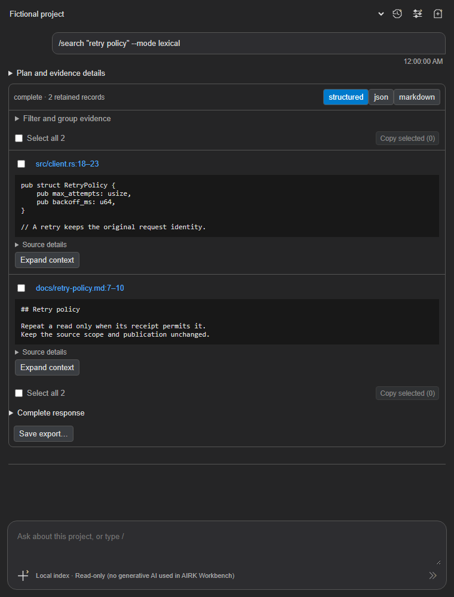
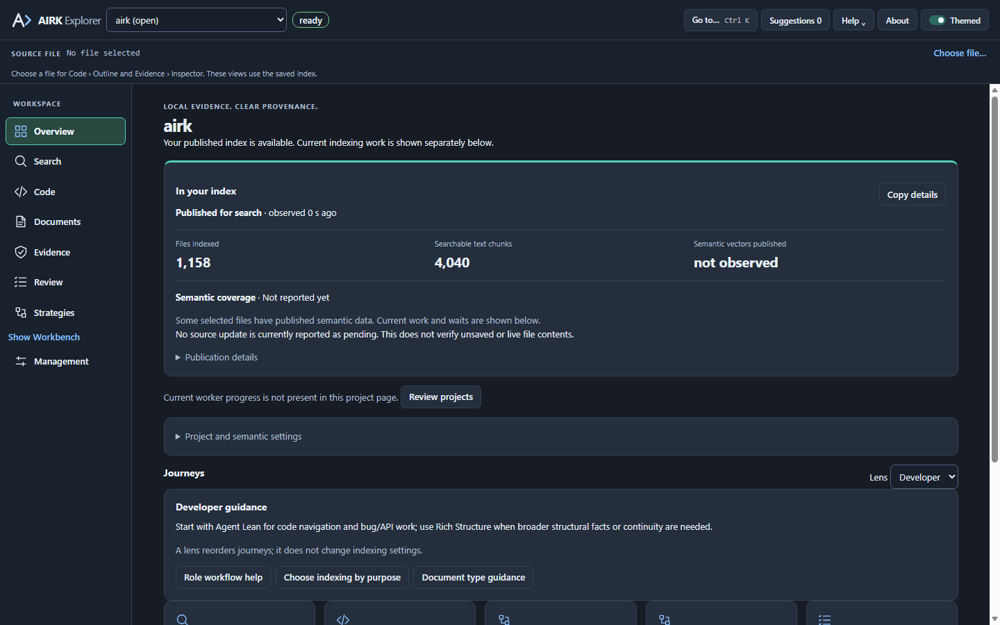

# AIRK: Local Search for Coding Agents

**1.9.0 development candidate:** native/extension versions and lockfiles are synchronized; supported forward runtime activation includes 1.9. The [candidate record](https://github.com/iokaio/airk/blob/main/docs/releases/release-1.9.0.md) tracks phase completion and validation. Project/index management and source verification remain planned work.

Compact discovery now supplies cited evidence to dependent plans and Workbench
results. Nested plan inputs are advertised as JSON objects. See the candidate
record for validation and qualification limits.

**Lean/Rich replies:** select Reply detail in a Workbench tool form, or pass
`reply_detail` in MCP / `--reply-detail` on CLI read commands. Choices affect
available evidence in the reply, preserve existing defaults when omitted and
require no reindex. Rich cannot recreate unretained facts. See the
[reply guide](https://github.com/iokaio/airk/blob/main/docs/reply-detail.md).

**Evidence guidance:** Workbench explains observed missing or limited evidence
and suggests a next read without executing tools or changing indexing. See the
[guide](https://github.com/iokaio/airk/blob/main/docs/evidence-guidance.md).

The [P3 design contracts](https://github.com/iokaio/airk/blob/main/docs/research/contracts-v190/README.md) define future Project/index scope, migration and verification safeguards. They enable no new management or verification behavior.

**Inherited 1.8.7 behavior:** CLI and Workbench reads use the MCP handlers and retain their full results, including configured `query_concurrency` in status/diagnostics. This release consolidates all unpublished 1.8.0-1.8.6 storage, startup, retrieval, concurrency and Workbench improvements. See the [consolidated release notes](https://github.com/iokaio/airk/blob/main/docs/releases/release-1.8.7.md) for current behavior and dated validation.

**Find the code and documents behind a feature. Give your coding agent cited evidence, or explore it yourself in AIRK Workbench.**

AIRK builds a searchable local index of your project so you and your coding tools can retrieve relevant passages, definitions and document facts without loading entire files into every request. Use it with MCP clients such as Claude Code, Codex and GitHub Copilot, or work directly in VS Code with no coding agent required.

**Configurable concurrent evidence requests.** Management → Service → **Concurrent requests…** selects **4, 8, 16, 32 or 64**, default **16**, with one additional status/control slot. MCP admission, independent native channels and project workers use the same setting. Changes apply to subsequent requests without restarting agents; accepted work drains when capacity decreases. Finite queues, source scope, revision identity and typed retry receipts remain authoritative.

**Complete evidence across interfaces.** CLI and Workbench retain the MCP handlers' full results: provenance, readiness, coverage, continuations and retry details. Workbench exposes filters, exact/suffix/contains matching, count/file summaries and conditional/continuity inputs. **Complete response** and full JSON/Markdown exports retain the result even when cited cards are shown; selected-evidence exports identify their subset. Status and diagnostics report configured capacity, including inside completed plan steps. See the [1.8.7 behavior and validation](https://github.com/iokaio/airk/blob/main/docs/releases/release-1.8.7.md).

- **Find useful context:** search code and documents together, then narrow the scope to a file, folder or named definition.
- **Inspect the evidence:** open cited sources, read surrounding context and keep source locations and indexed revisions with your results.
- **Keep retrieval local:** indexing, lexical and semantic search run on your machine with bundled models. AIRK needs no cloud service or API key.

**Version 1.8.2 improves installed responsiveness.** Normal-editor acceptance testing observed quicker loading and previously slow or timed-out requests returning promptly. Five measured fresh sessions through the installed launcher returned available first statuses with no status timeout; median initialization through confirmed status was 2.29 seconds, with a 7.31-second first-session outlier. The retained 1.7.6 example took about 5.5 seconds including a timeout and a second request; these are unmatched observations, not a guaranteed speedup percentage. Read the [performance improvements and causal analysis](https://github.com/iokaio/airk/blob/main/docs/performance-improvements-1.8.2.md) for complete evidence and remaining native regressions.

**Workbench improvements:** readiness proceeds independently of saved-history loading; New/Clear reuses the selected connection, Save avoids a duplicate session scan, and scalar status/save updates preserve complete exports. Query-first reveal, retained reading position and linked Select all/Copy selected controls make evidence easier to inspect and copy. In the retained 200-turn fixture, scalar status messages are over 95% smaller than full-state messages; this measures transfer work, not an elapsed UI speedup.

**Retained session choices:** each session keeps its selected tool, per-tool inputs and shared Scope/Recipe. Saved history restores those choices. **Reset this tool form** clears the active fields; New, Clear and Fork start fresh. Editing these choices submits no evidence request.

## Meet AIRK Workbench

Workbench is a compact evidence workspace in VS Code’s secondary sidebar. Ask about a named symbol, for example “I want to know about struct Owner.”, or use a slash command or evidence recipe. Inspect the retrieved evidence and open the original source. Copy cited results as Markdown or JSON, export a session, and return to recent investigations.

A small toolbar holds history, settings and new-session controls. The **+** menu offers scope, recipes and tool forms when you need them, keeping the transcript available for results. Proposed plans remain editable and require an explicit run action. **No generative AI is used in AIRK Workbench**; supported intent parsing uses a fixed local classifier, and semantic retrieval uses local embeddings.

*Compiled Workbench 1.8.7 UI with fictional project data. Linked selection controls, source/context actions, Complete response and export are visible. This preview is not installed-editor qualification or a retrieval-quality measurement.*

## AIRK Explorer: search, inspect and manage

Explorer brings search, code navigation, document facts, evidence review and indexing controls into one editor workspace. Check what is indexed, inspect source citations, and manage projects, storage and agent connections.

*Explorer 1.7.1 preview with fictional observations. In 1.7.2, Workbench moves to the toolbar and project selection moves into Overview and Management. Not installed-editor qualification.*

## Get your first result

1. **Install AIRK** for your workspace host’s OS and architecture. The native runtime and local models are bundled; no Docker, Rust toolchain or separate API key is needed to use the extension. VS Code 1.140 or newer is required.
2. **Open a trusted project.** With automatic setup enabled, AIRK registers the folder and starts indexing saved files. Open **AIRK Explorer → Management** to inspect progress, readiness and any skipped or failed files.
3. **Try Workbench.** It opens once after successful setup, or run **AIRK: Open Workbench**. Start with `/files` to see indexed paths. Then try `/search retry --mode lexical`, replacing `retry` with a term in your project, and open a cited result.
4. **Connect an agent when you want one.** Run **AIRK: Connect Coding Agent**, review its scoped configuration, and enable or approve AIRK in that client. Ask the agent to discover AIRK’s tools, check `status`, search the relevant scope and verify the cited live files before editing.

Success means a query returns evidence for the intended project and its citations open the expected source. Indexing or connection failures remain visible; an enabled-server badge alone does not prove that your agent can retrieve evidence.

## Three workflows to try

| Your task | Use AIRK to collect |
|---|---|
| Understand a feature | Matching code, named definitions and the design or requirement that describes it. |
| Investigate a bug | Relevant source passages, textual references and test mentions to inspect before changing behavior. |
| Prepare a change | A scoped evidence set with citations, an editable read-only plan, and Markdown or JSON you can share with your agent. |

In Workbench, try `/symbols YourSymbol`, `/outline path/to/file`, or `/read path/to/file:1-20` with names and paths from your project. The **+** menu includes recipes for definitions, document evidence, possible impact, test mentions, components and readiness. These workflows collect evidence; they do not edit source files or execute your tests.

## Code and documents in one index

AIRK combines lexical and local semantic search with bounded reads and structured evidence. Supported formats include source code, Markdown, text, PDF, DOCX, XLSX and PPTX. Document citations retain original locations such as pages, slides, paragraphs and worksheet cells where extraction supports them. See [format support and limits](https://github.com/iokaio/airk/blob/main/docs/document-indexing.md).

Results identify the indexed revision and source hash. Unsaved edits, pending indexing, skipped extraction and parser limitations can affect what is available. Code references and relationships are candidates unless supported by stronger provider evidence; AIRK does not claim complete language understanding or complete impact analysis.

## Use your existing coding agent

One AIRK MCP endpoint gives independently configured clients access to the same project index. Your agent handles reasoning and code changes; AIRK supplies bounded evidence.

| Client | AIRK setup route |
|---|---|
| VS Code / GitHub Copilot | Workspace MCP registration and VS Code’s MCP controls. |
| Claude Code | Project MCP configuration and client approval. |
| Codex | Scoped TOML configuration and the client’s MCP controls. |
| Gemini CLI / Antigravity | Project configuration and client-specific enablement. |
| Cursor, Cline, Roo, Junie and others | Configuration previews or connection guidance for the selected client. |

These are configuration routes, not a claim that every client/version has passed end-to-end testing. Use the built-in setup guide and [integration documentation](https://github.com/iokaio/airk/blob/main/docs/agent-integration.md). AIRK’s connection check verifies its helper; a successful request in your agent verifies that client’s access.

## Local control and transparent limits

Project indexes stay separate from source files. Native background watching updates saved-file evidence; pause, manual-update and semantic opt-out settings remain available. Explorer’s Management tabs show indexing progress, published readiness, storage, service state, agent setup and logs. Explorer’s **Workbench** toolbar button, immediately left of Help, toggles secondary-sidebar visibility and shows a pressed state while visible. The project selector is available inside Overview and Management; its selection remains shared across Explorer screens.

AIRK does not use a remote inference service. If you give retrieved evidence to an external coding agent, that agent’s provider, privacy and approval policies still apply. Local retrieval does not make the agent itself offline.

Usage reporting can help inspect retrieval activity and supplied measurement scenarios. Context, token or cost savings depend on the task and agent; AIRK does not promise a universal reduction in tokens, time or bills.

Developer references: [MCP tools](https://github.com/iokaio/airk/blob/main/docs/mcp-developer-guide.md) and [CLI commands](https://github.com/iokaio/airk/blob/main/docs/cli-developer-guide.md) explain purpose, examples, implementation ownership and the 28-tool unified versus 18-tool native catalogs.

## Version and setup notes

**Included in 1.8.2:** Supported developer, writer, architect and QA/tester requests retrieve code/document evidence, including simple symbol questions such as “I want to know about struct Owner.” Unsupported requests still ask for clarification, and multiple matches remain cited candidates. Workbench reveals the query bubble for a new pending, completed or failed reply, keeping the question visible above its details and results. Sidebar tab switches retain the reading position. Structured results have linked **Select all N** controls above and below the cards, with **Copy selected** in both rows. It admits supported forward runtime upgrades through the 1.8 line. Explorer publishes verified service health before optional management observations finish and delivers each successful Search result once. Index readiness remains separate, and installed responsiveness and native throughput have separate measurement results. See the [candidate record](https://github.com/iokaio/airk/blob/main/docs/releases/release-1.8.7.md#candidate-1-8-2). Automatic Explorer observations use lightweight status; explicit Refresh obtains separately aged details. Eligible saved selected projects can appear in Explorer and Workbench before other workspace roots finish preparation; native scope and lifecycle checks still apply. First semantic requests can wait within a bounded startup allowance for the embedding-helper connection to become available. Workbench reuses its selected connection across New/Clear, avoids a duplicate session scan when saving, and sends scalar status/save updates while retaining complete export values. Updated indexes publish source-bound optional pages for native facts, relationships, imported assertions and text ranges. Eligible native-owned collections can use selected-page readers with automatic physical integrity maintenance and fresh crash recovery; unsupported storage boundaries and omitted optional representations retain strict reads. Integrated storage and release qualification remains in progress.

**Published version 1.7.6** asks before the first installation what it will change, can run without starting any AIRK process (`airk.runtime.nativeExecution`), removes its terminal integration on uninstall and reports interrupted cleanups, and adds **AIRK: Review and Remove AIRK Data**. Common credential files are skipped by default. [Release notes and validation limits](https://github.com/iokaio/airk/blob/main/docs/releases/release-1.7.6.md) document the changes. Earlier records remain in the [release archive](https://github.com/iokaio/airk/blob/main/docs/releases/README.md).

VS Code may require **Developer: Reload Window** to replace an already running extension after an upgrade. AIRK keeps a **Reload to finish update** action when it detects a pending replacement. VS Code saves sidebar tab order; drag the AIRK tab to the right if needed. `airk.cli.autoInstall: false` disables automatic installation and registration; discovery can still run bundled native probes. `airk.runtime.nativeExecution: false` starts no AIRK process at all, and `airk.cli.shellIntegration` limits which shell startup files setup edits.

Before the first installation AIRK shows what setup changes and lets you set up, customize, defer or decline it. Setup installs the runtime/CLI, updates user PATH or marked shell-profile blocks and starts background indexing of registered folders; home folders and drive roots need an explicit choice. Hidden files can be included; common credential files are skipped by default, but AIRK is not a secret scanner, so ignore other sensitive sources before indexing. Index objects and saved Workbench results can retain excerpts, and evidence returned to an agent may reach its provider. On macOS/Linux, new storage folders are created private to you, and storage other accounts may read is reported, not changed. Uninstall removes AIRK's terminal integration but preserves native indexes; use **AIRK: Review and Remove AIRK Data** first if you want them gone. See [installation and evidence privacy](https://github.com/iokaio/airk/blob/main/docs/vscode-extension.md#installation-and-evidence-privacy) for controls and cleanup limits.

AIRK stands for **Artifact Indexing and Retrieval Kernel**. It is an independent local indexing and retrieval engine, licensed under Apache-2.0.

[Source and issues](https://github.com/iokaio/airk) · [Documentation](https://github.com/iokaio/airk/blob/main/docs/README.md) · [Installation and troubleshooting](https://github.com/iokaio/airk/blob/main/docs/service-installation.md)
